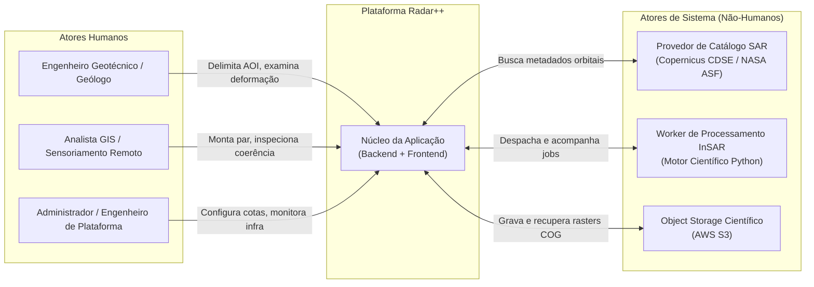

# Radar++ — Atores do Sistema e Personas de Usuário

**Documento:** `02-atores-e-personas.md`  
**Ciclo:** Ciclo 1 — Visão do Produto e Definição do MVP  
**Data:** Outubro de 2026  
**Status:** Proposto para Aprovação  
**Autores:** Equipe de Arquitetura de Software e Engenharia de Produto  
**Referências:** [01-visao-produto.md](file:///home/asoares/Documentos/repositories/repo_radar/docs/01-product/01-visao-produto.md).

---

## 1. Mapeamento de Atores do Sistema

Os atores representam qualquer entidade externa (humana ou computacional) que interage diretamente com as fronteiras do Radar++:

### 1.1. Atores Humanos
1. **Analista Primário (Geotécnico / Geólogo):** Profissional com formação em geotecnia, mineração ou geologia que necessita monitorar áreas críticas de risco e avaliar se há movimentação de terreno compatível com instabilidade estrutural.
2. **Especialista em Sensoriamento Remoto (GIS):** Profissional com conhecimento aprofundado em imagens orbitais, sistemas de coordenadas (CRS), parâmetros de radar (geometria de aquisição, órbitas, polarizações) e formatos geoespaciais (GeoTIFF, GeoJSON).
3. **Administrador da Plataforma:** Responsável pela governança operacional, monitoramento de quotas de rede/nuvem, gestão de credenciais e integridade das esteiras de processamento.

### 1.2. Atores de Sistema (Não-Humanos)
1. **Provedor de Catálogo Satelital (ESA Copernicus CDSE / NASA ASF Vertex):** Fornece APIs abertas para consulta e download de cenas Sentinel-1 IW SLC, metadados orbitais de alta precisão e arquivos de órbita precisa (POD/AUX_POEORB).
2. **Motor de Processamento Científico (Worker InSAR):** Componente computacional assíncrono (Python / SNAP GPT / HyP3) que executa a transformação de micro-ondas, corregistro, subtração de fase topográfica e unwrapping.
3. **Storage de Objetos em Nuvem (AWS S3):** Repositório de alta durabilidade para armazenamento de produtos Cloud Optimized GeoTIFF (COG), metadados de jobs e logs de execução.

---

## 2. Personas Propostas (Hipóteses de Perfil)

Para orientar as decisões de design de interface e requisitos funcionais, foram modeladas três personas arquetípicas:

### Persona 1: Carlos Eduardo — O Engenheiro Geotécnico de Barragens e Taludes
* **Perfil:** 38 anos, Engenheiro Civil com especialização em Geotecnia. Atua na gestão de segurança de estruturas geotécnicas em uma grande mineradora.
* **Contexto de Trabalho:** Responsável pela estabilidade física de taludes e diques. Utiliza dados de instrumentação em campo (piezômetros, prismas e radares terrestres de curta distância), mas tem "pontos cegos" em encostas e áreas adjacentes.
* **Dores:**
  * Não domina linhas de comando nem ferramentas científicas pesadas de processamento InSAR.
  * Precisa de respostas rápidas: "Há alguma movimentação atípica na ombreira da barragem nos últimos 30 dias?".
  * Teme tomar decisões com base em dados não rastreáveis ou aproximações empíricas duvidosas.
* **Necessidades no Radar++:**
  * Delimitar a área da estrutura com facilidade no mapa.
  * Visualizar o mapa de deformação com escala de cores intuitiva (ex.: de -30 mm/ano a +10 mm/ano).
  * Clicar sobre um ponto para verificar a medição de deslocamento em milímetros/centímetros e o nível de confiança (coerência $\gamma$).

---

### Persona 2: Mariana Prado — A Analista GIS e de Sensoriamento Remoto
* **Perfil:** 29 anos, Engenheira Cartógrafa com mestrado em Sensoriamento Remoto. Atua como consultora técnica para projetos de infraestrutura e meio ambiente.
* **Contexto de Trabalho:** Domina softwares de GIS (QGIS, ArcGIS) e compreende a física de radares SAR, incluindo a diferença entre modo ascendente e descendente, polarizações (VV/VH) e coerência interferométrica.
* **Dores:**
  * Perde dias baixando arquivos SLC brutos de 5 GB para rodar scripts locais no SNAP que frequentemente quebram por falta de memória RAM.
  * Dificuldade para explicar a gestores leigos as limitações físicas do radar (ex.: perda de coerência por chuva ou vegetação densa).
* **Necessidades no Radar++:**
  * Filtrar cenas por parâmetros técnicos rigorosos (órbita relativa, passagem ascendente/descendente, baseline perpendicular $< 150$ m).
  * Acessar o mapa de coerência interferométrica para validar se a medição de fase é confiável.
  * Baixar os produtos finais em formato Cloud Optimized GeoTIFF (COG) padronizado para abrir no QGIS.

---

### Persona 3: Roberto Vasconcelos — O Gestor Municipal de Defesa Civil
* **Perfil:** 47 anos, Geógrafo e coordenador de monitoramento de riscos geológicos em município com áreas de encostas e ocupações de risco.
* **Contexto de Trabalho:** Gerencia planos de contingência para evitar tragédias em períodos chuvosos. Não possui orçamento para instrumentação cara em todas as encostas da cidade.
* **Dores:**
  * Falta de visão histórica sobre a subsidência lenta que precede escorregamentos.
  * Sobrecarga de dados desconexos e relatórios em PDF com mapas estáticos desatualizados.
* **Necessidades no Radar++:**
  * Acompanhar o histórico de medições em áreas habitadas.
  * Interface clara, sem jargões de engenharia eletromagnética indecifráveis.
  * Rastreabilidade: comprovar perante órgãos públicos a data e o satélite que embasam um alerta preventivo.

---

## 3. Matriz de Distinção: Perfis Propostos vs Necessidades Validadas

É mandatório para a governança do produto distinguir o que representa **necessidade comprovada** daquilo que é apenas **hipótese inicial de design**:

| Aspecto / Recurso | Status de Validação | Classificação | Evidência / Justificativa |
|---|:---:|:---:|---|
| **Necessidade de delimitar AOI por mapa web** | **VALIDADA** | Necessidade Comprovada | Requisito unânime de usuários GIS e geotécnicos para evitar buscas manuais por coordenadas em planilhas. |
| **Necessidade de dados de radar reais (Sentinel-1 SLC)** | **VALIDADA** | Necessidade Comprovada | A auditoria do Ciclo 0 comprovou que dados ópticos e distâncias de tela são rejeitados por qualquer análise de engenharia. |
| **Exibição de mapa de coerência ($\gamma$) junto à deformação** | **VALIDADA** | Necessidade Comprovada | Obrigação metodológica da geodésia: sem o índice de coerência, o usuário não sabe se o deslocamento é real ou ruído de fase. |
| **Download de produtos em GeoTIFF / COG** | **VALIDADA** | Necessidade Comprovada | Especialistas exigem interoperabilidade com QGIS e softwares legados de geoprocessamento. |
| **Classificação automatizada de risco geotécnico** | **NÃO VALIDADA** | Hipótese Proposta (Rejeitada no MVP) | A auditoria provou que classificar "estável/instável" sem contexto geomecânico local induz a falsas sensações de segurança perigosas. |
| **Processamento totalmente no navegador do cliente** | **NÃO VALIDADA** | Hipótese Proposta (Rejeitada) | Dados SLC de 5 GB inviabilizam processamento client-side; a orquestração deve ser assíncrona no backend/nuvem. |
| **Decomposição 3D completa de vetores de deformação** | **NÃO VALIDADA** | Hipótese Futura (Pós-MVP) | Requer combinação de órbitas ascendentes e descendentes concomitantes; complexidade excessiva para o primeiro ciclo funcional. |
| **Disparo de alertas por SMS/WhatsApp para a população** | **NÃO VALIDADA** | Hipótese Futura (Pós-MVP) | Depende de validação institucional de órgãos de Defesa Civil e calibração de falsos positivos. |
