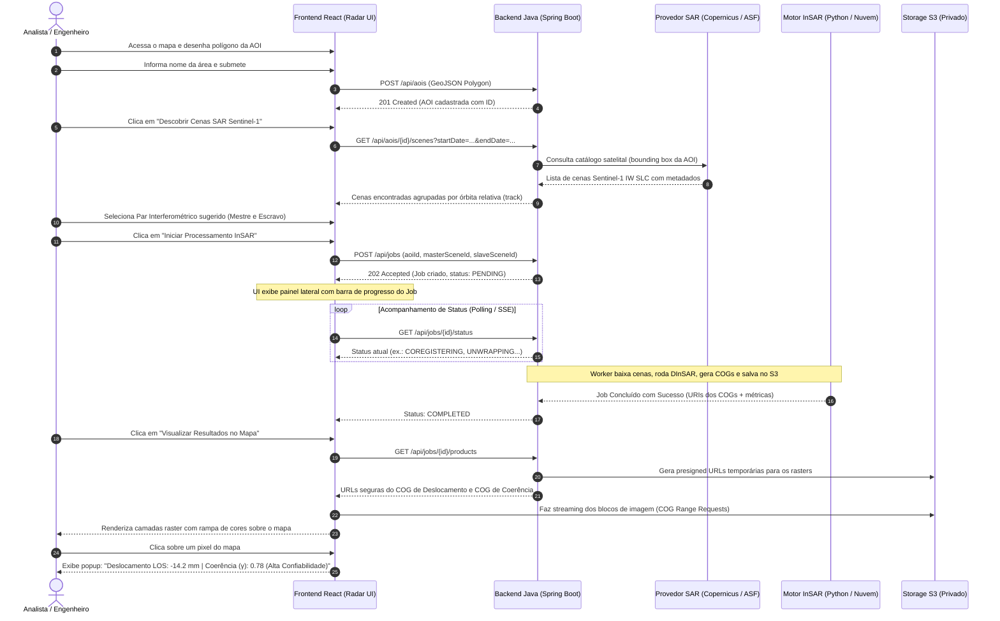
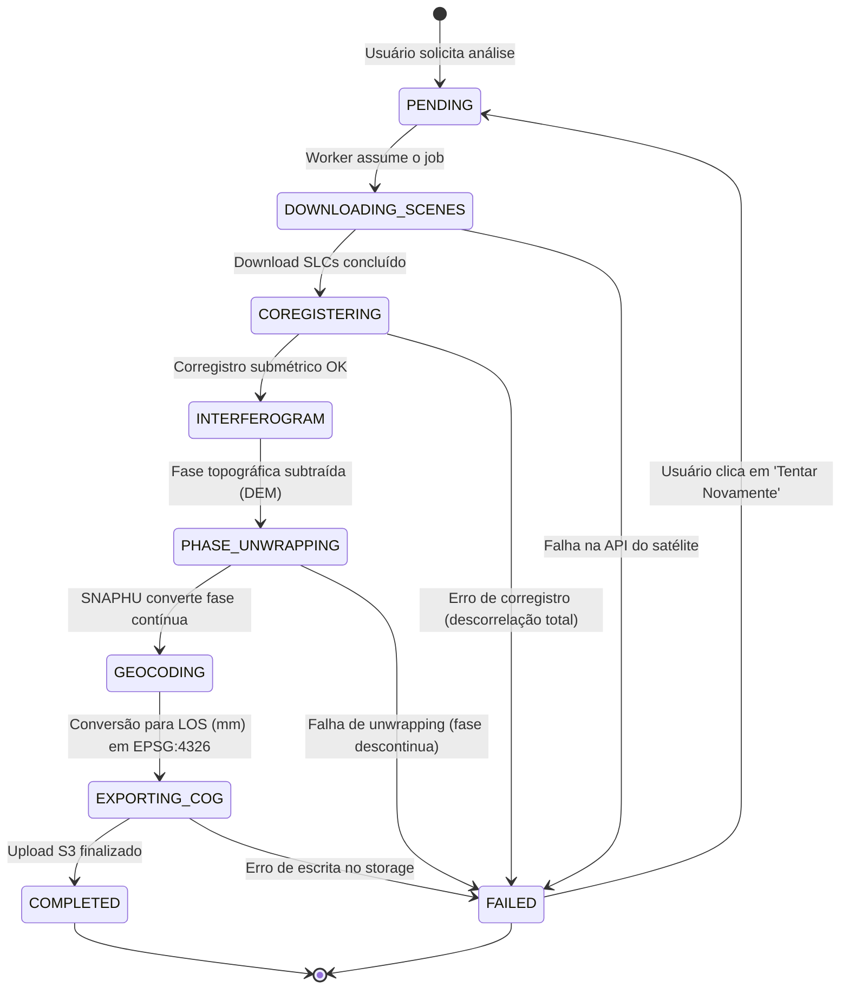
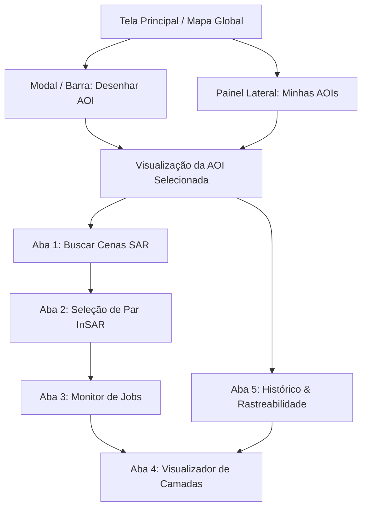

# Radar++ — Jornadas do Usuário e Ciclo de Vida da Análise

**Documento:** `04-jornadas-usuario.md`  
**Ciclo:** Ciclo 1 — Visão do Produto e Definição do MVP  
**Data:** Outubro de 2026  
**Status:** Proposto para Aprovação  
**Autores:** Equipe de Arquitetura de Software e Engenharia de Produto  
**Referências:** [01-visao-produto.md](file:///home/asoares/Documentos/repositories/repo_radar/docs/01-product/01-visao-produto.md), [02-atores-e-personas.md](file:///home/asoares/Documentos/repositories/repo_radar/docs/01-product/02-atores-e-personas.md), [03-escopo-mvp.md](file:///home/asoares/Documentos/repositories/repo_radar/docs/01-product/03-escopo-mvp.md).

---

## 1. Jornada Principal: Da Definição da AOI à Inspeção de Deformação

A jornada primária representa o caminho feliz (*Happy Path*) executado por um Engenheiro Geotécnico ou Analista GIS para realizar uma análise interferométrica sobre uma estrutura ou território:

### Etapas Detalhadas da Jornada Principal:
1. **Passo 1 — Definição Territorial:** O usuário abre o mapa web do Radar++, navega até a região desejada e utiliza a ferramenta de desenho para traçar o polígono delimitador da sua Área de Interesse (ex.: talude da mina ou centro urbano).
2. **Passo 2 — Catalogação Automática:** O sistema valida a geometria e consulta o acervo orbital, retornando as aquisições do Sentinel-1 disponíveis para aquela coordenada nos últimos 60 dias.
3. **Passo 3 — Seleção Guiada do Par:** A interface agrupa as cenas por órbita relativa e indica os pares com melhor geometria (linha de base perpendicular $< 100 \text{ m}$ e intervalo temporal de 12 ou 24 dias), evitando descorrelação.
4. **Passo 4 — Despacho Assíncrono:** Ao confirmar o processamento, o backend gera um identificador único de Job (`JOB-XXXX`) e delega a execução ao motor científico em segundo plano.
5. **Passo 5 — Acompanhamento Visual:** O usuário acompanha as etapas do processamento em um card de status com barra de progresso, sem travamento da interface.
6. **Passo 6 — Visualização e Auditoria:** O resultado é plotado como uma camada raster colorimétrica georreferenciada. O usuário alterna entre a camada de deslocamento e a de coerência e clica nos pontos de interesse para obter medições precisas.

---

## 2. Diagrama de Estados do Job de Processamento InSAR

A máquina de estados formal que rege o ciclo de vida de uma análise no Radar++:

---

## 3. Jornadas Alternativas e de Exceção

### 3.1. Jornada A1 — Ausência de Cenas Compatíveis na AOI
* **Cenário:** O usuário desenha uma AOI em período onde houve falha de cobertura do satélite ou todas as cenas possuem linhas de base perpendiculares excessivamente grandes ($B_\perp > 250 \text{ m}$).
* **Comportamento do Sistema:**
  1. A API retorna a lista bruta de cenas, mas a interface sinaliza visualmente: *"Nenhum par interferométrico recomendado encontrado para este intervalo de datas"*.
  2. O sistema sugere automaticamente a ampliação do intervalo temporal (ex.: de 30 para 90 dias) ou a troca de direção de órbita (de ascendente para descendente).
  3. O botão de processamento permanece desabilitado para pares incompatíveis, prevenindo execuções caras fadadas ao fracasso.

---

### 3.2. Jornada A2 — Falha no Processamento Científico (Baixa Coerência)
* **Cenário:** A área monitorada sofreu descorrelação temporal severa (ex.: vegetação densa molhada por chuva intensa entre as duas passagens do satélite). O algoritmo de unwrapping (SNAPHU) não consegue convergir ou a coerência média fica abaixo de $0.2$.
* **Comportamento do Sistema:**
  1. O Worker detecta a falha ou a degradação de qualidade extrema e transiciona o job para o estado `FAILED`.
  2. O backend armazena o log de erro científico: *"Erro: Coerência interferométrica insuficiente na AOI ($\gamma_{\text{médio}} = 0.14$). Desembrulhamento de fase inviabilizado"*.
  3. O frontend notifica o usuário com mensagem explicativa clara, sugerindo selecionar um par temporalmente mais próximo (ex.: 6 ou 12 dias em vez de 48 dias) ou buscar passagens em época de seca.
  4. Nenhum custo desnecessário de armazenamento permanente no S3 é gerado.

---

### 3.3. Jornada A3 — Auditoria e Rastreabilidade de Análises Anteriores
* **Cenário:** Um auditor técnico ou novo engenheiro precisa comprovar a origem de uma medição de subsidência realizada há 3 meses.
* **Comportamento do Sistema:**
  1. O usuário seleciona uma AOI e clica na aba "Histórico de Análises".
  2. O sistema lista todas as análises concluídas com data de execução, autor e metadados.
  3. Ao clicar em uma análise, o sistema exibe o painel de procedência detalhado:
     * Satélite: `Sentinel-1A`.
     * Cena Mestre: `S1A_IW_SLC__1SDV_20260810T...`.
     * Cena Escravo: `S1A_IW_SLC__1SDV_20260822T...`.
     * Órbita Relativa (Track): `155`.
     * Linha de Base Perpendicular ($B_\perp$): `-42.3 m`.
     * Linha de Base Temporal ($B_t$): `12 dias`.
     * Modelo DEM Utilizado: `Copernicus DEM GLO-30`.
     * Coerência Média ($\gamma$): `0.68`.
  4. O usuário clica em "Baixar Produtos" e recebe o arquivo compactado contendo o GeoTIFF de deslocamento, o GeoTIFF de coerência e um arquivo JSON com os metadados de auditoria.

---

## 4. Mapa de Navegação da Interface do Usuário (UI Flow)

