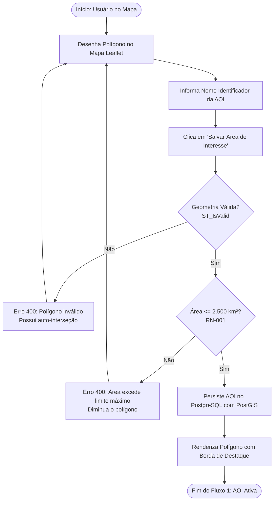
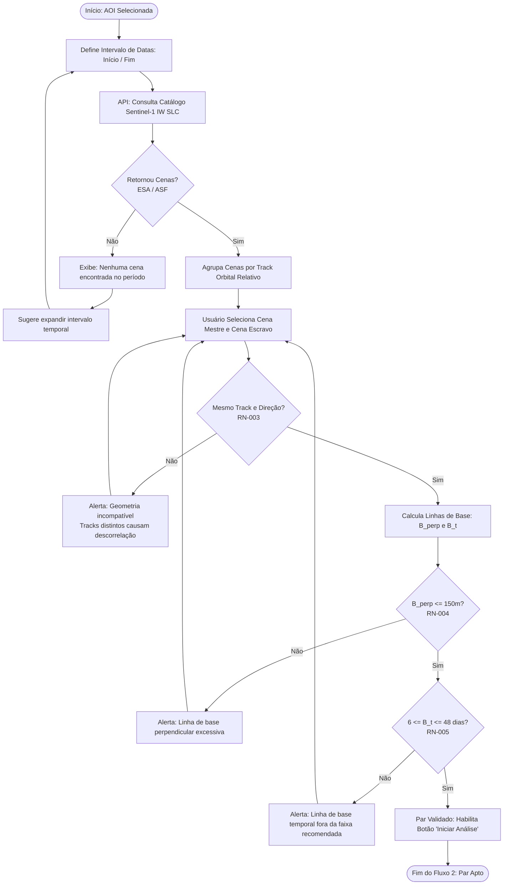
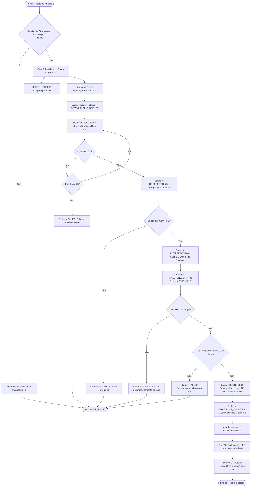
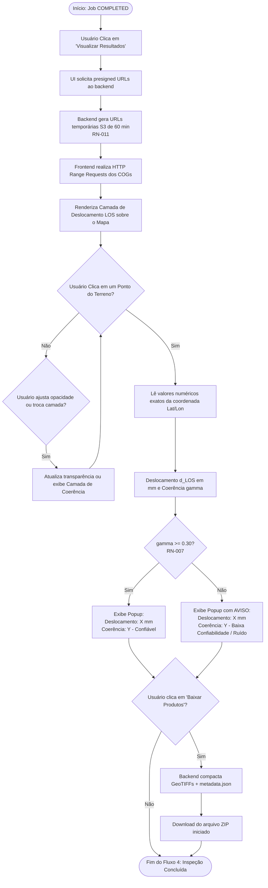

# Radar++ — Fluxos de Negócio e Decisões Operacionais

**Documento:** `08-fluxos-negocio.md`  
**Ciclo:** Ciclo 1 — Visão do Produto e Definição do MVP  
**Data:** Outubro de 2026  
**Status:** Proposto para Aprovação  
**Autores:** Equipe de Arquitetura de Software e Engenharia de Produto  
**Referências:** [04-jornadas-usuario.md](file:///home/asoares/Documentos/repositories/repo_radar/docs/01-product/04-jornadas-usuario.md), [05-requisitos-funcionais.md](file:///home/asoares/Documentos/repositories/repo_radar/docs/01-product/05-requisitos-funcionais.md), [07-regras-negocio.md](file:///home/asoares/Documentos/repositories/repo_radar/docs/01-product/07-regras-negocio.md).

---

## 1. Visão Geral dos Fluxos de Negócio

Os fluxos de negócio modelam como os dados e as decisões transitam entre os atores e subsistemas do Radar++, detalhando ramificações de validação, tratamento de erros e pontos de parada controlados:

```
[Fluxo 1: AOI] ──► [Fluxo 2: Cenas & Par] ──► [Fluxo 3: Orquestração InSAR] ──► [Fluxo 4: Visualização]
```

---

## 2. Fluxo 1: Seleção e Cadastro de Área de Interesse (AOI)



---

## 3. Fluxo 2: Descoberta de Cenas e Seleção do Par Interferométrico



---

## 4. Fluxo 3: Orquestração e Execução Assíncrona do Pipeline InSAR



---

## 5. Fluxo 4: Visualização Geoespacial e Inspeção de Qualidade


