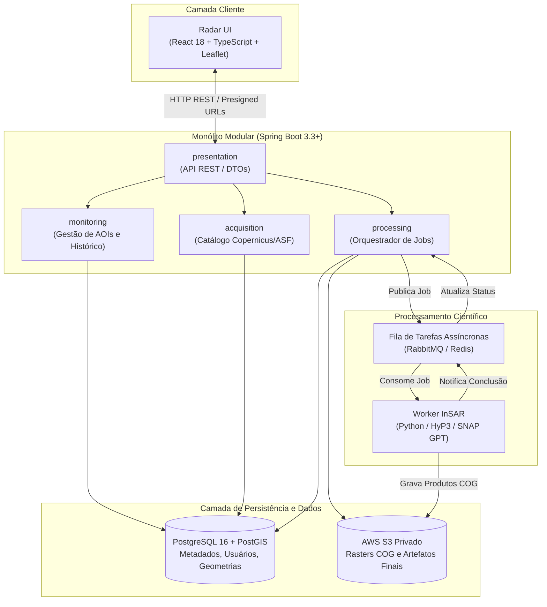

# ADR-001 — Plataforma Tecnológica, Arquitetura de Serviços e Estratégia de Persistência

**Status:** Aprovada  
**Data:** Outubro de 2026  
**Decisores:** Arquiteto de Software, Analista de Negócios Sênior, Especialista SAR  
**Contexto do Projeto:** Radar++ — Plataforma de Monitoramento InSAR  
**Referências:** Documentos de auditoria em `docs/audit/` ([00-radar-plus-panorama-executivo.md](file:///home/asoares/Documentos/repositories/repo_radar/docs/audit/00-radar-plus-panorama-executivo.md), [03-analise-backend.md](file:///home/asoares/Documentos/repositories/repo_radar/docs/audit/03-analise-backend.md), [09-estrategia-evolucao.md](file:///home/asoares/Documentos/repositories/repo_radar/docs/audit/09-estrategia-evolucao.md)).

---

## 1. Contexto e Problema

A auditoria do Ciclo 0 revelou que o protótipo inicial do Radar++ apresentava:
1. **Fragmentação Prematura:** Divisão em 4 repositórios desarticulados, gerando problemas crônicos de sincronização de contratos, CORS, portas conflitantes e credenciais expostas.
2. **Duplicação Ineficiente de Armazenamento:** Imagens binárias completas eram gravadas concorrentemente no Amazon S3 e dentro de tabelas relacionais do PostgreSQL via Large Objects OID (`@Lob`), gerando inchaço desnecessário do banco.
3. **Ausência de Suporte Geoespacial Nativo:** O banco relacional utilizava tipos numéricos primitivos (`double latitude`, `double longitude`) sem capacidade de indexação espacial (R-Tree / GiST) ou validação topológica de polígonos.
4. **Acoplamento Síncrono de Operações Pesadas:** O backend bloqueava threads HTTP do Tomcat para download e processamento de arquivos pesados, gerando frequentes timeouts de rede (HTTP 504).
5. **Necessidade de Especialização Tecnológica:** A geociência e o ecossistema InSAR (GDAL, SNAP, ISCE2, MintPy) são universalmente dominados por bibliotecas em Python e C/C++, enquanto a gestão de regras de negócio corporativas, transações financeiras e governança de dados se beneficia da tipagem forte e maturidade do ecossistema Java/Spring Boot.

Precisamos definir a arquitetura fundacional para a reconstrução controlada do Radar++ no MVP, assegurando escalabilidade, governança de dados, isolamento de responsabilidades e controle rigoroso de custos de infraestrutura.

---

## 2. Fatores de Decisão (Drivers Arquiteturais)

* **Produtividade e Time-to-Market:** Aproveitar as competências existentes da equipe em Spring Boot e React/TypeScript.
* **Isolamento de Domínio e Testabilidade:** Garantir que regras de negócio não se misturem com chamadas de infraestrutura satelital ou bibliotecas de baixo nível de processamento de imagem.
* **Desempenho Geoespacial:** Capacidade nativa de manipular polígonos, interseções espaciais e consultas por coordenadas.
* **Confiabilidade em Tarefas Longas:** Processamento InSAR dura entre 10 e 40 minutos; a arquitetura deve ser assíncrona por design.
* **Minimização de Custos em Nuvem:** Evitar provisionamento ocioso de clusters pesados de microsserviços e transferências de dados caras.

---

## 3. Alternativas Consideradas

### Alternativa 1: Microsserviços Distribuídos Puros (Java + Python + Node)
* Cada funcionalidade (catálogo, processamento, visualização, usuário) isolada em seu próprio repositório, banco de dados independente e deploy desacoplado via Kubernetes.
* *Avaliação:* **Rejeitada.** Adiciona altíssima complexidade de observabilidade distribuída, latência de rede entre serviços e custo de infraestrutura desproporcional para o estágio atual do MVP, cujo código proprietário totaliza menos de 3.000 linhas.

### Alternativa 2: Aplicação Monolítica 100% Python (Django ou FastAPI + Celery)
* Reescrever todo o backend e orquestração em Python.
* *Avaliação:* **Rejeitada.** Embora Python seja a linguagem nativa da ciência de dados, descartaria todo o investimento já realizado na base Spring Boot e enfraqueceria a modelagem de domínio corporativo avançada (DDD com tipagem estrita).

### Alternativa 3: Monólito Modular (Spring Boot) + Worker Científico Assíncrono (Python) + Frontend SPA (React)
* Uma aplicação backend Spring Boot organizada em módulos de domínio com limites rígidos (*Bounded Contexts*), gerenciando transações, catálogo, segurança e persistência no PostgreSQL/PostGIS.
* Um worker científico especializado em Python, acionado de forma assíncrona via mensageria/filas (RabbitMQ ou Celery) para execução do pipeline InSAR.
* Armazenamento de arquivos binários pesados exclusivamente no Amazon S3 privado.
* Frontend moderno em React / TypeScript reaproveitando os componentes visuais já validados.
* *Avaliação:* **Selecionada.** Combina a robustez corporativa do Java, a excelência científica do Python e a agilidade visual do React com o menor custo de infraestrutura possível.

---

## 4. Decisão Arquitetural Aprovada

Fica decidida a adoção da **Alternativa 3**, estruturada da seguinte forma:

### Detalhamento dos Componentes:
1. **Backend:** Java 17/21 com Spring Boot 3.3+, estruturado em Monólito Modular. As regras de negócio utilizam Domain-Driven Design (DDD) pragmático e inversão de controle (Clean Architecture).
2. **Frontend:** React 18, TypeScript, Vite e Tailwind CSS com componentes shadcn/ui. O mapa utiliza React-Leaflet com suporte a Cloud Optimized GeoTIFF (COG).
3. **Persistência Relacional e Espacial:** PostgreSQL com extensão **PostGIS**. Toda delimitação geográfica de AOI é persistida como geometria espacial nativa (`GEOMETRY(Polygon, 4326)`), permitindo consultas espaciais indexadas via GiST.
4. **Armazenamento Científico:** Amazon S3 estritamente privado (*Block Public Access: ON*). Arquivos binários brutos ou processados **nunca** serão armazenados no banco relacional. A visualização no frontend ocorrerá via URLs pré-assinadas com validade de 60 minutos.
5. **Processamento Científico:** Motor assíncrono em Python isolado, consumindo jobs de uma fila e entregando rasters finais em formato padronizado COG (EPSG:4326).
6. **Desenvolvimento Local:** Orquestração completa via **Docker Compose** unificando banco, mock de S3 (MinIO) e serviços auxiliares.

---

## 5. Consequências da Decisão

### Consequências Positivas:
* **Eliminação Imediata do Inchaço do Banco:** Ao proibir Large Objects OID no PostgreSQL, o banco relacional permanece leve, rápido e fácil de fazer backup.
* **Capacidade Geoespacial Real:** O uso de PostGIS viabiliza cálculos precisos de área, interseção espacial e corte de grades satelitais.
* **Resiliência a Travamentos:** A separação assíncrona do processamento pesado garante que a API REST permaneça ágil (resposta $< 800 \text{ ms}$), mesmo durante o processamento de interferogramas de 30 minutos.
* **Segurança e Conformidade:** Elimina credenciais públicas no S3 e expõe apenas URLs assinadas temporárias.
* **Facilidade de Manutenção:** O Monólito Modular elimina o overhead de redes distribuídas e permite refatorações seguras sob um único build consistente.

### Consequências Negativas e Riscos:
* **Complexidade Assíncrona:** A interface do usuário precisa lidar com estados assíncronos (polling ou eventos) em vez de respostas imediatas síncronas.
* **Necessidade de Suporte a PostGIS:** Exige que o ambiente de banco de dados suporte a extensão PostGIS (amplamente disponível no AWS RDS e imagens Docker oficiais).

---

## 6. Mitigações e Diretrizes de Implementação

1. **Gestão de Segredos:** Todas as credenciais AWS, NASA e Copernicus devem ser injetadas via variáveis de ambiente com validação obrigatória no startup da aplicação.
2. **Controle de Custos de Armazenamento:** Implementar expurgo obrigatório de cenas brutas SLC temporárias após a finalização de cada job, mantendo apenas os COGs no S3.
3. **Contratos Explícitos:** Definir especificações OpenAPI (Swagger) rigorosas para os endpoints REST e DTOs imutáveis entre módulos.
