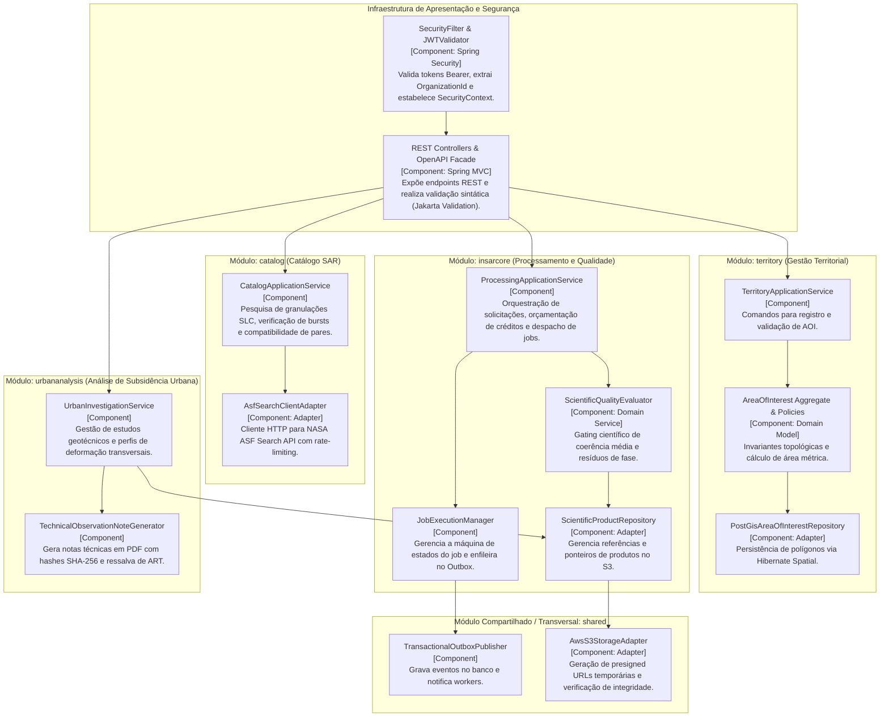

# Radar++ — Ciclo 4: Arquitetura Técnica, UML e Contratos
## Documento 02 — Modelagem C4 da Arquitetura do Sistema

**Documento:** `02-diagramas-c4.md`  
**Ciclo:** Ciclo 4 — Arquitetura Técnica, UML e Contratos  
**Data:** 24 de Outubro de 2026  
**Status:** Oficial — Entregue para Homologação de Arquitetura  
**Responsáveis:** Arquiteto de Software Sênior, Arquiteto de Sistemas Distribuídos, Arquiteto Cloud  
**Repositório Oficial:** `api-radar-deformacao` (caminho: `docs/architecture/cycle-04/02-diagramas-c4.md`)  

---

### 1. Nível 1: Diagrama de Contexto do Sistema (System Context Diagram)

O diagrama de contexto estabelece o limite de fronteira do Radar++, seus atores humanos primários e os sistemas externos com os quais interage:

```mermaid
graph TD
    subgraph "Atores Humanos (Usuários do Sistema)"
        USER_GEO["Engenheiro Geotécnico / Analista SIG<br/>(Visualiza séries temporais, investiga subsidência, emite notas técnicas)"]
        USER_ADM["Administrador da Organização<br/>(Gerencia cotas, créditos e áreas de interesse)"]
    end

    subgraph "Limite de Fronteira do Radar++"
        SYSTEM_RADAR["Sistema Radar++<br/>[Software System]<br/>Plataforma analítica e geodésica para monitoramento de deformação e subsidência usando InSAR Sentinel-1."]
    end

    subgraph "Sistemas Externos de Dados e Provedores"
        EXT_ASF["Alaska Satellite Facility (ASF)<br/>[External System]<br/>Fornece API de Catálogo SAR (Search API) e serviço de computação em nuvem HyP3 para geração de interferogramas."]
        EXT_CDSE["Copernicus Data Space Ecosystem (CDSE / ESA)<br/>[External System]<br/>Provedor oficial europeu de metadados e granulações SLC do satélite Sentinel-1."]
        EXT_AWS["Amazon Web Services (AWS S3)<br/>[External Cloud Storage]<br/>Armazenamento em nuvem privado de matrizes raster geodésicas (COGs), NetCDF e artefatos de auditoria."]
    end

    USER_GEO -->|1. Delimita AOI, pesquisa cenas, solicita análises e inspeciona deformação [HTTPS/Browser]| SYSTEM_RADAR
    USER_ADM -->|2. Configura usuários, limites de área e consulta saldo de créditos [HTTPS/Browser]| SYSTEM_RADAR
    
    SYSTEM_RADAR -->|3. Consulta metadados de cenas e submete jobs interferométricos [HTTPS/REST]| EXT_ASF
    SYSTEM_RADAR -->|4. Consulta catálogo e órbitas precisas do Sentinel-1 [HTTPS/STAC]| EXT_CDSE
    SYSTEM_RADAR -->|5. Grava e recupera rasters COG e séries temporais via URLs pré-assinadas [HTTPS/S3 API]| EXT_AWS
```

---

### 2. Nível 2: Diagrama de Contêineres (Container Diagram)

O diagrama de contêineres detalha as unidades de execução implantáveis, linguagens, protocolos de comunicação e armazenamentos de dados:

```mermaid
graph TB
    subgraph "Cliente Web"
        SPA["Single Page Application (SPA)<br/>[Container: React 18 / TypeScript / Vite]<br/>Interface gráfica responsiva, renderização cartográfica vetorial e raster COG, gráficos de séries temporais."]
    end

    subgraph "Backend Monolítico Modular"
        API["Backend Radar++<br/>[Container: Java 21 / Spring Boot 3.3+]<br/>Monólito modular com arquitetura hexagonal. Gerencia segurança JWT, governança territorial, catálogo, orquestração de jobs, avaliação de qualidade e persistência."]
    end

    subgraph "Processamento Científico"
        WORKER["Worker InSAR<br/>[Container: Python 3.11 / MintPy / GDAL]<br/>Processo em segundo plano que executa tarefas pesadas de sensoriamento remoto, interage com HyP3, calcula redes SBAS e converte rasters em COG."]
    end

    subgraph "Armazenamento de Dados"
        POSTGRES[("Banco de Dados Relacional e Espacial<br/>[Container: PostgreSQL 16 + PostGIS 3.4]<br/>Armazena metadados de negócios, geometrias vetoriais indexadas (GiST), histórico de jobs e tabela transacional de outbox.")]
        S3[("Storage de Objetos Privado<br/>[Container / Cloud: AWS S3 ou MinIO local]<br/>Armazenamento particionado de Cloud Optimized GeoTIFFs (COGs), matrizes NetCDF e relatórios técnicos.")]
    end

    SPA <-->|HTTPS / REST JSON (JWT Bearer)| API
    SPA -->|HTTPS / HTTP Range Request (Presigned GET)| S3
    
    API <-->|JDBC / SQL / PostGIS (Porta 5432)| POSTGRES
    API -->|AWS SDK v2 / S3 API| S3
    API -.->|Transactional Outbox (jobs_queue via SQL SKIP LOCKED)| WORKER
    
    WORKER <-->|SQL / Psycopg3 (Atualização de Status de Job)| POSTGRES
    WORKER -->|Boto3 / S3 API (Gravação de Produtos COG)| S3
    WORKER -->|HTTPS / REST API| EXT_ASF["NASA / ASF Search & HyP3"]
```

---

### 3. Nível 3: Diagrama de Componentes do Backend (Spring Boot Modular Monolith)

Detalhamento dos componentes internos do monólito modular Java, organizados por contexto delimitado:



---

### 4. Nível 3: Diagrama de Componentes do Worker Python (Processamento Científico)

Detalhamento dos componentes do processo em segundo plano responsável pela computação InSAR:

```mermaid
graph TB
    subgraph "Worker InSAR Python (Daemon CLI / Container)"
        DISPATCHER["TaskConsumer & JobPollingDispatcher<br/>[Module: polling]<br/>Executa polling no PostgreSQL com SELECT FOR UPDATE SKIP LOCKED."]
        
        HYP3_CLIENT["HyP3ApiClient<br/>[Module: hyp3_orchestrator]<br/>Submete jobs do tipo INSAR_ISCE_BURST e monitora conclusão via polling remoto."]
        
        MINTPY_RUNNER["MintPyPipelineExecutor<br/>[Module: time_series_inversion]<br/>Executa a inversão SBAS em lote sobre a rede de interferogramas."]
        
        PHASE_CHECKER["PhaseUnwrappingQualityChecker<br/>[Module: quality_assurance]<br/>Calcula coerência média espacial e resíduos topológicos de desdobramento de fase."]
        
        COG_CONVERTER["CloudOptimizedGeoTiffConverter<br/>[Module: gdal_tiling]<br/>Converte GeoTIFFs brutos em COG com blocos 256x256 e pirâmides overviews."]
        
        S3_SYNC["S3ArtifactSynchronizer<br/>[Module: storage_sync]<br/>Faz upload com SHA-256 e organiza artefatos nas 3 camadas de retenção."]
        
        STATUS_NOTIFIER["PostgresResultNotifier<br/>[Module: database_sync]<br/>Registra conclusão do job técnico e métricas na tabela processing_jobs."]
    end

    DISPATCHER --> HYP3_CLIENT
    HYP3_CLIENT --> MINTPY_RUNNER
    MINTPY_RUNNER --> PHASE_CHECKER
    PHASE_CHECKER --> COG_CONVERTER
    COG_CONVERTER --> S3_SYNC
    S3_SYNC --> STATUS_NOTIFIER
```



---

### 5. Nível 4: Diagrama de Implantação Local (Local Development Environment)

Configuração executável via `docker-compose.yml` para desenvolvimento e testes locais com custo zero de nuvem:

```mermaid
graph TD
    subgraph "Máquina do Desenvolvedor (Localhost)"
        subgraph "Rede Docker Bridge: radar-local-net"
            DOCKER_FRONT["Contêiner: radar-frontend<br/>Node 20 / Vite Dev Server<br/>Porta: 5173"]
            DOCKER_BACK["Contêiner: radar-backend<br/>Eclipse Temurin OpenJDK 21 / Spring Boot<br/>Porta: 8080"]
            DOCKER_WORKER["Contêiner: radar-worker-insar<br/>Python 3.11 / GDAL 3.8 / MintPy<br/>Daemon sem porta exposta"]
            DOCKER_DB["Contêiner: radar-postgres<br/>PostgreSQL 16 + PostGIS 3.4<br/>Porta: 5432 (Volume: pgdata)"]
            DOCKER_STORAGE["Contêiner: radar-minio<br/>MinIO (Emulador de AWS S3)<br/>Porta: 9000 / 9001 (Volume: s3data)"]
        end
        
        BROWSER["Navegador Web do Desenvolvedor"]
    end

    BROWSER -->|http://localhost:5173| DOCKER_FRONT
    BROWSER -->|http://localhost:8080/api/v1| DOCKER_BACK
    BROWSER -->|http://localhost:9000 (Presigned GET)| DOCKER_STORAGE

    DOCKER_FRONT -->|Proxy HTTP /api| DOCKER_BACK
    DOCKER_BACK -->|Conexão JDBC| DOCKER_DB
    DOCKER_BACK -->|S3 Client (endpoint: minio:9000)| DOCKER_STORAGE
    
    DOCKER_WORKER -->|Polling SQL| DOCKER_DB
    DOCKER_WORKER -->|Boto3 (endpoint: minio:9000)| DOCKER_STORAGE
```

---

### 6. Nível 4: Diagrama de Implantação em Produção (AWS Candidate Architecture)

Topologia de baixo custo para implantação em nuvem, priorizando segurança, alta disponibilidade e descarte automático de recursos computacionais ociosos:

```mermaid
graph TB
    subgraph "Clientes na Internet"
        WEB_USER["Navegador do Usuário Final"]
    end

    subgraph "AWS Edge Network"
        CF["Amazon CloudFront CDN<br/>• Distribui frontend estático (SPA)<br/>• Cache e compressão Brotli/Gzip"]
        S3_STATIC["Amazon S3 Bucket: radar-frontend-static<br/>Hospedagem estática de arquivos React (HTML, JS, CSS)"]
    end

    subgraph "AWS VPC: radar-vpc (10.0.0.0/16)"
        subgraph "Sub-redes Públicas"
            ALB["Application Load Balancer (ALB)<br/>• Terminação SSL/TLS (HTTPS:443)<br/>• Roteia /api/* para o Backend"]
            NAT_GW["NAT Gateway<br/>Permite saída segura para APIs da NASA/ESA"]
        end

        subgraph "Sub-redes Privadas de Aplicação"
            ECS_BACK["AWS ECS Fargate: radar-backend<br/>Contêiner Spring Boot auto-escalável (1 a 3 tarefas)<br/>Porta interna: 8080"]
            ECS_WORKER["AWS ECS Fargate / EC2 Spot: radar-worker-insar<br/>Workers efêmeros acionados sob demanda para processamento"]
        end

        subgraph "Sub-redes Privadas de Dados"
            RDS_DB[("Amazon RDS PostgreSQL 16 + PostGIS<br/>Instância db.t4g.medium (Multi-AZ opcional)<br/>Armazenamento gp3 com backup automatizado")]
        end
    end

    subgraph "Armazenamento em Nuvem e Gerenciamento"
        S3_STORAGE[("Amazon S3 Bucket Privado: radar-insar-artifacts<br/>• Bloqueio total de acesso público<br/>• Lifecycle rules ativadas<br/>• Criptografia SSE-S3 em repouso")]
        SECRETS["AWS Secrets Manager / SSM Parameter Store<br/>Chaves NASA ASF, tokens JWT e senhas do RDS"]
    end

    WEB_USER -->|1. Acesso Web HTTPS| CF
    CF --> S3_STATIC
    CF -->|2. Roteamento /api/*| ALB
    WEB_USER -->|3. Download direto de COGs (Presigned GET)| S3_STORAGE

    ALB --> ECS_BACK
    ECS_BACK --> RDS_DB
    ECS_BACK --> S3_STORAGE
    ECS_BACK --> SECRETS

    ECS_WORKER --> RDS_DB
    ECS_WORKER --> S3_STORAGE
    ECS_WORKER --> NAT_GW
    NAT_GW -->|HTTPS| EXT_INTERNET["NASA ASF / Copernicus CDSE"]
```
