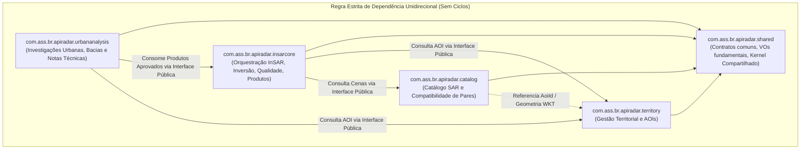

# Radar++ — Ciclo 4: Arquitetura Técnica, UML e Contratos
## Documento 03 — Arquitetura de Módulos Java (Monólito Modular)

**Documento:** `03-modulos-java.md`  
**Ciclo:** Ciclo 4 — Arquitetura Técnica, UML e Contratos  
**Data:** 24 de Outubro de 2026  
**Status:** Oficial — Entregue para Homologação de Arquitetura  
**Responsáveis:** Arquiteto de Software Sênior Java/Spring Boot, Especialista em DDD e Clean Architecture  
**Repositório Oficial:** `api-radar-deformacao` (caminho: `docs/architecture/cycle-04/03-modulos-java.md`)  

---

### 1. Visão Geral da Modularização Backend

O backend do Radar++ é estruturado como um **Monólito Modular** (*Modular Monolith*). Cada subdomínio de negócio homologado no Ciclo 3 corresponde a um módulo autônomo com fronteiras bem definidas, isolamento de pacotes e dependências estritamente unidirecionais.



> [!NOTE]
> **Evolução Arquitetural — Adendo Ciclo 5.3.1 / 5.4A (ADR-007):**  
> Conforme homologado na [ADR-007](file:///home/asoares/Documentos/repositories/repo_radar/api-radar-deformacao/docs/architecture/cycle-05/10-decisao-arquitetural-modulo-interferometry.md), a formação combinatória, verificação de baselines orbitais e preparação de processamento InSAR foi promovida a um **Bounded Context autônomo** de primeira classe: `com.ass.br.apiradar.interferometry`. O módulo consome cenas de `catalog`, geometrias de `territory` e gera contratos qualificados (`ELIGIBLE_FOR_SUBMISSION`) para o futuro orquestrador `insarcore`.

---

### 2. Estrutura Padrão de Camadas Internas de um Módulo

Cada módulo é organizado internamente em camadas concêntricas (Arquitetura Hexagonal / Clean Architecture):

```
com.ass.br.apiradar.<modulo>/
├── domain/                      <-- CAMADA DE DOMÍNIO (PURA, SEM DEPENDÊNCIAS DE FRAMEWORK)
│   ├── model/                   <-- Entidades, Agregados Raiz, Identificadores Fortes
│   ├── valueobjects/            <-- Objetos de Valor Imutáveis (Java Records)
│   ├── events/                  <-- Eventos de Domínio no Pretérito Perfeito
│   ├── policies/                <-- Regras e Estratégias de Domínio Desacopladas
│   └── ports/                   <-- Interfaces de Repositórios e Serviços Externos (SPIs)
│
├── application/                 <-- CAMADA DE APLICAÇÃO (CASOS DE USO E ORQUESTRAÇÃO)
│   ├── commands/                <-- Comandos CQRS (Records imutáveis de escrita)
│   ├── queries/                 <-- Consultas CQRS (Records imutáveis de leitura)
│   ├── services/                <-- Casos de Uso / Serviços de Aplicação
│   ├── dto/                     <-- Objetos de Transferência de Dados públicos do módulo
│   └── ports/api/               <-- INTERFACES PÚBLICAS EXPOSTAS PARA OUTROS MÓDULOS
│
└── infrastructure/              <-- CAMADA DE INFRAESTRUTURA E ADAPTADORES
    ├── adapters/input/web/      <-- Adaptadores de Entrada: REST Controllers, Request DTOs
    ├── adapters/output/persistence/ <-- Adaptadores de Saída: Spring Data JPA, Repositories
    ├── adapters/output/external/<-- Adaptadores de Saída: Clientes HTTP, S3, Notificadores
    └── mappers/                 <-- Conversores entre Domínio, DTOs e Entidades de Banco
```

---

### 3. Especificação Detalhada dos Quatro Módulos

---

#### 3.1. Módulo: `territory` (Gestão Territorial)
* **Pacote Raiz:** `com.ass.br.apiradar.territory`
* **Responsabilidade:** Garantir a validade geométrica, topológica e métrica dos polígonos de interesse monitorados (`AreaOfInterest`), calcular a Bounding Box (BBOX) de busca e assegurar o isolamento por organização (`OrganizationId`).
* **Interfaces Públicas Expostas (`ports/api`):**
  - `AreaOfInterestQueryApi`:
    - `Optional<AoiSummaryDto> findById(AoiId aoiId, OrganizationId orgId);`
    - `PolygonGeometryDto getGeometry(AoiId aoiId);`
    - `BoundingBoxDto getBoundingBox(AoiId aoiId);`
  - `AreaOfInterestManagementApi`:
    - `AoiId registerAreaOfInterest(RegisterAoiCommand command);`
    - `void archiveAreaOfInterest(AoiId aoiId, OrganizationId orgId);`
* **Dependências Permitidas:** Apenas `com.ass.br.apiradar.shared`.
* **Invariantes Protegidas:**
  - Anel poligonal exterior fechado e topologicamente simples (*isSimple*);
  - Área máxima contida no teto contratual do plano da organização (`MetricArea <= MaxAllowedArea`);
  - Todo polígono associado obrigatoriamente a uma organização.
* **Eventos Publicados:** `AreaOfInterestRegisteredEvent`, `AreaOfInterestGeometryUpdatedEvent`, `AreaOfInterestArchivedEvent`.

---

#### 3.2. Módulo: `catalog` (Catálogo SAR)
* **Pacote Raiz:** `com.ass.br.apiradar.catalog`
* **Responsabilidade:** Descoberta de cenas SAR Sentinel-1 IW SLC compatíveis, mapeamento das pegadas de bursts operacionais e verificação prévia de viabilidade de rede SBAS ($B_\perp$ e $\Delta t$).
* **Interfaces Públicas Expostas (`ports/api`):**
  - `SarCatalogQueryApi`:
    - `List<SarSceneDto> searchAvailableScenes(BoundingBoxDto bbox, DateRangeDto dateRange, PolarizationDto pol);`
    - `List<SarBurstDto> discoverIntersectingBursts(PolygonGeometryDto aoiGeometry, String relativeOrbit);`
    - `BaselineCompatibilityMatrixDto evaluatePairNetwork(List<String> sceneIds, BaselineThresholdsDto thresholds);`
* **Dependências Permitidas:** `com.ass.br.apiradar.shared`, `com.ass.br.apiradar.territory` (apenas para leitura de geometrias).
* **Adaptadores de Saída:**
  - `AsfSearchHttpAdapter`: Integração com a API pública do Alaska Satellite Facility.
  - `CdseStacHttpAdapter`: Integração com o catálogo STAC da ESA/Copernicus.
* **Políticas de Domínio:** `SceneCompatibilityPolicy` (mesmo sensor, mesma órbita relativa, mesmo modo IW SLC, polarização VV).

---

#### 3.3. Módulo: `insarcore` (Processamento, Produtos e Qualidade InSAR)
* **Pacote Raiz:** `com.ass.br.apiradar.insarcore`
* **Responsabilidade:** Ciclo de vida da solicitação de processamento, orçamentação decomposta de créditos HyP3, despacho e acompanhamento de jobs operacionais assíncronos, ingestão semântica de produtos e portão científico de qualidade.
* **Interfaces Públicas Expostas (`ports/api`):**
  - `ProcessingRequestApi`:
    - `RequestId submitProcessingRequest(SubmitProcessingRequestCommand command);`
    - `ProcessingCostEstimateDto estimateProcessingCost(RequestId requestId);`
  - `InSarAnalysisQueryApi`:
    - `Optional<AnalysisSummaryDto> getAnalysisSummary(AnalysisId analysisId, OrganizationId orgId);`
    - `List<ScientificProductRefDto> getApprovedProducts(AnalysisId analysisId);`
    - `PresignedUrlDto getProductDownloadUrl(ProductId productId, OrganizationId orgId);`
  - `QualityGatingApi`:
    - `QualityEvaluationResultDto evaluateQuality(AnalysisId analysisId, QualityMetricsDto metrics);`
* **Dependências Permitidas:** `com.ass.br.apiradar.shared`, `com.ass.br.apiradar.territory`, `com.ass.br.apiradar.catalog`.
* **Desacoplamento Crítico de Qualidade:**
  - O subdomínio de Avaliação de Qualidade é organizado no subpacote `com.ass.br.apiradar.insarcore.domain.quality`.
  - Compartilha o mesmo módulo físico de execução, mas mantém classes de serviço e políticas estritamente isoladas da infraestrutura de jobs.
* **Invariantes Protegidas:**
  - Nenhum produto atinge `AVAILABLE_FOR_VISUALIZATION` sem aprovação expressa no método `evaluateQuality()`;
  - A conclusão operacional de um job (`PROCESSING_COMPLETED`) transiciona a análise exclusivamente para `SCIENTIFIC_EVALUATION_PENDING`;
  - A grandeza primária soberana armazenada em todos os produtos matriciais é a velocidade em $\text{mm}_{\text{LOS}}$.
* **Eventos Publicados:** `ProcessingRequestSubmittedEvent`, `ProcessingJobDispatchedEvent`, `ProcessingJobCompletedEvent`, `ProcessingJobFailedEvent`, `ProductApprovedForVisualizationEvent`, `ProductQualifiedWithRestrictionsEvent`, `ProductRejectedQualityEvent`.

---

#### 3.4. Módulo: `urbananalysis` (Análise de Subsidência Urbana)
* **Pacote Raiz:** `com.ass.br.apiradar.urbananalysis`
* **Responsabilidade:** Ambiente de trabalho exploratório para engenheiros e analistas geotécnicos. Permite traçar perfis de seção transversal em bacias de subsidência aparente, inspecionar histórico temporal e registrar observações técnicas com rastreabilidade auditável.
* **Interfaces Públicas Expostas (`ports/api`):**
  - `UrbanInvestigationApi`:
    - `InvestigationId initiateInvestigation(InitiateInvestigationCommand command);`
    - `SectionProfileDto generateSectionProfile(InvestigationId id, LineStringDto profileLine);`
    - `TechnicalNoteId recordTechnicalObservation(RecordTechnicalObservationCommand command);`
    - `byte[] exportTechnicalObservationPdf(TechnicalNoteId noteId, OrganizationId orgId);`
* **Dependências Permitidas:** `com.ass.br.apiradar.shared`, `com.ass.br.apiradar.territory`, `com.ass.br.apiradar.insarcore` (apenas leitura de produtos aprovados/restritos).
* **Vedações Estritas de Responsabilidade:**
  - O módulo **não gera laudos periciais judiciais oficiais com fé pública**;
  - O módulo **não emite diagnósticos automáticos de segurança predial ou risco estrutural de fundações**;
  - Toda nota técnica emitida traz no rodapé o carimbo imutável dos algoritmos e a advertência expressa de que se trata de nota técnica observacional preliminar, cuja validade depende de validação presencial com ART.
* **Eventos Publicados:** `UrbanInvestigationInitiatedEvent`, `TechnicalObservationRecordedEvent`.

---

### 4. Políticas de Integração e Prevenção de Dependências Circulares

1. **Invocação Unidirecional de Serviços:** O módulo `urbananalysis` pode chamar `insarcore`, mas `insarcore` **nunca importa ou referencia classes de `urbananalysis`**.
2. **Desacoplamento via Eventos Assíncronos:** Mudanças de estado de alto impacto (ex.: promoção de um produto para `ProductApprovedForVisualization`) são propagadas via eventos da camada de aplicação através do barramento interno do Spring (`ApplicationEventPublisher` e `@TransactionalEventListener`).
3. **Validação Arquitetural Contínua com ArchUnit:** No Ciclo 5, serão incluídos testes automatizados garantindo que nenhuma classe fure o isolamento de pacotes ou importe classes dos pacotes `infrastructure` de outros módulos.
