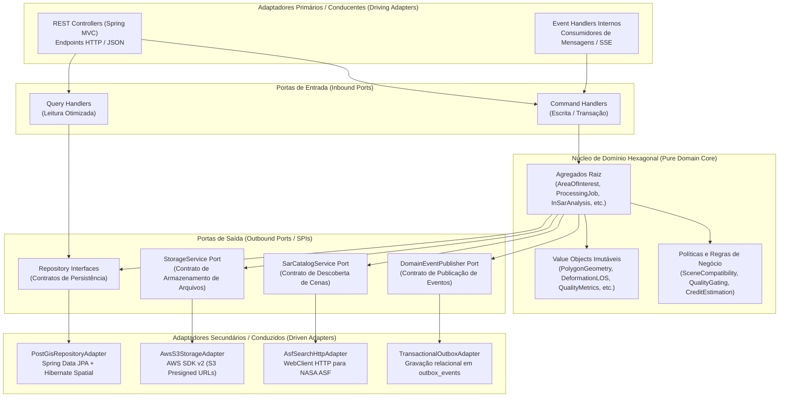

# Radar++ — Ciclo 4: Arquitetura Técnica, UML e Contratos
## Documento 04 — Arquitetura Hexagonal: Portas e Adaptadores

**Documento:** `04-arquitetura-hexagonal.md`  
**Ciclo:** Ciclo 4 — Arquitetura Técnica, UML e Contratos  
**Data:** 24 de Outubro de 2026  
**Status:** Oficial — Entregue para Homologação de Arquitetura  
**Responsáveis:** Arquiteto de Software Sênior Java/Spring Boot, Especialista em DDD e Clean Architecture  
**Repositório Oficial:** `api-radar-deformacao` (caminho: `docs/architecture/cycle-04/04-arquitetura-hexagonal.md`)  

---

### 1. Princípios da Arquitetura Hexagonal no Radar++

A Arquitetura Hexagonal (*Ports & Adapters*) isola o núcleo de domínio do Radar++ de quaisquer dependências externas de infraestrutura, bancos de dados, provedores em nuvem ou frameworks web.



---

### 2. Especificação das Portas de Entrada e Adaptadores Conducentes (*Driving*)

As portas de entrada representam os **Casos de Uso** da aplicação, segregados segundo o padrão CQRS (*Command Query Responsibility Segregation*):

```
+----------------------------------------------------------------------------------------------------------------------------------------------------+
|                                    MATRIZ DE PORTAS DE ENTRADA (INBOUND PORTS) DO BACKEND                                                          |
+---+----------------------------+---------------------------------------+-----------------------------+---------------------------------------------+
| # | Porta de Entrada           | Tipo CQRS                             | DTO de Entrada              | Adaptador Conducente (Driving Adapter)      |
+---+----------------------------+---------------------------------------+-----------------------------+---------------------------------------------+
| 1 | `RegisterAreaOfInterestPort`| Comando (Escrita)                    | `RegisterAoiCommand`        | `AreaOfInterestRestController.create()`     |
+---+----------------------------+---------------------------------------+-----------------------------+---------------------------------------------+
| 2 | `GetAreaOfInterestQueryPort`| Consulta (Leitura)                   | `GetAoiByIdQuery`           | `AreaOfInterestRestController.getById()`    |
+---+----------------------------+---------------------------------------+-----------------------------+---------------------------------------------+
| 3 | `SearchSarScenesQueryPort` | Consulta (Leitura)                    | `SearchSarScenesQuery`      | `SarCatalogRestController.searchScenes()`   |
+---+----------------------------+---------------------------------------+-----------------------------+---------------------------------------------+
| 4 | `SubmitProcessingReqPort`  | Comando (Escrita)                     | `SubmitProcessingReqCommand`| `ProcessingRequestRestController.submit()`  |
+---+----------------------------+---------------------------------------+-----------------------------+---------------------------------------------+
| 5 | `GetJobExecutionStatePort` | Consulta (Leitura)                    | `GetJobStatusQuery`         | `ProcessingJobRestController.getStatus()`   |
+---+----------------------------+---------------------------------------+-----------------------------+---------------------------------------------+
| 6 | `EvaluateQualityPort`      | Comando (Escrita)                     | `EvaluateQualityCommand`    | `InternalJobResultController.notifyComp()`  |
+---+----------------------------+---------------------------------------+-----------------------------+---------------------------------------------+
| 7 | `GetDisplacementSeriesPort`| Consulta (Leitura)                    | `GetTimeSeriesQuery`        | `InSarAnalysisRestController.getTimeSeries()`|
+---+----------------------------+---------------------------------------+-----------------------------+---------------------------------------------+
| 8 | `RecordObservationNotePort`| Comando (Escrita)                     | `RecordObservationCommand`  | `UrbanInvestigationController.recordNote()` |
+---+----------------------------+---------------------------------------+-----------------------------+---------------------------------------------+
```

---

### 3. Especificação das Portas de Saída e Adaptadores Conduzidos (*Driven*)

As portas de saída representam contratos de infraestrutura definidos no domínio e implementados por adaptadores externos:

#### 3.1. Porta de Persistência de Dados (`AreaOfInterestRepositoryPort`)
* **Contrato no Domínio:**
  ```java
  public interface AreaOfInterestRepositoryPort {
      void save(AreaOfInterest aoi);
      Optional<AreaOfInterest> findById(AoiId id, OrganizationId orgId);
      boolean existsByName(String name, OrganizationId orgId);
      List<AreaOfInterest> findAllByOrganization(OrganizationId orgId, Pageable pageable);
  }
  ```
* **Adaptador de Infraestrutura (`PostgisAoiRepositoryAdapter`):**
  - Implementa `AreaOfInterestRepositoryPort`;
  - Utiliza o repositório Spring Data `SpringDataJpaAoiRepository`;
  - Mapeia entre a entidade de domínio pura `AreaOfInterest` e a entidade de banco `AoiJpaEntity` (com anotações `@Entity`, `@Table("areas_of_interest")` e coluna espacial JTS `org.locationtech.jts.geom.Polygon`).

#### 3.2. Porta de Armazenamento de Arquivos em Nuvem (`ObjectStoragePort`)
* **Contrato no Domínio:**
  ```java
  public interface ObjectStoragePort {
      StorageArtifactUri uploadArtifact(byte[] content, String logicalKey, String contentType, ChecksumSha256 checksum);
      PresignedUrl generatePresignedDownloadUrl(StorageArtifactUri location, Duration timeToLive);
      boolean verifyArtifactIntegrity(StorageArtifactUri location, ChecksumSha256 expectedChecksum);
      void deleteArtifact(StorageArtifactUri location);
  }
  ```
* **Adaptador de Infraestrutura (`AwsS3StorageAdapter`):**
  - Utiliza `software.amazon.awssdk.services.s3.S3Client` e `S3Presigner`;
  - Gera URLs pré-assinadas com cabeçalho de controle de cache e limitação estrita de tempo de expiração (máximo 15 minutos);
  - Valida o hash SHA-256 no momento do upload (`x-amz-checksum-sha256`).

#### 3.3. Porta de Integração com Catálogo Satelital (`SarCatalogPort`)
* **Contrato no Domínio:**
  ```java
  public interface SarCatalogPort {
      List<SarSceneMetadata> queryScenes(BoundingBox bbox, DateRange range, OrbitDirection direction);
      List<BurstFootprint> queryBursts(PolygonGeometry aoi, int relativeOrbit);
  }
  ```
* **Adaptador de Infraestrutura (`AsfSearchClientAdapter`):**
  - Executa requisições HTTP GET na API pública de busca da NASA/ASF;
  - Trata falhas de rede com política de retentativa com recuo exponencial e circuit breaker;
  - Converte GeoJSON de resposta da NASA em modelos de domínio imutáveis.

#### 3.4. Porta de Publicação de Eventos e Fila Confiável (`DomainEventPublisherPort`)
* **Contrato no Domínio:**
  ```java
  public interface DomainEventPublisherPort {
      void publish(DomainEvent event);
  }
  ```
* **Adaptador de Infraestrutura (`TransactionalOutboxAdapter`):**
  - Serializa o evento de domínio em JSON canônico;
  - Grava na tabela relacional `outbox_events` na **mesma conexão transacional JDBC** da transação do agregado raiz;
  - Impede a perda de mensagens em caso de colapso do broker externo ou da rede.

---

### 4. Mapeamento de Dados e Isolamento da Camada de Domínio

O domínio permanece 100% agnóstico a bibliotecas externas. A separação entre o modelo de domínio e as representações externas é estritamente garantida por conversores bidirecionais:

```
[Cliente HTTP] 
      │ (JSON)
      ▼
[Request DTO (Record)] 
      │ 
      ▼ (Mapper)
[Comando CQRS / Value Objects de Entrada]
      │
      ▼ (Porta de Entrada)
[Agregado de Domínio Puro] ◄── Invariantes e Regras de Negócio
      │
      ▼ (Mapper de Persistência)
[Entidade JPA / Hibernate Spatial]
      │
      ▼ (JDBC Driver)
[Tabela PostgreSQL / PostGIS]
```

**Regras Estritas de Compilação:**
1. A camada `domain` não possui nenhuma importação de `org.springframework.*`, `jakarta.persistence.*`, `hibernate.*` ou `com.fasterxml.jackson.*`;
2. A biblioteca JTS Topology Suite (`org.locationtech.jts.geom`) é encapsulada dentro do Value Object de domínio `PolygonGeometry`, não permitindo vazamento de APIs mutáveis do JTS para a camada de aplicação;
3. Qualquer falha de integridade de banco ou rede é capturada pelo adaptador e relançada como uma exceção tipada de domínio (`DomainException`).
