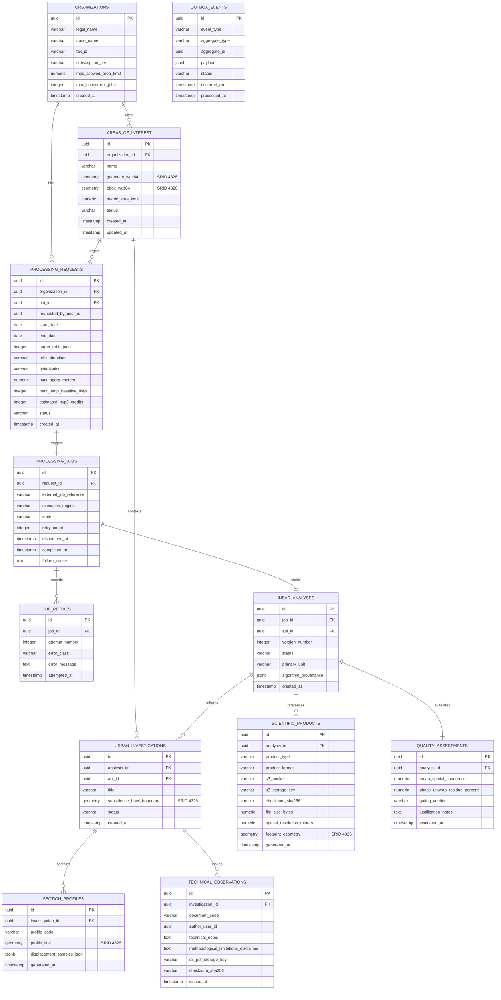

# Radar++ — Ciclo 4: Arquitetura Técnica, UML e Contratos
## Documento 05 — Modelo de Dados Relacional e Espacial (PostgreSQL / PostGIS)

**Documento:** `05-modelo-dados-postgis.md`  
**Ciclo:** Ciclo 4 — Arquitetura Técnica, UML e Contratos  
**Data:** 24 de Outubro de 2026  
**Status:** Oficial — Entregue para Homologação de Arquitetura  
**Responsáveis:** Especialista PostgreSQL/PostGIS, Arquiteto de Software Sênior, Modelador Geoespacial  
**Repositório Oficial:** `api-radar-deformacao` (caminho: `docs/architecture/cycle-04/05-modelo-dados-postgis.md`)  
**Regra de Governança Estrita:** Especificação conceitual de banco de dados e DDL declarativa. **Não executar migrações de banco (Flyway/Liquibase) nem instanciar tabelas nesta etapa.**

---

### 1. Diretrizes de Modelagem Espacial e Relacional

1. **Separação Rígida entre Dados Estruturados e Binários:** O banco de dados PostgreSQL 16 + PostGIS armazena **exclusivamente dados estruturados, metadados de auditoria, referências de storage e geometrias vetoriais**. É terminantemente proibido o armazenamento de arquivos raster SAR inteiros (GeoTIFFs, SLCs ou COGs) no banco de dados via `@Lob` ou tipos OID.
2. **Sistemas de Referência Espacial (SRID / CRS):**
   - **`EPSG:4326` (WGS 84 Geográfico - 2D):** Padrão canônico de armazenamento das geometrias das AOIs e bacias no banco. Assegura interoperabilidade nativa com Leaflet, OpenLayers, GeoJSON e APIs de satélites (NASA/ESA).
   - **`EPSG:4674` (SIRGAS 2000 Geográfico):** Padrão geodésico legal brasileiro (IBGE / Decreto Federal nº 5.334/2005). As transformações sob demanda entre EPSG:4326 e EPSG:4674 utilizam a função nativa `ST_Transform(geom, 4674)` do PostGIS (com deslocamento subcentimétrico na época contemporânea).
   - **`EPSG:31985` (SIRGAS 2000 / UTM Zona 25S):** Sistema métrico projetado utilizado internamente em consultas espaciais para cômputo exato de área em quilômetros quadrados (`ST_Area(ST_Transform(geom, 31985)) / 1000000.0`) na região do piloto de Maceió/AL.
3. **Indexação Espacial:** Toda coluna geométrica é indexada com índices espaciais **GiST (*Generalized Search Tree*)**, viabilizando consultas topológicas de contenção e interseção em tempo sub-milissegundo.
4. **Isolamento Organizacional Lógico:** Todas as tabelas que contêm dados proprietários de usuários possuem a coluna `organization_id UUID NOT NULL` com índice composto correspondente.

---

### 2. Diagrama Entidade-Relacionamento Conceitual (DER)



---

### 3. Proposta de Esquemas DDL Declarativos (PostgreSQL 16 / PostGIS)

Abaixo apresenta-se a estrutura formal de criação dos esquemas, tabelas e índices espaciais:

```sql
-- ============================================================================
-- SCHEMA INICIAL E EXTENSÕES ESPACIAIS
-- ============================================================================
CREATE EXTENSION IF NOT EXISTS "uuid-ossp";
CREATE EXTENSION IF NOT EXISTS "postgis";

CREATE SCHEMA IF NOT EXISTS radar;
SET search_path TO radar, public;

-- ============================================================================
-- 1. TABELA DE ORGANIZAÇÕES (ISOLAMENTO MULTI-TENANCY LÓGICO)
-- ============================================================================
CREATE TABLE radar.organizations (
    id UUID PRIMARY KEY DEFAULT uuid_generate_v4(),
    legal_name VARCHAR(255) NOT NULL,
    trade_name VARCHAR(255),
    tax_id VARCHAR(32) NOT NULL UNIQUE,
    subscription_tier VARCHAR(32) NOT NULL DEFAULT 'STANDARD',
    max_allowed_area_km2 NUMERIC(8,2) NOT NULL DEFAULT 50.00,
    max_concurrent_jobs INTEGER NOT NULL DEFAULT 2,
    created_at TIMESTAMPTZ NOT NULL DEFAULT CURRENT_TIMESTAMP
);

-- ============================================================================
-- 2. TABELA DE ÁREAS DE INTERESSE (GEOMETRIAS VETORIAIS POSTGIS)
-- ============================================================================
CREATE TABLE radar.areas_of_interest (
    id UUID PRIMARY KEY DEFAULT uuid_generate_v4(),
    organization_id UUID NOT NULL REFERENCES radar.organizations(id) ON DELETE RESTRICT,
    name VARCHAR(150) NOT NULL,
    geometry_wgs84 GEOMETRY(Polygon, 4326) NOT NULL,
    bbox_wgs84 GEOMETRY(Polygon, 4326) NOT NULL,
    metric_area_km2 NUMERIC(10,4) NOT NULL,
    status VARCHAR(32) NOT NULL DEFAULT 'ACTIVE',
    created_at TIMESTAMPTZ NOT NULL DEFAULT CURRENT_TIMESTAMP,
    updated_at TIMESTAMPTZ NOT NULL DEFAULT CURRENT_TIMESTAMP,
    CONSTRAINT chk_aoi_area_positive CHECK (metric_area_km2 > 0),
    CONSTRAINT chk_aoi_valid_geom CHECK (ST_IsValid(geometry_wgs84))
);

-- Índices Espaciais GiST e de Governança
CREATE INDEX idx_aoi_geom_gist ON radar.areas_of_interest USING GIST (geometry_wgs84);
CREATE INDEX idx_aoi_bbox_gist ON radar.areas_of_interest USING GIST (bbox_wgs84);
CREATE INDEX idx_aoi_org_id ON radar.areas_of_interest (organization_id);

-- ============================================================================
-- 3. TABELA DE SOLICITAÇÕES DE PROCESSAMENTO (GOVERNANÇA DE ENTRADA)
-- ============================================================================
CREATE TABLE radar.processing_requests (
    id UUID PRIMARY KEY DEFAULT uuid_generate_v4(),
    organization_id UUID NOT NULL REFERENCES radar.organizations(id) ON DELETE RESTRICT,
    aoi_id UUID NOT NULL REFERENCES radar.areas_of_interest(id) ON DELETE RESTRICT,
    requested_by_user_id UUID NOT NULL,
    start_date DATE NOT NULL,
    end_date DATE NOT NULL,
    target_orbit_path INTEGER NOT NULL,
    orbit_direction VARCHAR(16) NOT NULL,
    polarization VARCHAR(8) NOT NULL DEFAULT 'VV',
    max_bperp_meters NUMERIC(6,2) NOT NULL DEFAULT 150.00,
    max_temp_baseline_days INTEGER NOT NULL DEFAULT 36,
    estimated_hyp3_credits INTEGER NOT NULL DEFAULT 0,
    status VARCHAR(32) NOT NULL DEFAULT 'REQUEST_RECEIVED',
    created_at TIMESTAMPTZ NOT NULL DEFAULT CURRENT_TIMESTAMP,
    CONSTRAINT chk_req_dates CHECK (end_date > start_date),
    CONSTRAINT chk_req_direction CHECK (orbit_direction IN ('ASCENDING', 'DESCENDING'))
);

CREATE INDEX idx_proc_req_org_aoi ON radar.processing_requests (organization_id, aoi_id);

-- ============================================================================
-- 4. TABELA DE JOBS COMPUTACIONAIS (ORQUESTRAÇÃO OPERACIONAL)
-- ============================================================================
CREATE TABLE radar.processing_jobs (
    id UUID PRIMARY KEY DEFAULT uuid_generate_v4(),
    request_id UUID NOT NULL UNIQUE REFERENCES radar.processing_requests(id) ON DELETE RESTRICT,
    external_job_reference VARCHAR(128),
    execution_engine VARCHAR(64) NOT NULL DEFAULT 'HYP3_MINTPY',
    state VARCHAR(32) NOT NULL DEFAULT 'JOB_QUEUED',
    retry_count INTEGER NOT NULL DEFAULT 0,
    dispatched_at TIMESTAMPTZ,
    completed_at TIMESTAMPTZ,
    failure_cause TEXT,
    created_at TIMESTAMPTZ NOT NULL DEFAULT CURRENT_TIMESTAMP,
    CONSTRAINT chk_job_retries CHECK (retry_count >= 0 AND retry_count <= 5)
);

CREATE INDEX idx_proc_job_state ON radar.processing_jobs (state);
CREATE INDEX idx_proc_job_external_ref ON radar.processing_jobs (external_job_reference);

-- Tabela de Histórico de Retentativas de Jobs
CREATE TABLE radar.job_retries (
    id UUID PRIMARY KEY DEFAULT uuid_generate_v4(),
    job_id UUID NOT NULL REFERENCES radar.processing_jobs(id) ON DELETE CASCADE,
    attempt_number INTEGER NOT NULL,
    error_class VARCHAR(128) NOT NULL,
    error_message TEXT NOT NULL,
    attempted_at TIMESTAMPTZ NOT NULL DEFAULT CURRENT_TIMESTAMP
);

-- ============================================================================
-- 5. TABELA DE ANÁLISES CIENTÍFICAS (PROVENIÊNCIA E HISTÓRICO)
-- ============================================================================
CREATE TABLE radar.insar_analyses (
    id UUID PRIMARY KEY DEFAULT uuid_generate_v4(),
    job_id UUID NOT NULL UNIQUE REFERENCES radar.processing_jobs(id) ON DELETE RESTRICT,
    aoi_id UUID NOT NULL REFERENCES radar.areas_of_interest(id) ON DELETE RESTRICT,
    version_number INTEGER NOT NULL DEFAULT 1,
    status VARCHAR(32) NOT NULL DEFAULT 'SCIENTIFIC_EVALUATION_PENDING',
    primary_unit VARCHAR(16) NOT NULL DEFAULT 'MM_LOS',
    algorithm_provenance JSONB NOT NULL,
    created_at TIMESTAMPTZ NOT NULL DEFAULT CURRENT_TIMESTAMP,
    CONSTRAINT uq_aoi_analysis_version UNIQUE (aoi_id, version_number)
);

CREATE INDEX idx_analysis_aoi_status ON radar.insar_analyses (aoi_id, status);

-- ============================================================================
-- 6. TABELA DE AVALIAÇÃO DE QUALIDADE CIENTÍFICA (GATING)
-- ============================================================================
CREATE TABLE radar.quality_assessments (
    id UUID PRIMARY KEY DEFAULT uuid_generate_v4(),
    analysis_id UUID NOT NULL UNIQUE REFERENCES radar.insar_analyses(id) ON DELETE CASCADE,
    mean_spatial_coherence NUMERIC(4,3) NOT NULL,
    phase_unwrap_residue_percent NUMERIC(5,2) NOT NULL,
    gating_verdict VARCHAR(32) NOT NULL,
    justification_notes TEXT,
    evaluated_at TIMESTAMPTZ NOT NULL DEFAULT CURRENT_TIMESTAMP,
    CONSTRAINT chk_coherence_range CHECK (mean_spatial_coherence >= 0.0 AND mean_spatial_coherence <= 1.0)
);

-- ============================================================================
-- 7. TABELA DE PRODUTOS CIENTÍFICOS (REFERÊNCIAS IMUTÁVEIS S3)
-- ============================================================================
CREATE TABLE radar.scientific_products (
    id UUID PRIMARY KEY DEFAULT uuid_generate_v4(),
    analysis_id UUID NOT NULL REFERENCES radar.insar_analyses(id) ON DELETE CASCADE,
    product_type VARCHAR(64) NOT NULL,
    product_format VARCHAR(16) NOT NULL,
    s3_bucket VARCHAR(64) NOT NULL,
    s3_storage_key VARCHAR(512) NOT NULL,
    checksum_sha256 VARCHAR(64) NOT NULL,
    file_size_bytes BIGINT NOT NULL,
    spatial_resolution_meters NUMERIC(6,2) NOT NULL DEFAULT 20.00,
    footprint_geometry GEOMETRY(Polygon, 4326),
    generated_at TIMESTAMPTZ NOT NULL DEFAULT CURRENT_TIMESTAMP,
    CONSTRAINT uq_product_key UNIQUE (s3_bucket, s3_storage_key)
);

CREATE INDEX idx_products_analysis_id ON radar.scientific_products (analysis_id);
CREATE INDEX idx_products_footprint_gist ON radar.scientific_products USING GIST (footprint_geometry);

-- ============================================================================
-- 8. TABELA DE INVESTIGAÇÕES URBANAS E NOTAS TÉCNICAS (APLICAÇÃO)
-- ============================================================================
CREATE TABLE radar.urban_investigations (
    id UUID PRIMARY KEY DEFAULT uuid_generate_v4(),
    analysis_id UUID NOT NULL REFERENCES radar.insar_analyses(id) ON DELETE RESTRICT,
    aoi_id UUID NOT NULL REFERENCES radar.areas_of_interest(id) ON DELETE RESTRICT,
    title VARCHAR(200) NOT NULL,
    subsidence_bowl_boundary GEOMETRY(Polygon, 4326),
    status VARCHAR(32) NOT NULL DEFAULT 'IN_PROGRESS',
    created_at TIMESTAMPTZ NOT NULL DEFAULT CURRENT_TIMESTAMP
);

CREATE INDEX idx_investigation_bowl_gist ON radar.urban_investigations USING GIST (subsidence_bowl_boundary);

-- Notas Técnicas de Observação com Rastreabilidade de ART
CREATE TABLE radar.technical_observations (
    id UUID PRIMARY KEY DEFAULT uuid_generate_v4(),
    investigation_id UUID NOT NULL REFERENCES radar.urban_investigations(id) ON DELETE CASCADE,
    document_code VARCHAR(64) NOT NULL UNIQUE,
    author_user_id UUID NOT NULL,
    technical_notes TEXT NOT NULL,
    methodological_limitations_disclaimer TEXT NOT NULL,
    s3_pdf_storage_key VARCHAR(512) NOT NULL,
    checksum_sha256 VARCHAR(64) NOT NULL,
    issued_at TIMESTAMPTZ NOT NULL DEFAULT CURRENT_TIMESTAMP
);

-- ============================================================================
-- 9. TABELA TRANSACTIONAL OUTBOX (MENSAGERIA E RESILIÊNCIA)
-- ============================================================================
CREATE TABLE radar.outbox_events (
    id UUID PRIMARY KEY DEFAULT uuid_generate_v4(),
    event_type VARCHAR(128) NOT NULL,
    aggregate_type VARCHAR(64) NOT NULL,
    aggregate_id UUID NOT NULL,
    payload JSONB NOT NULL,
    status VARCHAR(32) NOT NULL DEFAULT 'PENDING',
    occurred_on TIMESTAMPTZ NOT NULL DEFAULT CURRENT_TIMESTAMP,
    processed_at TIMESTAMPTZ
);

CREATE INDEX idx_outbox_pending ON radar.outbox_events (status, occurred_on) WHERE status = 'PENDING';
```
