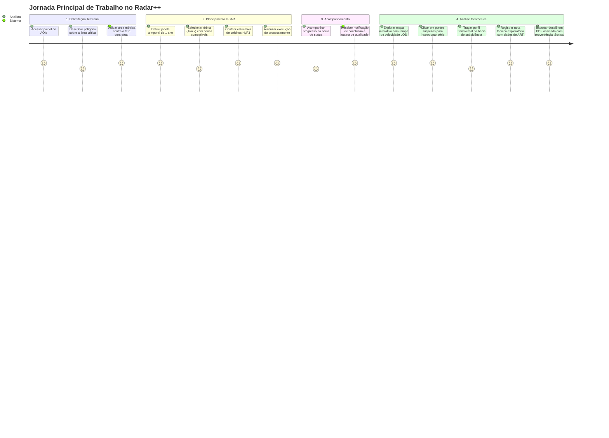

# Radar++ — Ciclo 4: Arquitetura Técnica, UML e Contratos
## Documento 09 — Arquitetura Frontend, Geovisualização e Renderização COG

**Documento:** `09-arquitetura-frontend.md`  
**Ciclo:** Ciclo 4 — Arquitetura Técnica, UML e Contratos  
**Data:** 24 de Outubro de 2026  
**Status:** Oficial — Entregue para Homologação de Arquitetura  
**Responsáveis:** Engenheiro Frontend React/TypeScript, Especialista em Geovisualização, Designer UI/UX  
**Repositório Oficial:** `api-radar-deformacao` (caminho: `docs/architecture/cycle-04/09-arquitetura-frontend.md`)  
**Regra de Governança Estrita:** Especificação conceitual e técnica de frontend. **Não modificar o código-fonte React/TypeScript existente nesta etapa.**

---

### 1. Visão Geral e Stack Tecnológica da Interface

O frontend do Radar++ é concebido como uma Single Page Application (SPA) moderna, de alta performance e visualmente sofisticada:
- **Core:** React 18+ com TypeScript estrito;
- **Build Tool:** Vite para carregamento ultrarrápido em desenvolvimento e otimização de bundle em produção;
- **Design System & Estilo:** Tailwind CSS com componentes baseados em Radix UI (shadcn/ui), modo escuro/claro nativo, contrastes acessíveis (WCAG AA);
- **Gerenciamento de Estado:** TanStack Query (React Query) para cache assíncrono de servidor, estados de requisição e invalidação reativa; Zustand para estados globais de navegação de mapa e camadas selecionadas;
- **Motor Cartográfico:** OpenLayers 9+ com plugin `geotiff` integrado (ou Leaflet com `georaster-layer-for-leaflet`);
- **Visualização Analítica de Gráficos:** Recharts / Chart.js para séries temporais de deslocamento InSAR e perfis transversais.

---

### 2. Avaliação de Estratégias para Renderização de Cloud Optimized GeoTIFF (COG)

A renderização de rasters geodésicos a partir de um storage Amazon S3 privado impõe desafios de performance e segurança:

```
+----------------------------------------------------------------------------------------------------------------------------------------------------+
|                                    AVALIAÇÃO DE ESTRATÉGIAS DE RENDERIZAÇÃO DE COG EM S3 PRIVADO                                                   |
+--------------------+---------------------------------------+---------------------------------------+-----------------------------------------------+
| Critério           | Estratégia 1: Leitura Direta no       | Estratégia 2: Tile Server Dedicado    | Estratégia 3: Pré-geração de Camadas XYZ/Tiles |
|                    | Navegador (geotiff.js / OpenLayers)   | (TiTiler em Python / FastAPI)         | (Pirâmides PNG geradas em lote)               |
+--------------------+---------------------------------------+---------------------------------------+-----------------------------------------------+
| **Complexidade**   | **Baixa:** Executa 100% no cliente.   | **Média-Alta:** Exige manter novo     | **Alta:** Exige pipeline extra de mosaico      |
| **de Infra**       | Zero contêineres de backend adicionais.| serviço de tile server em execução.   | e consome muito mais espaço no S3.            |
+--------------------+---------------------------------------+---------------------------------------+-----------------------------------------------+
| **Custo de Nuvem** | **Quase Zero:** Apenas requisições    | Custo contínuo de contêiner ECS/Fargate| Custo de processamento extra para fatiar      |
|                    | HTTP Range normais no S3.             | rodando TiTiler ($30-60/mês).         | milhares de imagens PNG por produto.          |
+--------------------+---------------------------------------+---------------------------------------+-----------------------------------------------+
| **Compatibilidade**| **Perfeita:** O navegador faz GET via | Complexa: Exige passar credenciais AWS| Boa, mas arquivos estáticos PNG perdem        |
| **com S3 Privado** | Presigned URL diretamente ao S3.      | ou token de autenticação ao TiTiler.  | os valores numéricos reais dos pixels em mm.  |
+--------------------+---------------------------------------+---------------------------------------+-----------------------------------------------+
| **Inspeção de**    | **Nativa:** O pixel preserva o valor  | Exige endpoint extra de point query   | Impossível: PNG RGB só tem cores, perde a     |
| **Valores Reais**  | float real de velocidade ($\text{mm}$).| para retornar o valor float.          | matriz geodésica flutuante original.          |
+--------------------+---------------------------------------+---------------------------------------+-----------------------------------------------+
| **Parecer Técnico**| **SELECIONADA PARA O MVP (ADR-004):** | **Alternativa Futura (Fase 2):**      | **Rejeitada:** Perda inaceitável de precisão  |
|                    | Eficiente, barata e matematicamente   | Recomendada apenas se houver clientes | científica e explosão de pequenos arquivos    |
|                    | precisa.                              | de baixo poder computacional (mobile).| no S3.                                        |
+--------------------+---------------------------------------+---------------------------------------+-----------------------------------------------+
```

---

### 3. Estrutura de Módulos e Páginas do Frontend

```
src/
├── app/
│   ├── routes.tsx                    <-- Roteamento declarativo com React Router v6
│   └── layout/                       <-- Layout principal (Sidebar colapsável, Topbar, Status)
│
├── modules/
│   ├── territory/                    <-- MÓDULO DE GESTÃO TERRITORIAL
│   │   ├── pages/AoiListPage.tsx     <-- Listagem de AOIs e métricas de área
│   │   ├── pages/AoiCreatePage.tsx   <-- Desenho interativo de polígono ou upload de Shapefile/GeoJSON
│   │   └── components/AoiMapDraw.tsx <-- Ferramenta Leaflet-Geoman para desenho vetorial
│   │
│   ├── catalog/                      <-- MÓDULO DE CATÁLOGO E SELEÇÃO SAR
│   │   ├── pages/SceneSearchPage.tsx <-- Filtro temporal, escolha de órbita (Path) e visualização de cenas
│   │   └── components/BaselineGraph.tsx <-- Gráfico da rede temporal de pares (Bperp x Tempo)
│   │
│   ├── processing/                   <-- MÓDULO DE JOBS E TELEMETRIA
│   │   ├── pages/JobMonitoringPage.tsx <-- Acompanhamento em tempo real de jobs assíncronos (Polling/SSE)
│   │   └── components/StepProgress.tsx <-- Barra de passos (Corregistro, SNAPHU, MintPy, COG)
│   │
│   └── geoviewer/                    <-- MÓDULO CENTRAL DE GEOVISUALIZAÇÃO ANALÍTICA
│       ├── pages/AnalysisViewerPage.tsx <-- Workspace principal de exploração geodésica
│       ├── components/MapCanvas.tsx   <-- Canvas OpenLayers com camada raster COG e basemap OSM/Satélite
│       ├── components/LayerControl.tsx<-- Alternância entre Velocidade Anual, Coerência e Séries
│       ├── components/ColorPaletteLegend.tsx <-- Legenda em mm/ano com limiares e rampa de cores
│       ├── components/TimeSeriesDrawer.tsx   <-- Drawer inferior com curva cinemática ao clicar no pixel
│       ├── components/QualityBadge.tsx       <-- Indicador visual de conformidade (Aprovado / Restrito)
│       └── components/CrossSectionModal.tsx  <-- Ferramenta para traçar linha de perfil e ver bacia
│
└── shared/
    ├── api/                          <-- Cliente Axios configurado com interceptor JWT e base URL
    ├── components/ui/                <-- Componentes shadcn/ui (Button, Dialog, Badge, Tooltip)
    └── hooks/                        <-- Hooks reutilizáveis (useAoi, useAnalysis, usePresignedUrl)
```

---

### 4. Jornada Principal do Usuário (User Journey)

A navegação foi projetada para ser linear, intuitiva e à prova de falhas:



---

### 5. Wireframes Conceituais e Layout da Interface

#### 5.1. Painel Principal de Geovisualização (`AnalysisViewerPage`)
```
+----------------------------------------------------------------------------------------------------------------+
|  RADAR++  |  AOI: Maceió - Mutange (Track 142)  |  Status: [ APROVADO ]  | Coerência: 0.54  | Usuário: eng_carlos  |
+-------------------------------------------------+--------------------------------------------------------------+
|  PAINEL DE CAMADAS (Esquerda)                   |  MAPA INTERATIVO (Centro / Canvas WebGL)                     |
|  [X] Velocidade Média Anual (LOS mm/ano)        |                                                              |
|      Opacidade: [====|===] 80%                  |   [ Satélite | Topo | OSM ]              [Zoom + / -]        |
|  [ ] Mapa de Coerência Espacial                 |                                                              |
|  [ ] Máscara de Decorrelação                    |       ~~~~~~ Lagoa Mundaú ~~~~~~                             |
|  ---------------------------------------------  |     +----------------------------------+                     |
|  LEGENDA (mm/ano na Visada - LOS)               |     |  * Ponto de Inspeção P1          |                     |
|  [Azul]    > +10 (Soerguimento / Elevação)      |     |    (Lat: -9.635, Lon: -35.742)   |                     |
|  [Verde]   -10 a +10 (Estável)                  |     |    Velocidade: -185.4 mm/ano     |                     |
|  [Amarelo] -10 a -50 (Subsidência Moderada)     |     +----------------------------------+                     |
|  [Vermelho]-50 a -250 (Subsidência Crítica)     |                                                              |
|  ---------------------------------------------  |                                                              |
|  AÇÕES DE INVESTIGAÇÃO URBANA                   |                                                              |
|  [ Traçar Perfil Transversal A-B ]              |                                                              |
|  [ Emitir Nota Técnica Exploratória ]           |                                                              |
+-------------------------------------------------+--------------------------------------------------------------+
|  DRAWER INFERIOR: SÉRIE TEMPORAL DO PONTO P1 (Inspecionado interativamente via HTTP Range Request)             |
|   0 mm |-------------------\                                                                                   |
| -50 mm |                    \                                                                                  |
| -100 mm|                     \---------\                                                                       |
| -150 mm|                                \                                                                      |
| -200 mm|                                 \-----------------* (-184.2 mm em 28/12/2023)                         |
|        +-------------------------------------------------------------------------------------------------------+
|        Jan/2023        Mar/2023        Mai/2023        Jul/2023        Set/2023        Nov/2023        Dez/2023|
+----------------------------------------------------------------------------------------------------------------+
```
