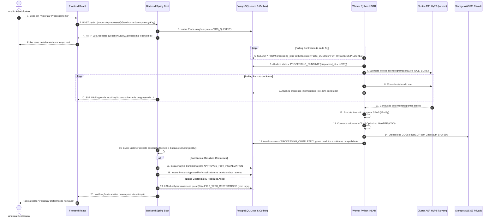

# Radar++ — Ciclo 4: Arquitetura Técnica, UML e Contratos
## Documento 10 — Processamento Assíncrono, Resiliência e Tolerância a Falhas

**Documento:** `10-processamento-assincrono.md`  
**Ciclo:** Ciclo 4 — Arquitetura Técnica, UML e Contratos  
**Data:** 24 de Outubro de 2026  
**Status:** Oficial — Entregue para Homologação de Arquitetura  
**Responsáveis:** Arquiteto de Sistemas Distribuídos, Arquiteto de Software Sênior, Engenheiro Python InSAR  
**Repositório Oficial:** `api-radar-deformacao` (caminho: `docs/architecture/cycle-04/10-processamento-assincrono.md`)  

---

### 1. Visão Geral do Ciclo Assíncrono Ponta a Ponta

O processamento interferométrico e a inversão temporal envolvem cálculos matriciais intensivos que levam de 15 a 45 minutos. Para manter a interface web interativa e evitar timeouts de rede (HTTP 504), o Radar++ implementa um **fluxo assíncrono não-bloqueante orientado a eventos**:



---

### 2. Padrão Transactional Outbox para Garantia de Entrega

Para evitar que falhas de rede entre o backend e os serviços externos gerem perda de mensagens (*Dual-Write Problem*), o Radar++ implementa o **Transactional Outbox Pattern**:

```
[Transação de Negócio do Agregado]
       │
       ├── 1. Modifica Estado do Agregado (ex.: InSarAnalysis aprovada)
       └── 2. INSERT INTO outbox_events (event_id, payload, status = 'PENDING')
       │
[COMMIT ATÔMICO NO POSTGRESQL] ◄── Garante que ou ambos gravam, ou nada grava
       │
       ▼
[Outbox Relay Worker (Spring Scheduled / Background Thread)]
       │
       ├── 3. SELECT * FROM outbox_events WHERE status = 'PENDING' FOR UPDATE SKIP LOCKED
       ├── 4. Despacha mensagem para fila interna / notificação SSE
       └── 5. UPDATE outbox_events SET status = 'PROCESSED', processed_at = NOW()
```

---

### 3. Estratégia de Resiliência e Tratamento de Falhas

---

#### 3.1. Classificação de Erros
- **Falhas Transitórias (Infraestrutura):** Instabilidades de rede temporárias, limites de taxa de requisições (*Rate Limit HTTP 429*) nas APIs da NASA/ASF ou indisponibilidade pontual do bucket S3.
- **Falhas Determinísticas (Domínio/Dados):** Geometria com polígono inválido, metadados de cenas corrompidos, arquivo SLC corrompido ou área coberta inteiramente por água/floresta densa causando decorrelação matemática absoluta no desdobramento de fase.

---

#### 3.2. Retentativas com Recuo Exponencial (*Exponential Backoff*)
Para falhas transitórias, o sistema aplica até **3 retentativas automáticas** com jitter aleatório para evitar sobrecarga sincronizada:
$$\text{Intervalo}_n = \min(120, 15 \times 2^{n}) \pm \text{random}(1, 5) \text{ segundos}$$
- Tentativa 1: após ~30 segundos;
- Tentativa 2: após ~60 segundos;
- Tentativa 3: após ~120 segundos.
Se a falha persistir após a terceira tentativa, o job é movido para o estado terminal `EXECUTION_FAILED`.

---

#### 3.3. Tolerância a Falhas Parciais em Redes SBAS
Em redes com 70 a 80 interferogramas temporais, a perda de 1 ou 2 pares devido a tempestades tropicais severas não deve inviabilizar o processamento:
1. O worker identifica os pares cujo desdobramento de fase divergiu (*phase unwrapping failure*);
2. Remove esses pares específicos da matriz de conectividade da rede;
3. Executa a checagem topológica: **se a matriz de tempo ainda mantiver conectividade redundante (sem sub-redes isoladas)**, o cálculo de inversão SVD prossegue normalmente com os pares restantes;
4. O relatório de auditoria registra formalmente o descarte dos pares afetados, preservando a transparência científica sem onerar o cliente com reprocessamentos integrais.

---

#### 3.4. Cancelamento Gracioso (*Graceful Cancellation*)
Quando um usuário com perfil `OrganizationAdmin` ou `TechnicalAnalyst` solicita o cancelamento de um job em andamento:
1. A API atualiza a linha do job no banco com o flag `cancellation_requested = true`;
2. No próximo ciclo de verificação, o worker Python intercepta o sinal e executa chamadas de cancelamento remoto (`DELETE /jobs/{jobId}`) no cluster HyP3;
3. O worker exclui os arquivos temporários da pasta `scratch/jobs/{jobId}` no S3;
4. O job é encerrado com status final `EXECUTION_CANCELLED`, liberando a cota de concorrência da organização.
