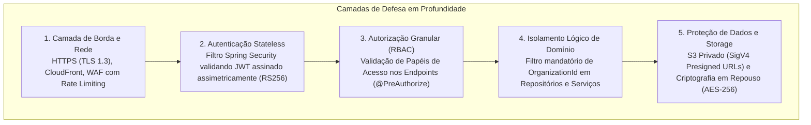

# Radar++ — Ciclo 4: Arquitetura Técnica, UML e Contratos
## Documento 11 — Segurança da Informação, Governança e Observabilidade

**Documento:** `11-seguranca-observabilidade.md`  
**Ciclo:** Ciclo 4 — Arquitetura Técnica, UML e Contratos  
**Data:** 24 de Outubro de 2026  
**Status:** Oficial — Entregue para Homologação de Arquitetura  
**Responsáveis:** Arquiteto Cloud AWS, Arquiteto de Software Sênior, Especialista em Segurança da Informação  
**Repositório Oficial:** `api-radar-deformacao` (caminho: `docs/architecture/cycle-04/11-seguranca-observabilidade.md`)  

---

### 1. Modelo de Segurança, Autenticação e Autorização

A segurança do Radar++ é estruturada sob o paradigma de **Defesa em Profundidade (*Defense in Depth*)**:



---

### 2. Papéis de Acesso e Matriz de Permissões (RBAC)

Para o MVP, definem-se três papéis de usuário padronizados:

```
+----------------------------------------------------------------------------------------------------------------------------------------------------+
|                                    MATRIZ DE CONTROLE DE ACESSO BASEADO EM PAPÉIS (RBAC)                                                           |
+---+------------------------------+---------------------------+-------------------------------------------------------------------------------------+
| # | Papel de Acesso (Role)       | Escopo de Atuação         | Permissões de Negócio Homologadas                                                   |
+---+------------------------------+---------------------------+-------------------------------------------------------------------------------------+
| 1 | `TechnicalAnalyst`           | Técnico Operacional       | Criar AOIs, pesquisar cenas SAR, solicitar processamento, visualizar COGs,          |
|   |                              |                           | consultar séries temporais, traçar perfis e registrar notas técnicas com ART.       |
+---+------------------------------+---------------------------+-------------------------------------------------------------------------------------+
| 2 | `DomainSpecialist`           | Especialista / Perito     | Todas as permissões de Analyst + autorizar gating científico manual, qualificar     |
|   |                              |                           | restrições de qualidade e homologar notas técnicas para exportação oficial.         |
+---+------------------------------+---------------------------+-------------------------------------------------------------------------------------+
| 3 | `OrganizationAdmin`          | Governança Organizacional | Todas as permissões técnicas + gerenciar usuários da organização, monitorar cotas   |
|   |                              |                           | e saldo de créditos HyP3, e autorizar cancelamento ou expurgo de análises.          |
+---+------------------------------+---------------------------+-------------------------------------------------------------------------------------+
```

---

### 3. Gestão Segura de Credenciais e Segredos

1. **Princípio do Privilégio Mínimo:** Nenhuma chave estática com permissões de administrador é embutida em código ou imagens Docker.
2. **Ambiente Local (Desenvolvimento):** Variáveis de ambiente declaradas no `.env` do Docker Compose (não versionado no Git), com credenciais mockadas para o MinIO local.
3. **Ambiente de Nuvem (Produção):**
   - Segredos corporativos (tokens de API da NASA/ASF, senhas do PostgreSQL RDS, chave privada JWT) são armazenados no **AWS Secrets Manager** e injetados nos contêineres ECS Fargate via IAM Task Execution Role.
   - O acesso ao Amazon S3 utiliza **IAM Roles for Service Accounts (IRSA)** ou perfis de instância temporários com tokens STS rotacionados a cada hora.

---

### 4. Arquitetura de Observabilidade e Monitoramento

A observabilidade do sistema assenta-se em três pilares integrados:

#### 4.1. Logs Estruturados e Rastreamento Distribuído
- **Formato:** Logs emitidos em JSON estruturado com padrão ECS (*Elastic Common Schema*);
- **ID de Correlação (*Correlation ID*):** Todo fluxo iniciado pelo frontend gera um cabeçalho `X-Correlation-ID: <UUID>`. O backend captura esse identificador e o injeta no contexto de diagnóstico de threads (*MDC — Mapped Diagnostic Context*), garantindo que todos os logs do Java e do Worker Python associados àquela requisição compartilhem o mesmo `correlationId`.

Exemplo de log JSON:
```json
{
  "timestamp": "2026-10-24T12:15:30.124Z",
  "level": "INFO",
  "logger": "com.ass.br.apiradar.insarcore.application.JobExecutionManager",
  "correlationId": "c0a80101-55bb-4122-8811-998877665544",
  "organizationId": "d3b07384-d113-40a2-9721-a53b2169b821",
  "jobId": "a1b2c3d4-e5f6-4a5b-8c9d-0123456789ab",
  "message": "Job InSAR concluído com sucesso no cluster remoto. Disparando gating científico de qualidade.",
  "durationMs": 1845000,
  "meanCoherence": 0.528
}
```

#### 4.2. Métricas de Aplicação e Negócio (Micrometer / Prometheus)
O backend expõe métricas via Spring Boot Actuator (`/actuator/prometheus`):
- `radar_jobs_submitted_total`: Total de jobs solicitados por organização;
- `radar_jobs_completed_total`: Total de jobs técnicos concluídos com sucesso;
- `radar_jobs_failed_total`: Total de jobs falhados (com tags por causa raiz);
- `radar_hyp3_credits_consumed_total`: Saldo acumulado de créditos consumidos;
- `radar_quality_gating_verdict_total`: Distribuição entre análises aprovadas, qualificadas com restrições e rejeitadas.

#### 4.3. Verificação de Saúde (*Health Checks*)
- Endpoint `/actuator/health` configurado com sondas de vivacidade (*liveness*) e prontidão (*readiness*), monitorando a conectividade com o banco PostgreSQL/PostGIS e a disponibilidade do Amazon S3.
