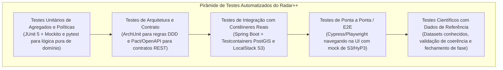

# Radar++ — Ciclo 4: Arquitetura Técnica, UML e Contratos
## Documento 12 — Estratégia Abrangente de Testes e Validação Científica

**Documento:** `12-estrategia-testes.md`  
**Ciclo:** Ciclo 4 — Arquitetura Técnica, UML e Contratos  
**Data:** 24 de Outubro de 2026  
**Status:** Oficial — Entregue para Homologação de Arquitetura  
**Responsáveis:** Especialista em Qualidade de Software, Arquiteto de Software Sênior, Especialista SAR/InSAR  
**Repositório Oficial:** `api-radar-deformacao` (caminho: `docs/architecture/cycle-04/12-estrategia-testes.md`)  
**Princípio Central de Validação:** **A conclusão com sucesso de um job computacional (Exit Code 0) ou o retorno HTTP 200 NÃO comprovam a validade física ou geodésica da medição.** A validação computacional e a validação científica são tratadas como disciplinas separadas com critérios de aceite distintos.

---

### 1. Pirâmide de Testes e Matriz de Cobertura

A estratégia de testes do Radar++ assegura alta confiabilidade por meio de múltiplas camadas complementares:



---

### 2. Especificação das Camadas de Testes Automatizados

---

#### 2.1. Testes Unitários de Agregados e Políticas (Pure Domain Tests)
* **Objetivo:** Validar invariantes matemáticas e regras de negócio sem inicializar o contexto do Spring ou conectar a bancos de dados.
* **Escopo:**
  - `AreaOfInterestTest`: Validação de anel poligonal fechado, rejeição de auto-interseções e cálculo métrico de área;
  - `SceneCompatibilityPolicyTest`: Garantia de rejeição de pares com órbitas diferentes, polarizações divergentes ou sensores incompatíveis;
  - `QualityGatingPolicyTest`: Teste determinístico das regras de aprovação plena ($\bar{\gamma} \ge 0{,}40$, resíduos $\le 15\%$), aprovação com restrições e rejeição;
  - `DisplacementValueTest`: Imutabilidade da unidade $\text{mm}_{\text{LOS}}$ e proibição de projeção vertical sem ângulo de incidência.
* **Ferramental:** JUnit 5, AssertJ. Tempo de execução da suíte: $< 5$ segundos.

---

#### 2.2. Testes de Arquitetura (ArchUnit)
* **Objetivo:** Garantir a integridade da Arquitetura Hexagonal e do Monólito Modular em tempo de compilação/teste, impedindo degradação da estrutura ao longo do desenvolvimento.
* **Regras Verificadas:**
  ```java
  // 1. O domínio não pode importar nada de frameworks ou infraestrutura
  noClasses().that().resideInAPackage("..domain..")
      .should().dependOnClassesThat().resideInAnyPackage("org.springframework..", "jakarta.persistence..")
      .check(importedClasses);

  // 2. Dependência unidirecional entre módulos (territory não conhece insarcore)
  noClasses().that().resideInAPackage("..territory..")
      .should().dependOnClassesThat().resideInAPackage("..insarcore..")
      .check(importedClasses);
  ```

---

#### 2.3. Testes de Integração com Contêineres Reais (Testcontainers)
* **Objetivo:** Testar os adaptadores de banco de dados e storage contra instâncias reais em contêineres Docker descartáveis, sem mocks frágeis.
* **Infraestrutura:**
  - `PostgreSQLContainer` com imagem oficial PostGIS (`postgis/postgis:16-3.4`);
  - `LocalStackContainer` emulando o Amazon S3 com suporte a geração e consumo de Presigned URLs.
* **Cenários Cobertos:**
  - Consultas espaciais PostGIS com operadores `ST_Intersects`, `ST_Contains` e `ST_Area`;
  - Despacho e consumo de eventos via Transactional Outbox;
  - Upload e verificação de integridade de arquivos com SHA-256 no S3.

---

#### 2.4. Testes do Worker Científico Python
* **Objetivo:** Garantir a correta orquestração dos scripts de inversão, conversão de COG e formatação de saídas.
* **Ferramental:** `pytest`, `pytest-mock`.
* **Cenários:**
  - Mock da API NASA ASF e do SDK HyP3;
  - Geração de GeoTIFF sintético e validação da conversão em COG (presença de blocos $256 \times 256$ e overviews válidos);
  - Extração de métricas de resíduos com SNAPHU simulado.

---

### 3. Validação Científica com Dados de Referência

A validação científica do Radar++ é realizada contra dados conhecidos e séries de referência:

```
+----------------------------------------------------------------------------------------------------------------------------------------------------+
|                                    MATRIZ DE VALIDAÇÃO E CALIBRAÇÃO CIENTÍFICA                                                                     |
+---+------------------------------+---------------------------------------+-------------------------------------------------------------------------+
| # | Teste Científico             | Método de Validação                   | Critério de Aceite Físico / Tolerância                                  |
+---+------------------------------+---------------------------------------+-------------------------------------------------------------------------+
| 1 | **Fechamento de Fase**       | Triangulação em laços fechados de     | Erro de fechamento residual $< 0{,}2$ radianos na média da rede.        |
|   | *(Phase Loop Closure)*       | três interferogramas ($A-B, B-C, C-A$).| Detecta saltos de desdobramento e decorrelação atmosférica severa.      |
+---+------------------------------+---------------------------------------+-------------------------------------------------------------------------+
| 2 | **Calibração de Estabilidade**| Monitoramento de área estável externa | Velocidade média observada em área estável de rocha cristalina          |
|   | *(Stable Ground Zero-Check)* | à bacia de subsidência de Maceió.     | deve situar-se no intervalo de $\pm 5\,\text{mm/ano}$.                  |
+---+------------------------------+---------------------------------------+-------------------------------------------------------------------------+
| 3 | **Ponto de Referência**      | Sensibilidade da escolha do pixel de  | A variação de velocidade ao deslocar o ponto de referência para um      |
|   | *(Reference Pixel Offset)*   | referência (*Ground Seed*).           | ponto vizinho de alta coerência deve ser $< 3\,\text{mm/ano}$.          |
+---+------------------------------+---------------------------------------+-------------------------------------------------------------------------+
| 4 | **Sintonia com GNSS/Marcos** | Comparação da série InSAR com marcos  | A curva de tendência em LOS projetada deve apresentar correlação        |
|   | *(External Benchmark Check)* | topográficos conhecidos (CPRM/Braskem)| linear $R^2 \ge 0{,}85$ com os dados de solo após calibração angular.   |
+---+------------------------------+---------------------------------------+-------------------------------------------------------------------------+
```

---

### 4. Testes de Falha, Resiliência e Recuperação de Desastres

1. **Simulação de Queda de Rede durante o Job:** Derrubada deliberada do contêiner do worker durante a fase de inversão MintPy para certificar que a transação no PostgreSQL é desfeita e o job retorna à fila para nova tentativa;
2. **Esgotamento de Retentativas:** Simulação de erro 500 persistente na API da NASA para confirmar que o job atinge o estado final `EXECUTION_FAILED` após 3 tentativas com *backoff*, registrando a causa raiz;
3. **Cancelamento em Voo:** Envio do comando `CancelProcessingJobCommand` com job em andamento para assegurar exclusão de arquivos efêmeros na pasta `scratch/` e aborto da tarefa no HyP3.
