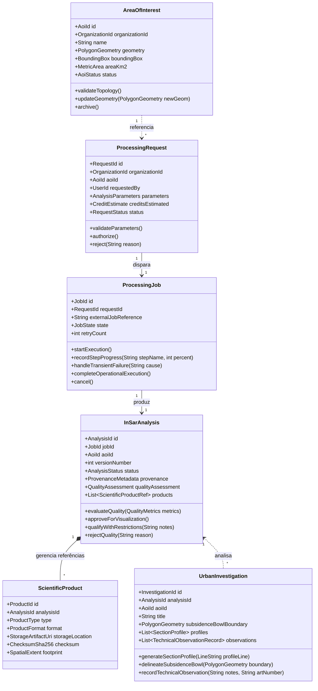
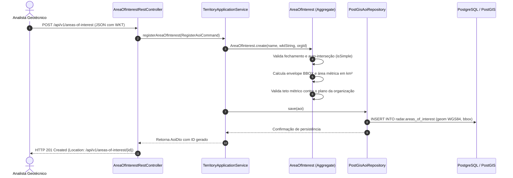
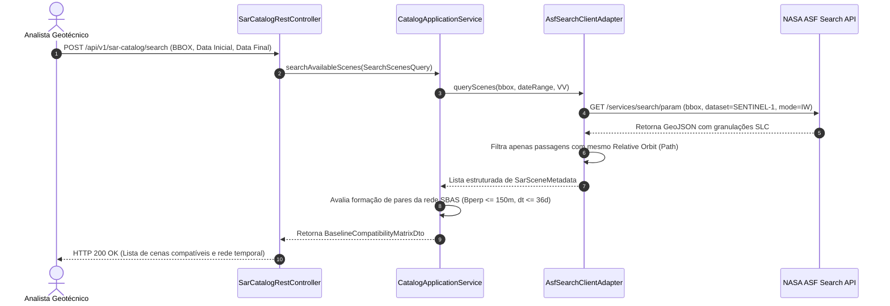
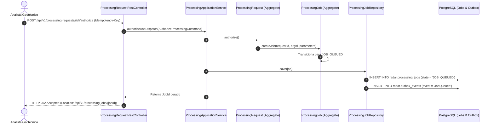
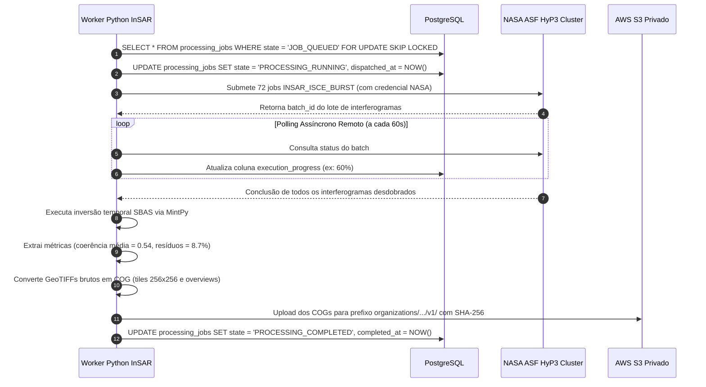
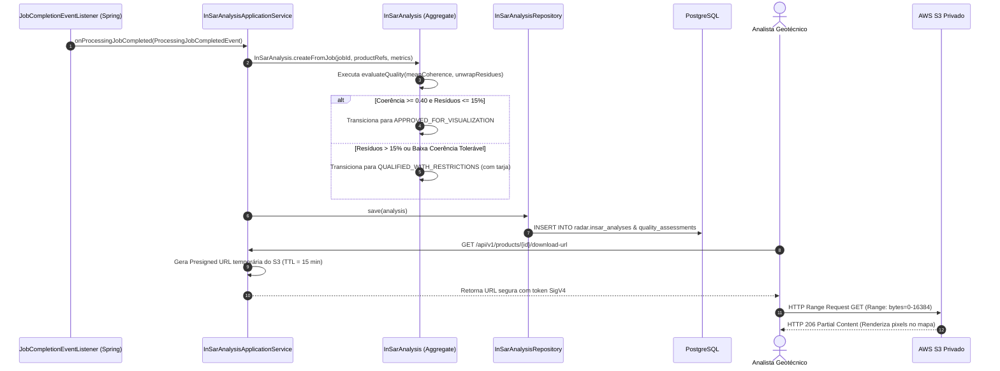
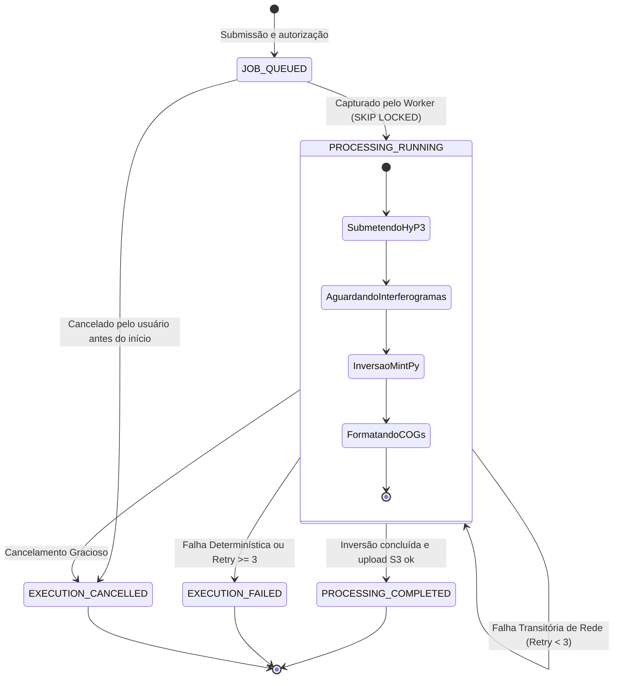
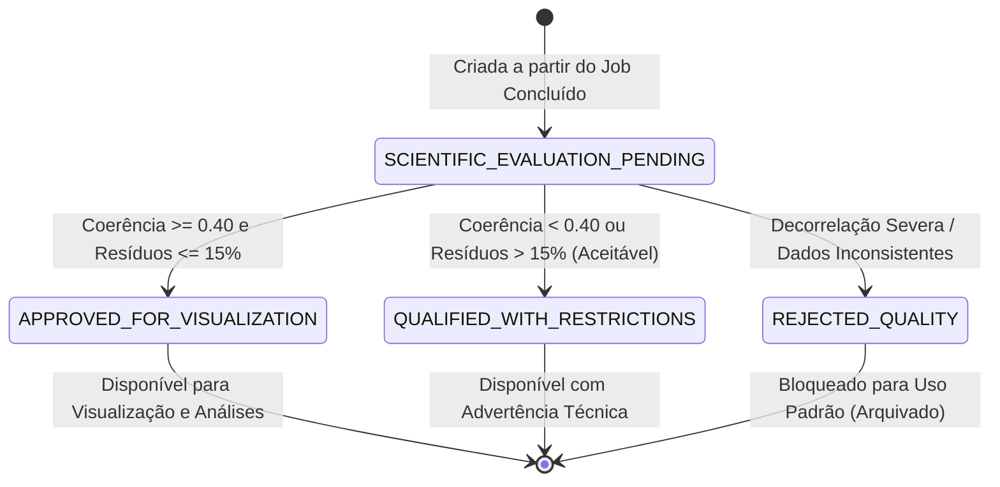

# Radar++ — Ciclo 4: Arquitetura Técnica, UML e Contratos
## Documento 13 — Suíte Completa de Diagramas UML Técnicos e Comportamentais

**Documento:** `13-diagramas-uml.md`  
**Ciclo:** Ciclo 4 — Arquitetura Técnica, UML e Contratos  
**Data:** 24 de Outubro de 2026  
**Status:** Oficial — Entregue para Homologação de Arquitetura  
**Responsáveis:** Arquiteto de Software Sênior, Especialista em DDD, Modelador UML  
**Repositório Oficial:** `api-radar-deformacao` (caminho: `docs/architecture/cycle-04/13-diagramas-uml.md`)  
**Aviso Conceitual:** Todos os diagramas representam **desenhos técnicos de arquitetura e contratos**, alinhados ao Monólito Modular Java/Spring Boot e aos Workers Python InSAR.

---

### 1. Diagrama de Classes Técnicas de Domínio e Persistência

---

### 2. Diagrama de Sequência: Criação e Validação de Área de Interesse (AOI)

---

### 3. Diagrama de Sequência: Descoberta de Cenas e Avaliação de Pares

---

### 4. Diagrama de Sequência: Submissão e Despacho de Job Assíncrono

---

### 5. Diagrama de Sequência: Execução Científica pelo Worker Python

---

### 6. Diagrama de Sequência: Gating de Qualidade e Disponibilização de Produtos

---

### 7. Diagramas de Estados Técnicos

#### 7.1. Máquina de Estados do Job (`ProcessingJob`)

#### 7.2. Máquina de Estados da Análise (`InSarAnalysis`)

