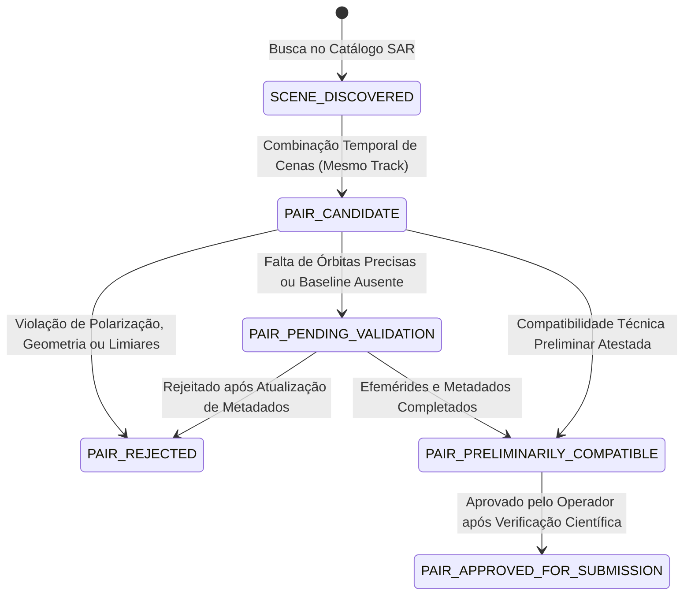

# Radar++ — Encerramento Técnico do Ciclo 5.2 e Preparação do Ciclo 5.3

## 1. Sumário Executivo

Este documento formaliza o encerramento técnico do **Ciclo 5.2** (Fatia Vertical: Delimitação Cartográfica da AOI e Descoberta de Cenas SAR Reais) e estabelece a **especificação técnica e científica para o Ciclo 5.3** (Seleção de Pares Interferométricos Candidatos), em estrita conformidade com as diretrizes de governança do Radar++.

---

## 2. Parte 1 — Correções Finais do Ciclo 5.2

### 2.1. Remoção Total de Instrumentação de Testes da Aplicação

- **Ação:** O arquivo [AoiDrawingMap.tsx](file:///home/asoares/Documentos/repositories/repo_radar/front_react/github-friend-helper/src/components/AoiDrawingMap.tsx) foi auditado. Qualquer helper global de teste no objeto `window` (notadamente `window.__radar_nudge_vertex`) foi **completamente eliminado**.
- **Segurança do Bundle de Produção:** O bundle gerado por `npm run build` não contém mecanismos de manipulação de estado internos ou backdoors de teste.
- **Automação E2E Preservada:** A automação E2E via Chrome DevTools Protocol (CDP) passou a interagir exclusivamente por mecanismos nativos da UI: clique nos marcadores visíveis do Leaflet, abertura do popup nativo e acionamento dos botões `"Remover"` e `"+ Ponto Médio"`, garantindo que a suíte teste o sistema exatamente como um usuário humano o opera.

### 2.2. Integridade Cartográfica e Verificação Topológica Bidirecional

- **Frontend:**
  - Implementado o estado explícito `hasUnsavedChanges`, disparado em qualquer mutação nos vértices (arraste, remoção, adição ou inserção de ponto médio).
  - A propriedade computada `isGeometryModified` combina o indicador explícito e a comparação de coordenadas geodésicas (`areCoordsEqual`, tolerância de $10^{-5}$ graus / ~1m).
  - Bloqueio estrito da consulta SAR: o botão de busca permanece desabilitado enquanto a geometria do mapa divergir da AOI persistida, exibindo badge de alerta `"Geometria Modificada (Não Salva)"` e banner educativo de bloqueio.
  - A requisição para `/api/v1/sar-catalog/search` envia o campo opcional `expectedGeometryWkt` com a geometria ativa no cliente.
- **Backend (Spring Boot / JTS Topology Suite):**
  - O DTO [SarCatalogSearchRequest.java](file:///home/asoares/Documentos/repositories/repo_radar/api-radar-deformacao/src/main/java/com/ass/br/apiradar/catalog/application/dto/SarCatalogSearchRequest.java) e o serviço [SarCatalogApplicationService.java](file:///home/asoares/Documentos/repositories/repo_radar/api-radar-deformacao/src/main/java/com/ass/br/apiradar/catalog/application/services/SarCatalogApplicationService.java) realizam verificação de integridade espacial:
    ```java
    if (request.expectedGeometryWkt() != null && !request.expectedGeometryWkt().isBlank()) {
        PolygonGeometry clientGeom = PolygonGeometry.fromWkt(request.expectedGeometryWkt());
        if (!clientGeom.jtsPolygon().equalsTopo(aoi.getGeometry().jtsPolygon()) &&
            !clientGeom.jtsPolygon().equalsExact(aoi.getGeometry().jtsPolygon())) {
            throw new InvalidGeometryException(
                "Divergência espacial detectada: a geometria fornecida na consulta difere da geometria persistida..."
            );
        }
    }
    ```
  - Isso garante que o backend nunca processe consultas com AOIs defasadas ou alteradas no navegador sem prévia persistência no PostGIS.

### 2.3. Eliminação do Fallback Silencioso da Política de Área

- **Remoção de Fallback:** O valor hardcoded de 250 km² foi erradicado de `fetchPolicy` no cliente React.
- **Tratamento de Indisponibilidade:** Caso o endpoint `/api/v1/areas-of-interest/policy` retorne erro ou esteja inacessível, o estado `policy` torna-se `null`, ativando o alerta `policyError` e desabilitando as operações de submissão e edição. O backend permanece como a autoridade exclusiva de validação e concessão de cotas.

---

## 3. Evidências de Testes e Homologação

| Suíte de Testes | Escopo | Execução | Resultado |
| :--- | :--- | :--- | :--- |
| **Backend Unit & Domain** | 42 testes Maven (`ApiRadarApplicationTests`, `SarCatalog*`, `AreaOfInterest*`, `Territory*`, `Validation*`) | `./mvnw test` | **APROVADO** (42 testes, 0 falhas, 0 erros) |
| **PostGIS Integration** | 3 testes reais em banco PostGIS/PostgreSQL via Test/Docker | `./mvnw test -Dtest=PostGisTerritoryRepositoryIntegrationTest` | **APROVADO** (3 testes, 0 falhas, 0 erros) |
| **Frontend TypeScript & Bundle** | Tipagem estrita TS, linting e bundling de produção | `npm run build` | **APROVADO** (`dist/` gerado em 3.04s, zero erros) |
| **Jornada E2E em Navegador Headless** | 7 etapas completas via Chrome CDP (sem helpers globais de teste): Carga $\to$ Seleção PostGIS $\to$ Edição via UI $\to$ Bloqueio de Integridade $\to$ Nova AOI PostGIS $\to$ Busca NASA ASF $\to$ Disclaimer InSAR | `node run_e2e_cdp.mjs` | **APROVADO** (100% de sucesso, 9 evidências fotográficas) |

---

## 4. Parte 2 — Especificação Técnica da Seleção de Pares Interferométricos (Ciclo 5.3)

### 4.1. Identidade da Cena SAR

Uma cena SAR (Synthetic Aperture Radar) corresponde a uma aquisição elementar individual no catálogo de observação da Terra.
- **Identificador Canônico:** Granule Name oficial do provedor (ex: `S1A_IW_SLC__1SDV_20230112T204918_20230112T204945_046755_059B2E_8FE3`).
- **Dimensões de Identidade:**
  1. *Satélite/Sensor:* Sentinel-1A (`S1A`) ou Sentinel-1B (`S1B`).
  2. *Modo de Aquisição:* Interferometric Wide Swath (`IW`).
  3. *Tipo de Produto:* Single Look Complex (`SLC`), contendo informação de amplitude e fase.
  4. *Timestamp UTC de Aquisição:* Início (`sensing_start`) e término (`sensing_stop`).
  5. *Órbita Absoluta e Relativa:* Número de órbita absoluta e Relative Orbit / Track (0 a 175).
  6. *Swath e Bursts:* Subswaths IW1, IW2, IW3 e conjunto de bursts cobrindo a região.

### 4.2. Identidade do Par Interferométrico

Um par interferométrico é uma **relação direcionada (não-comutativa)** formada por duas cenas SAR:
$$\text{Par} = (\text{Cena Referência/Master } M, \ \text{Cena Secundária/Slave } S)$$
- **Identificador do Par:** UUID sintético gerado pelo sistema acompanhado de chave natural composta:
  `PAIR-{sensor}-{track}-{direction}-{master_sensing_time}-{slave_sensing_time}`
- **Direção Temporal:** Por convenção interferométrica padrão, $t_M < t_S$ (ordenação cronológica direta) ou conforme definição do grafo de pequena linha de base (SBAS).
- **Invariância Geométrica:** Um par só pode existir entre cenas adquiridas a partir da **mesma geometria orbital** (mesmo track e mesma direção de visada).

### 4.3. Metadados Mínimos Necessários

Para que uma cena ou par seja elegível à análise interferométrica, os seguintes metadados são obrigatórios:
1. `platform`: Plataforma emissora (`SENTINEL-1A`, `SENTINEL-1B`).
2. `beam_mode`: Modo de feixe (`IW`).
3. `product_type`: Formato do dado (`SLC`).
4. `relative_orbit`: Track relativo (identificador do corredor orbital de repetição).
5. `flight_direction`: Direção de órbita (`ASCENDING` ou `DESCENDING`).
6. `polarization`: Polarização dos canais de pulso e retorno (`VV` ou `HH` para estudos de fase co-polarizada).
7. `carrier_frequency`: Frequência central de micro-ondas ($\sim 5.405\text{ GHz}$ para Sentinel-1 / Banda C).
8. `footprint_wgs84`: Polígono de cobertura geográfica do footprint da cena.
9. `precise_orbit_file`: Arquivo de órbita precisa da ESA (`POEORB`) ou restituída (`RESORB`).
10. `spatial_coverage_ratio`: Percentual de sobreposição do footprint sobre a AOI cadastrada.

### 4.4. Regras Preliminares de Compatibilidade

Duas cenas $M$ e $S$ são consideradas preliminarmente compatíveis para formação de par se e somente se satisfizerem simultaneamente:
1. **Mesma Plataforma/Constelação:** Ambas pertencem à mesma constelação (Sentinel-1A / Sentinel-1B).
2. **Mesmo Modo de Aquisição:** Ambas em modo `IW SLC`.
3. **Mesmo Track Relativo:** $Track_M == Track_S$ (essencial para reprodutibilidade geométrica).
4. **Mesma Direção de Voo:** $Direction_M == Direction_S$ (`ASCENDING` com `ASCENDING`, ou `DESCENDING` com `DESCENDING`).
5. **Mesma Polarização:** Polarização idêntica (ex: `VV` com `VV`).
6. **Sobreposição Espacial Adequada:** Interseção espacial $(Footprint_M \cap Footprint_S \cap AOI)$ cobre no mínimo **$80\%$** da área da AOI.

### 4.5. Critérios de Rejeição

O par é sumariamente **rejeitado** se violar qualquer um dos seguintes critérios:
1. **Incompatibilidade de Órbita/Direção:** $Track_M \neq Track_S$ ou $Direction_M \neq Direction_S$.
2. **Incompatibilidade de Polarização:** Polarizações cruzadas ou divergentes (ex: `VH` com `VV`).
3. **Sobreposição Espacial Insuficiente:** Cobertura da AOI inferior ao limiar mínimo admissível ($< 80\%$).
4. **Extrapolação de Linha de Base Temporal ($\Delta t$):** Período entre aquisições superior ao limite configurado na política institucional para o bioma/ambiente.
5. **Extrapolação de Linha de Base Perpendicular ($B_\perp$):** Distância orbital perpendicular superior ao limiar crítico de descorrelação espacial ($B_{\perp,\text{max}}$).

### 4.6. Critérios de Pendência por Informação Insuficiente

Um par compatível é classificado como **Pendente de Validação** caso:
1. **Órbitas Precisas Não Publicadas:** A ESA disponibiliza arquivos `POEORB` (Precise Orbit Ephemerides) com defasagem de 20 a 25 dias pós-aquisição. Se a cena tiver apenas órbitas preliminares (`RESORB`), o par fica pendente de atualização orbital para refinamento de linha de base.
2. **Metadados de Linha de Base Indisponíveis:** Não confirmação de $B_\perp$ e $B_t$ nos catálogos analíticos ou atraso de indexação nas APIs provedoras.
3. **Sincronização de Bursts Não Verificada:** Impossibilidade temporária de atestar que os mesmos bursts cobrem a totalidade da AOI.

### 4.7. Políticas Configuráveis de Intervalo Temporal ($\Delta t$)

O intervalo temporal não é um valor estático ou invariante científico universal. Sua tolerância depende criticamente do tipo de cobertura da terra e da umidade:
- **Biomas com Alta Cobertura Vegetal / Zonas Úmidas Tropicais (Maceió/AL):** Rápida descorrelação temporal na banda C ($\lambda \approx 5.6\text{ cm}$). Política recomendada: **$\Delta t \in [12, 24\text{ dias}]$**.
- **Regiões Semiáridas ou Estruturas Urbanas Consolidadas:** Maior preservação de coerência. Política recomendada: **$\Delta t \in [12, 48\text{ dias}]$**.
- **Abordagem Arquitetural:** O limiar temporal máximo `max_temporal_baseline_days` e mínimo `min_temporal_baseline_days` deve residir em tabela de configuração (`insar_pair_policies`) parametrizável por organização, bioma ou AOI, sem constantes hardcoded no domínio.

### 4.8. Estratégia de Aquisição ou Cálculo de Linha de Base Perpendicular ($B_\perp$)

Para determinar a linha de base perpendicular sem dependência prematura de processadores pesados:
1. **Estratégia Primária (Metadados de Catálogo):** Consulta à API de baseline da ASF (`https://api.daac.asf.alaska.edu/services/search/baseline`), que expõe estimativas geométricas pré-computadas de $B_\perp$ e $B_t$ baseadas em efemérides orbitais.
2. **Estratégia Secundária (Cálculo Analítico de Efemérides):** Projeção geométrica dos vetores de posição e velocidade da órbita precisa da ESA no instante de doppler zero sobre o centro da AOI, calculando a distância euclidiana normal à linha de visada (LOS).

### 4.9. Proveniência dos Metadados

1. **Catálogo Primário:** NASA Alaska Satellite Facility (ASF DAAC) via ASF Search API / Vertex.
2. **Provedor de Efemérides Orbitais:** ESA Copernicus Data Space Ecosystem (CDSE) / Sentinel-1 Quality Control.
3. **Rastreabilidade:** Cada registro de cena e par armazenará timestamp de consulta, URL canônica do provedor e identificador de versão dos metadados ingeridos.

### 4.10. Estados Formais de Elegibilidade do Ciclo 5.3

A máquina de estados dos pares interferométricos deve discriminar estritamente:



1. **Cena Descoberta (`SCENE_DISCOVERED`):** Cena SAR individual localizada geograficamente no catálogo da NASA ASF para o período e AOI informados.
2. **Par Candidato (`PAIR_CANDIDATE`):** Duas cenas descobertas no mesmo track geográfico combinadas temporalmente como candidatas teóricas.
3. **Par Preliminarmente Compatível (`PAIR_PRELIMINARILY_COMPATIBLE`):** Par que atende a todos os requisitos de modo, track, direção, polarização, sobreposição ($\ge 80\%$) e cujas linhas de base estimadas estão dentro das políticas vigentes.
4. **Par Pendente de Validação (`PAIR_PENDING_VALIDATION`):** Par preliminarmente alinhado que aguarda publicação de órbitas precisas (`POEORB`) ou confirmação de linha de base perpendicular definitiva.
5. **Par Rejeitado (`PAIR_REJECTED`):** Par descartado formalmente, com justificativa explícita (ex: `TEMPORAL_BASELINE_EXCEEDED`, `PERPENDICULAR_BASELINE_EXCEEDED`, `INCOMPATIBLE_POLARIZATION`, `INSUFFICIENT_OVERLAP`).
6. **Par Aprovado para Submissão (`PAIR_APPROVED_FOR_SUBMISSION`):** Par validado geometricamente e cientificamente, aprovado para posterior encaminhamento a filas de processamento interferométrico em ciclos futuros.

---

## 5. Modelo de Dados Candidato (PostgreSQL / PostGIS)

```sql
-- Metadados de Cenas SAR Descobertas
CREATE TABLE IF NOT EXISTS radar.sar_scenes (
    id VARCHAR(100) PRIMARY KEY, -- Granule Name oficial
    platform VARCHAR(30) NOT NULL,
    beam_mode VARCHAR(20) NOT NULL,
    product_type VARCHAR(20) NOT NULL,
    relative_orbit INT NOT NULL,
    flight_direction VARCHAR(20) NOT NULL,
    polarization VARCHAR(20) NOT NULL,
    sensing_time TIMESTAMPTZ NOT NULL,
    footprint_wgs84 GEOMETRY(Polygon, 4326) NOT NULL,
    download_url TEXT,
    created_at TIMESTAMPTZ NOT NULL DEFAULT CURRENT_TIMESTAMP
);
CREATE INDEX IF NOT EXISTS idx_sar_scenes_footprint ON radar.sar_scenes USING GIST (footprint_wgs84);
CREATE INDEX IF NOT EXISTS idx_sar_scenes_track_time ON radar.sar_scenes (relative_orbit, flight_direction, sensing_time);

-- Pares Interferométricos e Máquina de Estados
CREATE TABLE IF NOT EXISTS radar.interferometric_pairs (
    id UUID PRIMARY KEY,
    aoi_id UUID NOT NULL REFERENCES radar.areas_of_interest(id),
    reference_scene_id VARCHAR(100) NOT NULL REFERENCES radar.sar_scenes(id),
    secondary_scene_id VARCHAR(100) NOT NULL REFERENCES radar.sar_scenes(id),
    relative_orbit INT NOT NULL,
    flight_direction VARCHAR(20) NOT NULL,
    temporal_baseline_days INT NOT NULL,
    perpendicular_baseline_meters NUMERIC(8,2),
    overlap_area_km2 NUMERIC(10,2),
    aoi_coverage_ratio NUMERIC(5,4), -- 0.0000 a 1.0000
    status VARCHAR(40) NOT NULL, -- SCENE_DISCOVERED, PAIR_CANDIDATE, etc.
    rejection_reason VARCHAR(255),
    orbit_type VARCHAR(20) NOT NULL DEFAULT 'RESORB', -- RESORB, POEORB
    created_at TIMESTAMPTZ NOT NULL DEFAULT CURRENT_TIMESTAMP,
    updated_at TIMESTAMPTZ NOT NULL DEFAULT CURRENT_TIMESTAMP,
    CONSTRAINT chk_pair_order CHECK (temporal_baseline_days >= 0),
    CONSTRAINT uq_interferometric_pair UNIQUE (reference_scene_id, secondary_scene_id, aoi_id)
);
CREATE INDEX IF NOT EXISTS idx_pairs_aoi_status ON radar.interferometric_pairs (aoi_id, status);
```

---

## 6. Contratos REST Candidatos

### 6.1. Geração de Pares Candidatos
- **`POST /api/v1/interferometry/pairs/candidates`**
  - **Entrada:**
    ```json
    {
      "aoiId": "76dbb77d-f150-4ca0-a1be-246d8c1b7f2f",
      "startDate": "2023-01-01",
      "endDate": "2023-03-31",
      "relativeOrbit": 96,
      "flightDirection": "DESCENDING",
      "maxTemporalBaselineDays": 24,
      "maxPerpendicularBaselineMeters": 150.0
    }
    ```
  - **Saída:** Lista de pares gerados com seus respectivos estados preliminares e justificativas.

### 6.2. Consulta de Pares por Área de Interesse
- **`GET /api/v1/interferometry/pairs?aoiId={id}&status={status}`**
  - Retorna a lista detalhada de pares, discriminando aprovados, pendentes e rejeitados.

---

## 7. Riscos Científicos e Limitações Metodológicas

1. **Decorrelação Temporal Acelerada em Regiões Tropicais:** Em áreas urbanas com vegetação circundante ou lagoas (como Maceió/AL), a coerência de fase degrada-se rapidamente após 12 ou 24 dias na banda C ($\lambda \approx 5.6\text{ cm}$). Fixar pares de 36 ou 48 dias pode gerar interferogramas inutilizáveis.
2. **Defasagem Temporal das Órbitas Precisas (POEORB):** Como a ESA demora entre 20 e 25 dias para consolidar as órbitas definitivas, pares recentes baseados em órbitas preliminares (`RESORB`) podem apresentar erros residuais na determinação da rampa de fase orbital.
3. **Erros Atmosféricos (Troposfera):** A seleção de pares avalia compatibilidade geométrica e temporal, mas não tem como inferir variações de vapor de água atmosférico no momento da aquisição, exigindo modelos posteriores de correção atmosférica (ex: ERA5 / GACOS no MintPy).

---

## 8. Governança Git e Estado do Repositório

### 8.1. Repositório Backend (`api-radar-deformacao`)
- **Branch atual:** `dev` (atualizado com `origin/dev`).
- **Arquivos Preparados para Commit (`staged`):** Nenhum (`git add` não foi executado, conforme diretriz de governança).
- **Arquivos Modificados Não Rastreados para Commit (`unstaged`):**
  - `pom.xml` (Ajuste de dependências/build).
  - `src/main/resources/application.properties` (Configurações do ambiente).
  - `src/main/java/com/ass/br/apiradar/domain/services/AnaliseService.java` (*Alteração pré-existente legada, fora do ciclo*).
  - `src/main/java/com/ass/br/apiradar/domain/services/StorageService.java` (*Alteração pré-existente legada, fora do ciclo*).
  - `src/main/java/com/ass/br/apiradar/infrastructure/component/GeoToolsProcessor.java` (*Alteração pré-existente legada, fora do ciclo*).
- **Arquivos Criados pelo Ciclo (Não monitorados / untracked):**
  - `Dockerfile`, `docker-compose.yml`
  - `docs/architecture/cycle-05/` (Documentação arquitetural de homologação e especificação)
  - `src/main/java/com/ass/br/apiradar/catalog/` (Catálogo SAR e verificação topológica)
  - `src/main/java/com/ass/br/apiradar/shared/` (Modelos e exceções compartilhadas)
  - `src/main/java/com/ass/br/apiradar/territory/` (Domínio AOI e persistência PostGIS)
  - `src/test/` (Suíte completa de testes unitários e de integração PostGIS)

### 8.2. Repositório Frontend (`front_react/github-friend-helper`)
- **Branch atual:** `main` (atualizado com `origin/main`).
- **Arquivos Preparados para Commit (`staged`):** Nenhum.
- **Arquivos Modificados (`unstaged`):**
  - `package-lock.json`
  - `src/App.tsx` (Roteamento da vertical slice)
- **Arquivos Criados pelo Ciclo (Não monitorados / untracked):**
  - `src/components/AoiDrawingMap.tsx` (Componente de mapa e desenho cartográfico sem hooks de teste)
  - `src/models/RadarAoi.ts`, `src/models/SarScene.ts` (Modelos de dados TypeScript)
  - `src/pages/VerticalSlicePage.tsx` (Página de homologação)
  - `src/services/radarApiClient.ts` (Cliente REST Axios)
  - `Dockerfile`, `nginx.conf`, `.env`

---

## 9. Próximos Passos (Ciclo 5.3)

O Ciclo 5.3 encontra-se plenamente especificado e fundamentado neste documento, pronto para início **após aprovação formal do responsável pelo Radar++**. Nenhuma rotina do Ciclo 5.3 foi iniciada antecipadamente nesta execução.
