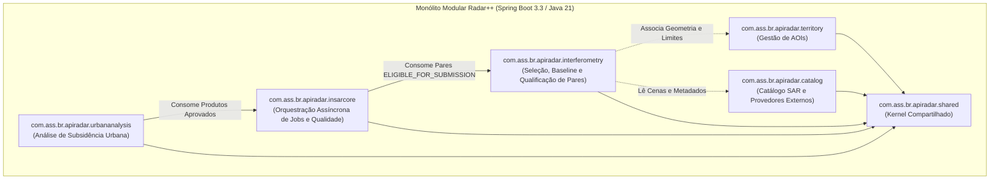

# Radar++ — Decisão Arquitetural (ADR-007)
## Módulo `interferometry` como Bounded Context Autônomo no Monólito Modular

**Documento:** `10-decisao-arquitetural-modulo-interferometry.md`  
**Ciclo:** Ciclo 5.3.1 — Homologação Científica e Decisões Arquiteturais  
**Data:** 26 de Outubro de 2026  
**Status:** **Aprovada (Oficial)**  
**Referência Cruzada:** ADR-002 (`docs/architecture/cycle-04/14-adrs-e-decisoes-pendentes.md`) e `03-modulos-java.md`  

---

### 1. Contexto

Durante a concepção arquitetural do Ciclo 4 (ADR-002), o backend do Radar++ foi projetado como um **Monólito Modular** baseado em quatro contextos delimitados principais:
1. `territory`: Gestão territorial e delimitação de AOIs.
2. `catalog`: Descoberta de cenas SAR brutas em provedores espaciais.
3. `insarcore`: Orquestração assíncrona de jobs InSAR, ingestão de produtos e gating de qualidade.
4. `urbananalysis`: Análise geotécnica de subsidência, perfis topográficos e notas técnicas.

No desenho original de `03-modulos-java.md`, a verificação de compatibilidade de pares aparecia pontualmente como uma função auxiliar do catálogo (`evaluatePairNetwork`). Contudo, o desenvolvimento do Ciclo 5.3 e a auditoria científica 5.3.1 demonstraram que a **seleção, combinação, validação física e qualificação metodológica de pares interferométricos** possui:
- Agregados e entidades complexas com identidade própria (`InterferometricPair`, `PairIdentifier`, `PairCompatibilityAssessment`).
- Máquina de estados com 5 níveis de maturidade (`PairEligibilityStatus`: `CANDIDATE`, `PRELIMINARILY_COMPATIBLE`, `PENDING_VALIDATION`, `REJECTED`, `ELIGIBLE_FOR_SUBMISSION`).
- Políticas científicas configuráveis, versionadas e com salvaguardas de clamping do servidor (`PairSelectionPolicy`).
- Portas e adaptadores de integração com serviços especializados de baseline e efemérides (`PerpendicularBaselinePort`, `AsfBaselineClientAdapter`).
- Algoritmos de formação combinatória com controle estrito de escalabilidade temporal e espacial ($O(N^2)$).

---

### 2. Decisão Arquitetural

Formaliza-se a criação e permanência do módulo **`com.ass.br.apiradar.interferometry`** como um **Bounded Context autônomo de primeira classe no Monólito Modular**, posicionado estrategicamente como a ponte entre o `catalog` e o `insarcore`.



---

### 3. Justificativa e Alternativas Avaliadas

| Alternativa | Análise Técnica | Veredito |
| :--- | :--- | :--- |
| **A. Manter em `catalog`** | Violaria o Princípio da Responsabilidade Única (SRP). O módulo `catalog` deve ser agnóstico à técnica de processamento (focado em ingestão/busca geoespacial de cenas). Misturar políticas interferométricas poluiria o catálogo com regras de física de deformação. | **REJEITADA** |
| **B. Mover diretamente para `insarcore`** | O módulo `insarcore` é voltado para o ciclo operacional assíncrono (despacho de jobs, filas PostgreSQL, download de COGs, SNAP/MintPy e portão de qualidade pós-processamento). Forçar a seleção de pares dentro dele acoplaria prematuramente a exploração interativa do usuário no frontend com a pesada esteira de jobs assíncronos. | **REJEITADA** |
| **C. Extrair como Microsserviço Independente** | Introduziria complexidade desnecessária para o estágio atual (redes, latência HTTP inter-serviços, serialização JSON e dual-deploy), contrariando a ADR-002 do Ciclo 4. | **REJEITADA** |
| **D. Módulo Dedicado `interferometry` (Monólito Modular)** | Isola o modelo conceitual de interferometria, permite testes de unidade ultrarrápidos (67 testes executam em < 1s), preserva independência das políticas científicas e fornece contratos limpos para o futuro despacho no Ciclo 5.4. | **APROVADA** |

---

### 4. Estrutura Canônica do Módulo `interferometry`

O módulo segue rigorosamente a Arquitetura Hexagonal:
```
com.ass.br.apiradar.interferometry/
├── domain/
│   ├── model/                  <-- InterferometricPair, PairIdentifier, BaselineValue, PairEligibilityStatus, PairSelectionPolicy
│   ├── ports/output/           <-- PerpendicularBaselinePort (SPI)
│   └── service/                <-- PairFormationService (algoritmo combinatório puro)
├── application/
│   ├── dto/                    <-- PairEvaluationRequest/Response, PolicyDto
│   └── InterferometricPairApplicationService.java
└── infrastructure/
    ├── adapters/output/external/<-- AsfBaselineClientAdapter (integração NASA ASF DAAC)
    └── web/                    <-- InterferometricPairController (REST API)
```

---

### 5. Regras de Acoplamento e Governança

1. **Dependência Unidirecional:** `interferometry` depende de `shared` e referencia modelos de leitura de `catalog` e `territory`.
2. **Independência de Framework no Domínio:** A camada `interferometry.domain` não possui anotações Spring, mantendo a lógica de combinação e física InSAR 100% testável em Java puro.
3. **Ponto de Integração para o Ciclo 5.4:** O serviço de orquestração assíncrona do Ciclo 5.4 consumirá exclusivamente pares que atinjam o estado `ELIGIBLE_FOR_SUBMISSION`, impedindo que análises sejam disparadas sem conformidade prévia.
