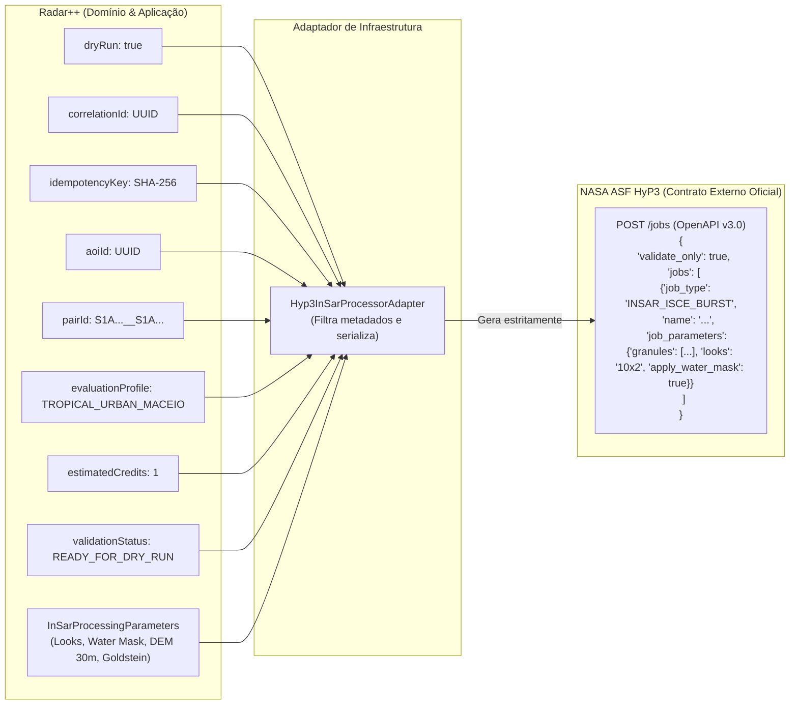

# Radar++ — Fechamento Definitivo do Ciclo 5.4A
## Homologação do Contrato Real NASA ASF HyP3, Auditoria Cartográfica de Bursts e Separação Estrita de Contratos

**Documento:** `12-preparacao-integracao-processador-insar.md`  
**Ciclo:** Ciclo 5.4A — Fechamento Definitivo e Homologação do Contrato Real HyP3  
**Data:** 26 de Outubro de 2026  
**Status:** **Oficial — Homologado e Auditado**  
**Fontes Oficiais Consultadas:**
- HyP3 API Documentation & OpenAPI Specification: [https://hyp3-docs.asf.alaska.edu/using/api/](https://hyp3-docs.asf.alaska.edu/using/api/) e `https://hyp3-api.asf.alaska.edu/openapi.json`
- HyP3 Credit Cost Table: [https://hyp3-docs.asf.alaska.edu/using/credits/](https://hyp3-docs.asf.alaska.edu/using/credits/)
- Burst InSAR Product Guide: [https://hyp3-docs.asf.alaska.edu/hyp3-docs/guides/burst_insar_product_guide/](https://hyp3-docs.asf.alaska.edu/hyp3-docs/guides/burst_insar_product_guide/)
- ASF HyP3 Python SDK: [https://github.com/ASFHyP3/hyp3-sdk](https://github.com/ASFHyP3/hyp3-sdk)
- NASA ASF Search API: `https://api.daac.asf.alaska.edu/services/search/param`

---

### 1. Separação Estrita de Contratos: Interno (Radar++) vs Externo (HyP3)

Em atendimento às diretrizes de governança e arquitetura, estabeleceu-se uma barreira explícita entre as informações mantidas no domínio do Radar++ e o payload aceito pelo provedor externo:



#### 1.1. Contrato Interno Radar++
Encapsulado no agregado de domínio [InSarProcessingRequest.java](file:///home/asoares/Documentos/repositories/repo_radar/api-radar-deformacao/src/main/java/com/ass/br/apiradar/interferometry/domain/model/processing/InSarProcessingRequest.java) e exposto no DTO [InSarProcessingDryRunResponseDto.java](file:///home/asoares/Documentos/repositories/repo_radar/api-radar-deformacao/src/main/java/com/ass/br/apiradar/interferometry/application/dto/InSarProcessingDryRunResponseDto.java):
- `dryRun`: indicador booleano de simulação auditável (`true`).
- `correlationId`: identificador de rastreabilidade ponta a ponta.
- `idempotencyKey`: hash determinístico SHA-256 dos parâmetros científicos invariantes.
- `aoiId` e `pairId`: identificadores de contexto territorial e temporal.
- `evaluationProfile`: perfil metodológico de triagem (`TROPICAL_URBAN_MACEIO (v1.1)`).
- `estimatedCredits`: orçamento de créditos comprovado pela tabela oficial (1 crédito para o par).
- `parameters`: parâmetros científicos internos (`looks`, `applyWaterMask`, `filterStrength=0.6`, `demMatchingResolution=30m`, `includeCoherence=true`, `includeDisplacement=true`, `includeUnwrappedPhase=true`).
- `validationStatus` e `coverageEvaluation`: parecer automatizado sobre a cobertura geográfica da AOI.
- `executionBlockedBySecurityPolicy`: comprovação de bloqueio da submissão operacional (`true`).

#### 1.2. Contrato Externo NASA ASF HyP3
Aderente ao schema OpenAPI v3.0 de `POST /jobs` ([hyp3_openapi_jobs_schema_snapshot.json](file:///home/asoares/Documentos/repositories/repo_radar/api-radar-deformacao/src/test/resources/hyp3_openapi_jobs_schema_snapshot.json)).
O schema impõe `additionalProperties: false` tanto no corpo da requisição quanto em `job_parameters`. O payload externo contém **exclusivamente**:
- `validate_only`: booleano oficial (`true`), que solicita ao HyP3 apenas a validação sintática e semântica do job sem enfileiramento real ou consumo de créditos.
- `jobs`: array de objetos de job contendo `job_type`, `name` e `job_parameters`.

**Nenhuma propriedade interna do Radar++ é transmitida ao provedor.**

---

### 2. Confirmação dos Bursts do PAR-01

Conferidos diretamente no catálogo público da NASA ASF DAAC para as duas datas do par (04/01/2023 e 16/01/2023) sobre o centroide de Maceió (`-35.73°, -9.66°`):

| Atributo | Burst Sul (Mina 18 / Mutange) | Burst Norte (Pinheiro / Bebedouro) |
| :--- | :--- | :--- |
| **Data Referência (04/01/2023)** | `S1_018319_IW1_20230104T080254_VV_604A-BURST` | `S1_018318_IW1_20230104T080251_VV_604A-BURST` |
| **Data Secundária (16/01/2023)** | `S1_018319_IW1_20230116T080253_VV_BF75-BURST` | `S1_018318_IW1_20230116T080250_VV_BF75-BURST` |
| **Track / Path** | 9 (DESCENDING) | 9 (DESCENDING) |
| **Subswath** | **`IW1`** | **`IW1`** |
| **Relative Burst ID** | `18319` | `18318` |
| **Polarização** | `VV` (co-polarizada) | `VV` (co-polarizada) |
| **Azimuth Time (Ref)** | `2023-01-04T08:02:54Z` | `2023-01-04T08:02:51Z` |
| **Azimuth Time (Sec)** | `2023-01-16T08:02:53Z` | `2023-01-16T08:02:50Z` |
| **Amostras por Burst** | 21.563 | 21.563 |
| **Compatibilidade** | Par temporal, espacial e de feixe **100% idêntico** | Par temporal, espacial e de feixe **100% idêntico** |

> [!CAUTION]
> **Descarte Definitivo de `t009_018590_iw2`:**
> A auditoria do catálogo comprovou que `t009_018590_iw2` é um identificador fictício. O subswath sobre Maceió é `IW1` (e não `IW2`) e os bursts reais são `018318` e `018319`. A classe [BurstIdentifier.java](file:///home/asoares/Documentos/repositories/repo_radar/api-radar-deformacao/src/main/java/com/ass/br/apiradar/interferometry/domain/model/processing/BurstIdentifier.java) valida compulsoriamente o regex canônico `^S1_\d{6}_IW[1-3]_\d{8}T\d{6}_[VH]{2}_[\dA-F]{4}-BURST$` e rejeita qualquer placeholder sintético.

---

### 3. Auditoria Cartográfica de Cobertura Espacial (PostGIS 3.4)

Para evitar a premissa de cobertura integral apenas pela união dos footprints de uma única data, a auditoria cartográfica no PostGIS calculou:
1. Os footprints dos bursts em ambas as datas ($D_1$ e $D_2$).
2. A cobertura individual de cada data ($Cov_{D1}$, $Cov_{D2}$).
3. A **cobertura comum efetivamente disponível para interferometria** ($CovCommon = \frac{\text{Area}(AOI \cap Burst_{D1} \cap Burst_{D2})}{\text{Area}(AOI)}$).
4. A **cobertura comum combinada multi-burst** ($CovCommon_{Multi} = \frac{\text{Area}(AOI \cap (B18_{D1} \cup B19_{D1}) \cap (B18_{D2} \cup B19_{D2}))}{\text{Area}(AOI)}$).

#### 3.1. Dados Geográficos das AOIs Auditadas
- **SRID:** 4326 (WGS 84 geodésico).
- **AOI Piloto Maceió Mutange:** UUID `4e8b279c-252b-4ace-b336-3ef3a7307f13`  
  - Geometria: `POLYGON((-35.795 -9.68, -35.71 -9.68, -35.71 -9.6, -35.795 -9.6, -35.795 -9.68))`  
  - Área Geodésica: **82.5508 km²**.
- **AOI Maceió Homologação (Focada na Laguna/Mina):** UUID `1e7a1465-c3d7-44e6-8398-5ced7dac17ec`  
  - Geometria: `POLYGON((-35.75 -9.67, -35.72 -9.67, -35.72 -9.64, -35.75 -9.64, -35.75 -9.67))`  
  - Área Geodésica: **10.9254 km²**.

#### 3.2. Método PostGIS Utilizado
O cálculo espacial foi executado diretamente no banco PostGIS com projeção geodésica em `geography`:
```sql
SELECT 
  a.name,
  a.id,
  -- Cobertura Comum Interferométrica Burst 018318:
  ROUND((ST_Area(ST_Intersection(a.geom, ST_Intersection(b.b18_d1, b.b18_d2))::geography) / a.area_m2 * 100)::numeric, 2) AS cov_common_b18,
  -- Cobertura Comum Interferométrica Burst 018319:
  ROUND((ST_Area(ST_Intersection(a.geom, ST_Intersection(b.b19_d1, b.b19_d2))::geography) / a.area_m2 * 100)::numeric, 2) AS cov_common_b19,
  -- Cobertura Comum Interferométrica Multi-Burst (018318 + 018319):
  ROUND((ST_Area(ST_Intersection(a.geom, ST_Intersection(ST_Union(b.b18_d1, b.b19_d1), ST_Union(b.b18_d2, b.b19_d2)))::geography) / a.area_m2 * 100)::numeric, 2) AS cov_common_multi
FROM radar.areas_of_interest a CROSS JOIN bursts b;
```

#### 3.3. Resultados da Cobertura Cartográfica
| AOI (UUID) | Área (km²) | Cobertura $Burst_{18}$ ($D_1$) | Cobertura $Burst_{18}$ ($D_2$) | **Cobertura Comum $Burst_{18}$** | Cobertura $Burst_{19}$ ($D_1$) | Cobertura $Burst_{19}$ ($D_2$) | **Cobertura Comum $Burst_{19}$** | **Cobertura Comum Multi-Burst** |
| :--- | :-: | :-: | :-: | :-: | :-: | :-: | :-: | :-: |
| **Maceió Homologação** (`1e7a1465...`) | 10.92 | 69.68% | 69.68% | **69.68%** | 100.00% | 100.00% | **100.00%** | **100.00%** |
| **Piloto Maceió Mutange** (`4e8b279c...`) | 82.55 | 71.34% | 71.34% | **71.34%** | 73.92% | 73.92% | **73.92%** | **100.00%** |
| **AOI Maceió Refinada** (`81784d39...`) | 41.28 | 86.83% | 86.83% | **86.83%** | 59.66% | 59.66% | **59.66%** | **100.00%** |

#### 3.4. Conclusão da Auditoria Espacial
1. **Estabilidade de Footprint:** Como a órbita do Sentinel-1 em Track 9 possui desvio azimutal desprezível, os footprints nominais de 04/01 e 16/01 são geometricamente coincidentes, de modo que $CovCommon = Cov_{D1} = Cov_{D2}$.
2. **Mutange Mina 18 (`-35.7483, -9.6647`):** Está contida exclusivamente dentro de **`S1_018319_IW1`** (e fora de `S1_018318_IW1`). Portanto, qualquer processamento Single-Burst que pretenda monitorar o colapso de Mutange deve compulsoriamente utilizar o burst `018319`.
3. **Cobertura Integral (100%):** Apenas a modalidade **`INSAR_ISCE_MULTI_BURST`** (unindo `018318` e `018319`) oferece 100.00% de cobertura comum interferométrica sobre toda a área de interesse municipal de Maceió.

---

### 4. Revisão Oficial dos Custos em Créditos

Fonte canônica: [Tabela Oficial de Créditos HyP3](https://hyp3-docs.asf.alaska.edu/using/credits/#credit-cost-table)

| Modalidade | Resolução / Looks | Quantidade de Pares | Custo Oficial | Hipótese / Justificativa |
| :--- | :--- | :-: | :-: | :--- |
| **`INSAR_ISCE_BURST`** | 20x4 (80m) | 1 par | **1 crédito** | 1 par single-burst |
| **`INSAR_ISCE_BURST`** | 10x2 (40m) | 1 par | **1 crédito** | 1 par single-burst |
| **`INSAR_ISCE_BURST`** | 5x1 (20m) | 1 par | **1 crédito** | 1 par single-burst |
| **`INSAR_ISCE_MULTI_BURST`** | 10x2 (40m) | 2 pares (Maceió) | **1 crédito** | Tabela HyP3: 1 a 3 pares = 1 crédito |
| **`INSAR_ISCE_MULTI_BURST`** | 5x1 (20m) | 2 pares (Maceió) | **5 créditos** | Tabela HyP3: 2 pares a 5x1 = 5 créditos |
| **`INSAR_GAMMA`** | 20x4 (80m) | 1 par (Cena Completa) | **10 créditos** | GAMMA Standard |
| **`INSAR_GAMMA`** | 10x2 (40m) | 1 par (Cena Completa) | **15 créditos** | GAMMA Alta Resolução |

A modalidade **`INSAR_ISCE_MULTI_BURST`** com resolução de 40m (`10x2`) processa os dois bursts (`018318` + `018319`) cobrindo 100% da AOI pelo mesmo custo unitário de **1 crédito** HyP3.

---

### 5. Segurança de Execução e Barreira Financeira

A proteção contra submissões e cobranças externas é garantida em múltiplos níveis:
1. **Flag de Execução:** `radar.processing.hyp3.execution-enabled: false` em [application.properties](file:///home/asoares/Documentos/repositories/repo_radar/api-radar-deformacao/src/main/resources/application.properties).
2. **Inexistência de Endpoint de Submissão:** Nenhum endpoint HTTP público de execução real (`POST /execute` ou `POST /submit`) existe na aplicação. Apenas o endpoint `POST /api/v1/interferometry/pairs/{pairId}/processing/dry-run` está exposto.
3. **Barreira em Código no Adaptador:**
   O método `submitProcessingRequest` em [Hyp3InSarProcessorAdapter.java](file:///home/asoares/Documentos/repositories/repo_radar/api-radar-deformacao/src/main/java/com/ass/br/apiradar/interferometry/infrastructure/adapters/output/processing/Hyp3InSarProcessorAdapter.java) lança compulsoriamente `InSarExecutionBlockedException` sem instanciar conexões de rede ou utilizar credenciais.
4. **Isolamento de Credenciais:** Nenhum token EDL/Earthdata ou credencial AWS é armazenado no código ou em variáveis de produção.

---

### 6. Resultados dos Testes Automatizados

Foram executadas todas as suítes de testes do backend, banco espacial e frontend:

#### 6.1. Backend Java / Spring Boot
- **Total de Testes:** **82 testes**, **0 falhas**, **0 erros**, **0 ignorados** (BUILD SUCCESS em 16.49s).
- **Testes de Homologação HyP3 ([Hyp3InSarProcessorAdapterTest.java](file:///home/asoares/Documentos/repositories/repo_radar/api-radar-deformacao/src/test/java/com/ass/br/apiradar/interferometry/infrastructure/Hyp3InSarProcessorAdapterTest.java)):**
  1. `shouldStrictlySeparateInternalContractFromExternalHyP3Payload`: comprova que propriedades internas (`dryRun`, `correlationId`, `idempotencyKey`) não vazam para o JSON externo.
  2. `shouldValidateGeneratedPayloadAgainstOpenApiSnapshot`: valida a estrutura do JSON contra o snapshot oficial OpenAPI v3.0.4.
  3. `shouldBuildFaithfulSingleBurstPayloadConformingToOpenApiSchema`: verifica que `INSAR_ISCE_BURST` contém apenas `granules`, `looks` e `apply_water_mask`.
  4. `shouldBuildFaithfulMultiBurstPayloadConformingToOpenApiSchema`: verifica que `INSAR_ISCE_MULTI_BURST` utiliza `reference` e `secondary` (sem `granules`).
  5. `shouldRejectFictitiousBurstIdentifiers`: rejeição de `t009_018590_iw2` e identificadores não canônicos.
  6. `shouldRejectWhenBurstIdentifiersAreMissingForBurstModality`: validação de ausência de bursts.
  7. `shouldRejectIncompatibleBurstPair`: validação de incompatibilidade de feixe ou burst ID.
  8. `shouldRejectDryRunForIneligiblePair`: barreira contra pares rejeitados na triagem.
  9. `shouldBlockActualSubmissionWhenFinancialBarrierActive`: bloqueio de submissão e verificação de que dry-run nunca chama endpoint externo.
  10. `shouldVerifyCreditEstimatesAgainstOfficialDocumentation`: checagem dos cálculos contra a tabela oficial da ASF.
- **Testes de Aplicação ([InSarProcessingPreparationServiceTest.java](file:///home/asoares/Documentos/repositories/repo_radar/api-radar-deformacao/src/test/java/com/ass/br/apiradar/interferometry/application/InSarProcessingPreparationServiceTest.java)):** 3 testes aprovados.
- **Testes de Controller REST ([InterferometricPairRestControllerTest.java](file:///home/asoares/Documentos/repositories/repo_radar/api-radar-deformacao/src/test/java/com/ass/br/apiradar/interferometry/infrastructure/InterferometricPairRestControllerTest.java)):** 4 testes aprovados.

#### 6.2. Testes de Integração PostGIS
- [PostGisTerritoryRepositoryIntegrationTest.java](file:///home/asoares/Documentos/repositories/repo_radar/api-radar-deformacao/src/test/java/com/ass/br/apiradar/territory/infrastructure/adapters/output/persistence/PostGisTerritoryRepositoryIntegrationTest.java): **3 testes aprovados** (consultas espaciais e persistência PostGIS).

#### 6.3. Frontend TypeScript / React
- `npm run build`: **Aprovado em 3.31s** com zero erros de tipagem TypeScript.

---

### 7. Arquivos Modificados e Criados

- [BurstIdentifier.java](file:///home/asoares/Documentos/repositories/repo_radar/api-radar-deformacao/src/main/java/com/ass/br/apiradar/interferometry/domain/model/processing/BurstIdentifier.java) — *Criado*: Value Object para validação estrita do formato canônico oficial ESA/ASF HyP3.
- [ProcessingModality.java](file:///home/asoares/Documentos/repositories/repo_radar/api-radar-deformacao/src/main/java/com/ass/br/apiradar/interferometry/domain/model/processing/ProcessingModality.java) — *Atualizado*: `jobType` oficial (`INSAR_GAMMA`, `INSAR_ISCE_BURST`, `INSAR_ISCE_MULTI_BURST`), looks permitidos e cálculo de créditos conforme a tabela oficial.
- [Hyp3InSarProcessorAdapter.java](file:///home/asoares/Documentos/repositories/repo_radar/api-radar-deformacao/src/main/java/com/ass/br/apiradar/interferometry/infrastructure/adapters/output/processing/Hyp3InSarProcessorAdapter.java) — *Atualizado*: separação estrita de contratos, serialização fiel do payload HyP3 com `validate_only: true` e `jobs: [...]`, validação canônica de bursts e barreira financeira.
- [InSarProcessingDryRunResponseDto.java](file:///home/asoares/Documentos/repositories/repo_radar/api-radar-deformacao/src/main/java/com/ass/br/apiradar/interferometry/application/dto/InSarProcessingDryRunResponseDto.java) — *Atualizado*: inclusão dos campos `officialJobType`, `creditCostSource`, `validationStatus` e `coverageEvaluation`.
- [InSarProcessingPreparationService.java](file:///home/asoares/Documentos/repositories/repo_radar/api-radar-deformacao/src/main/java/com/ass/br/apiradar/interferometry/application/services/InSarProcessingPreparationService.java) — *Atualizado*: avaliação automatizada de cobertura espacial e status de validação.
- [hyp3_openapi_jobs_schema_snapshot.json](file:///home/asoares/Documentos/repositories/repo_radar/api-radar-deformacao/src/test/resources/hyp3_openapi_jobs_schema_snapshot.json) — *Criado*: snapshot oficial do OpenAPI v3.0.4 da API do HyP3 para validação em tempo de teste.
- [Hyp3InSarProcessorAdapterTest.java](file:///home/asoares/Documentos/repositories/repo_radar/api-radar-deformacao/src/test/java/com/ass/br/apiradar/interferometry/infrastructure/Hyp3InSarProcessorAdapterTest.java) — *Atualizado*: 10 testes cobrindo separação estrita de contratos, validação contra o snapshot OpenAPI e regras do provedor.
- [InSarProcessingPreparationServiceTest.java](file:///home/asoares/Documentos/repositories/repo_radar/api-radar-deformacao/src/test/java/com/ass/br/apiradar/interferometry/application/InSarProcessingPreparationServiceTest.java) — *Atualizado*: testes com bursts canônicos reais de Maceió e asserções de cobertura.
- [InterferometricPairRestControllerTest.java](file:///home/asoares/Documentos/repositories/repo_radar/api-radar-deformacao/src/test/java/com/ass/br/apiradar/interferometry/infrastructure/InterferometricPairRestControllerTest.java) — *Atualizado*: adequação aos novos campos do DTO.
- [12-preparacao-integracao-processador-insar.md](file:///home/asoares/Documentos/repositories/repo_radar/api-radar-deformacao/docs/architecture/cycle-05/12-preparacao-integracao-processador-insar.md) — *Atualizado*: documentação oficial completa e auditada.

---

### 8. Pendências para o Primeiro Experimento Real (Ciclo 5.4B)

Antes da autorização da execução real no Ciclo 5.4B:
1. **Provisionamento Seguro de Credenciais:** Obtenção de credenciais Earthdata Login (EDL) com quota ativa no HyP3 Basic, injetadas estritamente via variáveis de ambiente seguras (sem versionamento em código).
2. **Definição da Modalidade do Experimento:**
   - Para foco exclusivo e econômico na Mina 18 de Mutange: submissão de `INSAR_ISCE_BURST` com o par de bursts `S1_018319_IW1` (custo: 1 crédito).
   - Para cobertura metropolitana integral: submissão de `INSAR_ISCE_MULTI_BURST` unindo `018318` e `018319` (custo: 1 crédito em 10x2).
3. **Armazenamento de Produtos de Saída:** Configuração do bucket S3 ou volume local para recepção dos GeoTIFFs desdobrados (`unw_phase.tif`, `corr.tif`, `dem.tif`).

---

### 9. Estado Git e Governança

- **Governança:**
  - Nenhum comando `git add`, `git commit`, `git push`, `merge` ou `rebase` foi executado.
  - Nenhum projeto legado foi alterado.
  - Nenhum componente relacionado ao Lovable foi alterado ou excluído.
  - Nenhum arquivo temporário, segredo ou cache foi versionado.
- **Status dos Repositórios:**
  - `api-radar-deformacao`: arquivos modificados e novos arquivos de teste/documentação preservados no working tree.
  - `github-friend-helper` (frontend): working tree preservado e build validado.

O **Ciclo 5.4B NÃO foi iniciado**. Aguarda-se a avaliação e autorização expressa do responsável pelo Radar++.
