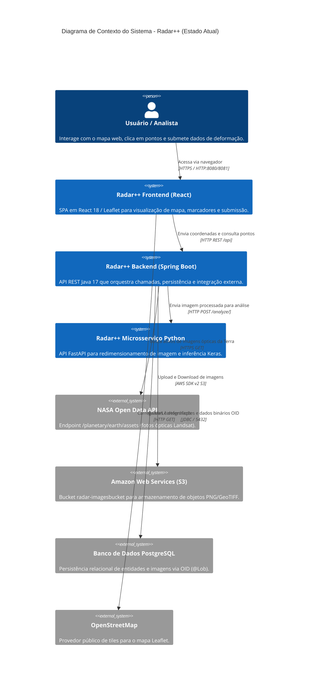
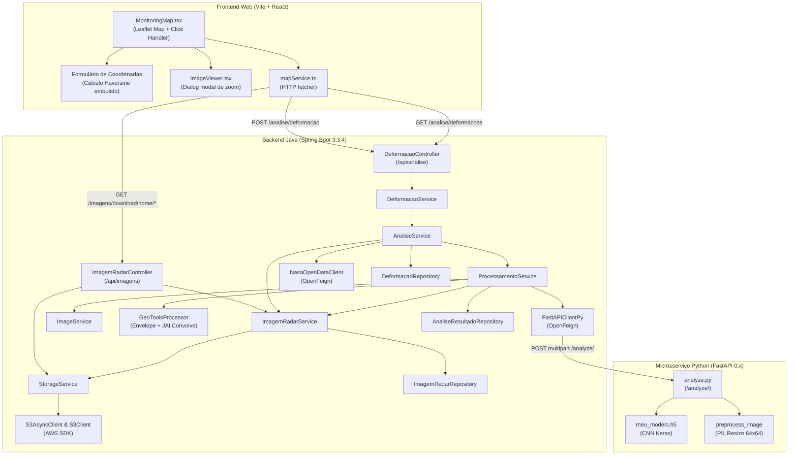
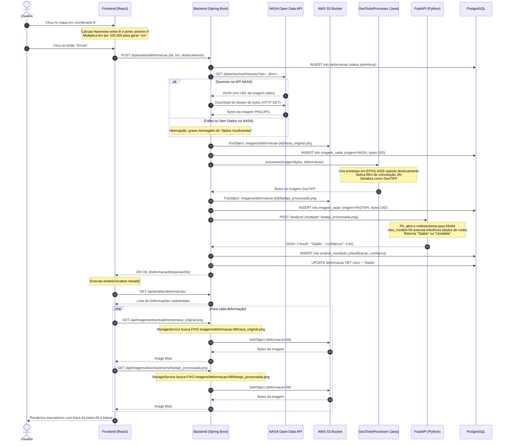
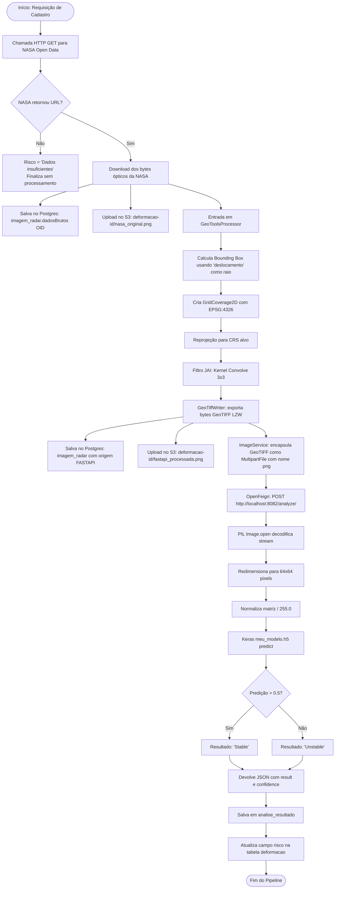

# Radar++ — Reconstrução da Arquitetura Atual e Fluxos do Sistema

**Documento:** `06-arquitetura-atual.md`  
**Data da Auditoria:** Outubro de 2026  
**Status:** Concluído  
**Escopo:** Reconstrução visual e descritiva da arquitetura real do Radar++, baseando-se estritamente nas implementações existentes.

---

## 1. Diagrama de Contexto do Sistema (C4 — Nível 1)

O diagrama abaixo ilustra o contexto operacional do Radar++, seus usuários, os subsistemas e as fronteiras com provedores externos:



---

## 2. Diagrama de Contêineres e Componentes (C4 — Nível 2 / 3)

Detalhamento dos componentes internos e suas conexões técnicas:



---

## 3. Diagrama do Fluxo de Requisições de Ponta a Ponta

Rastreamento sequencial do ciclo de registro de uma deformação:



---

## 4. Diagrama do Processamento de Imagens e Pipeline de Transformação



---

## 5. Mapeamento de Interrupções e Gargalos nos Fluxos

A análise arquitetural identificou quatro pontos críticos de ruptura onde o fluxo pretendido é quebrado ou substituído por atalhos artificiais:

```
[Usuário / Mapa] 
      │ 
      ▼ (1. Ruptura: Deslocamento calculado por distância euclidiana de clique)
[Frontend React] 
      │ 
      ▼ (2. Ruptura: CORS restrito a porta 8081 / Invocação síncrona bloqueante)
[Backend Spring Boot] 
      │ 
      ├─► [NASA API] (3. Ruptura: Imagem óptica Landsat, não radar SAR; falhas frequentes)
      │ 
      ├─► [Python FastAPI] (4. Ruptura: Modelo treinado em ruído aleatório uniforme)
      │ 
      └─► [AWS S3 Download] (5. Ruptura: Chave fixada na pasta deformacao-68)
```

1. **Ruptura 1 (Entrada de Dados):** Não há ingestão de parâmetros de missão de radar (passagem ascendente/descendente, ângulo de incidência, linha de base temporal/perpendicular). A entrada é baseada exclusivamente na distância de clique do mouse na tela.
2. **Ruptura 2 (Orquestração Síncrona Monolítica):** Toda a cadeia (NASA → Download → JAI → S3 → FastAPI → Banco) roda em uma única thread HTTP síncrona. Falhas de rede ou timeout quebram toda a transação.
3. **Ruptura 3 (Fonte Satelital):** Não há ingestão de dados SAR reais da ESA Copernicus ou NASA/ASF. A fonte externa é a API de fotografias da Terra da NASA.
4. **Ruptura 4 (Processamento Científico Inexistente):** Não há geração de interferogramas nem extração de fase. A análise é simulada por uma CNN alimentada por ruído estático.
5. **Ruptura 5 (Recuperação de Imagens):** A visualização no mapa é incapaz de exibir o histórico dinâmico real porque o código faz download forçado dos arquivos da pasta `deformacao-68`.
