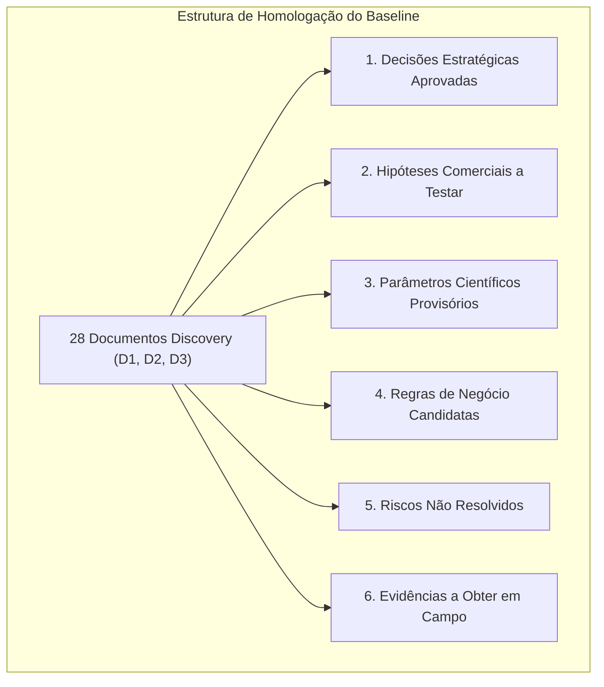

# Radar++ Discovery — D-ENC-01: Registro de Homologação Parcial do Discovery
## Consolidação Formal do Baseline de Investigação (D1, D2 e D3) e Transição para Engenharia de Domínio

**Documento:** `D-ENC-01-registro-aprovacao-discovery.md`  
**Ciclo:** Encerramento do Discovery e Preparação da Engenharia de Domínio  
**Data:** 24 de Outubro de 2026  
**Status:** Oficial — Entregue para Homologação da Governança  
**Responsável:** Equipe Multidisciplinar (Product Manager, Arquiteto de Software, Especialistas SAR e Negócios)  
**Repositório Oficial:** `api-radar-deformacao` (caminho: `docs/discovery/D-ENC-01-registro-aprovacao-discovery.md`)  
**Diretriz Epistemológica Fundamental:** Os 28 documentos produzidos no Discovery representam um **baseline investigativo preliminar**, e não especificações imutáveis de engenharia. É expressamente vedado declarar precisão milimétrica comprovada em software, coerência garantida ou validação instrumental antes da execução empírica do piloto experimental.

---

## 1. Contexto e Objetivo da Homologação Parcial

O ciclo de Discovery do Radar++ compreendeu três fases estruturadas de investigação:
* **Investigação D1:** Mercado de Subsidência Urbana, Contratos Públicos e Viabilidade Científica ([D1-01](file:///home/asoares/Documentos/repositories/repo_radar/api-radar-deformacao/docs/discovery/D1-01-mercado-subsidencia-urbana.md) a [D1-08](file:///home/asoares/Documentos/repositories/repo_radar/api-radar-deformacao/docs/discovery/D1-08-registro-saneamento.md));
* **Investigação D2:** Infraestrutura Linear (Rodovias e Ferrovias), Operadores e Modelos Comerciais ([D2-01](file:///home/asoares/Documentos/repositories/repo_radar/api-radar-deformacao/docs/discovery/D2-01-panorama-infraestrutura-linear.md) a [D2-10](file:///home/asoares/Documentos/repositories/repo_radar/api-radar-deformacao/docs/discovery/D2-10-parecer-estrategico.md));
* **Investigação D3:** Consolidação Estratégica, Tese de Produto, Capacidades e Regras ([D3-01](file:///home/asoares/Documentos/repositories/repo_radar/api-radar-deformacao/docs/discovery/D3-01-tese-produto.md) a [D3-10](file:///home/asoares/Documentos/repositories/repo_radar/api-radar-deformacao/docs/discovery/D3-10-parecer-consolidado.md)).

Este documento realiza o **fechamento formal do Discovery**, catalogando com rigor o que se tornou decisão aceita, o que permanece como hipótese aberta e quais são os limites de validação antes de qualquer esforço de implementação.

---

## 2. Registro Estruturado do Baseline Investigativo

### 2.1. Decisões Estratégicas Aprovadas Formalmente
As seguintes diretrizes estão consolidadas e orientam o produto:
1. **Hierarquia Oficial de Prioridades Inalterada:**
   * **Prioridade 1:** Subsidência e deformações urbanas (foco do piloto retrospectivo e do MVP).
   * **Prioridade 2:** Infraestrutura linear: rodovias e ferrovias (hipótese de expansão comercial pós-MVP).
   * **Prioridade 3:** Pesquisa científica e consultorias geoespaciais (usuário especialista, canal B2B2B e emissor de ART).
2. **Caso Selecionado para o Primeiro Piloto:** **Maceió/AL (Bairros Pinheiro, Mutange, Bebedouro e Bom Parto)** como piloto retrospectivo experimental (2018-2021).
3. **Posicionamento Institucional do Software:** O Radar++ é uma **plataforma analítica e de suporte à decisão geoespacial**. Não é um sistema de previsão infalível de desastres nem emite alertas imediatos de evacuação em tempo real.
4. **Isenção Formal de ART:** O sistema disponibiliza inteligência e dados de radar auditáveis; a Anotação de Responsabilidade Técnica (ART) é prerrogativa do engenheiro civil/geotécnico legalmente habilitado perante o CREA ([RN-01](file:///home/asoares/Documentos/repositories/repo_radar/api-radar-deformacao/docs/discovery/D3-05-catalogo-regras.md#L22-L37)).
5. **Padrão Operacional Inicial de Órbita Única:** Triagem inicial em linha de visada (LOS) para controle de custos, com combinação bi-orbital tratada como funcionalidade avançada opcional ([RC-01](file:///home/asoares/Documentos/repositories/repo_radar/api-radar-deformacao/docs/discovery/D3-05-catalogo-regras.md#L62-L78)).

---

### 2.2. Hipóteses Comerciais sob Investigação (Não Comprovadas)
As proposições comerciais a seguir **não são fatos de mercado**, dependendo de validação empírica nas entrevistas qualificadas ([D1-04](file:///home/asoares/Documentos/repositories/repo_radar/api-radar-deformacao/docs/discovery/D1-04-roteiro-entrevistas.md)):
1. **Hipótese de Preferência pelo Modelo sob Demanda (Modelo M3):** Supõe-se que consultorias geotécnicas preferem contratar diagnósticos retrospectivos pontuais por campanha/laudo, embutindo o custo no projeto final, em vez de assinaturas mensais recorrentes.
2. **Hipótese de Disposição a Pagar de Concessionárias Privadas:** Supõe-se que operadoras de rodovias e ferrovias pagariam assinaturas anuais por quilômetro para apoiar o SGTEC/ANTT, reduzindo custos de campo em trechos estáveis.
3. **Hipótese de Superioridade Comercial sobre Prefeituras:** Supõe-se que o ciclo de vendas corporativo B2B seja mais ágil do que o rito de contratação pública (Lei nº 14.133/2021), embora concessionárias possuam comitês de suprimentos lentos (6 a 12 meses).
4. **Hipótese de Canal B2B2B via Consultorias:** Supõe-se que consultorias de engenharia atuem como o principal vetor de distribuição do Radar++ para concessionárias e órgãos públicos.

---

### 2.3. Parâmetros Científicos Provisórios (Sujeitos a Calibração)
Os parâmetros a seguir foram adotados como pontos de partida teóricos da literatura SAR, devendo ser calibrados no piloto experimental de Maceió:
* **Limiar de Coerência Espacial Mínima:** $\bar{\gamma} \ge 0{,}40$ ([RT4](file:///home/asoares/Documentos/repositories/repo_radar/api-radar-deformacao/docs/discovery/D3-05-catalogo-regras.md#L187-L190)).
* **Linha de Base Perpendicular Máxima:** $B_\perp \le 150\text{ m}$ ([RT5](file:///home/asoares/Documentos/repositories/repo_radar/api-radar-deformacao/docs/discovery/D3-05-catalogo-regras.md#L191-L194)).
* **Linha de Base Temporal Máxima entre Pares:** $\Delta t \le 48\text{ dias}$ ([RT6](file:///home/asoares/Documentos/repositories/repo_radar/api-radar-deformacao/docs/discovery/D3-05-catalogo-regras.md#L195-L198)).
* **Tolerância a Resíduos de Desdobramento (Unwrapping):** $\le 15\%$ da área válida com saltos espaciais de $2\pi$ ([RQ-02](file:///home/asoares/Documentos/repositories/repo_radar/api-radar-deformacao/docs/discovery/D3-05-catalogo-regras.md#L137-L151)).
* **Área Máxima Parametrizada por AOI:** $100\text{ km}^2$ ([RT1](file:///home/asoares/Documentos/repositories/repo_radar/api-radar-deformacao/docs/discovery/D3-05-catalogo-regras.md#L175-L178)).

---

### 2.4. Regras de Negócio Candidatas
Mapeadas em [D3-05](file:///home/asoares/Documentos/repositories/repo_radar/api-radar-deformacao/docs/discovery/D3-05-catalogo-regras.md), aguardam homologação nos fluxos de usuário:
* Obrigatoriedade de aviso legal em relatórios PDF e telas analíticas ([RN-01](file:///home/asoares/Documentos/repositories/repo_radar/api-radar-deformacao/docs/discovery/D3-05-catalogo-regras.md#L22-L37)).
* Proibição de nomenclatura de "Alerta 24h" ou "Evacuação Imediata" ([RN-02](file:///home/asoares/Documentos/repositories/repo_radar/api-radar-deformacao/docs/discovery/D3-05-catalogo-regras.md#L39-L54)).
* Isolamento lógico estrito de dados entre inquilinos (*Multi-Tenancy*) ([RS-01](file:///home/asoares/Documentos/repositories/repo_radar/api-radar-deformacao/docs/discovery/D3-05-catalogo-regras.md#L155-L170)).
* Entrega obrigatória de matrizes geodésicas em formato *Cloud Optimized GeoTIFF* (COG) ([RO-02](file:///home/asoares/Documentos/repositories/repo_radar/api-radar-deformacao/docs/discovery/D3-05-catalogo-regras.md#L106-L121)).

---

### 2.5. Riscos Não Resolvidos
Demandam monitoramento contínuo da arquitetura e da gestão de produto:
1. **Decorrelação Temporal Severa sob Mata Atlântica:** A Banda C (Sentinel-1) perde sinal em encostas de serra densamente vegetadas; soluções dependem de espalhadores artificiais ou dados futuros em Banda L (NISAR).
2. **Dependência Crítica de APIs de Provedores Terceiros:** Flutuações ou imposição de limites de requisições na ASF Vertex API ou Copernicus Data Space podem interromper a orquestração assíncrona.
3. **Complexidade de Fatiamento de Buffers Lineares Estreitos:** O recorte de centenas de quilômetros de rodovias em fatias de 500m pode gerar fragmentação de arquivos raster e sobrecarga de processamento se não for segmentado em blocos homogêneos.
4. **Ciclo de Vendas Longo em Concessionárias:** A demora de 6 a 12 meses na aprovação de fornecedores por grandes grupos privados (Motiva, Arteris) pode comprometer o fluxo de caixa inicial caso o modelo sob demanda não atinja tração prévia.

---

### 2.6. Evidências que Ainda Precisam ser Obtidas
Lacunas que serão preenchidas nas próximas etapas:
* **Evidência Empírica E1:** Comprovação da curva de deslocamento acumulado em Maceió frente aos marcos de nivelamento do SGB/CPRM (a ser obtida no Piloto Experimental).
* **Evidência Qualitativa E2:** Confirmação por ao menos 3 consultorias de engenharia de que contratariam diagnósticos retrospectivos pontuais sob demanda (a ser obtida nas Entrevistas D1-04).
* **Evidência Técnica E3:** Medição real do consumo de créditos HyP3 e tempo de processamento para uma pilha de 30 interferogramas de área urbana média.

---

## 3. Declaração Formal de Rigor Epistemológico

Para fins de governança e proteção da reputação técnica do Radar++, firma-se:

> **DECLARAÇÃO DE LIMITES TÉCNICOS:**  
> 1. O Radar++ **não possui, no presente momento, precisão milimétrica demonstrada em software**, mas sim **sensibilidade teórica esperada** baseada na física interferométrica e em referências científicas da literatura geodésica.  
> 2. O Radar++ **não garante coerência interferométrica** em qualquer área arbitrária, reconhecendo que alvos sob vegetação tropical contínua sofrem descorrelação física inevitável na Banda C.  
> 3. O Radar++ **não realizou validação instrumental própria**, estando essa validação condicionada à execução formal do piloto retrospectivo de Maceió/AL frente aos dados públicos do SGB/CPRM e IBGE.
