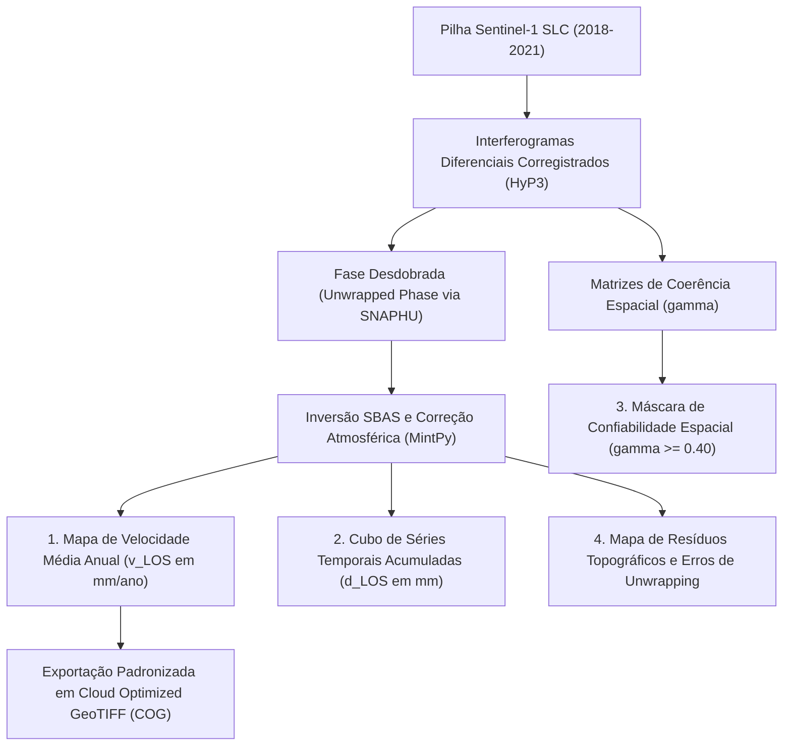

# Radar++ Discovery — D-ENC-03: Plano de Preparação do Piloto Científico Retrospectivo em Maceió/AL
## Protocolo Experimental Controlado, Objetivos Mensuráveis, Critérios de Qualidade e Limites de Execução

**Documento:** `D-ENC-03-plano-piloto-maceio.md`  
**Ciclo:** Encerramento do Discovery e Preparação da Engenharia de Domínio  
**Data:** 24 de Outubro de 2026  
**Status:** Oficial — Plano de Preparação (Aguardando Autorização Formal para Execução)  
**Responsável:** Especialista em Sensoriamento Remoto SAR/InSAR, Arquiteto de Software, Geólogo Consultor  
**Repositório Oficial:** `api-radar-deformacao` (caminho: `docs/discovery/D-ENC-03-plano-piloto-maceio.md`)  
**Regra Estrita de Governança:** Este plano destina-se estritamente ao planejamento e dimensionamento metodológico. **Nenhum processamento de dados, download de cenas brutas ou consumo de créditos computacionais (HyP3/AWS) deve ser executado nesta fase.**

---

## 1. Objetivos do Piloto Científico

O piloto experimental de Maceió/AL constitui a **Fase 0 do Roadmap Estratégico** ([D3-08](file:///home/asoares/Documentos/repositories/repo_radar/api-radar-deformacao/docs/discovery/D3-08-roadmap-estrategico.md#L30-L45)). Seus objetivos são exclusivamente científicos e metodológicos:

1. **Objetivo Científico Primário:** Demonstrar a capacidade do pipeline aberto (ASF HyP3 + MintPy) de reconstruir a bacia de subsidência dos bairros Pinheiro, Mutange, Bebedouro e Bom Parto entre 2018 e 2021 a partir de dados abertos do Sentinel-1.
2. **Objetivo Metodológico Mensurável:** Confrontar as velocidades na linha de visada ($v_{\text{LOS}}$) e séries temporais de deslocamento contra os marcos geodésicos de nivelamento geométrico de alta precisão do SGB/CPRM, alcançando:
   * **Coeficiente de Determinação:** $R^2 \ge 0{,}85$ na zona de deformação ativa;
   * **Erro Médio Quadrático:** $\text{RMSE} \le 15\text{ mm/ano}$ em relação aos dados topográficos terrestres;
   * **Delimitação Espacial:** Coincidência visual e topológica da geometria da bacia de afundamento com o polígono oficial de risco da Defesa Civil e CPRM.
3. **Objetivo de Engenharia:** Medir de forma empírica o consumo real de créditos HyP3, tempos de processamento assíncrono e volumetria final de arquivos COG gerados.

---

## 2. Área Candidata e Delimitação Geográfica

A área de interesse (AOI) candidata abrange a bacia sedimentar e as encostas lindeiras à Lagoa Mundaú, no município de Maceió, Estado de Alagoas:

```
+----------------------------------------------------------------------------------------------------------------------------------------------------+
|                                      DELIMITAÇÃO GEOGRÁFICA DO PILOTO EXPERIMENTAL (MACEIÓ/AL)                                                     |
+--------------------------+-------------------------------------------------------------------------------------------------------------------------+
| Parâmetro Geográfico     | Especificação Técnica                                                                                                   |
+--------------------------+-------------------------------------------------------------------------------------------------------------------------+
| Localização Administrat. | Município de Maceió / AL — Bairros Pinheiro, Mutange, Bebedouro, Bom Parto e borda leste da Lagoa Mundaú.             |
+--------------------------+-------------------------------------------------------------------------------------------------------------------------+
| Caixa Envolvente (BBOX)  | OESTE (Lon Min): -35.7850°  |  LESTE (Lon Max): -35.7150°                                                               |
|                          | SUL (Lat Min):   -9.6700°   |  NORTE (Lat Max): -9.6000°                                                                |
+--------------------------+-------------------------------------------------------------------------------------------------------------------------+
| Dimensão Territorial     | Aproximadamente 7,7 km (Leste-Oeste) x 7,8 km (Norte-Sul) $\approx 35\text{ km}^2$.                                    |
+--------------------------+-------------------------------------------------------------------------------------------------------------------------+
| Sistema de Referência    | SIRGAS 2000 (EPSG: 4674) / Projeção UTM Zona 25S (EPSG: 31985) para cálculos métricos de distância e área.             |
+--------------------------+-------------------------------------------------------------------------------------------------------------------------+
| Modelo de Elevação (DEM) | Copernicus GLO-30 Digital Elevation Model (resolução de 30 metros, corrigido radiometricamente).                       |
+--------------------------+-------------------------------------------------------------------------------------------------------------------------+
```

---

## 3. Seleção de Cenas SAR e Período de Análise

Para capturar o período crítico de aceleração da deformação documentado pelas vistorias de campo:

```
+----------------------------------------------------------------------------------------------------------------------------------------------------+
|                                    CONFIGURAÇÃO DA PILHA DE DADOS SENTINEL-1 CANDIDATA                                                             |
+--------------------------+-------------------------------------------------------------------------------------------------------------------------+
| Parâmetro de Aquisição   | Especificação Homologada                                                                                                |
+--------------------------+-------------------------------------------------------------------------------------------------------------------------+
| Intervalo Temporal       | **Janeiro de 2018 a Dezembro de 2021** (48 meses contínuos, abrangendo o início das fissuras até as evacuações em massa)|
+--------------------------+-------------------------------------------------------------------------------------------------------------------------+
| Sensor e Nível de Dado   | Sentinel-1A / Sentinel-1B — Nível 1 Single Look Complex (SLC), Modo Interferometric Wide (IW), Polarização VV.         |
+--------------------------+-------------------------------------------------------------------------------------------------------------------------+
| Geometria Orbital        | **Órbita Descendente — Path / Track 171** (Geometria preferencial: menor incidência de efeito de sombra sobre a encosta |
|                          | de falha do Mutange; ângulo de incidência local $\theta \approx 39{,}2^\circ$).                                          |
+--------------------------+-------------------------------------------------------------------------------------------------------------------------+
| Quantidade Estimada      | Pilha base de aproximadamente **45 a 55 cenas SLC**, gerando uma rede SBAS de cerca de **120 a 160 pares**             |
|                          | interferométricos com redundância temporal e perpendicular controlada.                                                  |
+--------------------------+-------------------------------------------------------------------------------------------------------------------------+
| Restrições de Conexão    | $B_\perp \le 150\text{ m}$ (Linha de base perpendicular máxima); $\Delta t \le 48\text{ dias}$ (Linha de base temporal).|
+--------------------------+-------------------------------------------------------------------------------------------------------------------------+
```

---

## 4. Referências Científicas e Verdade de Campo

A validação da acurácia do Radar++ será confrontada diretamente contra bases de dados abertas, públicas e auditadas:

1. **Relatório Síntese do SGB/CPRM (Maio de 2019):** *"Estudos sobre a instabilidade do terreno nos bairros Pinheiro, Mutange e Bebedouro, Maceió/AL"* (laudo pericial oficial que comprovou a reativação de falhas e subsidência provocada pela extração de sal-gema).
2. **Rede de Nivelamento Geométrico de Alta Precisão (CPRM / SGB):** Marcos topográficos instalados em estruturas rígidas nos bairros afetados, com leituras periódicas de recalque vertical milimétrico.
3. **Estação GNSS de Operação Contínua da Rede RBMC/IBGE:** Estação ALMC (Maceió) para amarração geodésica absoluta da referência e mitigação de deriva tectônica regional.
4. **Artigos Científicos Internacionais de Referência:** Publicações na literatura de sensoriamento remoto (ex.: *Vassileva et al., 2021; Hermans et al., 2021*) que processaram dados Sentinel-1 e TerraSAR-X sobre Maceió, fornecendo benchmarks independentes para confronto das velocidades estimadas.

---

## 5. Produtos Científicos Esperados do Piloto

O processamento experimental deverá gerar a seguinte suíte de artefatos raster e vetoriais:



---

## 6. Critérios de Qualidade e Estratégia de Comparação

```
+----------------------------------------------------------------------------------------------------------------------------------------------------+
|                                    MATRIZ DE AVALIAÇÃO DE CONFORMIDADE DO PILOTO                                                                   |
+--------------------------+-----------------------+-----------------------------------------------------------------------------------------+
| Critério de Qualidade    | Limiar de Aceite      | Mecanismo de Verificação no Experimento                                                 |
+--------------------------+-----------------------+-----------------------------------------------------------------------------------------+
| Coerência Espacial Média | $\bar{\gamma} \ge 0{,}40$ | Verificação na área urbana consolidada dos bairros afetados.                             |
+--------------------------+-----------------------+-----------------------------------------------------------------------------------------+
| Densidade de Alvos       | $\ge 50\text{ alvos/km}^2$| Densidade de dispersores coerentes (*PS/SBAS*) na zona edificada.                      |
+--------------------------+-----------------------+-----------------------------------------------------------------------------------------+
| Resíduos de Unwrapping   | $\le 15\%$ da área    | Cálculo da matriz de descontinuidade de fase do MintPy, garantindo ausência de saltos.  |
+--------------------------+-----------------------+-----------------------------------------------------------------------------------------+
| Concordância Temporal    | $R^2 \ge 0{,}85$      | Regressão linear entre a série temporal InSAR e os marcos de nivelamento da CPRM.       |
+--------------------------+-----------------------+-----------------------------------------------------------------------------------------+
| Erro Médio Quadrático    | $\text{RMSE} \le 15\text{ mm/ano}$| Discrepância média entre velocidade calculada pelo satélite e a medição topográfica.   |
+--------------------------+-----------------------+-----------------------------------------------------------------------------------------+
```

---

## 7. Estimativa Fundamentada de Custos e Créditos

Para garantir que a governança não seja surpreendida por despesas descontroladas na nuvem:

```
+----------------------------------------------------------------------------------------------------------------------------------------------------+
|                                    ESTIMATIVA DE RECURSOS COMPUTACIONAIS DO PILOTO EXPERIMENTAL                                                    |
+--------------------------+-----------------------+------------------------------------+----------------------------------------------------+
| Recurso / Serviço Nuvem  | Quantidade Estimada   | Custo Unitário Estimado            | Total Estimado da Fase Experimental                |
+--------------------------+-----------------------+------------------------------------+----------------------------------------------------+
| Créditos ASF HyP3        | ~120 a 160 pares      | 1 crédito por par interferométrico | **120 a 160 créditos HyP3**                        |
| (On-demand InSAR)        | IW interferométricos  | (quota gratuita de pesquisa/usuário)| (Consumo dentro da cota padrão de P&D do ASF).     |
+--------------------------+-----------------------+------------------------------------+----------------------------------------------------+
| Armazenamento AWS S3     | ~15 GB a 25 GB        | US$ 0,023 por GB/mês (us-east-1)   | **US$ 0,35 a US$ 0,60 / mês**                      |
| (Produtos Finais COG)    | (Rasters otimizados)  |                                    | (Arquivos SLC intermediários são expurgados).      |
+--------------------------+-----------------------+------------------------------------+----------------------------------------------------+
| Processamento MintPy     | ~6 a 10 horas de CPU  | Execução em máquina local ou       | **Custo nulo ou < US$ 5,00**                       |
| (Inversão e Séries)      | multicore (16 GB RAM) | instância Spot AWS (c5.2xlarge)    | (Ambiente isolado de testes em Jupyter Notebook).  |
+--------------------------+-----------------------+------------------------------------+----------------------------------------------------+
| Tráfego de Saída (Egress)| < 5 GB                | US$ 0,09 por GB                    | **< US$ 0,50** (Transferência restrita aos COGs).  |
+--------------------------+-----------------------+------------------------------------+----------------------------------------------------+
| **Total Financeiro Est.**| —                     | —                                  | **Menor que US$ 10,00 (ou ~R$ 55,00)**             |
+--------------------------+-----------------------+------------------------------------+----------------------------------------------------+
```

---

## 8. Riscos Específicos do Piloto e Mitigações

1. **Atraso Troposférico por Vapor d'Água (Lagoa Mundaú e Oceano):** A proximidade com corpos d'água tropicais gera gradientes de umidade no ar que podem simular subsidência aparente. *Mitigação:* Utilização de modelo de correção atmosférica global baseado no ERA5 ou filtro espaço-temporal de alta frequência no MintPy.
2. **Descontinuidade Espacial pela Lagoa:** A presença da lagoa impede a continuidade de fase interferométrica entre as margens. *Mitigação:* Delimitação estrita da AOI na margem terrestre leste (área urbana), excluindo a lâmina d'água da malha de desdobramento.
3. **Decorrelação em Áreas Arborizadas:** Bairros com quintais vegetados no Pinheiro podem perder coerência temporal. *Mitigação:* Utilização de limiar adaptativo de coerência e foco nos telhados de fibrocimento e cerâmica, que atuam como excelentes espalhadores.

---

## 9. Critérios de Aprovação ou Reprovação da Fase Experimental (Go / No-Go)

A validação científica será submetida à deliberação da liderança com base em critérios objetivos e binários:

* **Critério para APROVAÇÃO (GO):**
  1. A taxa média de deformação na zona do afundamento do Mutange demonstrar subsidência contínua superior a $50\text{ mm/ano}$;
  2. A correlação estatística com os dados de campo do SGB/CPRM atingir $R^2 \ge 0{,}85$ e $\text{RMSE} \le 15\text{ mm/ano}$;
  3. A geometria espacial da bacia for delimitada sem artefatos artificiais de desdobramento de fase.
* **Critério para REPROVAÇÃO / REFORMULAÇÃO (NO-GO):**
  1. Ocorrência de resíduos de *unwrapping* superiores a 25% da área que impeçam a continuidade do sinal;
  2. Discrepância estatística severa ($\text{RMSE} > 30\text{ mm/ano}$ ou $R^2 < 0{,}60$) sem justificativa física fundamentada;
  3. *Ação em caso de No-Go:* Reavaliar a parametrização de filtros de fase (Goldstein) e consultar os laboratórios acadêmicos parceiros antes de qualquer avanço na engenharia de produto.
