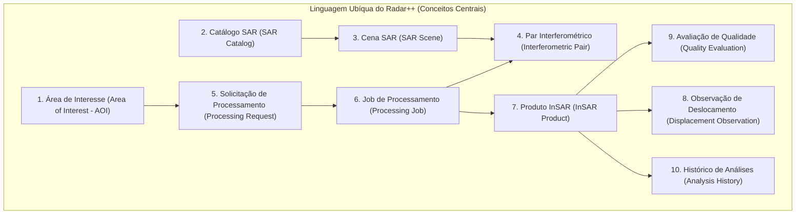

# Radar++ Discovery — D-ENC-04: Proposta de Escopo para Linguagem Ubíqua v1
## Glossário Conceitual de Domínio, Invariantes e Estabilidade Terminológica

**Documento:** `D-ENC-04-linguagem-ubiqua-v1.md`  
**Ciclo:** Encerramento do Discovery e Preparação da Engenharia de Domínio  
**Data:** 24 de Outubro de 2026  
**Status:** Oficial — Proposta de Escopo para Modelagem DDD  
**Responsável:** Arquiteto de Software (DDD / Clean Architecture), Especialista em Sensoriamento Remoto, Analista de Processos  
**Repositório Oficial:** `api-radar-deformacao` (caminho: `docs/discovery/D-ENC-04-linguagem-ubiqua-v1.md`)  
**Regra Estrita de Governança:** Este documento é estritamente conceitual e semântico. **Não criar classes Java, anotações JPA, migrações de banco de dados ou endpoints nesta fase.**

---

## 1. Visão Geral da Linguagem Ubíqua do Radar++

No Domain-Driven Design (DDD), a **Linguagem Ubíqua** é o vocabulário compartilhado e rigoroso utilizado tanto por especialistas de negócio e cientistas de radar quanto por desenvolvedores de software, eliminando ambiguidades conceituais entre termos do domínio geodésico e termos de engenharia de software:



---

## 2. Dicionário Conceitual de Domínio

### 2.1. Área de Interesse (*Area of Interest — AOI*)
* **Definição de Domínio:** Delimitação geográfica bidimensional contínua (polígono ou envelope) definida pelo usuário, que estabelece o recorte territorial para busca de imagens e processamento interferométrico.
* **Papel no Domínio:** Entidade raiz de espacialização de um estudo. Define a fronteira de cálculo geodésico.
* **Atributos Conceituais:** Identificador exclusivo, nome amigável, geometria vetorial fechada (WKT/GeoJSON), sistema de coordenadas de referência (EPSG:4674 SIRGAS 2000), área total calculada ($\text{km}^2$), caixa envolvente (*Bounding Box* — BBOX) e identificador da organização proprietária (*TenantId*).
* **Invariantes Conceituais:** O polígono deve ser topologicamente válido (sem auto-interseções), orientado em sentido horário e respeitar os limites de área máxima parametrizada ([RT1](file:///home/asoares/Documentos/repositories/repo_radar/api-radar-deformacao/docs/discovery/D3-05-catalogo-regras.md#L175-L178)).
* **Classificação de Estabilidade:** **Conceito Estável**.

---

### 2.2. Catálogo SAR (*SAR Catalog*)
* **Definição de Domínio:** Serviço agregador e indexador que consulta acervos orbitais abertos (ESA Copernicus, Alaska Satellite Facility - ASF) para descobrir dados disponíveis sobre uma determinada AOI.
* **Papel no Domínio:** Serviço de domínio que atua como porta de entrada de metadados externos para o sistema.
* **Atributos Conceituais:** Identificador da fonte do catálogo (ex.: *ASF Vertex*, *Copernicus Data Space*), ponto de extremidade de consulta, estado de sincronização e regras de paginação/limitação de requisições.
* **Invariantes Conceituais:** Consultas ao catálogo devem ser idempotentes e encapsuladas para evitar vazamento de dependência externa no núcleo de domínio.
* **Classificação de Estabilidade:** **Conceito Estável**.

---

### 2.3. Cena SAR (*SAR Scene*)
* **Definição de Domínio:** Registro individual de aquisição eletromagnética capturada por um sensor orbital em uma data e horário específicos sobre uma faixa do terreno.
* **Papel no Domínio:** Objeto de valor / entidade imutável representando a unidade elementar de dado de radar.
* **Atributos Conceituais:** Identificador da cena na missão (ex.: *S1A_IW_SLC__1SDV_...*), satélite (Sentinel-1A ou 1B), modo de aquisição (IW), polarização (VV/VH), nível de produto (Level-1 SLC), órbita relativa (*Relative Orbit / Path*), direção de voo (Ascendente ou Descendente), data/hora de aquisição (UTC) e polígono de pegada (*footprint*).
* **Invariantes Conceituais:** Uma cena é imutável no tempo. Cenas de modos ou satélites diferentes não podem ser agrupadas como idênticas.
* **Classificação de Estabilidade:** **Conceito Estável**.

---

### 2.4. Par Interferométrico (*Interferometric Pair*)
* **Definição de Domínio:** Associação matemática de duas cenas SAR da mesma geometria orbital (uma cena de referência primária e uma cena secundária) cuja defasagem de fase reflete o deslocamento do terreno e a topografia.
* **Papel no Domínio:** Entidade fundamental da interferometria diferencial.
* **Atributos Conceituais:** Referência à Cena Primária, referência à Cena Secundária, linha de base perpendicular ($B_\perp$ em metros), linha de base temporal ($\Delta t$ em dias), órbita relativa compartilhada e coerência espacial estimada.
* **Invariantes Conceituais:** Ambas as cenas devem obrigatoriamente possuir o mesmo *Relative Orbit Number*, mesma direção e polarização ([RC-03](file:///home/asoares/Documentos/repositories/repo_radar/api-radar-deformacao/docs/discovery/D3-05-catalogo-regras.md#L91-L102)). A data da cena secundária deve ser cronologicamente posterior à cena primária.
* **Classificação de Estabilidade:** **Conceito Estável**.

---

### 2.5. Solicitação de Processamento (*Processing Request*)
* **Definição de Domínio:** Intenção de negócio manifestada pelo usuário de gerar uma análise interferométrica para uma AOI em um determinado intervalo temporal.
* **Papel no Domínio:** Objeto de fronteira que inicia o ciclo de vida analítico e valida as permissões e parâmetros antes da orquestração.
* **Atributos Conceituais:** Identificador da solicitação, usuário solicitante, tipo de análise (Interferograma Simples, Série Temporal SBAS ou Back-Analysis Urbana), parâmetros configurados (limiar de coerência, baselines) e carimbo de data/hora.
* **Invariantes Conceituais:** Não pode ser despachada se a AOI for inválida ou se o número de cenas compatíveis for insuficiente para gerar um grafo interferométrico conectado.
* **Classificação de Estabilidade:** **Conceito Estável**.

---

### 2.6. Job de Processamento (*Processing Job*)
* **Definição de Domínio:** Unidade operacional de execução assíncrona responsável por coordenar a execução das etapas geodésicas em ambiente computacional na nuvem.
* **Papel no Domínio:** Entidade de orquestração assíncrona com ciclo de vida com máquina de estados.
* **Atributos Conceituais:** Identificador do job (*JobId*), identificador externo no provedor (ex.: *HyP3 Job UUID*), estado do ciclo de vida (*SUBMITTED*, *PENDING*, *RUNNING*, *SUCCEEDED*, *FAILED*), registro de tentativas, código de erro e tempo decorrido.
* **Invariantes Conceituais:** A transição de estados é unidirecional e auditável. Um job concluído (*SUCCEEDED*) torna-se imutável ([RO-01](file:///home/asoares/Documentos/repositories/repo_radar/api-radar-deformacao/docs/discovery/D3-05-catalogo-regras.md#L89-L104)).
* **Classificação de Estabilidade:** **Conceito Estável**.

---

### 2.7. Produto InSAR (*InSAR Product*)
* **Definição de Domínio:** O resultado geodésico matricial gerado por um job de processamento, pronto para consumo visual e analítico.
* **Papel no Domínio:** Agregado principal de entrega de valor do sistema.
* **Atributos Conceituais:** Identificador do produto, tipo de produto (Interferograma Desdobrado, Coerência Espacial, Velocidade Média Anual, Deslocamento Acumulado), URI de armazenamento do Cloud Optimized GeoTIFF (COG), metadados STAC, sistema de coordenadas de saída e resolução espacial métrica (~15 a 20m).
* **Invariantes Conceituais:** Todo produto InSAR deve estar em formato COG com pirâmides internas de visão geral ([RO-02](file:///home/asoares/Documentos/repositories/repo_radar/api-radar-deformacao/docs/discovery/D3-05-catalogo-regras.md#L106-L121)) e conter metadados de auditoria vinculados ([RQ-01](file:///home/asoares/Documentos/repositories/repo_radar/api-radar-deformacao/docs/discovery/D3-05-catalogo-regras.md#L123-L135)).
* **Classificação de Estabilidade:** **Conceito Estável**.

---

### 2.8. Observação de Deslocamento (*Displacement Observation*)
* **Definição de Domínio:** Medição quantitativa pontual de deformação extraída em uma coordenada espacial $(x, y)$ ao longo do tempo.
* **Papel no Domínio:** Objeto de valor que subsidia a renderização de séries temporais e gráficos de velocidade.
* **Atributos Conceituais:** Coordenada geográfica $(lat, lon)$, data da observação, valor escalar medido ($\text{mm}_{\text{LOS}}$), índice de coerência local ($\gamma$), incerteza estimada e indicador de geometria (Ascendente ou Descendente).
* **Invariantes Conceituais:** O valor medido é expresso estritamente na linha de visada do satélite ($d_{\text{LOS}}$), a menos que explicitamente decomposto ([RC-01](file:///home/asoares/Documentos/repositories/repo_radar/api-radar-deformacao/docs/discovery/D3-05-catalogo-regras.md#L62-L78)).
* **Classificação de Estabilidade:** **Conceito Estável**.

---

### 2.9. Avaliação de Qualidade (*Quality Evaluation*)
* **Definição de Domínio:** Conjunto de métricas e indicadores geodésicos que quantificam o grau de confiabilidade científica de um produto InSAR.
* **Papel no Domínio:** Objeto de valor associado ao produto InSAR que orienta a interpretação do usuário.
* **Atributos Conceituais:** Coerência espacial média ($\bar{\gamma}$), desvio-padrão do resíduo de fase, percentual de pixels mascarados por baixa coerência, percentual de resíduos de desdobramento de fase e indicador booleano de conformidade (*QualityFlag*).
* **Invariantes Conceituais:** Produtos com coerência média inferior a $0{,}40$ ou resíduos de desdobramento $> 15\%$ recebem status visual obrigatório de advertência técnica ([RQ-02](file:///home/asoares/Documentos/repositories/repo_radar/api-radar-deformacao/docs/discovery/D3-05-catalogo-regras.md#L137-L151)).
* **Classificação de Estabilidade:** **Conceito Provisório (Parâmetros em calibração no Piloto Maceió)**.

---

### 2.10. Histórico de Análises (*Analysis History*)
* **Definição de Domínio:** Trilha de auditoria imutável que registra todas as etapas, parâmetros, versões de software e usuários que interagiram com um determinado estudo.
* **Papel no Domínio:** Entidade de conformidade e cadeia de custódia técnico-pericial.
* **Atributos Conceituais:** Identificador da trilha, histórico de alterações de parâmetros, registro de exportações de relatórios em PDF, metadados de execução do MintPy/HyP3 e carimbos de tempo certificados.
* **Invariantes Conceituais:** Registros de histórico são estritamente incrementais e não podem ser apagados ou alterados (*Append-Only*).
* **Classificação de Estabilidade:** **Conceito Estável**.

---

## 3. Matriz de Classificação de Estabilidade e Dependências Científicas

```
+----------------------------------------------------------------------------------------------------------------------------------------------------+
|                                    ESTABILIDADE DOS CONCEITOS E DEPENDÊNCIAS DE VALIDAÇÃO                                                          |
+----+--------------------------------+-----------------------+--------------------------------------------------------------------------------------+
| ID | Conceito do Domínio            | Grau de Estabilidade  | Dependência de Validação Científica ou de Mercado                                    |
+----+--------------------------------+-----------------------+--------------------------------------------------------------------------------------+
| 01 | Área de Interesse (AOI)        | **Estável**           | Independe de validação; fundamentada em padrões OGC (GeoJSON/WKT).                  |
+----+--------------------------------+-----------------------+--------------------------------------------------------------------------------------+
| 02 | Catálogo SAR                   | **Estável**           | Alinhada aos padrões de metadados da ESA e ASF Vertex API.                          |
+----+--------------------------------+-----------------------+--------------------------------------------------------------------------------------+
| 03 | Cena SAR                       | **Estável**           | Especificação física imutável do programa Copernicus Sentinel-1.                     |
+----+--------------------------------+-----------------------+--------------------------------------------------------------------------------------+
| 04 | Par Interferométrico           | **Estável**           | Física clássica do corregistro e geometria SAR (Hanssen; Zebker).                    |
+----+--------------------------------+-----------------------+--------------------------------------------------------------------------------------+
| 05 | Solicitação de Processamento   | **Estável**           | Padrão de caso de uso de software B2B.                                               |
+----+--------------------------------+-----------------------+--------------------------------------------------------------------------------------+
| 06 | Job de Processamento           | **Estável**           | Padrão de mensageria assíncrona e máquina de estados em nuvem.                       |
+----+--------------------------------+-----------------------+--------------------------------------------------------------------------------------+
| 07 | Produto InSAR                  | **Estável**           | Padrão COG / STAC amplamente adotado na indústria geoespacial moderna.               |
+----+--------------------------------+-----------------------+--------------------------------------------------------------------------------------+
| 08 | Observação de Deslocamento     | **Estável**           | Medição vetorial LOS com carimbo de tempo.                                           |
+----+--------------------------------+-----------------------+--------------------------------------------------------------------------------------+
| 09 | Avaliação de Qualidade         | **Provisório**        | **Depende dos resultados do Piloto Maceió** para calibrar limiares de resíduo e     |
|    |                                |                       | sensibilidade de corte da máscara de coerência.                                      |
+----+--------------------------------+-----------------------+--------------------------------------------------------------------------------------+
| 10 | Conceitos Especializados Infra | **Provisório**        | **Depende das Entrevistas D1-04** para validar regras de estaqueamento (km viário)   |
|    | (Buffer, Estaqueamento, Ativo) |                       | e associação de terraplenos do SGTEC.                                                |
+----+--------------------------------+-----------------------+--------------------------------------------------------------------------------------+
```
