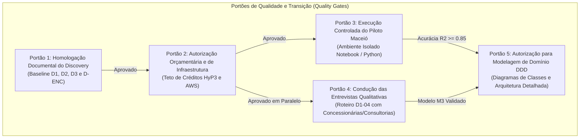

# Radar++ Discovery — D-ENC-06: Critérios Formais para Autorização de Execução Experimental
## Portões de Decisão (Quality Gates), Condições Precursoras e Governança para o Próximo Ciclo

**Documento:** `D-ENC-06-criterios-autorizacao-experimental.md`  
**Ciclo:** Encerramento do Discovery e Preparação da Engenharia de Domínio  
**Data:** 24 de Outubro de 2026  
**Status:** Oficial — Entregue para Deliberação e Homologação da Governança  
**Responsável:** Arquiteto de Software, Product Manager B2B/B2G, Especialista em Governança de TI  
**Repositório Oficial:** `api-radar-deformacao` (caminho: `docs/discovery/D-ENC-06-criterios-autorizacao-experimental.md`)  
**Diretriz de Transição:** Nenhuma linha de código em produção, consumo de créditos de terceiros ou modelagem de classes detalhadas deve ser iniciada sem o cumprimento estrito dos portões de qualidade aqui estabelecidos.

---

## 1. Visão Geral dos Portões de Decisão (*Quality Gates*)

Para assegurar que o Radar++ mantenha o mais alto padrão de integridade metodológica e não consuma recursos desnecessários em hipóteses não validadas, a transição entre o **Encerramento do Discovery** e a **Execução Experimental / Engenharia de Domínio** é controlada por cinco portões formais de decisão:



---

## 2. Detalhamento dos Cinco Portões de Qualidade

### Portão 1: Homologação Documental do Discovery
* **Condição de Aceite:** Aprovação formal pela liderança e pela governança dos 28 documentos técnicos produzidos nas investigações D1, D2 e D3, bem como dos 6 documentos de encerramento (`D-ENC-01` a `D-ENC-06`).
* **Verificação Obrigatória:**
  * Inexistência de alegações de precisão milimétrica comprovada em software;
  * Inexistência de promessas de alertas imediatos de deslizamento em tempo real;
  * Classificação explícita de modelos comerciais e disposição a pagar como hipóteses sob teste;
  * Preservação da ordem oficial de prioridades (1. Subsidência Urbana; 2. Infraestrutura Linear; 3. Canal de Consultorias/Pesquisa).
* **Responsável pela Homologação:** Liderança Executiva do Radar++ / Governança do Projeto.
* **Status:** **Pronto para Deliberação**.

---

### Portão 2: Autorização Orçamentária e de Infraestrutura Nuvem
* **Condição de Aceite:** Deliberação executiva aprovando os tetos máximos de consumo de créditos e custos computacionais para a validação científica de Maceió ([D-ENC-03](file:///home/asoares/Documentos/repositories/repo_radar/api-radar-deformacao/docs/discovery/D-ENC-03-plano-piloto-maceio.md#L98-L125)):
  * Consumo máximo aprovado de **créditos ASF HyP3:** Teto de 160 créditos;
  * Consumo máximo aprovado de **armazenamento AWS S3:** Teto de 30 GB de dados temporários e COGs finais (< US$ 1,00/mês);
  * Custo financeiro total da fase experimental restrito a menos de **US$ 15,00 (quinze dólares)**.
* **Verificação Obrigatória:** Garantia de que nenhum processamento será despachado sem monitoramento de saldo de créditos.
* **Status:** **Aguardando Abertura pelo Gestor de Recursos**.

---

### Portão 3: Execução Controlada do Piloto Maceió em Ambiente Isolado (Fase 0)
* **Condição de Aceite:** O piloto experimental deve ser executado exclusivamente em ambiente isolado de ciência de dados (Jupyter Notebook / scripts Python em contêiner ou máquina local), **sem tocar no backend Java (`api-radar-deformacao`) e sem acoplar bibliotecas no repositório principal**.
* **Critérios de Sucesso Científico (Go / No-Go):**
  * Obtenção de correlação de Pearson $R^2 \ge 0{,}85$ na zona central do afundamento do Mutange;
  * Erro Médio Quadrático $\text{RMSE} \le 15\text{ mm/ano}$ comparado aos dados do SGB/CPRM;
  * Ausência de saltos artificiais de $2\pi$ de desdobramento de fase na bacia urbana.
* **Status:** **Condicionado à Abertura dos Portões 1 e 2**.

---

### Portão 4: Condução das Entrevistas Qualitativas de Mercado (Fase 1)
* **Condição de Aceite:** Condução de 5 a 8 conversas técnicas estruturadas com base no roteiro `D1-04` com profissionais de concessionárias de rodovias/ferrovias e consultorias de engenharia geotécnica.
* **Critérios de Sucesso Comercial:**
  * Pelo menos 3 consultorias confirmarem interesse no Modelo M3 (contratação de diagnósticos pontuais sob demanda por laudo pericial);
  * Mapeamento claro dos requisitos de compras corporativas e prazos médios de homologação de fornecedores.
* **Status:** **Condicionado à Abertura do Portão 1**.

---

### Portão 5: Autorização para Modelagem DDD e Engenharia de Domínio Detalhada
* **Condição de Aceite:** A modelagem detalhada de classes, agregados em Java, diagramas UML de sequência técnica e escrita de entidades JPA **só será autorizada após a homologação conjunta dos Portões 3 e 4**.
* **Justificativa de Engenharia:** Desenhar entidades e agregados em código antes de comprovar os limites do algoritmo de desdobramento e os parâmetros de negócio do cliente resultaria em retrabalho arquitetural e código descartável.
* **Status:** **Bloqueado até a Conclusão das Fases 0 e 1**.

---

## 3. Matriz de Permissões e Ações Autorizadas vs. Vedadas na Transição

```
+----------------------------------------------------------------------------------------------------------------------------------------------------+
|                                    QUADRO DE DIRETRIZES OPERACIONAIS DE TRANSIÇÃO                                                                   |
+---------------------------------------------------------------+------------------------------------------------------------------------------------+
| Ações Formalmente AUTORIZADAS (Após Portão 1)                 | Ações Estritamente VEDADAS (Até Abertura dos Portões Subsequentes)                 |
+---------------------------------------------------------------+------------------------------------------------------------------------------------+
| 1. Configurar ambiente de pesquisa Python (Notebook / MintPy).| 1. Modificar qualquer arquivo de código Java nos serviços existentes.              |
+---------------------------------------------------------------+------------------------------------------------------------------------------------+
| 2. Preparar listas de granulos Sentinel-1 SLC no ASF Vertex.  | 2. Disparar processamentos HyP3 em lote sem aprovação orçamentária do Portão 2.   |
+---------------------------------------------------------------+------------------------------------------------------------------------------------+
| 3. Agendar reuniões técnicas de entrevista baseadas no D1-04. | 3. Fazer promessas comerciais ou emitir propostas com preços fictícios.            |
+---------------------------------------------------------------+------------------------------------------------------------------------------------+
| 4. Elaborar rascunhos conceituais de Linguagem Ubíqua.        | 4. Criar tabelas em bancos de dados ou endpoints RESTful de produção.              |
+---------------------------------------------------------------+------------------------------------------------------------------------------------+
| 5. Manter documentos centralizados exclusivamente em docs/.   | 5. Executar `git add`, `git commit` ou `git push` nas branches de produção.       |
+---------------------------------------------------------------+------------------------------------------------------------------------------------+
```
