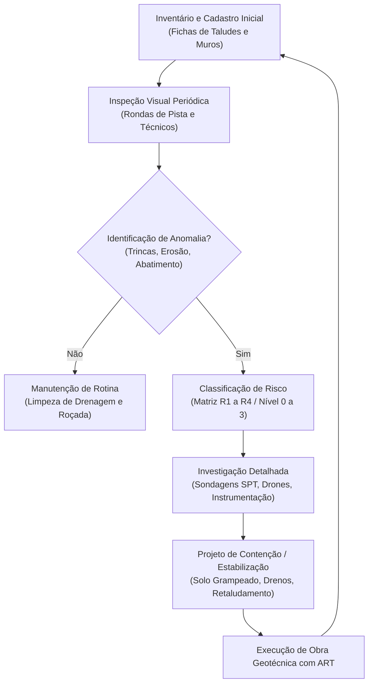

# Radar++ Discovery — D2-01: Panorama da Infraestrutura Linear de Transporte no Brasil
## Contexto Geomorfológico, Concessões Rodoviárias e Ferroviárias e Macrofluxo de Gestão

**Documento:** `D2-01-panorama-infraestrutura-linear.md`  
**Ciclo:** Investigação D2 — Infraestrutura Linear (Rodovias e Ferrovias)  
**Data:** 24 de Outubro de 2026  
**Status:** Oficial — Entregue para Governança  
**Responsável:** Equipe Multidisciplinar de Inteligência Estratégica, Geotecnia e Regulação  
**Repositório Oficial:** `api-radar-deformacao` (caminho: `docs/discovery/D2-01-panorama-infraestrutura-linear.md`)  

---

## 1. A Malha de Infraestrutura Linear no Brasil

O Brasil possui dimensões continentais e uma matriz de transportes fortemente dependente do modal rodoviário para cargas e passageiros, complementada por corredores ferroviários troncais voltados primariamente à exportação de commodities minerais e agrícolas:

```
+---------------------------------------------------------------------------------------------------------------+
|                                 DIMENSÕES DA MALHA DE TRANSPORTE TERRESTRE BRASILEIRA                         |
+--------------------------+-----------------------+-----------------------------+------------------------------+
| Modal                    | Extensão Total        | Extensão Concedida (Privada)| Órgão Regulador / Fiscalizador|
+--------------------------+-----------------------+-----------------------------+------------------------------+
| Rodovias Pavimentadas    | ~124.000 km           | ~26.000 km                  | ANTT (Federais) /            |
|                          |                       | (Principais corredores econ)| ARTESP, DERs (Estaduais)     |
+--------------------------+-----------------------+-----------------------------+------------------------------+
| Ferrovias Operacionais   | ~30.500 km            | ~29.000 km                  | ANTT                         |
|                          |                       | (Quase totalidade da malha) |                              |
+--------------------------+-----------------------+-----------------------------+------------------------------+
```
*(Fontes: CNT — Confederação Nacional do Transporte, 2024; ANTT — Anuário Estatístico, 2024).*

---

## 2. Desafios Geomorfológicos e Orográficos Críticos

A infraestrutura linear brasileira foi construída cortando relevos serranos tropicais de grande declividade, alta pluviosidade sazonal e coberturas coluvionares intemperizadas. Os principais gargalos geotécnicos concentram-se em:

```
+---------------------------------------------------------------------------------------------------------------+
|                                    PRINCIPAIS GARGALOS GEOTÉCNICOS LINEARES NO BRASIL                         |
+-------------------+-----------------------+-----------------------------+-------------------------------------+
| Região Geomorfol. | Corredores Afetados   | Desafio Geotécnico Crítico  | Fenômeno Predominante               |
+-------------------+-----------------------+-----------------------------+-------------------------------------+
| Serra do Mar      | Rod. Imigrantes/Anchi-| Encostas com declividade    | Escorregamentos translacionais      |
| (SP / RJ / PR)    | eta (EcoVias), BR-116 | acentuada, espessos mantos  | rasos, corridas de detritos         |
|                   | Régis (Arteris), Rumo | de intemperismo e chuvas >  | (*debris flows*) e queda de blocos  |
|                   | Ferroviária (Santos)  | 2.500 mm/ano concentradas   | sobre pistas e trilhos.             |
+-------------------+-----------------------+-----------------------------+-------------------------------------+
| Serra das Araras  | BR-116 Presidente Du- | Relevo montanhoso escarpado;| Rastejo (*creep*) de encostas,     |
| (RJ)              | tra (Motiva Rodovias /| taludes de corte históricos | instabilidade em obras de duplicação|
|                   | CCR RioSP)            | em rochas gnáissicas/granito| e deslizamentos de blocos de rocha. |
+-------------------+-----------------------+-----------------------------+-------------------------------------+
| Serra da Mantique-| BR-040, BR-381 Fernão | Vales profundos, solo resi- | Colapso de aterros rodoviários e    |
| ira e Quadrilátero| Dias, Malha Ferroviá- | dual instável, cortes pro-  | escorregamentos rotacionais que     |
| Ferrífero (MG/RJ) | ria MRS Logística     | fundos em xistos e filitos  | paralisam o transporte de minério.  |
+-------------------+-----------------------+-----------------------------+-------------------------------------+
| Baixadas Litorâne-| Acessos aos Portos de | Camadas espessas de argila  | Recalques diferenciais lentos e     |
| as e Mangues      | Santos, Paranaguá e   | marinha altamente compressí-| contínuos em aterros ferroviários e |
|                   | Rio de Janeiro        | vel e lençol freático raso  | encontros de pontes e viadutos.     |
+-------------------+-----------------------+-----------------------------+-------------------------------------+
```

---

## 3. Macrofluxo de Gestão Geotécnica em Concessionárias

As operadoras privadas são contratualmente obrigadas a gerenciar a integridade dos seus terraplenos e encostas lindeiras. O fluxo padrão da indústria de infraestrutura segue o seguinte ciclo:



---

## 4. Onde o InSAR se Encaixa no Fluxo Operacional

* **O Gargalo Atual:** A etapa `B` (Inspeção Visual) cobre milhares de quilômetros linearmente com técnicos olhando da pista para cima. Movimentações milimétricas lentas no topo das encostas (*creep* / rastejo) que ocorrem centenas de metros acima da rodovia são **invisíveis a olho nu** até o colapso repentino na época de chuvas.
* **O Papel Potencial do Radar++:** Atuar na **triagem em macroescala (*Screening*)**, processando corredores a cada ciclo orbital e alertando as equipes de engenharia sobre quais taludes apresentam tendências de deformação milimétrica acumulada (*creep*), subsidiando a priorização de vistorias de campo e instrumentação (etapa `F`). Essa triagem está condicionada a fatores favoráveis de coerência de fase e geometria de visada, não constituindo garantia de detecção antecipada para rupturas bruscas ou áreas sob floresta contínua.
