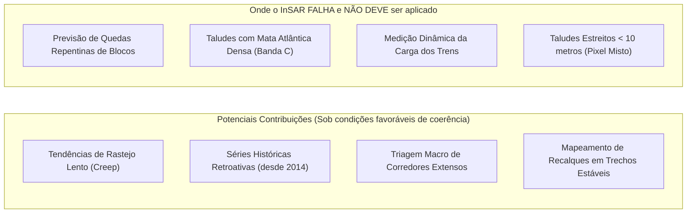

# Radar++ Discovery — D2-02: Problemas Operacionais em Rodovias e Ferrovias e a Cadeia de Detecção
## Investigação Detalhada das Dores Geotécnicas e Avaliação de Aplicabilidade do InSAR

**Documento:** `D2-02-problemas-operacionais.md`  
**Ciclo:** Investigação D2 — Infraestrutura Linear (Rodovias e Ferrovias)  
**Data:** 24 de Outubro de 2026  
**Status:** Oficial — Entregue para Governança  
**Responsável:** Equipe Multidisciplinar de Inteligência Estratégica, Geotecnia e Regulação  
**Repositório Oficial:** `api-radar-deformacao` (caminho: `docs/discovery/D2-02-problemas-operacionais.md`)  

---

## 1. Problemas Operacionais Críticos em Rodovias

```
+----------------------------------------------------------------------------------------------------------------------------------------------------+
|                                      MATRIZ DE PROBLEMAS OPERACIONAIS GEOTÉCNICOS EM RODOVIAS CONCEDIDAS                                           |
+--------------------+-----------------------------------------------------+-------------------------------------------------------------------------+
| Critério           | Problema R1: Rastejo (*Creep*) em Encostas Naturais | Problema R2: Instabilidade em Taludes de Corte e Aterro                 |
+--------------------+-----------------------------------------------------+-------------------------------------------------------------------------+
| 1. Quem Sofre as   | Concessionária (custo de remoção e multas da ANTT), | Concessionária (risco de sinistro com veículos), usuários da rodovia,   |
| Consequências      | usuários (bloqueios de pista) e seguradoras.        | seguradoras e equipes de conservação viária.                           |
+--------------------+-----------------------------------------------------+-------------------------------------------------------------------------+
| 2. Como é Detec-   | Tradicionalmente NÃO é detectado na fase lenta;     | Visualmente por rondas de pista que avistam trincas longitudinais no    |
| tado Atualmente    | percebido apenas quando a massa se rompe na pista.  | asfalto, deformação de defensas metálicas ou trincas em canaletas.      |
+--------------------+-----------------------------------------------------+-------------------------------------------------------------------------+
| 3. Como é Inves-   | Vistorias geológicas escalando a encosta a pé;      | Instalação de piquetes topográficos manuais e abertura de poços de     |
| tigado             | mapeamento de árvores inclinadas e trincas de tração| inspeção para verificação do plano de ruptura.                          |
+--------------------+-----------------------------------------------------+-------------------------------------------------------------------------+
| 4. Tecnologias     | Inclinômetros de tubo em pontos críticos isolados;  | Drones com câmeras ópticas RGB para geração de ortomosaicos e modelos   |
| Utilizadas         | medições topográficas com estação total.            | digitais de superfície (MDS).                                           |
+--------------------+-----------------------------------------------------+-------------------------------------------------------------------------+
| 5. Informações     | Deslocamento acumulado no topo do tubo inclinométri-| Ficha cadastral do talude, classificação de risco (R1 a R4) e largura  |
| Registradas        | co (mm) e nível do lençol freático em piezômetros.  | da trinca de asfalto (medida com fissurômetro acrílico).                |
+--------------------+-----------------------------------------------------+-------------------------------------------------------------------------+
| 6. Impacto         | Interdição total ou parcial de pistas (ex.: Serra do| Redução de velocidade da via, interdição de acostamento, obras de       |
| Operacional        | Cafezal / Regis Bittencourt); perdas de milhões/dia.| emergência de contenção (solo grampeado) e custos de desvio de tráfego. |
+--------------------+-----------------------------------------------------+-------------------------------------------------------------------------+
| 7. Limitações      | Inclinômetros medem apenas um ponto pontual (1 m²); | Drones não penetram copas de árvores densas e não medem movimentações  |
| Relatadas          | custo de instalação de R$ 30k a R$ 80k por furo.    | milimétricas subsuperficiais antes do surgimento da trinca superficial. |
+--------------------+-----------------------------------------------------+-------------------------------------------------------------------------+
| 8. Onde o InSAR    | **POTENCIAL DE CONTRIBUIÇÃO:** Identificação de     | Identificação de movimentações históricas preexistentes (*back-analysis*|
| Agrega Valor       | tendências de rastejo (*creep*) em escala macro, sob| antes da obra) e mapeamento de afundamentos em trechos com coerência     |
|                    | condições favoráveis de coerência (sem garantia de   | preservada, auxiliando na priorização de inspeções de campo.            |
|                    | detecção antecipada universal de rupturas).          |                                                                         |
+--------------------+-----------------------------------------------------+-------------------------------------------------------------------------+
| 9. Quando InSAR    | **NÃO ADEQUADO** em encostas com floresta densa de  | **NÃO ADEQUADO** para taludes estreitos (<10 m) onde o pixel do satélite|
| NÃO É ADEQUADO     | Mata Atlântica (descorrelação na Banda C do S1).    | mistura asfalto, valeta de concreto e vegetação (pixel misto).          |
+--------------------+-----------------------------------------------------+-------------------------------------------------------------------------+
```

---

## 2. Problemas Operacionais Críticos em Ferrovias

```
+----------------------------------------------------------------------------------------------------------------------------------------------------+
|                                    MATRIZ DE PROBLEMAS OPERACIONAIS GEOTÉCNICOS EM FERROVIAS DE CARGA                                              |
+--------------------+-----------------------------------------------------+-------------------------------------------------------------------------+
| Critério           | Problema F1: Recalques de Lastro sobre Solos Moles  | Problema F2: Movimentações em Cortes e Taludes Lindeiros                |
+--------------------+-----------------------------------------------------+-------------------------------------------------------------------------+
| 1. Quem Sofre as   | Concessionária ferroviária (Rumo, MRS, VLI), opera- | Operador ferroviário e clientes de carga (atraso no transbordo portuário|
| Consequências      | dores de trens e indústrias embarcadoras de carga.  | de minério de ferro e grãos agrícolas em Santos e Tubarão).             |
+--------------------+-----------------------------------------------------+-------------------------------------------------------------------------+
| 2. Como é Detec-   | Pelo vagão de geometria de via (EM-100 / Plasser),  | Vistorias visuais ao longo da linha por turmas de conservação de via    |
| tado Atualmente    | que mede nivelamento longitudinal e bitola.         | permanente e relatos de maquinistas sobre pedras ou terra nos trilhos.  |
+--------------------+-----------------------------------------------------+-------------------------------------------------------------------------+
| 3. Como é Inves-   | Sondagens a percussão (SPT) e ensaios de palheta    | Mapeamento geológico de campo e inspeção com drones nos pontos de corte |
| tigado             | (Vane Test) para quantificar espessura do solo mole.| rochoso mais íngremes.                                                  |
+--------------------+-----------------------------------------------------+-------------------------------------------------------------------------+
| 4. Tecnologias     | Nivelamento óptico geométrico periódico e sensores  | Marcos topográficos superficiais, barreira dinâmica de impacto e rede de |
| Utilizadas         | de assentamento instalados na sub-base do aterro.   | tiltímetros sem fio com telemetria via satélite instalada em taludes.   |
+--------------------+-----------------------------------------------------+-------------------------------------------------------------------------+
| 5. Informações     | Flecha de deformação da via (mm) e taxa de recalque | Fichas de inspeção de obras de arte e registro de quedas de blocos no   |
| Registradas        | acumulada (cm/mês) no trecho crítico.               | sistema de manutenção ferroviária (ex.: SAP PM / Maximo).               |
+--------------------+-----------------------------------------------------+-------------------------------------------------------------------------+
| 6. Impacto         | Redução compulsória da velocidade dos trens (de     | Paralisação imediata da circulação de trens por risco de descarrila-    |
| Operacional        | 60 km/h para 15 km/h), gerando gargalo logístico.   | mento; perda de receita de milhões de reais por dia de via bloqueada.   |
+--------------------+-----------------------------------------------------+-------------------------------------------------------------------------+
| 7. Limitações      | Vagões de geometria operam periodicamente (a cada 3 | Vistorias a pé não conseguem monitorar centenas de km em áreas remotas; |
| Relatadas          | ou 6 meses); não entregam monitoramento contínuo.   | sensores pontuais cobrem apenas os cortes previamente conhecidos.       |
+--------------------+-----------------------------------------------------+-------------------------------------------------------------------------+
| 8. Onde o InSAR    | **VALOR MÁXIMO:** Rastreamento regional contínuo do | Triagem contínua de taludes remotos sem necessidade de deslocamento de  |
| Agrega Valor       | adensamento do solo ao longo de todo o traçado.     | equipes para áreas de difícil acesso logístico.                         |
+--------------------+-----------------------------------------------------+-------------------------------------------------------------------------+
| 9. Quando InSAR    | **NÃO ADEQUADO** para medir o impacto dinâmico da   | **NÃO ADEQUADO** para prever quedas repentinas de blocos rochosos soltos|
| NÃO É ADEQUADO     | passagem do trem em tempo real (frequência em Hz).  | que caem por gravidade sem fase precursora de deslocamento lento.       |
+--------------------+-----------------------------------------------------+-------------------------------------------------------------------------+
```

---

## 3. Síntese dos Limites e Oportunidades do InSAR em Corredores

A análise dos problemas operacionais comprova que o InSAR **não resolve todos os desafios geotécnicos lineares**, mas preenche uma lacuna específica e valiosa:


