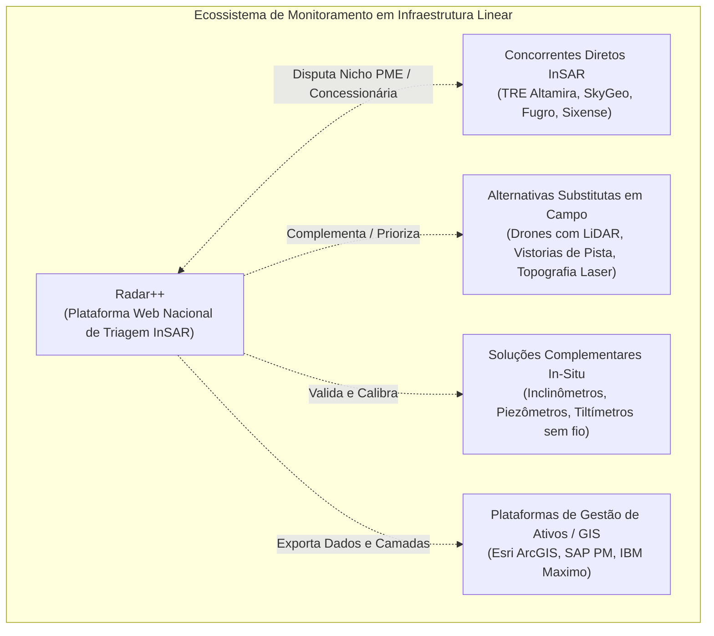

# Radar++ Discovery — D2-04: Concorrência e Soluções Alternativas em Infraestrutura Linear
## Mapeamento de Fornecedores, Tecnologias Substitutas, Complementares e Integradores

**Documento:** `D2-04-concorrentes-e-alternativas.md`  
**Ciclo:** Investigação D2 — Infraestrutura Linear (Rodovias e Ferrovias)  
**Data:** 24 de Outubro de 2026  
**Status:** Oficial — Entregue para Governança  
**Responsável:** Equipe Multidisciplinar de Inteligência Estratégica, Geotecnia e Regulação  
**Repositório Oficial:** `api-radar-deformacao` (caminho: `docs/discovery/D2-04-concorrentes-e-alternativas.md`)  

---

## 1. Categorização do Ecossistema Tecnológico em Corredores Lineares

Para que a inteligência competitiva seja útil à engenharia e ao produto, é essencial não tratar todas as empresas como "concorrentes diretos". O mercado divide-se em cinco categorias funcionais:



---

## 2. Matriz Comparativa Estruturada de Fornecedores e Tecnologias

```
+----------------------------------------------------------------------------------------------------------------------------------------------------+
|                                    MATRIZ COMPARATIVA DE SOLUÇÕES PARA MONITORAMENTO DE CORREDORES LINEARES                                        |
+-------------------+--------------------+--------------------+--------------------+--------------------+--------------------+--------------------+
| Critério          | Concorrentes InSAR | Levantamentos com  | Instrumentação     | Plataformas GIS /  | Vistoria Visual    | Radar++            |
|                   | (TRE, Fugro, SkyGeo| Drones (LiDAR/RGB) | In-Situ (Sensores) | Gestão (Esri / SAP)| de Pista (Campo)   | (Posicionamento)   |
+-------------------+--------------------+--------------------+--------------------+--------------------+--------------------+--------------------+
| 1. Tipo de        | Concorrente Direto | Alternativa Substi-| Solução Complemen- | Potencial Parceiro | Alternativa Tradi- | Produto Proposto   |
| Relação           | de Alto Tíquete    | tuta / Competidora | tar Obrigatória    | Integrador         | cional Concorrente | (SaaS Focado)      |
+-------------------+--------------------+--------------------+--------------------+--------------------+--------------------+--------------------+
| 2. Resolução      | Milimétrica no des-| Centimétrica visual| Milimétrica pontual| Não mede; apenas   | Subjetiva qualitati| Milimétrica no des-|
| Métrica           | locamento temporal | (ortofoto e nuvem) | no sensor fincado  | armazena e exibe   | va (visão humana)  | locamento temporal |
+-------------------+--------------------+--------------------+--------------------+--------------------+--------------------+--------------------+
| 3. Cobertura      | Regional ampla de  | Trechos de 5 a     | Pontual extrema    | Não aplicável      | Contínua ao longo  | Regional de cente- |
| Espacial          | centenas de km     | 50 km por voo      | (1 m² por poço)    | (Camada de mapas)  | da faixa de asfalto| nas de km lineares |
+-------------------+--------------------+--------------------+--------------------+--------------------+--------------------+--------------------+
| 4. Análise        | Sim (arquivos de   | Não (apenas a par- | Não (apenas a par- | Não aplicável      | Não (apenas se hou-| Sim (catálogo aber-|
| Histórica Prévia  | radar desde 1992)  | tir do 1º sobrevoo)| tir da instalação) |                    | ver foto antiga)   | to desde 2014)     |
+-------------------+--------------------+--------------------+--------------------+--------------------+--------------------+--------------------+
| 5. Comportamento  | Excelente em áreas | Bloqueado por copa | Imune à vegetação  | Não aplicável      | Enxerga apenas a   | Depende de rocha,  |
| sob Vegetação     | abertas e rochas   | densa (exceto LiDAR| (sensor enterrado) |                    | saia do talude     | solo exposto ou PS |
+-------------------+--------------------+--------------------+--------------------+--------------------+--------------------+--------------------+
| 6. Requisito de   | Nulo (dados puramen| Equipe em campo com| Instalação física  | Apenas computadores| Ronda diária de ca-| Nulo (autosserviço |
| Equipe em Campo   | te orbitais)       | piloto e gerador   | pesada e furos SPT | e servidores de TI | minhonete de pista | 100% web em nuvem) |
+-------------------+--------------------+--------------------+--------------------+--------------------+--------------------+--------------------+
| 7. Modelo         | Contratos anuais de| Cobrança por km    | Venda de hardware  | Licenciamento cor- | Custo de folha de  | Assinatura por km/ |
| Comercial         | engenharia e SaaS  | sobrevoado / diária| + serviços de obra | porativo de softw. | pagamento interna  | ano ou área mensal |
+-------------------+--------------------+--------------------+--------------------+--------------------+--------------------+--------------------+
| 8. Limitações     | Tíquete proibitivo | Custo alto de mobi-| Custo de R$ 30k a  | Não gera dados nem | Lenta, perigosa e  | Pixel de ~20m com  |
| Críticas          | (>R$ 300k); foco em| lização; não mede  | R$ 80k por furo;   | realiza processa-  | subjetiva; não vê  | risco de mistura;  |
|                   | megamineração Tier1| deslocamento lento | sujeito a vandalismo| mento científico  | creep subsuperf.   | vegetação tropical |
+-------------------+--------------------+--------------------+--------------------+--------------------+--------------------+--------------------+
```

---

## 3. Análise Detalhada dos Grupos Competitivos

### 3.1. Concorrentes Diretos: Fornecedores de InSAR
* **CLS Brasil (TRE Altamira):** Líder mundial com plataforma *TREmaps®*. Atua no Brasil fornecendo monitoramento de alta precisão para a Vale (ferrovias e minas) e grandes concessionárias rodoviárias. Contudo, seu foco comercial está em grandes pacotes customizados com imagens comerciais em Banda X (TerraSAR-X / COSMO-SkyMed).
* **Sixense Brasil (Grupo Vinci):** Fortemente posicionada no monitoramento de metrôs (São Paulo) e concessões do próprio grupo Vinci. Utiliza a tecnologia *Atlas InSAR* atrelada à sua plataforma de instrumentação *Geoscope*. Vende a solução como pacote fechado de gestão de risco em grandes obras.
* **Fugro Brasil:** Atua como integradora de engenharia de geodados. Não comercializa software de prateleira avulso; fornece laudos completos de engenharia geotécnica com ART.

### 3.2. Alternativas Substitutas: O Domínio dos Drones (LiDAR / RGB)
* **Realidade de Mercado:** Nos últimos cinco anos, as concessionárias rodoviárias brasileiras investiram massivamente na contratação de sobrevoos com drones para cadastro de taludes e mapeamento de faixas de domínio.
* **Vantagem do Drone:** Entrega ortofotos com resolução centimétrica (GSD de 2 a 5 cm), onde o engenheiro visualiza diretamente trincas no pavimento, rachaduras em canaletas e erosões em estágio inicial.
* **Desvantagem do Drone:** Custo de mobilização por quilômetro é elevado; não mede rastejo milimétrico subsuperficial contínuo no tempo; não reconstrói o histórico anterior ao voo.

### 3.3. Soluções Complementares: Instrumentação In-Situ
* **Empresas:** Sisgeo, Geobrugg, Encardio-rite, Solução Geotécnica.
* **Dinâmica:** Instrumentos in-situ (inclinômetros e piezômetros) são indispensáveis para obras de engenharia com risco R4 (muito alto). O InSAR não substitui o inclinômetro no plano de ruptura; o InSAR atua como o **indicador de triagem** que avisa onde o inclinômetro deve ser instalado.

---

## 4. Estratégia de Posicionamento Frente à Concorrência

O Radar++ não deve se posicionar como um concorrente frontal dos drones nem da instrumentação de campo, mas como a **camada de inteligência prévia de triagem em macroescala**:

```
+---------------------------------------------------------------------------------------------------+
|                                  A CADEIA DE VALOR DO MONITORAMENTO VIÁRIO                        |
+--------------------------+---------------------------------+--------------------------------------+
| Camada Tecnológica       | Ferramenta Responsável          | Papel no Processo de Decisão         |
+--------------------------+---------------------------------+--------------------------------------+
| 1. Triagem Macro (Macro) | **RADAR++ (Satélite InSAR)**    | Mapeia tendências de deformação acu- |
|                          | Cobertura de 1.000 km contínuos | mulada (creep) sob coerência favorável|
+--------------------------+---------------------------------+--------------------------------------+
| 2. Inspeção Local (Meso) | **Drones (LiDAR / Ortofoto)**   | Sobrevoa os pontos suspeitos indica- |
|                          | Resolução centimétrica          | dos pelo Radar++ para ver detalhes   |
+--------------------------+---------------------------------+--------------------------------------+
| 3. Investigação (Micro)  | **Inclinômetro / Sondagem SPT** | Perfura o talude anômalo para calcu- |
|                          | Instrumentação física de solo   | lar o fator de segurança da contenção|
+--------------------------+---------------------------------+--------------------------------------+
```
