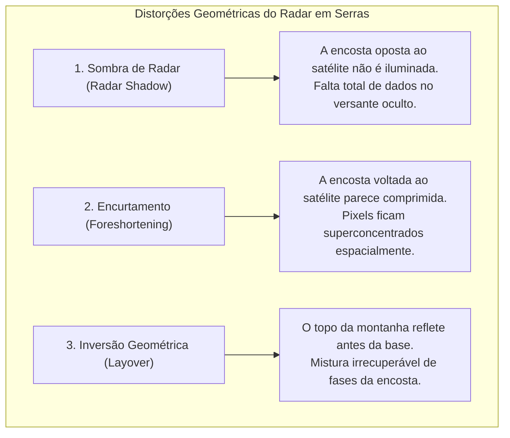

# Radar++ Discovery — D2-05: Avaliação Técnica e Geofísica da Aplicabilidade do SAR/InSAR em Corredores Lineares
## Resolução Espacial, Coerência na Banda C, Geometria de Visada e Limitações Físicas

**Documento:** `D2-05-viabilidade-insar.md`  
**Ciclo:** Investigação D2 — Infraestrutura Linear (Rodovias e Ferrovias)  
**Data:** 24 de Outubro de 2026  
**Status:** Oficial — Entregue para Governança  
**Responsável:** Especialista em Sensoriamento Remoto SAR/InSAR e Engenheiro Geotécnico  
**Repositório Oficial:** `api-radar-deformacao` (caminho: `docs/discovery/D2-05-viabilidade-insar.md`)  
**Diretriz Obrigatória de Governança:** O Radar++ **não deve emitir alertas automáticos de segurança geotécnica** nesta etapa de maturidade tecnológica.  

---

## 1. O Desafio da Resolução Espacial em Corredores Estreitos

A missão **Sentinel-1** opera primariamente no modo *Interferometric Wide Swath* (IW), cujas características nominais determinam os limites de detecção:

```
+---------------------------------------------------------------------------------------------------------------+
|                                CARACTERÍSTICAS ESPACIAIS DO SENTINEL-1 IW SLC EM CORREDORES                   |
+--------------------------+-----------------------+------------------------------------------------------------+
| Parâmetro Geométrico     | Valor Nominal         | Implicação Prática em Rodovias e Ferrovias                 |
+--------------------------+-----------------------+------------------------------------------------------------+
| Resolução em Slant Range | ~2,7 a 3,1 metros     | Resolução física ao longo do raio de visada do radar.      |
+--------------------------+-----------------------+------------------------------------------------------------+
| Resolução em Azimute     | ~22,5 metros          | Resolução física ao longo da trajetória da órbita.         |
+--------------------------+-----------------------+------------------------------------------------------------+
| Tamanho do Pixel         | ~14 x 4 metros        | Um único pixel de radar cobre uma área de aproximadamente  |
| Geocodificado (Multi-look| a 20 x 20 metros      | 150 a 400 m² no terreno após corregistro e geocodificação. |
| 5x1 / 20x4 looks)        |                       |                                                            |
+--------------------------+-----------------------+------------------------------------------------------------+
| Largura da Faixa de      | 3,5 m por faixa;      | A faixa de tráfego asfáltica tem largura inferior a um     |
| Tráfego / Pista          | pista dupla ~15 a 20 m| único pixel do satélite Sentinel-1.                        |
+--------------------------+-----------------------+------------------------------------------------------------+
| Largura Típica de Talude | 10 a 30 metros de     | O pixel do satélite frequentemente captura uma mistura de  |
| de Corte ou Aterro       | projeção horizontal   | asfalto, canaleta de concreto e vegetação adjacente.       |
+--------------------------+-----------------------+------------------------------------------------------------+
```

### O Problema do Pixel Misto (*Mixed Pixel Effect*):
Quando um pixel de radar abrange simultaneamente o asfalto (alvo reflector liso) e o capim/arbusto da saia do talude (alvo dispersor com movimento pelo vento), o sinal resultante sofre severa contaminação de fase. O Radar++ **não é capaz de medir individualmente uma trinca de 5 cm no asfalto com Sentinel-1**, mas sim o **deslocamento do bloco maciço do talude** quando este ultrapassa as dimensões do pixel.

---

## 2. Coerência Interferométrica ($\gamma$) e Descorrelação em Vegetação Tropical

A coerência interferométrica ($\gamma \in [0, 1]$) quantifica a correlação complexa entre os sinais de radar de duas datas distintas. Para medições confiáveis de deslocamento, exige-se $\gamma \ge 0{,}40$.

### 2.1. O Impacto da Banda C ($5{,}6\text{ cm}$) na Mata Atlântica
* **Mecanismo de Descorrelação:** O comprimento de onda do Sentinel-1 ($\lambda = 5{,}546\text{ cm}$) é da ordem de grandeza das folhas, galhos e gramíneas. Em regiões tropicais brasileiras (Serra do Mar, Serra das Araras e Vale do Paraíba), o rápido crescimento da biomassa e a movimentação contínua da vegetação pelo vento provocam **descorrelação volumétrica e temporal quase instantânea** (a fase aleatória anula o sinal interferométrico em intervalos superiores a 12 dias).
* **Onde a Banda C Funciona com Sucesso:**
  1. *Afloramentos Rochosos e Escarpas:* Encostas com rocha gnáissica ou granítica exposta.
  2. *Estruturas Construídas:* Muros de contenção de concreto, cortinas atirantadas, gabiões e encontros de pontes.
  3. *Trilhos e Dormentes Ferroviários:* Estruturas metálicas de alta refletividade (*Persistent Scatterers*).
  4. *Pavimento Asfáltico Desobstruído:* Rodovias e acostamentos sem árvores lindeiras cobrindo a pista.

### 2.2. O Papel da Futura Banda L (NISAR / ALOS-2)
Satélites em Banda L (comprimento de onda de $\sim 24\text{ cm}$, como o ALOS-2 e o futuro satélite **NISAR** da NASA/ISRO) conseguem penetrar a copa das árvores tropicais e refletir no tronco e no solo subjacente, mantendo coerência por meses. **O Radar++ deve preparar sua arquitetura de ingestão de dados para ser compatível com a Banda L assim que os dados do NISAR estiverem abertos.**

---

## 3. Limitações Geométricas da Linha de Visada (LOS)

Os satélites de radar operam em geometria de visada lateral (*Side-Looking Radar*) com ângulos de incidência ($\theta$) típicos de 30° a 45° em relação ao zênite. Em terrenos serranos com encostas íngremes, ocorrem três distorções geométricas inevitáveis:



### 3.1. Abordagens Orbitais: Órbita Única vs. Combinação Bi-Orbital

O uso de passagens orbitais em corredores lineares envolve escolhas técnicas entre custo computacional e resolução geométrica:

1. **Processamento com Órbita Única (Ascendente OU Descendente):**
   * *Benefícios:* Menor consumo de créditos e tempo de processamento (reduz à metade o volume de dados e armazenamento); simplifica o pipeline no MVP; é a abordagem padrão amplamente utilizada na literatura científica para triagem inicial de velocidade escalar em LOS (*Line-of-Sight*).
   * *Limitações:* Apenas os versantes orientados favoravelmente à visada do satélite têm dados confiáveis; encostas no versante oposto sofrem sombra (*radar shadow*) ou encurtamento severo; não permite separar o componente vertical puro do horizontal.
2. **Processamento Combinado Bi-Orbital (Ascendente E Descendente):**
   * *Benefícios:* Permite decompor o vetor de deslocamento em componentes vertical ($d_{\text{vert}}$) e leste-oeste ($d_{\text{E-W}}$); ilumina ambos os lados de vales e cortes rodoviários profundos, preenchendo lacunas de sombra geométrica.
   * *Limitações:* Dobra o número de pares e o consumo de créditos e armazenamento em nuvem; exige corregistro de grades em geometrias de visada opostas; não é obrigatório para análises exploratórias preliminares ou triagens iniciais.

* **Diretriz de Arquitetura do Radar++:** A plataforma deve suportar o processamento ágil com **órbita única por padrão** (priorizando a órbita de melhor visada local para controle de custos), oferecendo a **combinação bi-orbital como funcionalidade avançada sob demanda** para estudos detalhados de trechos críticos de serra.

---

## 4. Distinção Física Fundamental: LOS vs. Vertical vs. Estrutural

É imperativo que a interface e os relatórios do Radar++ não cometam o erro conceitual de rotular medições na linha de visada como "afundamento vertical puro":

```
+---------------------------------------------------------------------------------------------------------------+
|                                    DISTINÇÃO ENTRE GRANDEZAS CINEMÁTICAS                                      |
+--------------------------+-----------------------+-----------------------------+------------------------------+
| Grandeza Medida          | Definição Física      | Sensibilidade do Satélite   | Risco de Má Interpretação    |
+--------------------------+-----------------------+-----------------------------+------------------------------+
| Deslocamento LOS         | Movimento escalar pro-| Alta sensibilidade ao vetor | Se o terreno desce na verti- |
| (Line-of-Sight - d_LOS)  | jetado no vetor saté- | inclinado (combinação de    | cal, o satélite mede apenas  |
|                          | lite-alvo (mm)        | vertical + este-oeste)      | d_LOS = d_vert * cos(theta). |
+--------------------------+-----------------------+-----------------------------+------------------------------+
| Deslocamento Vertical    | Movimento real puro   | Só pode ser calculado se    | Não pode ser afirmado com    |
| Reconstruído (d_vert)    | no eixo Z geocêntrico | houver par de órbitas Asc.  | precisão utilizando apenas   |
|                          | (afundamento/recalque)| e Desc. combinadas na AOI   | uma única órbita isolada.    |
+--------------------------+-----------------------+-----------------------------+------------------------------+
| Deformação Estrutural    | Torção, flexão ou cis-| Baixa correlação em alvos   | O satélite mede o desloca-   |
| de Obra Civil            | alhamento interno de  | pontuais sem espalhador per-| mento do solo ao redor, não a|
|                          | concreto e aço        | sistente puro calibrado     | fadiga do material civil.    |
+--------------------------+-----------------------+-----------------------------+------------------------------+
```

---

## 5. Diretriz de Governança: Por Que NÃO Emitir Alertas Automáticos de Risco

O Radar++ **não deve promover funcionalidades de "alerta automático em tempo real de queda de barreira"**, pelos seguintes motivos de engenharia e responsabilidade jurídica:

1. **Latência de Passagem (6 a 12 dias):** Um satélite que passa a cada 6 ou 12 dias não é ferramenta de alarme em tempo real para chuvas torrenciais convectivas que causam deslizamentos em questão de horas.
2. **Falsos Positivos por Ruído Atmosférico:** Atrasos de fase provocados por nuvens convectivas locais e umidade na serra podem simular falsas movimentações de 10 a 20 mm, gerando alarmes falsos de evacuação de rodovia.
3. **Falsos Negativos:** Quedas repentinas de blocos rochosos ou deslizamentos planares rápidos sem fase precursora de rastejo (*creep*) não geram sinal interferométrico detectável antes da ruptura.
4. **Responsabilidade Civil:** Caso a plataforma emita um alerta e a rodovia seja interditada sem motivo (prejuízo logístico milionário) ou deixe de alertar um desastre real com perda de vidas, o desenvolvedor responderá judicialmente.
* **Posicionamento Correto:** O Radar++ é uma **ferramenta analítica de triagem histórica e suporte à decisão de engenharia**, devendo suas análises serem sempre interpretadas por profissionais habilitados com ART.
