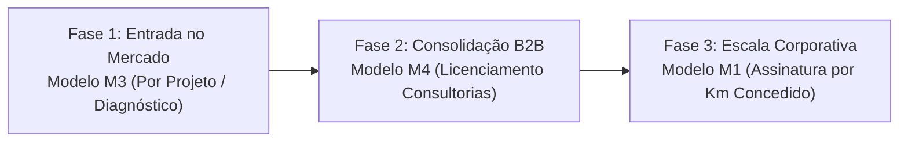

# Radar++ Discovery — D2-07: Avaliação de Modelos de Negócio e Precificação para Infraestrutura Linear
## Análise Estruturada de Modelos Comerciais, Barreiras de Adoção e Viabilidade Econômica

**Documento:** `D2-07-modelos-comerciais.md`  
**Ciclo:** Investigação D2 — Infraestrutura Linear (Rodovias e Ferrovias)  
**Data:** 24 de Outubro de 2026  
**Status:** Oficial — Entregue para Governança  
**Responsável:** Especialista em Modelos de Negócio B2B/B2G e Arquiteto de Software  
**Repositório Oficial:** `api-radar-deformacao` (caminho: `docs/discovery/D2-07-modelos-comerciais.md`)  
**Regra Estrita de Governança:** Não inventar faturamento garantido, tabelas públicas falsas de concorrentes nem projeções irrealistas de retorno sobre investimento.  

---

## 1. Visão Geral dos Modelos de Negócio Avaliados

Para o setor de infraestrutura linear, foram desenhados e avaliados criticamente cinco modelos comerciais potenciais para o Radar++:

```
+---------------------------------------------------------------------------------------------------------------+
|                                    MATRIZ COMPARATIVA DE MODELOS COMERCIAIS AVALIADOS                         |
+----+--------------------------------+----------------------------+-----------------------+--------------------+
| ID | Modelo de Negócio              | Unidade de Cobrança        | Perfil de Comprador   | Maturidade Atual   |
+----+--------------------------------+----------------------------+-----------------------+--------------------+
| M1 | Assinatura por Extensão Linear | R$ / km de corredor / ano  | Grandes Concessioná-  | Hipótese Aberta    |
|    | de Corredor (Km/Ano)           | (com faixa de buffer 500m) | rias Rodov. e Ferrov. | (Alto Valor)       |
+----+--------------------------------+----------------------------+-----------------------+--------------------+
| M2 | Assinatura por Área Monitorada | R$ / km² / mês             | Concessionárias e     | Hipótese Aberta    |
|    | (Polígono Geográfico)          | (AOIs de serra / trechos)  | Consórcios de Obras   | (Flexível)         |
+----+--------------------------------+----------------------------+-----------------------+--------------------+
| M3 | Contratação por Campanha /     | R$ fixo por estudo         | Consultorias de Enge- | **VALIDAÇÃO MAIS   |
|    | Diagnóstico Pontual (Laudo)    | retrospectivo entregue     | nharia Geotécnica PME | **ÁGIL E PROMISSORA|
+----+--------------------------------+----------------------------+-----------------------+--------------------+
| M4 | Licenciamento White-Label      | Mensalidade de software    | Consultorias de Projet| Hipótese Aberta    |
|    | para Consultorias Geotécnicas  | para a consultoria revender| de Infraestrutura     | (Médio Prazo)      |
+----+--------------------------------+----------------------------+-----------------------+--------------------+
| M5 | Conector de Integração com     | Taxa de implantação +      | Operadores com SAP PM,| Hipótese Complexa  |
|    | Sistemas de Ativos (ERP/GIS)   | anuidade de conector API   | IBM Maximo ou ArcGIS  | (Longo Prazo)      |
+----+--------------------------------+----------------------------+-----------------------+--------------------+
```

---

## 2. Detalhamento Estruturado dos Modelos

### 2.1. Modelo M1 — Assinatura por Extensão Linear de Corredor (R$ / km / ano)
* **Comprador Potencial:** Diretor de Operações e Engenharia de Concessionárias de Rodovias (Motiva, Arteris, EcoRodovias) ou Ferrovias (Rumo, MRS).
* **Usuário Final:** Coordenador de Geotecnia e Pavimento da concessionária.
* **Problema Atendido:** Monitoramento preventivo de centenas de quilômetros de pistas e vias para cumprimento do SGTEC e prevenção de interrupções de tráfego.
* **Forma de Contratação:** Contrato corporativo de fornecimento B2B anual, faturado mensalmente com base na extensão concedida (ex.: 400 km de malha).
* **Benefício Esperado:** Redução dos custos com rondas e inspeções topográficas desnecessárias em trechos estáveis.
* **Custos Operacionais para o Radar++:** Consumo moderado de armazenamento em nuvem e processamento de bursts Sentinel-1 ao longo da linha do corredor.
* **Dependências Técnicas:** Ferramenta de *buffer* automático que gere polígonos estreitos (ex.: 500 m para cada lado do eixo) para evitar o processamento de áreas florestadas irrelevantes fora da faixa de domínio.
* **Barreiras de Adoção:** Hipótese de ciclo de vendas corporativo longo (estimado preliminarmente em 6 a 12 meses), com governança de compras rigorosa e exigência de prova de conceito local antes de qualquer contratação para a malha completa.

### 2.2. Modelo M3 — Contratação por Campanha / Diagnóstico Pontual (Laudo Retrospectivo)
* **Comprador Potencial:** Sócios e Responsáveis Técnicos de empresas de consultoria geotécnica de pequeno e médio porte (PMEs).
* **Usuário Final:** Engenheiro civil ou geólogo da consultoria que elabora laudos periciais de encostas e projetos de contenção.
* **Problema Atendido:** Necessidade urgente de saber se um determinado talude que começou a trincar vinha se movimentando nos últimos 5 anos, para instruir ação judicial ou projeto executivo de reforço.
* **Forma de Contratação:** Pagamento sob demanda (por projeto / por AOI processada). A consultoria embute o valor do Radar++ diretamente na proposta comercial enviada ao seu cliente final.
* **Benefício Esperado:** A consultoria obtém uma análise histórica retrospectiva completa (2014-2026) em 24 a 48 horas, sem precisar contratar um especialista em radar nem instalar servidores Linux próprios.
* **Custos Operacionais:** Muito baixos (processamento pontual executado sob demanda).
* **Barreiras de Adoção:** Menor previsibilidade de receita recorrente para o Radar++ (*revenue* transacional em vez de ARR).
* **Hipótese de Entrada Mais Ágil:** Configura a hipótese de modelo mais aderente à realidade de entrada no mercado brasileiro, pois reduz o atrito de decisão e dispensa a contratação imediata de assinaturas anuais de alto valor.

### 2.3. Modelo M4 — Licenciamento para Consultorias Geotécnicas (Parceria B2B2B)
* **Comprador Potencial:** Empresas médias de geotecnia viária (ex.: empresas que prestam serviços regulares para o DNIT e concessionárias).
* **Usuário Final:** Equipe interna de geoprocessamento da consultoria.
* **Problema Atendido:** A consultoria deseja oferecer monitoramento orbital por satélite aos seus clientes corporativos para se diferenciar no mercado, mas não quer desenvolver a plataforma tecnológica do zero.
* **Forma de Contratação:** Assinatura mensal de plataforma que permite processar até X áreas por mês e exportar dados padronizados com a logomarca da consultoria (*White-Label* ou *Powered by Radar++*).
* **Benefício Esperado:** Escala comercial acelerada para o Radar++, utilizando a força de vendas e a carteira de clientes já estabelecida da consultoria.

---

## 3. Análise de Viabilidade e Recomendação de Sequenciamento Comercial

O Radar++ não deve tentar fechar contratos milionários de extensão de corredor (Modelo M1) no primeiro dia, pois a plataforma ainda não possui validação de marca nem atestados de capacidade técnica corporativos.



### O Caminho Crítico Recomendado:
1. **Passo 1 (Validação Rápida):** Oferecer diagnósticos retrospectivos pontuais (Modelo M3) para consultorias geotécnicas parceiras, validando a metodologia e acumulando casos de sucesso reais.
2. **Passo 2 (Recorrência via Consultorias):** Converter as consultorias mais ativas para planos mensais de licenciamento da plataforma (Modelo M4).
3. **Passo 3 (Entrada nas Concessionárias):** Utilizar as consultorias parceiras como porta de entrada para disputar contratos anuais de monitoramento de corredor linear (Modelo M1) junto às grandes concessionárias (Motiva, Arteris, EcoRodovias, Rumo).
