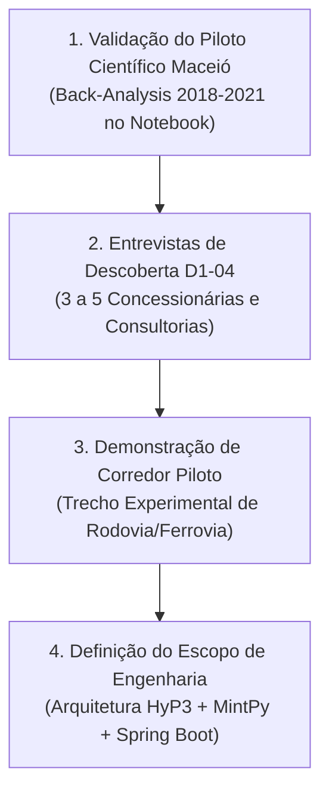

# Radar++ Discovery — D2-10: Parecer Estratégico e Recomendações Finais da Investigação D2
## Conclusões sobre Infraestrutura Linear, Posicionamento do Produto e Próximos Passos

**Documento:** `D2-10-parecer-estrategico.md`  
**Ciclo:** Investigação D2 — Infraestrutura Linear (Rodovias e Ferrovias)  
**Data:** 24 de Outubro de 2026  
**Status:** Oficial — Entregue para Deliberação da Governança  
**Responsável:** Equipe Multidisciplinar de Inteligência Estratégica, Geotecnia e Regulação  
**Repositório Oficial:** `api-radar-deformacao` (caminho: `docs/discovery/D2-10-parecer-estrategico.md`)  

---

## 1. Conclusão Principal: Avaliação da Oportunidade Comercial em Infraestrutura Linear

### Resposta Objetiva:
> **A investigação D2 indica uma HIPÓTESE PROMISSORA DE APLICAÇÃO COMERCIAL em Infraestrutura Linear (Rodovias e Ferrovias), que precisa ser validada em campo mediante entrevistas com concessionárias e consultorias. O InSAR não deve se posicionar como substituto de drones ou vistorias de campo, mas como uma HIPÓTESE DE CAMADA COMPLEMENTAR DE TRIAGEM EM MACROESCALA E ANÁLISE HISTÓRICA RETROSPECTIVA.**

### Fundamentação da Avaliação:
1. **O Operador Não Consegue Vigiar Milhares de Quilômetros:** Concessionárias como Motiva (CCR), Arteris, EcoRodovias e Rumo administram entre 3.000 e 14.000 km de malha. É inviável deslocar equipes de drones ou topógrafos com alta frequência para toda essa extensão. O satélite Sentinel-1 possui custo marginal de aquisição nulo, cobrindo corredores extensos em suas passagens orbitais regulares.
2. **Potencial de Rastreio de Tendências Lentas (*Creep*), sem Detecção Garantida de Ruptura:** Sob condições favoráveis de coerência de fase e geometria de visada, o InSAR em Banda C permite mapear tendências de deformação milimétrica lenta (*creep*). Contudo, **não há garantia técnica de detecção antecipada de rupturas ou deslizamentos repentinos**, especialmente sob cobertura florestal de Mata Atlântica ou em instabilidades deflagradas abruptamente por temporais torrenciais.
3. **Hipótese de Disposição a Pagar e Ciclos Comerciais a Validar:** Concessionárias privadas possuem orçamentos de conservação viária e sofrem penalidades contratuais da ANTT/ARTESP por interrupções, o que sustenta a hipótese de maior capacidade orçamentária do que municípios. Todavia, a disposição real a pagar por serviços de monitoramento orbital, os custos de aquisição e a duração dos ciclos de vendas corporativos (estimados preliminarmente entre 6 e 12 meses) **permanecem estritamente como hipóteses comerciais a validar** no roteiro de entrevistas `D1-04`.

---

## 2. Limites Críticos do Produto e Diretrizes Operacionais

Para garantir que o Radar++ mantenha sua integridade técnica e não gere expectativas irrealistas:

1. **O Radar++ NÃO DEVE Prometer Detecção sob Vegetação Densa com Sentinel-1:** Em taludes cobertos por floresta contínua de Mata Atlântica sem rocha exposta ou intervenção civil, a Banda C sofre descorrelação temporal severa. O Radar++ deve registrar com transparência essa limitação geofísica, aguardando futuras missões em Banda L (NISAR).
2. **O Radar++ NÃO DEVE Emitir Alertas em Tempo Real de Queda de Barreira:** Deslizamentos rápidos decorrentes de temporais torrenciais ocorrem em minutos; satélites operam em ciclos de revisita de 6 a 12 dias. O Radar++ entrega **tendência de deslocamento acumulado e triagem de prioridades de manutenção**, nunca sirene ou alarme de evacuação imediata.
3. **O Radar++ NÃO Emite ART:** O produto entrega inteligência geoespacial e mapas auditáveis; a responsabilidade técnica do projeto de estabilização continua sendo privativa da consultoria ou do engenheiro geotécnico da operadora.
4. **Flexibilidade Orbital (Órbita Única vs. Bi-orbital):** Não é obrigatório o uso simultâneo de órbitas ascendentes e descendentes em todas as análises. O processamento por órbita única (LOS) é o padrão operacional recomendado para triagens iniciais de baixo custo, enquanto a combinação bi-orbital é uma funcionalidade avançada sob demanda voltada para decomposição vetorial 2D/3D em trechos críticos de serra.
5. **Preservação da Distinção entre Piloto Científico e Mercado Comercial:** O caso de **Maceió/AL (subsidência urbana)** atua estritamente como **piloto científico de validação retrospectiva** do algoritmo e do pipeline HyP3/MintPy contra dados auditados do SGB/CPRM. A **infraestrutura linear** configura uma **hipótese de mercado comercial a ser validada**, sem que haja inversão prematura da prioridade técnica de desenvolvimento.

---

## 3. Recomendações Práticas e Próximos Passos para o Radar++

### Plano de Ação Imediato:
1. **Homologação dos Documentos D1 e D2:** Submeter a suíte documental completa (18 documentos em `docs/discovery/`) para deliberação da liderança do Radar++.
2. **Conduzir as Entrevistas Qualitativas com Base no Roteiro `D1-04`:** Agendar conversas com engenheiros de concessionárias privadas e consultorias geotécnicas para testar se a proposta de triagem prévia de taludes ressoa com suas dores cotidianas de manutenção e validar a disposição a pagar.
3. **Execução Controlada do Piloto Maceió (Em Ambiente Experimental):** Rodar o protocolo `D1-05` em ambiente isolado (Jupyter Notebook / Python) para consolidar a evidência empírica de acurácia contra os laudos do SGB/CPRM, gerando a primeira grande vitrine técnica do produto.
4. **Preservar o Repositório sem Código Prematuro:** Manter os repositórios de código (`api-radar-deformacao`, `radar_fastapi_py`, `front_react`) protegidos contra desenvolvimento de telas ou microsserviços até que as entrevistas comprovem o modelo de contratação preferido pelos clientes.
