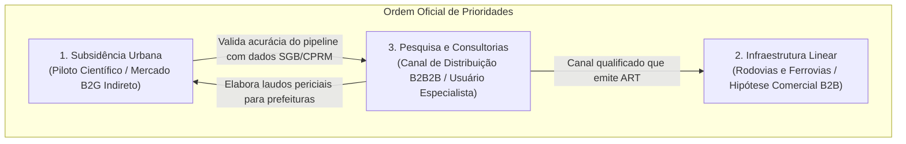

# Radar++ Discovery — D3-02: Segmentação Estruturada de Mercado e Perfis de Atores
## Caracterização dos Segmentos, Papéis de Decisão e Dinâmica de Compra

**Documento:** `D3-02-segmentacao-mercado.md`  
**Ciclo:** Investigação D3 — Consolidação Estratégica e Engenharia de Produto  
**Data:** 24 de Outubro de 2026  
**Status:** Oficial — Entregue para Governança  
**Responsável:** Equipe Multidisciplinar (Analista Sênior B2B/B2G, Especialista em Concessões, Consultor de Negócios)  
**Repositório Oficial:** `api-radar-deformacao` (caminho: `docs/discovery/D3-02-segmentacao-mercado.md`)  

---

## 1. Visão Geral da Segmentação Estratégica

O Radar++ estrutura seu mercado em três segmentos interdependentes, preservando a ordem oficial de prioridades aprovada pela governança:



---

## 2. Detalhamento Estruturado dos Segmentos

### 2.1. Segmento 1: Subsidência e Deformações Urbanas (Prioridade 1 — Piloto Científico)

```
+----------------------------------------------------------------------------------------------------------------------------------------------------+
|                                      CARACTERIZAÇÃO DO SEGMENTO DE SUBSIDÊNCIA URBANA                                                              |
+--------------------------+-------------------------------------------------------------------------------------------------------------------------+
| Critério                 | Diagnóstico Estruturado                                                                                                 |
+--------------------------+-------------------------------------------------------------------------------------------------------------------------+
| Papel no Radar++         | **Segmento de Validação Científica Fundamental** (MVP) e mercado comercial B2G de médio prazo via consultorias.       |
+--------------------------+-------------------------------------------------------------------------------------------------------------------------+
| Problema Típico          | Afundamento regional do solo decorrente de dissolução de rochas (carste/sal-gema), extração de água subterrânea ou      |
|                          | adensamento de solos moles de baixadas, gerando trincas estruturais em milhares de imóveis e rompimento de redes.       |
+--------------------------+-------------------------------------------------------------------------------------------------------------------------+
| Caso de Validação        | **Maceió/AL (Bairros Pinheiro, Mutange, Bebedouro, Bom Parto):** Dados abertos, laudos auditados do SGB/CPRM e marcos  |
|                          | geodésicos do IBGE (SIRGAS 2000) servem de verdade de campo para aferição da velocidade milimétrica e desdobramento.   |
+--------------------------+-------------------------------------------------------------------------------------------------------------------------+
| Comprador Econômico      | Secretarias Municipais de Infraestrutura / Obras; Coordenadorias de Defesa Civil (COMPDEC); Ministério Público.        |
+--------------------------+-------------------------------------------------------------------------------------------------------------------------+
| Usuário Operacional      | Engenheiro ou geólogo de Defesa Civil; analista de risco do SGB; consultores contratados para elaboração de laudos.    |
+--------------------------+-------------------------------------------------------------------------------------------------------------------------+
| Dinâmica de Aquisição    | B2G complexo via Lei Federal nº 14.133/2021 (licitações formais, concorrências ou dispensa por emergência comprovada). |
+--------------------------+-------------------------------------------------------------------------------------------------------------------------+
| Disposição a Pagar       | **Baixa a Nula para SaaS Direto**: Prefeituras médias não dispõem de orçamento contínuo de software de geoprocessamento;|
|                          | **Alta para Serviços Integrados de Engenharia**: Orçamentos de R$ 500k a R$ 3M em contratos amplos de consultoria.      |
+--------------------------+-------------------------------------------------------------------------------------------------------------------------+
| Barreiras de Entrada     | Falta de equipe técnica interna nos municípios para operar ferramentas sofisticadas; burocracia de contratação pública. |
+--------------------------+-------------------------------------------------------------------------------------------------------------------------+
```

### 2.2. Segmento 2: Infraestrutura Linear — Rodovias e Ferrovias (Prioridade 2 — Mercado Comercial)

```
+----------------------------------------------------------------------------------------------------------------------------------------------------+
|                                      CARACTERIZAÇÃO DO SEGMENTO DE INFRAESTRUTURA LINEAR                                                           |
+--------------------------+-------------------------------------------------------------------------------------------------------------------------+
| Critério                 | Diagnóstico Estruturado                                                                                                 |
+--------------------------+-------------------------------------------------------------------------------------------------------------------------+
| Papel no Radar++         | **Possível Mercado Comercial de Expansão** (Hipótese sob validação qualitativa nas entrevistas D1-04).                 |
+--------------------------+-------------------------------------------------------------------------------------------------------------------------+
| Problema Típico          | Rastejo lento (*creep*) em taludes de corte rochoso e aterros rodoviários/ferroviários; colapso de encostas e quedas de |
|                          | barreira que interrompem o tráfego de cargas e passageiros em trechos de serra (ex.: Serra das Araras, Serra do Mar).  |
+--------------------------+-------------------------------------------------------------------------------------------------------------------------+
| Escala Operacional       | Concessionárias privadas gerenciam malhas de 3.000 a 14.000 km (ex.: Motiva/CCR, Arteris, EcoRodovias, Rumo, MRS).     |
+--------------------------+-------------------------------------------------------------------------------------------------------------------------+
| Comprador Econômico      | Diretor de Engenharia e Operações; Gerente Geral de Conservação Viária ou Via Permanente.                               |
+--------------------------+-------------------------------------------------------------------------------------------------------------------------+
| Usuário Operacional      | Coordenador de Geotecnia e Pavimento; Engenheiro de Terraplenos e Obras de Arte Especiais (OAEs); Especialista SIG.     |
+--------------------------+-------------------------------------------------------------------------------------------------------------------------+
| Contexto Regulatório     | ANTT exige Sistema de Gestão de Terraplenos e Contenções (SGTEC) em concessões federais; ARTESP fiscaliza malha em SP;  |
|                          | DNIT reformulou o PROARTE (IN nº 2/2026), adotando orçamentação paramétrica para OAEs (InSAR como hipótese complementar)|
+--------------------------+-------------------------------------------------------------------------------------------------------------------------+
| Disposição a Pagar       | **Hipótese Comercial a Validar**: Supõe-se capacidade orçamentária no OPEX de conservação viária, mas o interesse real  |
|                          | em pagar por assinaturas anuais por quilômetro depende de comprovação de eficácia frente a drones e vistorias de pista. |
+--------------------------+-------------------------------------------------------------------------------------------------------------------------+
| Barreiras de Entrada     | Comitês corporativos com ciclo de vendas de 6 a 12 meses; exigência de prova de conceito local; aversão a falsos alarmes.|
+--------------------------+-------------------------------------------------------------------------------------------------------------------------+
```

### 2.3. Segmento 3: Pesquisa Científica e Consultorias de Engenharia (Prioridade 3 — Canal Estratégico)

```
+----------------------------------------------------------------------------------------------------------------------------------------------------+
|                                      CARACTERIZAÇÃO DO SEGMENTO DE CONSULTORIAS E ACADEMIA                                                         |
+--------------------------+-------------------------------------------------------------------------------------------------------------------------+
| Critério                 | Diagnóstico Estruturado                                                                                                 |
+--------------------------+-------------------------------------------------------------------------------------------------------------------------+
| Papel no Radar++         | **Canal Primário de Distribuição (B2B2B / B2B2G), Usuários Especialistas e Parceiros de Validação Metodológica**.       |
+--------------------------+-------------------------------------------------------------------------------------------------------------------------+
| Problema Típico          | Necessidade de instruir laudos periciais de encostas e projetos executivos de contenção com histórico de deformação sem |
|                          | dispor de infraestrutura local de supercomputação nem cientistas de radar dedicados na folha de pagamento.              |
+--------------------------+-------------------------------------------------------------------------------------------------------------------------+
| Perfil de Empresa        | Consultorias de engenharia civil geotécnica de pequeno e médio porte (PMEs com 5 a 50 engenheiros).                     |
+--------------------------+-------------------------------------------------------------------------------------------------------------------------+
| Comprador Econômico      | Sócio Diretor / Responsável Técnico da Consultoria.                                                                     |
+--------------------------+-------------------------------------------------------------------------------------------------------------------------+
| Usuário Operacional      | Engenheiro Geotécnico de Projetos, Geólogo ou Analista de Geoprocessamento encarregado do laudo.                        |
+--------------------------+-------------------------------------------------------------------------------------------------------------------------+
| Vantagem Estratégica     | As consultorias emitem a Anotação de Responsabilidade Técnica (ART) exigida por concessionárias e prefeituras, preen-   |
|                          | chendo a fronteira jurídica que um software puramente digital não pode assumir.                                         |
+--------------------------+-------------------------------------------------------------------------------------------------------------------------+
| Modelo Mais Aderente     | **Contratação sob Demanda por Campanha / Laudo Pontual (Modelo M3)**: A consultoria embute o custo do processamento no   |
|                          | orçamento fechado do laudo apresentado ao seu cliente final, eliminando a barreira de assinatura anual no início.         |
+--------------------------+-------------------------------------------------------------------------------------------------------------------------+
```

---

## 3. Matriz de Atores e Papéis Decisórios

```
+----------------------------------------------------------------------------------------------------------------------------------------------------+
|                                      DISTRIBUIÇÃO DOS ATORES POR SEGMENTO E NÍVEL DE DECISÃO                                                        |
+-----------------------------+-----------------------------+-----------------------------+----------------------------------------------------------+
| Papel na Jornada            | Subsidência Urbana (D1)     | Infraestrutura Linear (D2)  | Consultorias e Pesquisa (Canal)                          |
+-----------------------------+-----------------------------+-----------------------------+----------------------------------------------------------+
| **Usuário Operacional**     | Técnico da Defesa Civil     | Engenheiro de Pavimento/OAE | Engenheiro Geotécnico / Analista SIG                     |
| *(Consome a interface)*     | Analista GIS Municipal      | Coordenador de Geotecnia    | Pesquisador de Sensoriamento Remoto                      |
+-----------------------------+-----------------------------+-----------------------------+----------------------------------------------------------+
| **Comprador Econômico**     | Secretário de Obras/Habitação| Diretor de Operações        | Sócio-Proprietário / RT da Consultoria                   |
| *(Assina o cheque)*         | Prefeito / Procurador Geral | Gerente Geral de Manutenção | Coordenador de P&D (Universidades/FAPESP)                |
+-----------------------------+-----------------------------+-----------------------------+----------------------------------------------------------+
| **Influenciador Técnico**   | Ministério Público (Promotor)| Especialista de Campo       | Consultor Acadêmico Externo                              |
| *(Define requisitos)*       | Auditor do Tribunal de Contas| Inspetor do SGTEC (ANTT)    | Professor de Geotecnia / Geodésia                        |
+-----------------------------+-----------------------------+-----------------------------+----------------------------------------------------------+
| **Parceiro de Validação**   | Pesquisadores SGB/CPRM      | Comissões Técnicas da ABCR  | Laboratórios de Radar da COPPE/UFRJ,                     |
| *(Atesta confiabilidade)*   | Instituto de Pesquisas (IPT)| Engenheiros Consultores DER | EPUSP, UFPE e Centros de Pesquisa                        |
+-----------------------------+-----------------------------+-----------------------------+----------------------------------------------------------+
```

---

## 4. Síntese Epistemológica: O que é Fato e o que é Hipótese por Segmento

```
+----------------------------------------------------------------------------------------------------------------------------------------------------+
|                                      STATUS DE MATURIDADE DO CONHECIMENTO POR SEGMENTO                                                             |
+-------------------+---------------------------------------------------------+----------------------------------------------------------------------+
| Segmento          | Fatos Confirmados (Evidências de Registro)              | Hipóteses Abertas a Validar                                          |
+-------------------+---------------------------------------------------------+----------------------------------------------------------------------+
| Subsidência       | 1. Maceió sofreu afundamento centimétrico documentado   | 1. Se prefeituras contratariam laudos InSAR via dispensa da         |
| Urbana            |    pelo SGB/CPRM e CPRM com dados InSAR consolidados.   |    Lei 14.133/2021 antes de eventos críticos manifestos.             |
|                   | 2. Prefeituras médias não têm equipes de geodésia SAR.  | 2. Se a visualização web direta reduz o tempo de resposta municipal. |
+-------------------+---------------------------------------------------------+----------------------------------------------------------------------+
| Infraestrutura    | 1. ANTT exige SGTEC, mas não impõe InSAR por nome.      | 1. Se concessionárias pagarão assinatura anual por km monitorado.    |
| Linear            | 2. Drones e vistorias de pista são a prática padrão.    | 2. Se o ciclo de vendas corporativo pode ser reduzido a < 6 meses    |
|                   | 3. IN DNIT nº 2/2026 reestruturou PROARTE (paramétrico).|    com demonstrações de corredor piloto prévio.                      |
+-------------------+---------------------------------------------------------+----------------------------------------------------------------------+
| Consultorias      | 1. Consultorias emitem ART exigida pelo mercado.        | 1. Se o modelo M3 (pagamento por campanha/laudo) atinge tração       |
| e Academia        | 2. PMEs de geotecnia não dominam terminais MintPy.      |    comercial mais rápida que planos mensais de software.             |
+-------------------+---------------------------------------------------------+----------------------------------------------------------------------+
```
