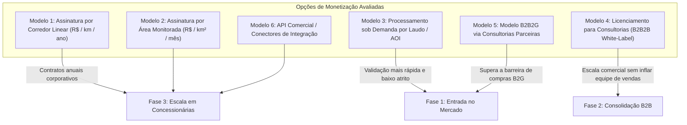

# Radar++ Discovery — D3-03: Avaliação de Modelos de Negócio e Estratégia Comercial
## Análise Estruturada das Vias de Monetização, Custos Operacionais e Hipóteses a Validar

**Documento:** `D3-03-modelo-negocio.md`  
**Ciclo:** Investigação D3 — Consolidação Estratégica e Engenharia de Produto  
**Data:** 24 de Outubro de 2026  
**Status:** Oficial — Entregue para Governança  
**Responsável:** Equipe Multidisciplinar (Consultor de Viabilidade Comercial, Product Manager B2B/B2G, Arquiteto de Software)  
**Repositório Oficial:** `api-radar-deformacao` (caminho: `docs/discovery/D3-03-modelo-negocio.md`)  
**Regra Estrita de Governança:** Não inventar tabelas públicas falsas de preços de concorrentes, projeções de faturamento não comprovadas ou disposição a pagar sem respaldo empírico. Todas as proposições comerciais são tratadas como hipóteses a validar.

---

## 1. Visão Geral das Alternativas Comerciais Avaliadas

Foram identificadas e comparadas criticamente seis alternativas de modelo comercial para o Radar++:



---

## 2. Detalhamento Estruturado dos Modelos Avaliados

### 2.1. Modelo 1 — Assinatura por Corredor Linear de Transporte (R$ / km / ano)
* **Problema Atendido:** Monitoramento contínuo de centenas ou milhares de quilômetros de ferrovias ou rodovias para apoio ao SGTEC e prevenção de interrupções de tráfego.
* **Usuário:** Coordenador de Geotecnia e Pavimento da concessionária.
* **Comprador Econômico:** Diretor de Operações e Engenharia de Concessionárias Privadas (Motiva, Arteris, Rumo).
* **Valor Potencial:** Otimização do direcionamento de vistorias de campo e redução do risco de bloqueios não planejados por eventos de rastejo lento.
* **Custos Operacionais Estimados:** Custo computacional moderado na nuvem (fatiamento de bursts ao longo do buffer de 500m do shapefile) e armazenamento de COGs em AWS S3.
* **Riscos e Barreiras:** Ciclo de vendas longo (estimado preliminarmente em 6 a 12 meses); comitês de compras rigorosos; exigência de prova de conceito local antes de contratar a malha inteira.
* **Evidências Disponíveis e Estado da Hipótese:** *Hipótese Comercial Aberta a Validar* no roteiro de entrevistas `D1-04`.

### 2.2. Modelo 2 — Assinatura por Área Monitorada (R$ / km² / mês)
* **Problema Atendido:** Monitoramento contínuo de bacias urbanas de subsidência, canteiros de obras pesadas ou campos de mineração delimitados por polígono geográfico (AOI).
* **Usuário:** Analista SIG, engenheiro civil ou perito ambiental.
* **Comprador Econômico:** Secretarias municipais, consórcios construtores de infraestrutura ou mineradoras de médio porte.
* **Valor Potencial:** Acompanhamento mensal sistemático da evolução de deslocamentos acumulados na AOI contratada.
* **Custos Operacionais:** Muito previsíveis (AOI fixa consome número fixo de bursts por ciclo orbital de 6 ou 12 dias).
* **Riscos e Barreiras:** Prefeituras têm dificuldade em empenhar assinaturas mensais recorrentes de software puro; alto risco de *churn* se a velocidade de afundamento estabilizar.
* **Evidências Disponíveis e Estado da Hipótese:** *Hipótese sob Avaliação*.

### 2.3. Modelo 3 — Processamento sob Demanda / Diagnóstico Pontual (Pay-per-Analysis)
* **Problema Atendido:** Necessidade emergencial de um laudo pericial ou estudo retrospectivo (2014-2026) sobre uma encosta específica ou quarteirão que começou a trincar.
* **Usuário:** Engenheiro geotécnico de campo ou consultor independente.
* **Comprador Econômico:** Sócio ou Responsável Técnico de consultorias de engenharia de pequeno e médio porte (PMEs).
* **Valor Potencial:** Reconstrução histórica em 24 a 48 horas sem custos fixos mensais; o cliente embute o preço do Radar++ diretamente na proposta fechada ao seu cliente final.
* **Custos Operacionais:** Praticamente nulos em repouso (custo ocorre estritamente durante o disparo do job computacional).
* **Riscos e Barreiras:** Receita transacional com menor previsibilidade de faturamento recorrente (*ARR*).
* **Evidências Disponíveis e Estado da Hipótese:** **Hipótese de Entrada Mais Promissora**. Alinha-se perfeitamente com a baixa maturidade inicial do produto e elimina o atrito de decisão corporativa.

### 2.4. Modelo 4 — Licenciamento para Consultorias Geotécnicas (White-Label / Parceria B2B2B)
* **Problema Atendido:** A consultoria quer oferecer monitoramento orbital contínuo aos seus clientes corporativos para se diferenciar da concorrência, mas não tem equipe nem software proprietário.
* **Usuário:** Equipe técnica interna da consultoria.
* **Comprador Econômico:** Diretoria da consultoria de engenharia.
* **Valor Potencial:** A consultoria revende relatórios e acessos com sua própria marca ou como "Powered by Radar++", cobrando honorários de engenharia e repassando mensalidade de software.
* **Custos Operacionais:** Suporte a multi-inquilino (*multi-tenancy*) e exportação automatizada de laudos formatados.
* **Riscos e Barreiras:** Exige maturidade de marca da consultoria e alinhamento de confidencialidade de dados com clientes finais.
* **Evidências Disponíveis e Estado da Hipótese:** *Hipótese sob Teste Qualitativo*.

### 2.5. Modelo 5 — Modelo B2B2G via Consultorias Parceiras
* **Problema Atendido:** Acesso a recursos públicos municipais e estaduais para estudos de risco geológico sem submeter o Radar++ diretamente às amarras da Lei Federal nº 14.133/2021.
* **Usuário:** Consultores contratados pelo município e técnicos da Defesa Civil.
* **Comprador Econômico:** A consultoria de engenharia que venceu a concorrência pública de monitoramento geotécnico do município.
* **Valor Potencial:** O município contrata o laudo global de engenharia com emissão de ART; a consultoria subcontrata a plataforma de processamento de satélite do Radar++ como insumo técnico.
* **Custos Operacionais:** Baixos (foco no processamento e disponibilização de camadas SIG).
* **Riscos e Barreiras:** Dependência do fluxo de caixa e cronograma de medição da consultoria em contratos públicos.
* **Evidências Disponíveis e Estado da Hipótese:** **Fato Documentado no Mercado Brasileiro** (prefeituras contratam consórcios de engenharia, não plataformas SaaS isoladas).

### 2.6. Modelo 6 — API Comercial e Conectores de Integração
* **Problema Atendido:** Operadores corporativos com grandes plataformas internas de gestão de ativos (Esri ArcGIS Enterprise, SAP PM, IBM Maximo) querem receber os dados de deformação diretamente nos seus sistemas.
* **Usuário:** Analistas de sistemas GIS e engenheiros de confiabilidade corporativa.
* **Comprador Econômico:** CIO / Gerente Geral de TI e Automação de concessionárias de grande porte.
* **Valor Potencial:** Automação de ordens de serviço (se o satélite detectar deformação > limiar, o sistema gera automaticamente uma tarefa de vistoria no SAP).
* **Custos Operacionais:** Desenvolvimento e manutenção contínua de conectores e APIs RESTful seguras com alta disponibilidade.
* **Riscos e Barreiras:** Altos custos de integração e requisitos de segurança da informação (ISO 27001, SOC 2); indicado apenas para clientes maduros.
* **Evidências Disponíveis e Estado da Hipótese:** *Hipótese Tecnológica de Longo Prazo*.

---

## 3. Matriz Comparativa das Alternativas Comerciais

```
+----------------------------------------------------------------------------------------------------------------------------------------------------+
|                                    MATRIZ COMPARATIVA DE MODELOS DE NEGÓCIO PARA O RADAR++                                                         |
+----+----------------------+--------------------+--------------------+--------------------+--------------------+------------------------------------+
| ID | Modelo Avaliado      | Complexidade Venda | Previsibilidade    | Custo Nuvem Radar++| Nível de Risco     | Recomendação Estratégica           |
+----+----------------------+--------------------+--------------------+--------------------+--------------------+------------------------------------+
| M1 | Assinatura Linear    | Alta (6-12 meses)  | Alta (Recorrente)  | Médio (Buffers)    | Alto               | Fase 3 (Escala em Concessionárias) |
+----+----------------------+--------------------+--------------------+--------------------+--------------------+------------------------------------+
| M2 | Assinatura por Área  | Média (3-6 meses)  | Média (Risco churn)| Baixo a Médio      | Médio              | Fase 3 (Grandes bacias urbanas)    |
+----+----------------------+--------------------+--------------------+--------------------+--------------------+------------------------------------+
| M3 | Processamento Demanda| **Baixa (Dias)**   | Baixa (Transação)  | **Muito Baixo**    | **Muito Baixo**    | **FASE 1: PRIORIDADE DE ENTRADA**  |
+----+----------------------+--------------------+--------------------+--------------------+--------------------+------------------------------------+
| M4 | Licenciamento Consul.| Média (1-3 meses)  | Média a Alta       | Baixo              | Baixo a Médio      | **FASE 2: ALAVANCA DE ESCALA B2B** |
+----+----------------------+--------------------+--------------------+--------------------+--------------------+------------------------------------+
| M5 | B2B2G via Consultoria| Média (Vinculada)  | Moderada           | Baixo              | Baixo              | **FASE 1 e 2: ENTRADA NO SETOR PÚB**|
+----+----------------------+--------------------+--------------------+--------------------+--------------------+------------------------------------+
| M6 | Conectores API       | Muito Alta         | Alta               | Médio a Alto       | Alto               | Fase 4 (Clientes corporativos Tier1|
+----+----------------------+--------------------+--------------------+--------------------+--------------------+------------------------------------+
```

---

## 4. Estratégia de Sequenciamento Comercial Recomendada

Para mitigar o risco de queimar capital antes de comprovar tração no mercado, a equipe multidisciplinar recomenda o seguinte sequenciamento progressivo:

```
+----------------------------------------------------------------------------------------------------------------------------------------------------+
|                                         ROADMAP DE IMPLEMENTAÇÃO DOS MODELOS COMERCIAIS                                                           |
+-------------------+--------------------------------------------------------------------------------------------------------------------------------+
| Estágio           | Foco Comercial e Ações Críticas                                                                                                |
+-------------------+--------------------------------------------------------------------------------------------------------------------------------+
| **Fase 1: Entrada**| Adotar **Modelo M3 (Sob Demanda)** e **Modelo M5 (B2B2G Indireto)**. Oferecer diagnósticos retrospectivos rápidos para        |
| (MVP e Piloto)    | consultorias parceiras utilizarem em laudos reais de subsidência e taludes de rodovias, validando a disposição a pagar.          |
+-------------------+--------------------------------------------------------------------------------------------------------------------------------+
| **Fase 2: Tração**| Lançar **Modelo M4 (Licenciamento B2B2B)**. Converter as consultorias que mais utilizam diagnósticos pontuais em planos       |
| (Pós-Validação)   | mensais com créditos recorrentes de processamento e relatórios padronizados com a logomarca da consultoria.                   |
+-------------------+--------------------------------------------------------------------------------------------------------------------------------+
| **Fase 3: Escala**| Disputar **Modelo M1 (Assinatura por Km)** junto a grandes concessionárias (Motiva, Arteris, Rumo), utilizando as consultorias |
| (Maturidade B2B)  | parceiras já credenciadas como co-proponentes técnicas e emissoras da ART do serviço.                                         |
+-------------------+--------------------------------------------------------------------------------------------------------------------------------+
```
