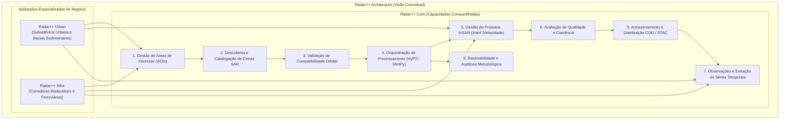
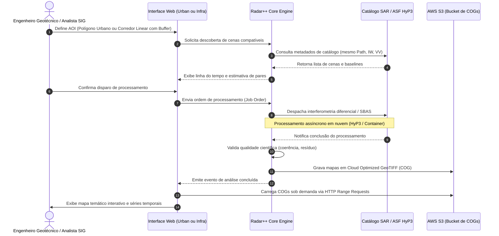

# Radar++ Discovery — D3-04: Arquitetura Conceitual e Capacidades de Produto
## Decomposição Funcional entre Core Compartilhado, Módulo Urban e Módulo Infra

**Documento:** `D3-04-capacidades-produto.md`  
**Ciclo:** Investigação D3 — Consolidação Estratégica e Engenharia de Produto  
**Data:** 24 de Outubro de 2026  
**Status:** Oficial — Entregue para Governança  
**Responsável:** Arquiteto de Software, Product Manager B2B/B2G, Especialista em Sensoriamento Remoto  
**Repositório Oficial:** `api-radar-deformacao` (caminho: `docs/discovery/D3-04-capacidades-produto.md`)  
**Diretriz Arquitetural:** Esta divisão é estritamente conceitual e orientada a capacidades de negócio. **Não criar novos repositórios Git, microsserviços ou bancos de dados nesta fase.**

---

## 1. Visão Geral da Arquitetura Funcional

O Radar++ organiza suas capacidades em torno de um núcleo de processamento interferométrico compartilhado (**Radar++ Core**) que atende a dois módulos especializados de negócio: **Radar++ Urban** (subsidência e deformações urbanas) e **Radar++ Infra** (corredores rodoviários e ferroviários).



---

## 2. Detalhamento do Radar++ Core (Capacidades Compartilhadas)

O Core encapsula toda a complexidade da geodésia por satélite, sensoriamento remoto SAR e orquestração de dados em nuvem:

```
+----------------------------------------------------------------------------------------------------------------------------------------------------+
|                                      CATÁLOGO DE CAPACIDADES DO RADAR++ CORE                                                                        |
+----+--------------------------------+--------------------------------------------------------------------------------------------------------------+
| ID | Capacidade                     | Descrição Funcional e Responsabilidade                                                                      |
+----+--------------------------------+--------------------------------------------------------------------------------------------------------------+
| C1 | Gestão de Áreas de Interesse   | Permitir o desenho interativo no mapa ou upload de arquivos geográficos (GeoJSON, KML, Shapefile compactado).|
|    | (AOIs)                         | Validação de auto-interseção, cálculo de área total (km²) e geração de caixa envolvente (*bounding box*).   |
+----+--------------------------------+--------------------------------------------------------------------------------------------------------------+
| C2 | Descoberta e Catalogação SAR   | Consulta assíncrona ao catálogo aberto do Sentinel-1 via APIs abertas (ASF Search API / ESA Copernicus Hub).|
|    |                                | Recuperação de metadados: data de aquisição, órbita relativa (Path), modo (IW), polarização (VV) e direção.  |
+----+--------------------------------+--------------------------------------------------------------------------------------------------------------+
| C3 | Validação de Compatibilidade   | Validação rigorosa dos pré-requisitos interferométricos antes do processamento: mesmo Path orbital, mesma    |
|    | Orbital e Temporal             | geometria de visada (Ascendente ou Descendente), *baseline* perpendicular ($B_\perp < 150\text{ m}$) e temporal.|
+----+--------------------------------+--------------------------------------------------------------------------------------------------------------+
| C4 | Orquestração de Processamento  | Despacho assíncrono de jobs de interferometria diferencial (InSAR) para processamento em nuvem (ex.: ASF     |
|    |                                | HyP3 via API), com monitoramento de status (*PENDING*, *RUNNING*, *SUCCEEDED*, *FAILED*) e retentativas.   |
+----+--------------------------------+--------------------------------------------------------------------------------------------------------------+
| C5 | Gestão de Produtos InSAR       | Ingestão e catalogação dos resultados científicos: interferogramas de fase desdobrada (*unwrapped phase*),  |
|    |                                | matrizes de coerência espacial ($\gamma$), modelos digitais de elevação utilizados e velocidade média anual.  |
+----+--------------------------------+--------------------------------------------------------------------------------------------------------------+
| C6 | Avaliação de Qualidade e       | Cálculo automático de métricas de confiabilidade: coerência espacial média ($\bar{\gamma}$), desvio-padrão   |
|    | Confiabilidade                 | residual, porcentagem de pixels válidos pós-máscara e verificação de erros de *unwrapping* (saltos de $2\pi$).|
+----+--------------------------------+--------------------------------------------------------------------------------------------------------------+
| C7 | Observações e Séries Temporais | Consulta pontual em qualquer coordenada $(x, y)$ da AOI para extração da curva temporal de deslocamento      |
|    |                                | acumulado (mm) entre 2014 e a data atual, com ajuste de regressão linear para determinação da velocidade.    |
+----+--------------------------------+--------------------------------------------------------------------------------------------------------------+
| C8 | Rastreabilidade e Auditoria    | Registro imutável de todos os parâmetros técnicos empregados: identificadores das cenas brutas SLC, DEM de   |
|    |                                | referência (Copernicus 30m), versão do software (MintPy/ISCE2) e usuário solicitante para auditoria pericial.|
+----+--------------------------------+--------------------------------------------------------------------------------------------------------------+
| C9 | Armazenamento e Distribuição   | Conversão dos rasters geodésicos para formato *Cloud Optimized GeoTIFF (COG)* armazenados em bucket S3, com  |
|    | de Dados Otimizados            | metadados catalogados no padrão STAC para visualização imediata no frontend via *Range Requests* HTTP.       |
+----+--------------------------------+--------------------------------------------------------------------------------------------------------------+
```

---

## 3. Detalhamento do Radar++ Urban (Capacidades Especializadas)

O módulo **Urban** atende às demandas de perícia geológica, defesa civil e planejamento territorial em áreas com adensamento urbano:

```
+----------------------------------------------------------------------------------------------------------------------------------------------------+
|                                      CATÁLOGO DE CAPACIDADES DO RADAR++ URBAN                                                                       |
+----+--------------------------------+--------------------------------------------------------------------------------------------------------------+
| ID | Capacidade Especializada       | Descrição Funcional e Diferencial de Negócio                                                                 |
+----+--------------------------------+--------------------------------------------------------------------------------------------------------------+
| U1 | Gestão de Bacias de Subsidência| Delimitação de zonas urbanas com histórico de afundamento; cruzamento espacial com setores censitários do   |
|    | e Perímetros de Risco          | IBGE e perímetros de bairros ou concessões de água e saneamento.                                             |
+----+--------------------------------+--------------------------------------------------------------------------------------------------------------+
| U2 | Investigação Retrospectiva     | Reconstrução histórica (*Back-Analysis*) em múltiplas janelas temporais (ex.: 2015-2018 vs. 2019-2022 vs.    |
|    | (*Back-Analysis*) Histórica    | 2023-2026) para determinação precisa de quando a aceleração do afundamento teve início.                     |
+----+--------------------------------+--------------------------------------------------------------------------------------------------------------+
| U3 | Mapeamento Temático de         | Geração automática de isolinhas de deformação (taxa anual em mm/ano) e visualização em mapa de calor com     |
|    | Deformação Urbana              | paleta calibrada (ex.: subsídencia em tons de vermelho/magenta e áreas estáveis em verde).                   |
+----+--------------------------------+--------------------------------------------------------------------------------------------------------------+
| U4 | Perfis Topográficos e de       | Traçado interativo de linhas de corte no mapa para visualização do perfil transversal do terreno e da bacia  |
|    | Subsidência em Seção           | de abatimento, permitindo identificar gradientes diferenciais que provocam trincas nas estruturas civis.   |
+----+--------------------------------+--------------------------------------------------------------------------------------------------------------+
| U5 | Laudo Sintético de Risco       | Exportação de relatório pericial preliminar em PDF contendo mapas temáticos, séries temporais de pontos de   |
|    | Pericial para Órgãos Públicos  | controle e declaração explícita dos parâmetros geodésicos e limitações físicas da análise.                  |
+----+--------------------------------+--------------------------------------------------------------------------------------------------------------+
```

---

## 4. Detalhamento do Radar++ Infra (Capacidades Especializadas)

O módulo **Infra** atende às demandas operacionais de concessionárias rodoviárias e ferroviárias para monitoramento preventivo de grandes eixos de transporte:

```
+----------------------------------------------------------------------------------------------------------------------------------------------------+
|                                      CATÁLOGO DE CAPACIDADES DO RADAR++ INFRA                                                                       |
+----+--------------------------------+--------------------------------------------------------------------------------------------------------------+
| ID | Capacidade Especializada       | Descrição Funcional e Diferencial de Negócio                                                                 |
+----+--------------------------------+--------------------------------------------------------------------------------------------------------------+
| I1 | Cadastro de Corredores Lineares| Importação do traçado do eixo viário (rodovia ou ferrovia); geração automática de faixa de proteção         |
|    | com Buffer Inteligente         | (*buffer* estreito de 100m a 500m) para fatiar apenas os dados relevantes, reduzindo o custo de nuvem.       |
+----+--------------------------------+--------------------------------------------------------------------------------------------------------------+
| I2 | Projeção em Estaqueamento      | Conversão automática de coordenadas geográficas $(lat, lon)$ para a notação padrão de engenharia viária     |
|    | Rodoviário / Ferroviário (km)  | (*Ex.: BR-116/SP, km 54+300*), permitindo que os engenheiros de conservação localizem a anomalia na pista.  |
+----+--------------------------------+--------------------------------------------------------------------------------------------------------------+
| I3 | Cadastro e Associação de Ativos| Vínculo espacial de taludes de corte rochoso, aterros, muros de contenção, pontes e viadutos cadastrados no  |
|    | Geotécnicos e OAEs             | SGTEC diretamente aos pontos de espalhamento persistente (PS) do satélite.                                 |
+----+--------------------------------+--------------------------------------------------------------------------------------------------------------+
| I4 | Triagem Preventiva de Taludes  | Painel gerencial que lista e classifica os trechos da malha com maior taxa de deslocamento acumulado        |
|    | (*Screening* de Creep)         | (*creep* contínuo), priorizando os pontos para vistorias presenciais ou sobrevoos de drone com LiDAR.       |
+----+--------------------------------+--------------------------------------------------------------------------------------------------------------+
| I5 | Conectores Conceituais de      | Especificação de modelos de integração para exportação automatizada de polígonos de alerta para sistemas     |
|    | Gestão de Ativos (GIS/ERP)     | corporativos de manutenção da concessionária (Esri ArcGIS Enterprise, SAP PM, IBM Maximo).                  |
+----+--------------------------------+--------------------------------------------------------------------------------------------------------------+
```

---

## 5. Fluxo de Dados Integrado entre Módulos


