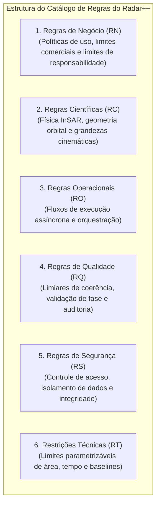

# Radar++ Discovery — D3-05: Catálogo Estruturado de Regras do Produto
## Regras de Negócio, Científicas, Operacionais, de Qualidade, Segurança e Restrições Técnicas

**Documento:** `D3-05-catalogo-regras.md`  
**Ciclo:** Investigação D3 — Consolidação Estratégica e Engenharia de Produto  
**Data:** 24 de Outubro de 2026  
**Status:** Oficial — Entregue para Governança  
**Responsável:** Arquiteto de Software, Especialista em Sensoriamento Remoto, Analista de Processos e Requisitos  
**Repositório Oficial:** `api-radar-deformacao` (caminho: `docs/discovery/D3-05-catalogo-regras.md`)  
**Diretriz de Rigor:** Não transformar parâmetros experimentais em invariantes universais. Manter limiares geodésicos como parâmetros configuráveis. Distinguir formalmente deslocamento LOS de deslocamento vertical e de avaliação de risco geotécnico. Não prometer previsão de desastres ou detecção infalível de rupturas.

---

## 1. Visão Geral das Categorias de Regras



---

## 2. Regras de Negócio (RN)

### RN-01: Isenção de Emissão de Responsabilidade Técnica (ART)
* **Descrição:** O Radar++ é uma plataforma de inteligência geoespacial e apoio à decisão analítica. O sistema não emite Anotação de Responsabilidade Técnica (ART) nem substitui laudos geotécnicos assinados por profissionais habilitados perante o CREA.
* **Objetivo:** Estabelecer a fronteira jurídica do produto e mitigar o risco de responsabilização civil direta por decisões executivas de engenharia.
* **Justificativa:** A legislação brasileira (Lei Federal nº 5.194/1966 e Resoluções do CONFEA) reserva a responsabilidade técnica privativamente a engenheiros e geólogos registrados.
* **Origem:** Requisito de governança jurídica e boas práticas de software B2B de engenharia.
* **Pré-condições:** Geração de qualquer relatório, laudo preliminar ou exportação de mapa temático.
* **Pós-condições:** O documento gerado deve conter rodapé padronizado informando que se trata de estudo analítico de apoio que exige homologação por profissional habilitado.
* **Exceções:** Nenhuma. Regra universal e mandatória.
* **Critério de Aceite:** 100% dos relatórios em PDF e telas de exportação exibem a declaração legal explícita.
* **Prioridade:** P0 (Crítica / Bloqueante).
* **Estado de Validação:** **Fato Confirmado (Diretriz Jurídica)**.
* **Módulo:** Radar++ Core / Urban / Infra.

---

### RN-02: Vedações a Promessas de Alertas de Emergência em Tempo Real
* **Descrição:** É estritamente vedado ao sistema emitir avisos ou mensagens denominadas "Alerta Imediato de Deslizamento" ou "Evacuação em Tempo Real". O sistema deve apresentar seus resultados sob a denominação "Tendência de Deformação Lenta Acumulada (*Creep*)" e "Triagem Macroespacial de Risco Potencial".
* **Objetivo:** Prevenir a indução de falsas expectativas em gestores públicos e operadores privados de infraestrutura.
* **Justificativa:** O satélite Sentinel-1 opera com ciclos de revisita temporal de 6 a 12 dias. O InSAR não possui resolução temporal para detectar rupturas súbitas que ocorrem em minutos durante tempestades severas.
* **Origem:** Pareceres técnicos D2-02, D2-05 e D2-10.
* **Pré-condições:** Configuração de limiares de notificação ou painéis gerenciais.
* **Pós-condições:** Notificações usam nomenclatura padronizada de tendência de rastejo acumulado.
* **Exceções:** Nenhuma.
* **Critério de Aceite:** Inexistência de qualquer termo de "alarme em tempo real" na interface e na documentação.
* **Prioridade:** P0 (Crítica).
* **Estado de Validação:** **Fato Confirmado (Limitação Física de Sensoriamento Remoto)**.
* **Módulo:** Radar++ Core / Infra.

---

### RN-03: Não Exclusividade Comercial do SGTEC
* **Descrição:** A conformidade com o Sistema de Gestão de Terraplenos e Contenções (SGTEC) da ANTT em concessões rodoviárias não deve ser anunciada como dependente de InSAR, mas como uma metodologia complementar e voluntária de triagem para otimização de inspeções.
* **Objetivo:** Alinhar o discurso comercial à realidade regulatória brasileira apurada na Investigação D2.
* **Justificativa:** Os manuais da ANTT e contratos de concessão rodoviária exigem vistorias e inventários cadastrais com base na NBR 11682, sem exigir nominalmente nenhuma tecnologia de satélite.
* **Origem:** Parecer D2-01 e D2-09.
* **Pré-condições:** Propostas comerciais e apresentações institucionais para concessionárias.
* **Pós-condições:** O InSAR é posicionado como ferramenta de ganho de eficiência no cumprimento do SGTEC.
* **Exceções:** Nenhuma.
* **Critério de Aceite:** Documentação comercial não alega exigência mandatória da ANTT.
* **Prioridade:** P1 (Alta).
* **Estado de Validação:** **Fato Confirmado (Realidade Regulatória)**.
* **Módulo:** Radar++ Infra.

---

## 3. Regras Científicas (RC)

### RC-01: Distinção Obrigatória entre Deslocamento na Linha de Visada (LOS) e Vertical
* **Descrição:** O produto InSAR padrão de órbita única fornece a medição escalar de deslocamento projetada no vetor satélite-alvo ($d_{\text{LOS}}$). É terminantemente proibido rotular ou apresentar o valor de $d_{\text{LOS}}$ como "afundamento vertical" ou "recalque absoluto" sem que haja processamento bi-orbital ou pressuposto geométrico devidamente informado.
* **Objetivo:** Garantir rigor científico e evitar erros graves de interpretação geotécnica em taludes e fundações.
* **Justificativa:** Geometricamente, $d_{\text{LOS}} = -d_{\text{vert}} \cos\theta + d_{\text{E-W}} \sin\theta \cos\alpha - d_{\text{N-S}} \sin\theta \sin\alpha$. Um deslocamento medido na visada pode ser fruto de movimentação horizontal do terreno, e não vertical pura.
* **Origem:** Literatura Geodésica (Hanssen, 2001; Zebker et al.).
* **Pré-condições:** Exibição de mapas de deformação e séries temporais na interface.
* **Pós-condições:** O rótulo da unidade de medida deve ser explicitamente indicado como $\text{mm}_{\text{LOS}}$ ou acompanhado da legenda explicativa.
* **Exceções:** Casos processados com combinação bi-orbital (Ascendente + Descendente), onde o vetor vertical puro $d_{\text{vert}}$ tenha sido matematicamente decomposto.
* **Critério de Aceite:** A interface exibe a legenda explicativa da visada do sensor em todos os gráficos e mapas.
* **Prioridade:** P0 (Crítica).
* **Estado de Validação:** **Fato Científico Comprovado**.
* **Módulo:** Radar++ Core.

---

### RC-02: Máscara Obrigatória de Coerência Interferométrica
* **Descrição:** Nenhum pixel com coerência espacial média ($\bar{\gamma}$) inferior ao limiar parametrizado (padrão: $\bar{\gamma} < 0{,}40$) deve ter seu deslocamento exibido no mapa principal ou integrado ao cálculo de velocidade média sem máscara de incerteza.
* **Objetivo:** Eliminar o ruído de fase aleatório em áreas florestadas ou de água, evitando falsos diagnósticos de subsidência.
* **Justificativa:** Em alvos com baixa coerência, a fase interferométrica é dominada por ruído estocástico decorrente de descorrelação temporal, inviabilizando o desdobramento de fase confiável.
* **Origem:** Protocolo de Validação D1-05 e Manuais MintPy/ISCE2.
* **Pré-condições:** Conclusão da etapa de desdobramento de fase (*phase unwrapping*).
* **Pós-condições:** Aplicação de máscara booleana que oculta ou destaca em transparência os pixels incoerentes.
* **Exceções:** O usuário especialista pode ajustar manualmente o limiar de coerência entre $0{,}25$ e $0{,}60$ no modo avançado para fins de pesquisa.
* **Critério de Aceite:** Pixels sob áreas de dossel florestal denso sem alvos persistentes aparecem mascarados por padrão.
* **Prioridade:** P0 (Crítica).
* **Estado de Validação:** **Fato Científico Comprovado**.
* **Módulo:** Radar++ Core.

---

### RC-03: Homogeneidade de Geometria Orbital no Empilhamento (Stacking)
* **Descrição:** Uma série temporal de interferometria por dispersores persistentes (PS) ou de pequenas linhas de base (SBAS) só pode empilhar cenas que compartilhem rigorosamente o mesmo *Relative Orbit Number* (Path), a mesma direção de voo (Ascendente ou Descendente), o mesmo modo de aquisição (IW) e a mesma polarização (VV).
* **Objetivo:** Impedir inconsistências de fase provocadas por geometrias de iluminação conflitantes.
* **Justificativa:** A interferometria mede a diferença de fase entre duas passagens de mesma geometria. Misturar visadas opostas corrompe a fase interferométrica.
* **Origem:** Princípio elementar da física SAR.
* **Pré-condições:** Criação de um projeto de processamento interferométrico.
* **Pós-condições:** O sistema filtra e segrega as cenas candidatas em *stacks* homogêneos antes do despacho.
* **Exceções:** Nenhuma.
* **Critério de Aceite:** O sistema rejeita automaticamente a inclusão de cenas de órbitas relativas distintas no mesmo job de processamento diferencial.
* **Prioridade:** P0 (Bloqueante).
* **Estado de Validação:** **Fato Científico Comprovado**.
* **Módulo:** Radar++ Core.

---

## 4. Regras Operacionais (RO)

### RO-01: Execução Assíncrona Não Bloqueante de Processamentos
* **Descrição:** Nenhuma chamada de processamento interferométrico (orquestração HyP3, desdobramento MintPy ou conversão COG) deve ser executada de forma síncrona na requisição HTTP do usuário. Todas as tarefas devem operar via mensageria assíncrona com persistência de estado (*PENDING*, *QUEUED*, *PROCESSING*, *COMPLETED*, *FAILED*).
* **Objetivo:** Garantir escalabilidade da plataforma e evitar *timeouts* HTTP em processamentos científicos que duram de 15 minutos a várias horas.
* **Justificativa:** A geração de pilhas interferométricas envolve processamento pesado de dezenas de gigabytes de dados de radar.
* **Origem:** Análise de Arquitetura de Software e Auditoria Técnica.
* **Pré-condições:** Submissão de ordem de processamento pelo usuário.
* **Pós-condições:** Retorno imediato de código HTTP 202 (Accepted) com identificador exclusivo do Job (*JobId*) para consulta de progresso.
* **Exceções:** Consultas a metadados pré-existentes e recortes leves de rasters já processados em cache.
* **Critério de Aceite:** O endpoint de despacho responde em menos de 500ms, liberando a navegação do usuário.
* **Prioridade:** P0 (Crítica).
* **Estado de Validação:** **Diretriz de Arquitetura Consolidada**.
* **Módulo:** Radar++ Core.

---

### RO-02: Armazenamento e Entrega de Imagens via Padrão Cloud Optimized GeoTIFF (COG)
* **Descrição:** Todos os produtos matriciais gerados (mapas de velocidade, interferogramas desdobrados e matrizes de coerência) devem ser gerados e armazenados exclusivamente no padrão Cloud Optimized GeoTIFF (COG) com pirâmides internas de visão geral (*overviews*) e compressão sem perdas (DEFLATE/LZW).
* **Objetivo:** Permitir que o navegador do usuário carregue apenas a fatia visível do mapa em alta performance sem necessidade de baixar o arquivo raster inteiro (via requisições HTTP *Range Requests*).
* **Justificativa:** Reduz o consumo de banda de saída (*egress*) da nuvem e garante experiência de usuário fluida em conexões lentas.
* **Origem:** Requisitos Não Funcionais de Software Geoespacial Moderno.
* **Pré-condições:** Finalização do cálculo geodésico no container de processamento.
* **Pós-condições:** O arquivo final é gravado no bucket S3 com cabeçalho COG validado.
* **Exceções:** Nenhuma.
* **Critério de Aceite:** O visualizador de mapas do frontend renderiza o raster em menos de 2 segundos utilizando bibliotecas como GeoTIFF.js/OpenLayers/Leaflet.
* **Prioridade:** P1 (Alta).
* **Estado de Validação:** **Diretriz Técnica Consolidada**.
* **Módulo:** Radar++ Core.

---

## 5. Regras de Qualidade (RQ)

### RQ-01: Auditoria e Reprodutibilidade Científica de Parâmetros
* **Descrição:** Todo mapa temático ou gráfico de série temporal deve estar associado a um registro permanente de metadados contendo: versão exata dos softwares utilizados (MintPy, ISCE2, GDAL), DEM de referência utilizado (ex.: Copernicus GLO-30), lista de IDs das cenas Sentinel-1 SLC, coordenadas de corte e data/hora exata do processamento.
* **Objetivo:** Permitir que qualquer estudo do Radar++ seja auditado em juízo ou perante órgãos de fiscalização pública.
* **Justificativa:** Laudos periciais de engenharia exigem comprovação de cadeia de custódia e reprodutibilidade analítica.
* **Origem:** Práticas Forenses e Periciais de Engenharia Legal.
* **Pré-condições:** Criação do registro de resultado no banco de dados.
* **Pós-condições:** Disponibilização de botão "Baixar Metadados de Auditoria (JSON)" na interface.
* **Exceções:** Nenhuma.
* **Critério de Aceite:** O arquivo de metadados permite reproduzir o processamento de forma determinística fora da plataforma.
* **Prioridade:** P1 (Alta).
* **Estado de Validação:** **Fato Confirmado (Exigência de Mercado Pericial)**.
* **Módulo:** Radar++ Core.

---

### RQ-02: Verificação Automática de Erros de Desdobramento de Fase (Unwrapping Residues)
* **Descrição:** Após o desdobramento de fase executado pelo MintPy/SNAPHU, o sistema deve calcular o percentual de resíduos topológicos e saltos espaciais bruscos de $2\pi$ radianos em áreas contínuas. Se o índice de resíduos exceder 15% da área válida, o produto deve ser classificado como "Qualidade Comprometida (*Flag de Atenção*)".
* **Objetivo:** Alertar o engenheiro usuário de que a área apresenta descontinuidade topográfica ou decorrelação que pode distorcer a velocidade estimada.
* **Justificativa:** Falhas no algoritmo de desdobramento de fase geram degraus de velocidade artificiais que não correspondem a deformações reais do solo.
* **Origem:** Literatura Científica de Processamento SAR.
* **Pré-condições:** Execução do algoritmo SNAPHU.
* **Pós-condições:** Atribuição do indicador de qualidade ao produto gerado.
* **Exceções:** Nenhuma.
* **Critério de Aceite:** Produtos com falha grave de desdobramento exibem tarja visual de alerta na interface de análise.
* **Prioridade:** P1 (Alta).
* **Estado de Validação:** **Regra Parametrizável em Teste**.
* **Módulo:** Radar++ Core.

---

## 6. Regras de Segurança (RS)

### RS-01: Isolamento de Dados e Polígonos de Interesse entre Inquilinos (Multi-Tenancy)
* **Descrição:** As áreas de interesse (AOIs), traçados de corredores lineares e relatórios gerados por um cliente (concessionária ou consultoria) são estritamente confidenciais e inacessíveis para outros usuários da plataforma.
* **Objetivo:** Garantir a conformidade com a LGPD e proteger o segredo industrial de operadores de transporte em trechos sob investigação de risco.
* **Justificativa:** Concessionárias de infraestrutura tratam dados de anomalias geotécnicas como informações corporativas de alta sensibilidade comercial e de imagem pública.
* **Origem:** Requisitos de Segurança Corporativa e Governança de TI.
* **Pré-condições:** Toda requisição à API é autenticada via token criptográfico com validação de escopo de organização (*TenantId*).
* **Pós-condições:** Isolamento lógico rigoroso no banco de dados e políticas de acesso a objetos no S3 (*S3 Bucket Policies / Pre-signed URLs*).
* **Exceções:** Dados e laudos de validação pública aberta (ex.: Piloto Científico de Maceió/AL).
* **Critério de Aceite:** Testes de segurança automatizados comprovam que nenhum usuário consegue ler AOIs de outra organização.
* **Prioridade:** P0 (Crítica).
* **Estado de Validação:** **Diretriz de Segurança Mandatória**.
* **Módulo:** Radar++ Core.

---

## 7. Restrições Técnicas Parametrizáveis (RT)

```
+----------------------------------------------------------------------------------------------------------------------------------------------------+
|                                    CATÁLOGO DE RESTRIÇÕES TÉCNICAS E PARÂMETROS CONFIGURÁVEIS                                                      |
+----+--------------------------------+------------------------+-------------------+----------------------------------------------------------------+
| ID | Parâmetro Técnico              | Valor Padrão (Default) | Faixa Permitida   | Justificativa Técnica                                          |
+----+--------------------------------+------------------------+-------------------+----------------------------------------------------------------+
| RT1| Área Máxima por AOI Poligonal  | $100\text{ km}^2$      | $10$ a $500$ km²  | Controlar o consumo de memória RAM do container MintPy e evitar|
|    | (Módulo Urban)                 |                        |                   | sobrecarga de créditos computacionais de terceiros (HyP3).     |
+----+--------------------------------+------------------------+-------------------+----------------------------------------------------------------+
| RT2| Extensão Máxima de Corredor    | $200\text{ km}$        | $20$ a $1.000$ km | Limitar o número de bursts Sentinel-1 processados em uma única |
|    | (Módulo Infra)                 |                        |                   | requisição de mosaico linear.                                  |
+----+--------------------------------+------------------------+-------------------+----------------------------------------------------------------+
| RT3| Largura do Buffer do Corredor  | $500\text{ m}$ (cada   | $100$ a $2.000$ m | Minimizar o processamento de áreas externas à faixa de domínio |
|    | (Módulo Infra)                 | lado do eixo)          |                   | que sofreriam decorrelação temporal severa por floresta.       |
+----+--------------------------------+------------------------+-------------------+----------------------------------------------------------------+
| RT4| Limiar Mínimo de Coerência     | $\bar{\gamma} = 0{,}40$| $0{,}25$ a $0{,}65$| Equilíbrio entre cobertura espacial de alvos e confiabilidade |
|    | para Série Temporal (MintPy)   |                        |                   | estatística da velocidade calculada.                           |
+----+--------------------------------+------------------------+-------------------+----------------------------------------------------------------+
| RT5| Linha de Base Perpendicular    | $B_\perp \le 150\text{ m}$| $50$ a $250$ m  | Pares com $B_\perp > 150$ m sofrem descorrelação geométrica    |
|    | Máxima ($B_\perp$)             |                        |                   | excessiva na Banda C do Sentinel-1.                            |
+----+--------------------------------+------------------------+-------------------+----------------------------------------------------------------+
| RT6| Linha de Base Temporal Máxima  | $48\text{ dias}$       | $12$ a $120$ dias | Manter a coerência de fase ao longo do empilhamento temporal   |
|    | ($\Delta t$) para Pares SBAS   |                        |                   | em regiões com variação sazonal de umidade.                    |
+----+--------------------------------+------------------------+-------------------+----------------------------------------------------------------+
```
