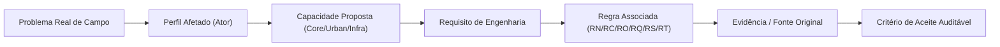

# Radar++ Discovery — D3-06: Matriz Integrada de Rastreabilidade
## Alinhamento Ponta a Ponta: Dores, Perfis, Capacidades, Requisitos, Regras e Evidências

**Documento:** `D3-06-matriz-rastreabilidade.md`  
**Ciclo:** Investigação D3 — Consolidação Estratégica e Engenharia de Produto  
**Data:** 24 de Outubro de 2026  
**Status:** Oficial — Entregue para Governança  
**Responsável:** Analista de Processos e Requisitos, Arquiteto de Software, Product Manager B2B/B2G  
**Repositório Oficial:** `api-radar-deformacao` (caminho: `docs/discovery/D3-06-matriz-rastreabilidade.md`)  
**Diretriz de Transparência:** Todas as relações de negócio ou técnicas que dependem de confirmação empírica futura estão explicitamente rotuladas como **[HIPÓTESE A VALIDAR]**.

---

## 1. Visão Geral do Encadeamento Lógico de Rastreabilidade

O modelo de engenharia do Radar++ estabelece um encadeamento rigoroso e bidirecional que conecta cada elemento do sistema à sua justificativa original:



---

## 2. Matriz Integrada de Rastreabilidade do Produto

```
+----------------------------------------------------------------------------------------------------------------------------------------------------+
|                                      MATRIZ INTEGRADA DE RASTREABILIDADE DO PRODUTO RADAR++                                                        |
+----+-----------------------+--------------------+---------------------+--------------------+--------------------+--------------------+---------+
| ID | 1. Problema Central   | 2. Perfil Afetado  | 3. Capacidade       | 4. Requisito       | 5. Regra Vinculada | 6. Evidência /     | 7. Tipo |
|    |                       |                    | Proposta            | de Produto         |                    | Origem             | Relação |
+----+-----------------------+--------------------+---------------------+--------------------+--------------------+--------------------+---------+
| R1 | Falta de histórico de | Perito Geotécnico, | **C1** (Gestão AOI) | Sistema deve per-  | **RC-01** (LOS vs  | Laudos SGB/CPRM em | Fato    |
|    | deformação prévia em  | Consultoria PME,   | **C7** (Série Temp.)| mitir seleção de   | Vertical) e        | Maceió/AL e        | Conhe-  |
|    | bairros colapsados por| Defesa Civil       | **U2** (Back-Anal.) | AOI e exibir série | **RQ-01** (Metada- | artigos de subsidên| cido    |
|    | subsidência urbana.   | Municipal.         | **U3** (Mapa Calor) | histórica 2014-2026| dos de Auditoria). | cia de Recife/PE.  |         |
+----+-----------------------+--------------------+---------------------+--------------------+--------------------+--------------------+---------+
| R2 | Inviabilidade de ins- | Engenheiro de      | **I1** (Corredores) | Sistema deve fatiar| **RT-03** (Buffer) | Contratos ANTT de  | Hipótese|
|    | pecionar visualmente  | Manutenção Viária, | **I2** (Estaqueam.) | corredor viário com| **RC-02** (Coerên- | concessão e ma-    | a Vali- |
|    | 3.000 a 14.000 km de  | Concessionária de  | **I4** (Triagem de  | buffer estreito e  | cia) e             | nuais do SGTEC     | dar     |
|    | malha contra rastejo. | Rodovia/Ferrovia.  | Creep em Taludes)   | listar anomalias.  | **RN-02** (Não Aler| (antt.gov.br).     | (D1-04) |
+----+-----------------------+--------------------+---------------------+--------------------+--------------------+--------------------+---------+
| R3 | Complexidade e custo  | Engenheiro de      | **C4** (Orquestra-  | Plataforma web que | **RO-01** (Execução| Manuais do ASF HyP3| Fato    |
|    | de instalar e operar  | Consultoria PME,   | ção em Nuvem) e     | dispara processa-  | Assíncrona) e      | e literatura       | Técnico |
|    | clusters Linux com    | Pesquisador        | **C9** (Entrega COG | mento assíncrono   | **RO-02** (Armazena| de software aberto | Compro- |
|    | MintPy / ISCE2.       | Universitário.     | e STAC via S3).     | sem setup local.   | mento via COG/S3). | (Yunjun et al.).   | vado    |
+----+-----------------------+--------------------+---------------------+--------------------+--------------------+--------------------+---------+
| R4 | Dúvidas jurídicas e   | Diretor de Engenha-| **U5** (Laudo Sin-  | Todo relatório deve| **RN-01** (Isenção | Lei Federal nº     | Fato    |
|    | risco de responsabili-| ria, Concessionária| tético de Apoio) e  | exibir aviso de que| de ART) e          | 5.194/1966 e Re-   | Jurídico|
|    | zação técnica civil   | e Órgãos de Con-   | **C8** (Rastreabili-| não substitui ART e| **RN-03** (Não Ex- | resoluções do      | Estabele|
|    | de software na obra.  | trole Externo.     | dade de Parâmetros).| requer engenheiro. | clusividade SGTEC).| CONFEA/CREA.       | cido    |
+----+-----------------------+--------------------+---------------------+--------------------+--------------------+--------------------+---------+
| R5 | Confundir velocidade  | Analista SIG,      | **C6** (Avaliação de| Interface deve dei-| **RC-01** (Distin- | Princípios de inter| Fato    |
|    | escalar na linha de   | Engenheiro Geotéc- | Qualidade) e        | xar explícito o ve-| ção LOS vs Vert.)  | ferometria de radar| Cientí- |
|    | visada com afundamento| nico e Perito de   | **U4** (Perfis em   | tor de visada e a  | e **RC-03** (Homoge| e decomposição     | fico    |
|    | vertical puro.        | Defesa Civil.      | Seção Transversal). | geometria orbital. | neidade Orbital).  | geométrica 2D.     | Rígido  |
+----+-----------------------+--------------------+---------------------+--------------------+--------------------+--------------------+---------+
| R6 | Risco de vazamento de | Concessionária de  | **C1** (Gestão AOI) | Dados e polígonos  | **RS-01** (Isolamen| Diretrizes da LGPD | Fato    |
|    | áreas de risco geoló- | Rodovias/Ferrovias | e **I3** (Associação| de uma empresa não | to Multi-Tenancy   | e exigências de    | Cor-    |
|    | gico de operadoras    | e Consultorias     | de Ativos e OAEs).  | podem ser vistos   | rigoroso entre     | segurança da       | porativo|
|    | concorrentes.         | Privadas.          |                     | por outros clientes| organizações).     | informação B2B.    | Crítico |
+----+-----------------------+--------------------+---------------------+--------------------+--------------------+--------------------+---------+
| R7 | Falsos diagnósticos de| Geólogo Pericial,  | **C5** (Produtos    | Máscara automática | **RC-02** (Máscara | Decorrelação tem-  | Fato    |
|    | deformação por ruído  | Engenheiro de      | InSAR) e            | de incoerência e   | de Coerência) e    | poral em Mata      | Físico  |
|    | estocástico sob mata. | Infraestrutura.    | **C6** (Qualidade). | bandeira de alerta | **RQ-02** (Resíduo | Atlântica (Zebker  | Compro- |
|    |                       |                    |                     | de desdobramento.  | de Unwrapping).    | & Villasenor).     | vado    |
+----+-----------------------+--------------------+---------------------+--------------------+--------------------+--------------------+---------+
| R8 | Resistência de conces-| Gerente de Conserva| **D3-03** (Modelo   | Oferecer contra-   | **RN-03** (Venda   | Entrevistas D1-04  | Hipótese|
|    | sionárias a assinatu- | ção Viária, Sócio  | Comercial M3 sob    | tação flexível por | como Ferramenta de | e práticas comer-  | Comer-  |
|    | ras anuais de alto    | de Consultoria PME.| demanda e M4 B2B2B) | projeto sem com-   | Otimização, sem    | ciais de SaaS      | cial a  |
|    | valor para toda malha.|                    |                     | promisso de malha. | promessas falsas). | de infraestrutura. | Testar  |
+----+-----------------------+--------------------+---------------------+--------------------+--------------------+--------------------+---------+
```

---

## 3. Critérios de Aceite por Requisito de Rastreabilidade

### R1 (Subsidência Urbana e Histórico):
* *Critério de Aceite:* Para a AOI do caso Maceió (bairros Pinheiro e Mutange), a plataforma deve renderizar a série histórica 2018-2021 com correlação estatística de Pearson $R^2 \ge 0{,}85$ em relação aos dados de nivelamento topográfico e GNSS do SGB/CPRM.

### R2 (Triagem em Infraestrutura Linear):
* *Critério de Aceite:* O recorte automatizado de um corredor rodoviário experimental de 200 km (ex.: trecho de serra da BR-116) com *buffer* de 500m deve consumir menos de 300 créditos HyP3 e gerar uma lista de classificação de trechos por taxa de rastejo decrescente em até 2 horas.

### R3 (Encapsulamento em Nuvem):
* *Critério de Aceite:* O usuário realiza todo o fluxo de desenho de AOI, consulta de catálogo e submissão de processamento via navegador web em menos de 5 minutos, sem necessidade de executar nenhum comando em terminal de linha de comando.

### R4 (Isenção Jurídica de ART):
* *Critério de Aceite:* 100% dos relatórios sintéticos em PDF e das visualizações web exportáveis contêm a ressalva jurídica padronizada: *"Este relatório contém dados de apoio analítico baseados em sensoriamento remoto e não substitui laudo geotécnico com Anotação de Responsabilidade Técnica (ART) emitido por profissional legalmente habilitado"*.

### R5 (Rigor Geodésico LOS vs. Vertical):
* *Critério de Aceite:* Toda tela de análise com processamento de órbita única exibe a unidade de medida expressa como $\text{mm}_{\text{LOS}}$ e disponibiliza um *tooltip* interativo explicando a inclinação do feixe do satélite ($\theta \approx 39^\circ$).

### R6 (Segurança e Isolamento Multi-Tenancy):
* *Critério de Aceite:* Em testes de injeção e varredura de endpoints de API, requisições autenticadas com credenciais do *Tenant A* recebem HTTP 404/403 ao tentar acessar IDs de AOIs ou dados de processamento pertencentes ao *Tenant B*.

### R7 (Confiabilidade Científica sob Vegetação):
* *Critério de Aceite:* Em trechos de talude com cobertura florestal densa contínua onde a coerência média for inferior a $0{,}40$, o sistema mascara os pixels e exibe aviso de que a área apresenta descorrelação temporal física inerente à Banda C.

### R8 (Aderência Comercial do Modelo Sob Demanda):
* *Critério de Aceite:* Validação no roteiro de entrevistas `D1-04` de que ao menos 3 entre 5 consultorias de engenharia confirmam preferência por contratação pontual por projeto (Modelo M3) frente a assinaturas de longo prazo.
