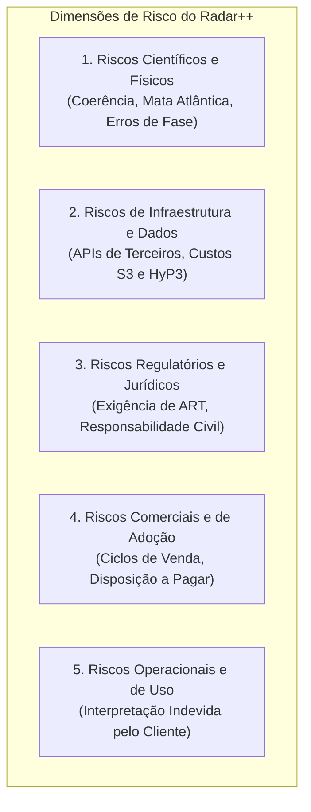
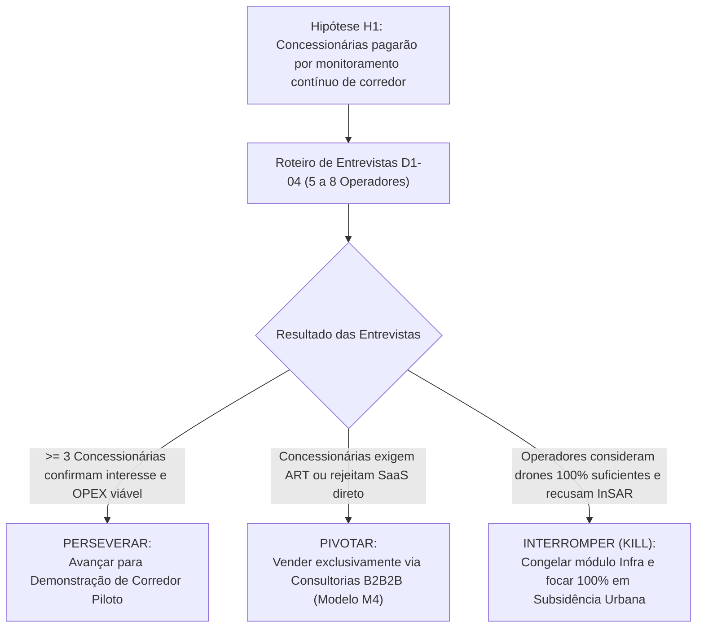

# Radar++ Discovery — D3-07: Matriz de Riscos, Hipóteses Críticas e Critérios de Decisão
## Avaliação Multidimensional de Incertezas e Condições Objetivas de Pivot, Perseverança ou Descontinuação

**Documento:** `D3-07-riscos-hipoteses.md`  
**Ciclo:** Investigação D3 — Consolidação Estratégica e Engenharia de Produto  
**Data:** 24 de Outubro de 2026  
**Status:** Oficial — Entregue para Governança  
**Responsável:** Equipe Multidisciplinar (Consultor de Estratégia, Arquiteto de Software, Especialista SAR, Product Manager B2B/B2G)  
**Repositório Oficial:** `api-radar-deformacao` (caminho: `docs/discovery/D3-07-riscos-hipoteses.md`)  

---

## 1. Visão Geral das Dimensões de Risco

O Radar++ atua na interseção entre geodésia espacial, computação em nuvem e engenharia civil regulada. Essa complexidade exige uma matriz estruturada que avalia riscos em cinco dimensões fundamentais:



---

## 2. Avaliação Detalhada dos Doze Fatores de Risco

```
+----------------------------------------------------------------------------------------------------------------------------------------------------+
|                                    AVALIAÇÃO ESTRUTURADA DE RISCOS DO RADAR++                                                                      |
+----+----------------------+-------------+---------+----------------------------------------------------+-------------------------------------------+
| ID | Fator de Risco       | Probabilid. | Impacto | Descrição do Risco Operacional                     | Estratégia de Mitigação Implementada      |
+----+----------------------+-------------+---------+----------------------------------------------------+-------------------------------------------+
| 01 | Dependência de Pro-  | Média       | Alto    | Instabilidade ou rate-limiting na ASF Vertex API / | Cache local de metadados; múltiplos nós   |
|    | vedores SAR Externos |             |         | ESA Copernicus Data Space bloqueando consultas.    | de consulta; suporte a catálogo espelho.  |
+----+----------------------+-------------+---------+----------------------------------------------------+-------------------------------------------+
| 02 | Incompatibilidade de | Baixa       | Alto    | Cenas de paths ou geometrias orbitais distintas    | Validação rigorosa em **RC-03** antes de  |
|    | Cenas no Stack       |             |         | sendo misturadas, corrompendo interferogramas.     | permitir o disparo do processamento.      |
+----+----------------------+-------------+---------+----------------------------------------------------+-------------------------------------------+
| 03 | Descorrelação por    | **Alta**    | **Alto**| Encostas de serra cobertas por Mata Atlântica per- | Aplicação de máscara em **RC-02**; aviso  |
|    | Vegetação Tropical   |             |         | dem coerência temporal na Banda C do Sentinel-1.   | transparente ao usuário; aguardar Banda L.|
+----+----------------------+-------------+---------+----------------------------------------------------+-------------------------------------------+
| 04 | Erros de Unwrapping  | Média       | Alto    | Ruído gerando saltos de fase de 2pi que distorcem  | Verificação de resíduos em **RQ-02** com  |
|    | de Fase (SNAPHU)     |             |         | a velocidade estimada do terreno.                  | bandeira visual de incerteza no laudo.    |
+----+----------------------+-------------+---------+----------------------------------------------------+-------------------------------------------+
| 05 | Falta de Verdade de  | Média       | Alto    | Ausência de dados in-situ para calibrar a taxa de  | Foco inicial em **Maceió/AL** (banco de   |
|    | Campo para Calibração|             |         | velocidade em novas áreas sem histórico.           | dados robusto do SGB/CPRM e marcos IBGE). |
+----+----------------------+-------------+---------+----------------------------------------------------+-------------------------------------------+
| 06 | Custos de Processa-  | Média       | Médio   | Consumo excessivo de créditos de processamento na  | Restrições técnicas **RT-01** (área máx.) |
|    | mento em Nuvem (HyP3)|             |         | nuvem por AOIs muito extensas ou desnecessárias.   | e **RT-03** (buffers lineares estreitos). |
+----+----------------------+-------------+---------+----------------------------------------------------+-------------------------------------------+
| 07 | Custos de Storage S3 | Baixa       | Baixo   | Acúmulo de arquivos intermediários pesados (SLCs)  | Descarte de arquivos brutos temporários;  |
|    | e Egress de Dados    |             |         | inflando a fatura mensal da AWS.                   | retenção apenas de produtos finais COG.   |
+----+----------------------+-------------+---------+----------------------------------------------------+-------------------------------------------+
| 08 | Risco de Exigência   | **Alta**    | **Alto**| Clientes corporativos e prefeituras exigirem ART   | **RN-01** (Isenção explícita de ART) e   |
|    | de ART pelo Cliente  |             |         | assinada para aceitar os relatórios da plataforma. | canal **B2B2B** via consultorias técnicas.|
+----+----------------------+-------------+---------+----------------------------------------------------+-------------------------------------------+
| 09 | Dependência de       | **Alta**    | Médio   | O cliente leigo não saber interpretar os mapas     | Encapsulamento de métricas em relatórios  |
|    | Especialistas        |             |         | temáticos e tomar decisões erradas.                | sintéticos e foco de venda em engenheiros.|
+----+----------------------+-------------+---------+----------------------------------------------------+-------------------------------------------+
| 10 | Risco de Má Inter-   | **Alta**    | **Alto**| Cliente confundir deslocamento LOS com vertical ou | **RC-01** (Rótulo LOS explícito) e        |
|    | pretação pelo Usuário|             |         | achar que o satélite dá alerta de queda de barreira| **RN-02** (Proibição de termo alerta 24h).|
+----+----------------------+-------------+---------+----------------------------------------------------+-------------------------------------------+
| 11 | Concorrência de      | **Alta**    | Médio   | Concessionárias preferirem continuar usando ape-   | Posicionamento como camada prévia macro,   |
|    | Drones com LiDAR/RGB |             |         | nas drones e vistorias de rotina por hábito.       | demonstrando histórico de 10 anos atrás.  |
+----+----------------------+-------------+---------+----------------------------------------------------+-------------------------------------------+
| 12 | Ciclo de Venda Longo | **Alta**    | **Alto**| Ciclos de homologação de 6 a 12 meses em conces-   | Priorização do **Modelo M3 sob demanda**  |
|    | em Concessionárias   |             |         | sionárias asfixiarem o fluxo de caixa inicial.     | com consultorias PMEs de ciclo curto.     |
+----+----------------------+-------------+---------+----------------------------------------------------+-------------------------------------------+
```

---

## 3. Critérios Objetivos de Decisão Estratégica: Continuar, Pivotar ou Interromper

Para evitar que a equipe prossiga indefinidamente com hipóteses falhas ou sem tração comercial, são estabelecidas regras formais de deliberação:

### 3.1. Hipótese H1: Aderência Comercial em Infraestrutura Linear (Rodovias e Ferrovias)



* **Critério para PERSEVERAR (Continuar):** Pelo menos 3 entre 5 concessionárias entrevistadas no roteiro `D1-04` afirmarem que considerariam contratar um serviço InSAR se ele comprovar detecção prévia de rastejo (*creep*) em taludes com classificação de risco R2/R3, alocando recursos de conservação de rotina.
* **Critério para PIVOTAR (Reformular):** Se os operadores afirmarem que têm interesse nos dados, mas que seus regulamentos internos de compras impedem contratar software sem ART ou sem laudo assinado por consultoria credenciada. *Ação:* Abandonar a venda direta B2B e adotar o modelo B2B2B onde a consultoria de geotecnia é a cliente e intermediária exclusiva.
* **Critério para INTERROMPER (Kill / Congelar):** Se as operadoras afirmarem unanimemente que os levantamentos com drones com câmeras ópticas e LiDAR cobrem todas as suas exigências regulatórias perante a ANTT/ARTESP e seguradoras, considerando dados de satélite redundantes ou de resolução espacial insuficiente para pista. *Ação:* Interromper imediatamente qualquer investimento em engenharia no módulo *Radar++ Infra*, canalizando 100% dos recursos para subsidência urbana e pesquisa pericial.

---

### 3.2. Hipótese H2: Viabilidade Computacional de Buffers Lineares Estreitos

* **Critério para PERSEVERAR:** O protótipo de recorte de bursts Sentinel-1 ao longo do traçado de uma rodovia real de 200 km (com *buffer* de 500m) consumir menos de 300 créditos HyP3 e gerar COGs com tamanho final consolidado inferior a 200 MB por data.
* **Critério para PIVOTAR:** Se o recorte por buffer estreito gerar fragmentação excessiva de polígonos que complique a topologia do desdobramento de fase no MintPy. *Ação:* Adotar caixas envolventes retangulares (*bounding boxes*) menores segmentadas a cada 20 km de rodovia em vez de buffer contínuo sinuoso.
* **Critério para INTERROMPER:** Se a densidade de alvos persistentes na faixa de domínio da rodovia em relevo de serra for inferior a 5 pontos/km², inviabilizando qualquer inferência de estabilidade. *Ação:* Declarar inviabilidade técnica da Banda C para corredores rodoviários serranos sem alvos artificiais, postergando o módulo Infra até a disponibilidade operacional de dados em Banda L (NISAR).

---

### 3.3. Hipótese H3: Acurácia do Piloto Científico Retrospectivo em Maceió/AL

* **Critério para PERSEVERAR:** A série temporal gerada pelo pipeline HyP3 + MintPy sobre a bacia de afundamento do bairro Mutange apresentar correlação de Pearson $R^2 \ge 0{,}85$ e erro médio quadrático ($RMSE \le 12\text{ mm/ano}$) em comparação com os laudos oficiais de nivelamento topográfico e GNSS do SGB/CPRM (2018-2021).
* **Critério para PIVOTAR:** Se o erro residual decorrente de variações troposféricas for excessivo ($RMSE > 25\text{ mm/ano}$), mas a geometria de bacia for claramente discernível. *Ação:* Incorporar modelos atmosféricos globais de correção de atraso de fase (GACOS / ERA5) no pipeline MintPy.
* **Critério para INTERROMPER:** Se o pipeline aberto não conseguir reproduzir a detecção da bacia de subsidência documentada pelo SGB/CPRM, gerando descorrelação total ou incapacidade de *unwrapping*. *Ação:* Interromper o desenvolvimento de produto web e rever as bases metodológicas do processamento científico com pesquisadores acadêmicos parceiros.
