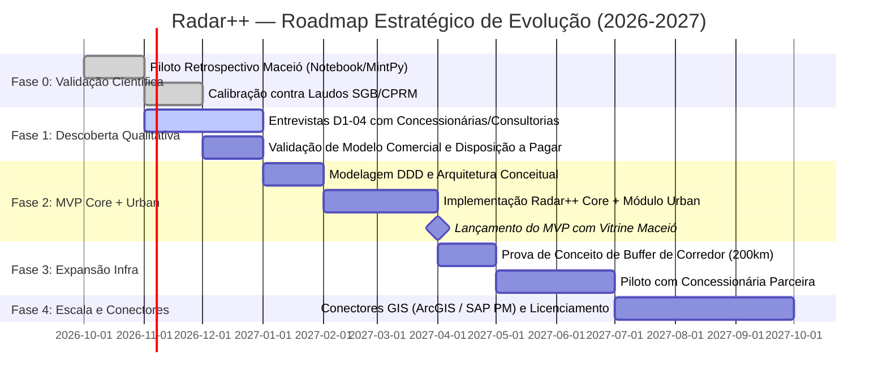

# Radar++ Discovery — D3-08: Roadmap Estratégico e Sequenciamento de Fases
## Planejamento em Fases, Escopo do MVP e Fronteira entre Validação Imediata e Expansão Futura

**Documento:** `D3-08-roadmap-estrategico.md`  
**Ciclo:** Investigação D3 — Consolidação Estratégica e Engenharia de Produto  
**Data:** 24 de Outubro de 2026  
**Status:** Oficial — Entregue para Governança  
**Responsável:** Product Manager B2B/B2G, Arquiteto de Software, Especialista em Sensoriamento Remoto  
**Repositório Oficial:** `api-radar-deformacao` (caminho: `docs/discovery/D3-08-roadmap-estrategico.md`)  
**Diretriz de Escopo:** O MVP do Radar++ deve validar primeiramente o algoritmo científico e a usabilidade essencial em uma bacia urbana auditada (Maceió). A expansão para corredores de infraestrutura linear e integrações complexas deve aguardar as fases posteriores.

---

## 1. Visão Geral do Roadmap em Cinco Fases



---

## 2. Detalhamento Estruturado das Fases

### 2.1. Fase 0: Validação Científica Retrospectiva (Ambiente Experimental)
* **Objetivo Central:** Comprovar empiricamente a acurácia do pipeline aberto HyP3 + MintPy contra uma verdade de campo incontestável e auditada, sem desenvolver código de frontend ou microsserviços.
* **Ambiente de Execução:** Jupyter Notebook / Python em ambiente isolado de ciência de dados.
* **Área Alvo:** **Maceió/AL (Bairros Pinheiro, Mutange, Bebedouro e Bom Parto)**.
* **Entregáveis da Fase:**
  1. Script reprodutível de download e desdobramento de fase da pilha Sentinel-1 (2018-2021).
  2. Gráficos de dispersão e correlação estatística ($R^2$ e $RMSE$) comparando as séries temporais InSAR com os marcos geodésicos e laudos do SGB/CPRM.
  3. Relatório técnico interno de validação científica confirmando se a acurácia atinge os parâmetros exigidos para laudos de engenharia.
* **Critério de Saída da Fase:** Obter correlação de Pearson $R^2 \ge 0{,}85$ na zona de maior subsidência.

---

### 2.2. Fase 1: Descoberta Qualitativa de Mercado e Validação de Modelo Comercial
* **Objetivo Central:** Testar o interesse real, as dores operacionais e a disposição a pagar de compradores potenciais sem criar software antes de ouvir o mercado.
* **Ações Principais:**
  1. Realização de 5 a 8 entrevistas com diretores/gerentes de concessionárias privadas (Motiva, Arteris, Rumo) e sócios de consultorias geotécnicas com base no roteiro `D1-04`.
  2. Validação da preferência entre contratação por campanha/laudo (Modelo M3) versus assinatura por km monitorado (Modelo M1).
  3. Investigação sobre o processo interno de compras corporativo e requisitos mínimos para credenciamento como fornecedor.
* **Entregáveis da Fase:**
  1. Relatório consolidado de entrevistas qualitativas.
  2. Tabela de precificação calibrada e modelo de contratação validado.
* **Critério de Saída da Fase:** Pelo menos duas organizações manifestarem formalmente intenção de testar a plataforma após o lançamento do MVP.

---

### 2.3. Fase 2: Construção do MVP — Radar++ Core + Radar++ Urban
* **Objetivo Central:** Desenvolver a primeira versão funcional e auditável da plataforma web, disponibilizando o núcleo interferométrico e o módulo especializado de subsidência urbana.
* **Escopo Funcional Incluído:**
  * Gestão de AOIs poligonais simples (desenho no mapa ou upload de GeoJSON).
  * Catálogo de cenas Sentinel-1 aberto com filtro de compatibilidade de órbita relativa.
  * Disparo assíncrono de jobs HyP3 e geração de séries temporais MintPy.
  * Armazenamento e visualização de mapas de calor de velocidade e séries temporais via COG em bucket S3.
  * **Vitrine Técnica Oficial:** Apresentação dos dados históricos pré-processados de Maceió/AL já carregados na plataforma como demonstração pública do produto.
* **Entregáveis da Fase:**
  1. Aplicação web responsiva e funcional.
  2. Documentação de API RESTful interna documentada.
  3. Primeiro laudo sintético exportável em PDF com auditoria de metadados.
* **Critério de Saída da Fase:** Usuário realiza a inspeção visual de uma área urbana e exporta laudo em menos de 5 minutos na web.

---

### 2.4. Fase 3: Expansão Experimental — Radar++ Infra (Corredores Lineares)
* **Objetivo Central:** Expandir as capacidades da plataforma para atender corredores rodoviários e ferroviários, caso a Fase 1 tenha validado a viabilidade comercial.
* **Escopo Funcional Incluído:**
  * Importação de traçados de eixos rodoviários/ferroviários (Shapefile/KML).
  * Geração automática de buffers estreitos de 100m a 500m.
  * Projeção de anomalias em estaqueamento de quilometragem viária (km).
  * Painel de triagem macro de taludes com tendência contínua de rastejo (*creep*).
* **Entregáveis da Fase:**
  1. Piloto operacional demonstrativo conduzido em um trecho de serra real (ex.: 100 km da BR-116 ou descida ferroviária de Santos).
  2. Módulo *Radar++ Infra* integrado ao frontend web.
* **Critério de Saída da Fase:** Homologação técnica do relatório de triagem por engenheiro geotécnico da concessionária parceira.

---

### 2.5. Fase 4: Escala Comercial e Conectores de Integração
* **Objetivo Central:** Atender grandes clientes corporativos que exigem integração direta com seus ecossistemas de gestão de manutenção e ativos.
* **Escopo Funcional Incluído:**
  * Licenciamento *White-Label* para consultorias de engenharia (Modelo M4).
  * Conectores de exportação para Esri ArcGIS Enterprise, SAP PM e IBM Maximo.
  * Suporte a dados comerciais sob demanda de altíssima resolução em Banda X (TerraSAR-X / COSMO-SkyMed) para alvos críticos pontuais.
* **Critério de Saída da Fase:** Primeiro contrato anual recorrente faturado diretamente com concessionária ou grande consultoria.

---

## 3. Matriz de Escopo: O que Está no MVP vs. O que Aguarda Fases Posteriores

```
+----------------------------------------------------------------------------------------------------------------------------------------------------+
|                                    MATRIZ DE FRONTEIRA DE ESCOPO DO RADAR++                                                                       |
+---------------------------------------------------------------+-------------------------------+--------------------------------------------+
| Capacidade / Funcionalidade                                   | Fase do Roadmap               | Justificativa de Sequenciamento            |
+---------------------------------------------------------------+-------------------------------+--------------------------------------------+
| **Desenho e Upload de AOI Poligonal Simples**                 | **MVP (Fase 2)**              | Essencial para seleção de bacias urbanas.  |
+---------------------------------------------------------------+-------------------------------+--------------------------------------------+
| **Busca e Catalogação Automática Sentinel-1 (IW, VV)**        | **MVP (Fase 2)**              | Insumo básico obrigatório do pipeline SAR. |
+---------------------------------------------------------------+-------------------------------+--------------------------------------------+
| **Orquestração Assíncrona HyP3 + MintPy em Nuvem**            | **MVP (Fase 2)**              | Motor de processamento científico central. |
+---------------------------------------------------------------+-------------------------------+--------------------------------------------+
| **Exibição de Séries Temporais e Mapas de Velocidade LOS**    | **MVP (Fase 2)**              | Entrega primária de valor do produto web.  |
+---------------------------------------------------------------+-------------------------------+--------------------------------------------+
| **Vitrine Pública Auditada de Maceió/AL (2018-2021)**         | **MVP (Fase 2)**              | Prova incontestável de autoridade técnica. |
+---------------------------------------------------------------+-------------------------------+--------------------------------------------+
| **Importação de Traçado Linear com Buffer Estreito**          | Fase 3 (Radar++ Infra)        | Exige algoritmo de fatiamento específico.  |
+---------------------------------------------------------------+-------------------------------+--------------------------------------------+
| **Projeção em Estaqueamento Viário (km de Rodovia)**          | Fase 3 (Radar++ Infra)        | Requisito exclusivo de infraestrutura.     |
+---------------------------------------------------------------+-------------------------------+--------------------------------------------+
| **Painel de Triagem Macro de Rastejo em Taludes**             | Fase 3 (Radar++ Infra)        | Depende de validação em campo de campo.    |
+---------------------------------------------------------------+-------------------------------+--------------------------------------------+
| **Decomposição Vetorial Bi-Orbital 2D (Vertical / E-W)**      | Fase 3 (Avançado sob demanda) | Dobra custos de nuvem; opcional no início. |
+---------------------------------------------------------------+-------------------------------+--------------------------------------------+
| **Conectores Automatizados de API para SAP PM / IBM Maximo**  | Fase 4 (Escala Corporativa)   | Requisito corporativo de alto tíquete.     |
+---------------------------------------------------------------+-------------------------------+--------------------------------------------+
| **Módulo Multi-Inquilino White-Label para Consultorias**      | Fase 4 (Escala Corporativa)   | Complexidade de produto para fase madura.  |
+---------------------------------------------------------------+-------------------------------+--------------------------------------------+
```
