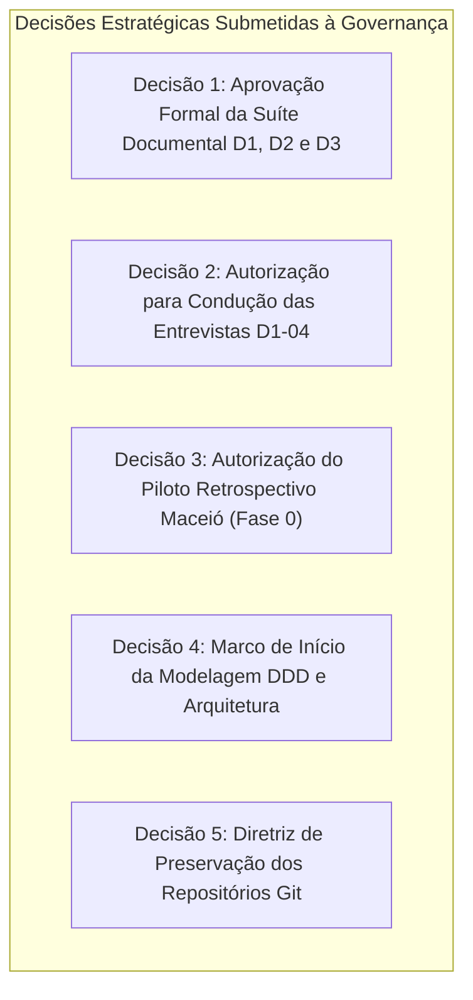

# Radar++ Discovery — D3-09: Decisões Pendentes, Saneamento de Contradições e Governança
## Registro de Contradições Corrigidas, Decisões Estratégicas Submetidas e Critérios de Transição

**Documento:** `D3-09-decisoes-pendentes.md`  
**Ciclo:** Investigação D3 — Consolidação Estratégica e Engenharia de Produto  
**Data:** 24 de Outubro de 2026  
**Status:** Oficial — Entregue para Governança  
**Responsável:** Equipe Multidisciplinar (Product Manager B2B/B2G, Arquiteto de Software, Especialistas de Negócios e SAR)  
**Repositório Oficial:** `api-radar-deformacao` (caminho: `docs/discovery/D3-09-decisoes-pendentes.md`)  

---

## 1. Registro de Contradições Saneadas ao Longo do Discovery (D1, D2 e D3)

Durante as três etapas de investigação, foram identificadas e formalmente saneadas cinco contradições conceituais críticas entre versões preliminares e o posicionamento oficial consolidado:

```
+----------------------------------------------------------------------------------------------------------------------------------------------------+
|                                    QUADRO DE CONTRADIÇÕES IDENTIFICADAS E SANEADAS                                                                 |
+----+-----------------------+-----------------------------------------------+-----------------------------------------------+-----------------------+
| ID | Tópico Crítico        | Versão Preliminar / Alegação Superada         | Versão Oficial Corrigida e Saneada (D3)       | Justificativa / Fonte |
+----+-----------------------+-----------------------------------------------+-----------------------------------------------+-----------------------+
| C1 | Regulação e InSAR no  | "A ANTT e a IN DNIT nº 2/2026 formalizaram a  | **ANTT exige SGTEC e DNIT reformulou PROARTE**| Análise dos contratos |
|    | Setor de Transportes  | elegibilidade ou obrigatoriedade do InSAR     | com orçamentação paramétrica, mas **nenhum**   | de concessão da ANTT, |
|    |                       | em contratos de concessão rodoviária".        | diploma normativo cita InSAR nominalmente.    | Resoluções e texto da |
|    |                       |                                               | InSAR é hipótese complementar sob avaliação.  | IN DNIT nº 2/2026.    |
+----+-----------------------+-----------------------------------------------+-----------------------------------------------+-----------------------+
| C2 | Detecção Antecipada   | "O Sentinel-1 oferece detecção antecipada ga- | **O Sentinel-1 mapeia tendências de deforma-** | Literatura geodésica  |
|    | de Deslizamentos      | rantida de quedas de barreira e deslizamentos | **ção lenta contínua (creep)** sob coerência  | e física de radares:  |
|    |                       | em trechos de serra antes da estação chuvosa".| favorável. **Não há garantia de detecção**    | ciclo de 6-12 dias não|
|    |                       |                                               | de rupturas rápidas ou sob Mata Atlântica.    | vê ruptura instantânea|
+----+-----------------------+-----------------------------------------------+-----------------------------------------------+-----------------------+
| C3 | Obrigatoriedade de    | "O Radar++ exige obrigatoriamente o proces-   | **Órbita única (LOS) é o padrão operacional** | Reduz à metade o custo|
|    | Geometria Bi-Orbital  | samento simultâneo de órbitas ascendentes e   | suficiente para triagem inicial de baixo      | computacional no MVP; |
|    |                       | descendentes em todas as análises do produto".| custo; a combinação bi-orbital é funcionalidade| bi-orbital é recurso  |
|    |                       |                                               | avançada opcional para trechos críticos.      | avançado sob demanda. |
+----+-----------------------+-----------------------------------------------+-----------------------------------------------+-----------------------+
| C4 | Superioridade Comer-  | "A infraestrutura linear é um mercado comer-  | **A infraestrutura linear é uma hipótese co-** | Concessionárias têm   |
|    | cial da Infraestrutura| cialmente superior, com disposição a pagar    | **mercial promissora a ser validada em campo**| processos lentos de   |
|    | Linear sobre Cidades  | imediata comprovada e ciclo de vendas curto". | nas entrevistas D1-04, sem garantias prévias. | compras e exigem ART. |
+----+-----------------------+-----------------------------------------------+-----------------------------------------------+-----------------------+
| C5 | Papel do Caso de      | "Maceió é apenas um caso histórico e o foco   | **Maceió é o Piloto Científico Retrospectivo**| Maceió possui verdade |
|    | Maceió vs. Rodovias   | comercial imediato deve ser rodovias privadas"| indispensável para calibrar o pipeline MintPy | de campo pública do   |
|    |                       |                                               | antes de avançar para corredores comerciais.  | SGB; rodovias são pós.|
+----+-----------------------+-----------------------------------------------+-----------------------------------------------+-----------------------+
```

---

## 2. Decisões Estratégicas Submetidas à Deliberação da Liderança

Para assegurar o alinhamento de governança antes de qualquer iniciativa de código ou investimento, as seguintes decisões são formalmente submetidas para aprovação:



### Decisão 1: Aprovação Formal da Suíte Documental D1, D2 e D3
* **Descrição:** Homologar o conjunto de 28 documentos técnicos produzidos nas investigações D1 (8 docs), D2 (10 docs) e D3 (10 docs) em `docs/discovery/`.
* **Recomendação da Equipe:** **APROVAR**, consolidando os achados como base oficial e imutável para os próximos ciclos.

### Decisão 2: Autorização para Condução das Entrevistas Qualitativas com Base em `D1-04`
* **Descrição:** Autorizar o agendamento de 5 a 8 conversas técnicas exploratórias com engenheiros de concessionárias privadas (Motiva, Arteris, Rumo) e consultorias geotécnicas para testar a aderência do produto e validar o modelo comercial sob demanda.
* **Recomendação da Equipe:** **APROVAR**, executando a rodada de validação sem venda de produto comercial, estritamente como pesquisa de mercado e produto.

### Decisão 3: Autorização para Execução do Piloto Retrospectivo Maceió (Fase 0)
* **Descrição:** Autorizar a execução do protocolo experimental `D1-05` em ambiente isolado de ciência de dados (Jupyter Notebook / Python) para processar os dados históricos de Maceió (2018-2021) e confrontar contra os laudos do SGB/CPRM.
* **Recomendação da Equipe:** **APROVAR**, com orçamento controlado de créditos computacionais (consumo inferior a 300 créditos HyP3).

### Decisão 4: Marco Formal de Transição para Modelagem de Domínio (DDD) e UML
* **Descrição:** Definir o momento em que a equipe iniciará a redação da Linguagem Ubíqua, diagramas de classes e modelagem de domínio orientada a microsserviços.
* **Recomendação da Equipe:** **CONDICIONAR AO TÉRMINO DAS FASES 0 E 1**. Não iniciar DDD ou diagramação de classes antes que a validação algorítmica de Maceió e as entrevistas com concessionárias forneçam os limites reais de negócio.

### Decisão 5: Governança dos Repositórios Git Existentes
* **Descrição:** Manter os três repositórios Git (`api-radar-deformacao`, `radar_fastapi_py`, `front_react`) protegidos contra código prematuro ou commits não deliberados.
* **Recomendação da Equipe:** **APROVAR**, mantendo todos os artefatos de discovery centralizados exclusivamente na pasta documental oficial sem poluição das branches de produção.
