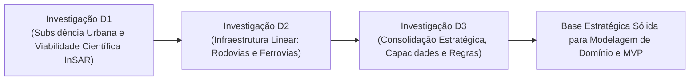

# Radar++ Discovery — D3-10: Parecer Estratégico Consolidado e Diretrizes Finais
## Síntese Executiva do Discovery D1, D2 e D3 e Recomendações para a Liderança do Produto

**Documento:** `D3-10-parecer-consolidado.md`  
**Ciclo:** Investigação D3 — Consolidação Estratégica e Engenharia de Produto  
**Data:** 24 de Outubro de 2026  
**Status:** Oficial — Entregue para Deliberação e Homologação da Governança  
**Responsável:** Equipe Multidisciplinar (Product Manager B2B/B2G, Analista Sênior de Negócios, Arquiteto de Software, Especialistas SAR e Regulação)  
**Repositório Oficial:** `api-radar-deformacao` (caminho: `docs/discovery/D3-10-parecer-consolidado.md`)  

---

## 1. Síntese Executiva do Ciclo de Descoberta (Discovery D1, D2 e D3)

Ao longo de três investigações multidisciplinares exaustivas, o Radar++ transitou de um conceito exploratório difuso para uma **tese de produto rigorosa, auditável e fundamentada em evidências verificáveis**:



### Principais Conclusões Estratégicas Consolidadas:
1. **A Ordem Oficial de Prioridades é Plenamente Justificada:**
   * **Prioridade 1 — Subsidência e Deformações Urbanas:** Configura o **Piloto Científico de Validação Retrospectiva** obrigatório do produto. O caso de Maceió/AL fornece a verdade de campo auditada pelo SGB/CPRM para calibrar o pipeline MintPy com baixo custo e altíssima coerência interferométrica ($\bar{\gamma} > 0{,}60$).
   * **Prioridade 2 — Infraestrutura Linear (Rodovias e Ferrovias):** Configura a **Hipótese de Mercado Comercial de Expansão** mais promissora do ponto de vista econômico privado (OPEX de concessionárias), que precisa ser validada em campo mediante entrevistas qualitativas (`D1-04`) antes de qualquer investimento pesado em software.
   * **Prioridade 3 — Pesquisa Científica e Consultorias de Engenharia:** Configura o **Canal Primário de Distribuição (B2B2B / B2B2G)** e os usuários operacionais mais qualificados. São as consultorias que emitem a ART exigida pelo mercado, eliminando a barreira jurídica de responsabilidade técnica que o software não pode assumir.

2. **O Posicionamento Tecnológico é de Triagem em Macroescala, não de Substituição:**
   * O Radar++ **não substitui drones com LiDAR nem vistorias presenciais de pista**, mas atua como a **camada prévia de triagem macroespacial e reconstituição histórica** (2014-2026).
   * O produto direciona os recursos caros de campo (drones e sondagens) exatamente para os taludes e quarteirões que apresentam tendência contínua de deformação milimétrica acumulada (*creep*).

3. **As Limitações Físicas São Tratadas com Total Rigor e Transparência:**
   * O sistema **não emite alertas de desastre em tempo real** nem promete previsão de rupturas bruscas causadas por temporais;
   * O sistema **não garante detecção sob vegetação densa de Mata Atlântica** na Banda C do Sentinel-1;
   * O sistema **distingue rigorosamente a velocidade escalar na linha de visada (LOS) do deslocamento vertical puro**, preservando a integridade científica da engenharia.

---

## 2. Mapa Consolidado dos Entregáveis Documentais do Discovery

Com a conclusão do ciclo D3, a pasta documental oficial em [api-radar-deformacao/docs/discovery/](file:///home/asoares/Documentos/repositories/repo_radar/api-radar-deformacao/docs/discovery/) conta com **28 documentos estruturados**, distribuídos nas seguintes categorias:

```
+----------------------------------------------------------------------------------------------------------------------------------------------------+
|                                    ESTRUTURA DOCUMENTAL COMPLETA DO DISCOVERY RADAR++                                                              |
+--------------------------+-----------------------+-------------------------------------------------------------------------------------------------+
| Ciclo / Etapa            | Quantidade Documental | Foco Temático e Arquivos Principais                                                             |
+--------------------------+-----------------------+-------------------------------------------------------------------------------------------------+
| **Investigação D1**      | 8 Documentos          | Mercado de Subsidência Urbana, Contratos Públicos, Concorrência, Roteiro de Entrevistas,        |
|                          | (`D1-01` a `D1-08`)   | Protocolo Piloto Maceió, Hipóteses/Evidências, Parecer D1 e Registro de Saneamento.              |
+--------------------------+-----------------------+-------------------------------------------------------------------------------------------------+
| **Investigação D2**      | 10 Documentos         | Panorama de Infraestrutura Linear, Problemas Operacionais em Rodovias/Ferrovias, Compradores    |
|                          | (`D2-01` a `D2-10`)   | Concorrentes, Viabilidade InSAR, Casos Reais, Modelos Comerciais, Comparativo D1/D2 e Parecer D2.|
+--------------------------+-----------------------+-------------------------------------------------------------------------------------------------+
| **Investigação D3**      | 10 Documentos         | Tese de Produto, Segmentação de Mercado, Modelo de Negócio, Capacidades (Core/Urban/Infra),     |
|                          | (`D3-01` a `D3-10`)   | Catálogo de Regras, Matriz de Rastreabilidade, Riscos/Decisão, Roadmap, Decisões e Parecer D3.  |
+--------------------------+-----------------------+-------------------------------------------------------------------------------------------------+
```

---

## 3. Diretrizes Finais e Recomendações para a Liderança do Radar++

A equipe multidisciplinar recomenda à liderança e governança do Radar++ a adoção das seguintes diretrizes imediatas:

1. **Homologar Formalmente a Documentação:** Aprovar a suíte documental completa de 28 documentos em `docs/discovery/` como especificação conceitual oficial de produto.
2. **Executar a Fase 0 em Ambiente Experimental:** Autorizar a execução do piloto científico retrospectivo de Maceió/AL exclusivamente em Jupyter Notebook (Python isolado), comprovando os índices de correlação estatística ($R^2 \ge 0{,}85$) contra os dados do SGB/CPRM.
3. **Executar a Fase 1 de Descoberta Qualitativa:** Agendar e conduzir as entrevistas com engenheiros de concessionárias privadas e sócios de consultorias geotécnicas com base no roteiro `D1-04`, testando a aceitação do modelo de contratação sob demanda (Modelo M3).
4. **Preservar a Governança dos Repositórios de Código:** Manter os repositórios Git (`api-radar-deformacao`, `radar_fastapi_py`, `front_react`) protegidos contra criação de tabelas, microsserviços ou telas prematuras até a homologação dos resultados das Fases 0 e 1.
5. **Transição Planejada para DDD e Arquitetura Detalhada:** Iniciar a modelagem de domínio (Linguagem Ubíqua e diagramas UML) somente após a validação empírica de Maceió e o fechamento das entrevistas qualitativas.

---

### Conclusão Final:
> **O Radar++ possui agora uma base de engenharia de produto e inteligência estratégica extremamente sólida, madura e imune a promessas irrealistas. A missão da Investigação D3 está plenamente concluída, pronta para a deliberação soberana da liderança.**
