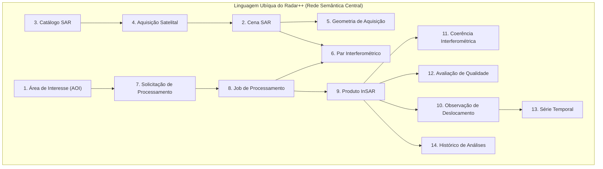

# Radar++ — Domínio: 01-linguagem-ubiqua-v1.md
## Vocabulário Ubíquo Central, Definições Formais e Regras de Consistência Semântica

**Documento:** `01-linguagem-ubiqua-v1.md`  
**Ciclo:** Ciclo 2 — Linguagem Ubíqua e Modelo Conceitual do Domínio  
**Data:** 24 de Outubro de 2026  
**Status:** Oficial — Entregue para Homologação de Domínio  
**Responsável:** Especialista em DDD, Arquiteto de Software, Especialista em SAR/InSAR, Modelador de Domínios Geoespaciais  
**Repositório Oficial:** `api-radar-deformacao` (caminho: `docs/domain/01-linguagem-ubiqua-v1.md`)  
**Regra de Governança:** Este documento é estritamente conceitual e semântico. **Não criar classes Java, entidades JPA, migrações de banco de dados ou endpoints REST nesta etapa.**

---

## 1. Fundamentos da Linguagem Ubíqua do Radar++

No *Domain-Driven Design* (DDD), a **Linguagem Ubíqua** é a linguagem rigorosa, consistente e compartilhada adotada conjuntamente por especialistas de negócio, engenheiros geotécnicos, cientistas de radar e desenvolvedores de software. Ela elimina ambiguidades entre jargões geodésicos (fase, órbita, visada) e construções de software (jobs, entidades, eventos).



---

## 2. Catálogo Oficial dos Quatorze Conceitos Centrais

---

### 2.1. Área de Interesse
1. **Nome Oficial em Português:** Área de Interesse (AOI).
2. **Nome Técnico em Inglês:** *Area of Interest (AOI)*.
3. **Definição:** Delimitação geográfica bidimensional contínua (polígono ou envelope retangular) definida pelo usuário, que estabelece o recorte espacial estrito para descoberta de dados orbitais, processamento interferométrico e extração analítica.
4. **Finalidade no Domínio:** Servir de âncora espacial para estudos geotécnicos e subsidiar o fatiamento de dados brutos, limitando o consumo computacional na nuvem.
5. **Exemplos Reais:** Polígono cobrindo os bairros Pinheiro, Mutange e Bebedouro em Maceió/AL ($\approx 35\text{ km}^2$ a $60\text{ km}^2$); faixa de *buffer* de $500\text{ m}$ ao longo de $100\text{ km}$ da rodovia BR-116 na Serra das Araras/RJ.
6. **Termos que Não Devem Ser Confundidos:**
   * *Não confundir com Bounding Box (BBOX):* A BBOX é o retângulo envolvente mínimo; a AOI pode ser um polígono irregular complexo.
   * *Não confundir com Footprint:* *Footprint* é a pegada territorial projetada no solo pela passagem do satélite, enquanto a AOI é definida pelo usuário.
7. **Relações com Outros Conceitos:** Relaciona-se com `Catálogo SAR` (filtro espacial de busca), `Solicitação de Processamento` (alvo do processamento) e `Produto InSAR` (limite de recorte dos rasters).
8. **Regras Associadas:** [RT1](file:///home/asoares/Documentos/repositories/repo_radar/api-radar-deformacao/docs/discovery/D3-05-catalogo-regras.md#L175-L178) (área máxima parametrizável de $100\text{ km}^2$ padrão), validação topológica obrigatória (sem auto-interseções, fechamento de anel externo).
9. **Fonte Científica:** Padrões OGC Simple Features (ISO 19125); EPSG Geodetic Parameter Registry (EPSG:4674 SIRGAS 2000).
10. **Grau de Estabilidade:** **Estável**.

---

### 2.2. Cena SAR
1. **Nome Oficial em Português:** Cena SAR.
2. **Nome Técnico em Inglês:** *SAR Scene*.
3. **Definição:** Registro raster complexo individual de dados de radar capturados por um sensor de abertura sintética durante uma passagem orbital, contendo amplitude e fase (Nível 1 SLC — *Single Look Complex*).
4. **Finalidade no Domínio:** Representar a unidade atômica fundamental de dado bruto fornecida pela agência espacial para formar pares interferométricos.
5. **Exemplos Reais:** `S1A_IW_SLC__1SDV_20190510T211530_..._027170_03102A_C2B1` (Cena Sentinel-1A capturada em 10/05/2019 sobre o Nordeste brasileiro).
6. **Termos que Não Devem Ser Confundidos:**
   * *Não confundir com Burst:* Um *burst* é uma sub-divisão de aquisição de 3 segundos no modo TOPSAR; uma cena IW típica do Sentinel-1 é composta por 27 a 30 *bursts* (3 sub-swaths com 9 a 10 *bursts* cada).
   * *Não confundir com Imagem Óptica:* A cena SAR não mede luz visível, mas a retroespalhamento de micro-ondas coerentes em magnitude e fase.
7. **Relações com Outros Conceitos:** Gerada a partir de uma `Aquisição Satelital`, catalogada no `Catálogo SAR`, vinculada a uma `Geometria de Aquisição` e combinada em `Pares Interferométricos`.
8. **Regras Associadas:** [RC-03](file:///home/asoares/Documentos/repositories/repo_radar/api-radar-deformacao/docs/discovery/D3-05-catalogo-regras.md#L91-L102) (homogeneidade de sensor, polarização e modo para processamento conjunto).
9. **Fonte Científica:** ESA Sentinel-1 User Handbook; Alaska Satellite Facility (ASF) DAAC Data Products.
10. **Grau de Estabilidade:** **Estável**.

---

### 2.3. Catálogo SAR
1. **Nome Oficial em Português:** Catálogo SAR.
2. **Nome Técnico em Inglês:** *SAR Catalog*.
3. **Definição:** Serviço e repositório de metadados padronizados que indexa as cenas e *bursts* orbitais disponíveis nos acervos espaciais abertos (Copernicus, ASF, NASA) sobre uma determinada região geográfica e intervalo de tempo.
4. **Finalidade no Domínio:** Permitir a descoberta automatizada, filtragem e verificação prévia de disponibilidade de insumos orbitais sem exigir download manual de arquivos gigabióticos.
5. **Exemplos Reais:** Conector de consulta da ASF Vertex Search API para Sentinel-1 IW SLC; Catálogo SpatioTemporal Asset Catalog (STAC) do Copernicus Data Space Ecosystem.
6. **Termos que Não Devem Ser Confundidos:**
   * *Não confundir com Storage de Arquivos:* O Catálogo armazena exclusivamente metadados (identificadores, geometrias, órbitas, datas), não os arquivos binários SLC de vários gigabytes.
   * *Não confundir com Catálogo de Produtos do Radar++:* O Catálogo SAR indexa insumos de terceiros; o catálogo de produtos do Radar++ indexa os rasters COG gerados internamente.
7. **Relações com Outros Conceitos:** Consulta dados a partir de uma `Área de Interesse` e devolve listas de `Aquisições Satelitais` e `Cenas SAR`.
8. **Regras Associadas:** Idempotência de consultas; isolamento de APIs externas via Camada Anti-Corrupção (ACL).
9. **Fonte Científica:** Especificação STAC (SpatioTemporal Asset Catalog v1.0.0); OGC API - Records.
10. **Grau de Estabilidade:** **Estável**.

---

### 2.4. Aquisição Satelital
1. **Nome Oficial em Português:** Aquisição Satelital.
2. **Nome Técnico em Inglês:** *Satellite Acquisition*.
3. **Definição:** Evento físico e temporal de iluminação e sensoriamento do solo por um radar orbital operando em trajetória e instante definidos.
4. **Finalidade no Domínio:** Registrar a existência cronológica e orbital da passagem do satélite, servindo de elo entre o agendamento da missão espacial e as cenas geradas.
5. **Exemplos Reais:** Passagem orbital do satélite Sentinel-1A sobre a órbita relativa 171 no dia 15/03/2020 às 21:14:05 UTC.
6. **Termos que Não Devem Ser Confundidos:**
   * *Não confundir com Cena SAR:* A aquisição é o evento temporal/orbital físico; a cena é o arquivo de dados digitais resultante dessa aquisição.
7. **Relações com Outros Conceitos:** Produz uma ou mais `Cenas SAR` e possui uma `Geometria de Aquisição` imutável.
8. **Regras Associadas:** Periodicidade orbital vinculada ao ciclo de revisita da missão (6 a 12 dias para Sentinel-1).
9. **Fonte Científica:** Curlander & McDonough (1991), *Synthetic Aperture Radar: Systems and Signal Processing*.
10. **Grau de Estabilidade:** **Estável**.

---

### 2.5. Geometria de Aquisição
1. **Nome Oficial em Português:** Geometria de Aquisição.
2. **Nome Técnico em Inglês:** *Acquisition Geometry*.
3. **Definição:** Conjunto de parâmetros angulares, vetoriais e espaciais que descrevem a trajetória do sensor no espaço em relação à superfície terrestre no momento do sensoriamento.
4. **Finalidade no Domínio:** Determinar a direção de visada, os pontos cegos topográficos (sombra e encurtamento) e as equações de projeção interferométrica.
5. **Exemplos Reais:** Direção Descendente (*Descending*), Órbita Relativa (*Path/Track*) 171, Ângulo de Incidência central $\theta = 39{,}2^\circ$, Ângulo de Azimute da Linha de Visada $\alpha \approx -168^\circ$.
6. **Termos que Não Devem Ser Confundidos:**
   * *Não confundir com Direção do Voo:* A direção do voo é o vetor de deslocamento da plataforma (Norte-Sul ou Sul-Norte); a direção de visada (LOS) é lateral ao voo (apontando para Leste ou Oeste).
7. **Relações com Outros Conceitos:** Atributo intrínseco de cada `Cena SAR`; condiciona a formação de `Pares Interferométricos` válidos.
8. **Regras Associadas:** [RC-03](file:///home/asoares/Documentos/repositories/repo_radar/api-radar-deformacao/docs/discovery/D3-05-catalogo-regras.md#L91-L102) (proibição de pares de geometrias orbitais distintas em mesmo stack).
9. **Fonte Científica:** Hanssen (2001), *Radar Interferometry: Data Interpretation and Error Analysis*.
10. **Grau de Estabilidade:** **Estável**.

---

### 2.6. Par Interferométrico
1. **Nome Oficial em Português:** Par Interferométrico.
2. **Nome Técnico em Inglês:** *Interferometric Pair*.
3. **Definição:** Combinação matemática e física de duas cenas ou *bursts* SAR da mesma geometria orbital (uma cena de referência primária e uma cena secundária), corregistrados com precisão submétrica para extração de diferença de fase interferométrica ($\Delta\phi$).
4. **Finalidade no Domínio:** Constituir a unidade geradora de sinal geodésico que permite calcular deformações milimétricas do solo e topografia.
5. **Exemplos Reais:** Par Sentinel-1 (Cena Primária de 10/05/2019 e Secundária de 22/05/2019, com $\Delta t = 12\text{ dias}$ e $B_\perp = 42\text{ m}$).
6. **Termos que Não Devem Ser Confundidos:**
   * *Não confundir com Pilha Interferométrica (Stack):* O par é a relação binária entre duas cenas; o *stack* é o grafo completo ou sequência temporal contendo dezenas de pares conectados.
   * *Não confundir com Interferograma:* O par é a combinação lógica dos insumos; o interferograma é o produto raster gerado após a multiplicação complexa conjugada.
7. **Relações com Outros Conceitos:** Formado por duas `Cenas SAR`, processado em um `Job de Processamento`, gera um `Produto InSAR` e possui uma `Coerência Interferométrica` associada.
8. **Regras Associadas:** [RT5](file:///home/asoares/Documentos/repositories/repo_radar/api-radar-deformacao/docs/discovery/D3-05-catalogo-regras.md#L191-L194) (linha de base perpendicular configurável $B_\perp \le 150\text{ m}$); [RT6](file:///home/asoares/Documentos/repositories/repo_radar/api-radar-deformacao/docs/discovery/D3-05-catalogo-regras.md#L195-L198) (linha de base temporal configurável $\Delta t \le 48\text{ dias}$).
9. **Fonte Científica:** Zebker & Goldstein (1986); Bamler & Hartl (1998).
10. **Grau de Estabilidade:** **Estável**.

---

### 2.7. Solicitação de Processamento
1. **Nome Oficial em Português:** Solicitação de Processamento.
2. **Nome Técnico em Inglês:** *Processing Request*.
3. **Definição:** Registro formal da intenção de um usuário ou sistema cliente de executar uma análise interferométrica sobre uma Área de Interesse, especificando o intervalo temporal, o pipeline analítico desejado e os parâmetros de configuração.
4. **Finalidade no Domínio:** Controlar a entrada do fluxo de trabalho, auditar a autoria do pedido e validar cotas comerciais antes do envio computacional.
5. **Exemplos Reais:** Solicitação nº 1042: Estudo de subsidência histórica em Maceió (01/2018 a 12/2021) utilizando pipeline SBAS MintPy, submetida pelo usuário `eng.geotecnico@consultoria.com`.
6. **Termos que Não Devem Ser Confundidos:**
   * *Não confundir com Job de Processamento:* A solicitação é o objeto de intenção negocial e autorização; o job é a unidade técnica de execução assíncrona na infraestrutura de nuvem.
7. **Relações com Outros Conceitos:** Vinculada a uma `Área de Interesse`, autoriza e cria um ou mais `Jobs de Processamento`.
8. **Regras Associadas:** [RS-01](file:///home/asoares/Documentos/repositories/repo_radar/api-radar-deformacao/docs/discovery/D3-05-catalogo-regras.md#L155-L170) (isolamento estrito entre organizações multi-inquilino).
9. **Fonte Científica:** Padrões de Arquitetura de Software Assíncrona e Enterprise Integration Patterns (EIP).
10. **Grau de Estabilidade:** **Estável**.

---

### 2.8. Job de Processamento
1. **Nome Oficial em Português:** Job de Processamento.
2. **Nome Técnico em Inglês:** *Processing Job*.
3. **Definição:** Instância operacional assíncrona de processamento científico gerenciada por uma máquina de estados finitos, encarregada de executar tarefas geodésicas pesadas em contêineres na nuvem ou serviços de terceiros (ASF HyP3).
4. **Finalidade no Domínio:** Rastrear o ciclo de vida da execução, capturar logs, lidar com retentativas automáticas e notificar a conclusão ou falha do cálculo geodésico.
5. **Exemplos Reais:** Job HyP3 UUID `8f3b2a1c-99d4-...` executando geração de interferograma desdobrado com SNAPHU; Job MintPy executando inversão matricial SBAS.
6. **Termos que Não Devem Ser Confundidos:**
   * *Não confundir com Processo de Sistema Operacional (PID):* O job é um conceito distribuído de negócio/orquestração, podendo coordenar múltiplos passos e contêineres sucessivos.
7. **Relações com Outros Conceitos:** Criado por uma `Solicitação de Processamento`, orquestra `Pares Interferométricos` e produz `Produtos InSAR`.
8. **Regras Associadas:** [RO-01](file:///home/asoares/Documentos/repositories/repo_radar/api-radar-deformacao/docs/discovery/D3-05-catalogo-regras.md#L89-L104) (execução assíncrona mandatória, não-bloqueante na interface HTTP).
9. **Fonte Científica:** Alaska Satellite Facility HyP3 Architecture Documentation (2022).
10. **Grau de Estabilidade:** **Estável**.

---

### 2.9. Produto InSAR
1. **Nome Oficial em Português:** Produto InSAR.
2. **Nome Técnico em Inglês:** *InSAR Product*.
3. **Definição:** Artefato raster georreferenciado e auditável resultante da cadeia de processamento geodésico, formatado em conformidade com padrões geoespaciais abertos (Cloud Optimized GeoTIFF).
4. **Finalidade no Domínio:** Disponibilizar o resultado numérico científico para visualização em mapas temáticos, extração analítica e geração de laudos.
5. **Exemplos Reais:** Raster COG de velocidade anual de deformação (`velocity_los_2018_2021.tif`); matriz de fase desdobrada (`unwrapped_phase_20190510_20190522.tif`).
6. **Termos que Não Devem Ser Confundidos:**
   * *Não confundir com Mapa Temático de Frontend:* O produto é o arquivo de dados geodésicos matriciais (valores de velocidade em float32); o mapa temático é a representação visual estilizada com cores no navegador.
7. **Relações com Outros Conceitos:** Gerado por um `Job de Processamento`, submetido a uma `Avaliação de Qualidade`, consultado para extrair `Observações de Deslocamento` e indexado no `Histórico de Análises`.
8. **Regras Associadas:** [RO-02](file:///home/asoares/Documentos/repositories/repo_radar/api-radar-deformacao/docs/discovery/D3-05-catalogo-regras.md#L106-L121) (formato obrigatório Cloud Optimized GeoTIFF com pirâmides internas); [RQ-01](file:///home/asoares/Documentos/repositories/repo_radar/api-radar-deformacao/docs/discovery/D3-05-catalogo-regras.md#L123-L135) (metadados obrigatórios de reprodutibilidade).
9. **Fonte Científica:** OGC Cloud Optimized GeoTIFF Standard (2023); SpatioTemporal Asset Catalog (STAC).
10. **Grau de Estabilidade:** **Estável**.

---

### 2.10. Observação de Deslocamento
1. **Nome Oficial em Português:** Observação de Deslocamento.
2. **Nome Técnico em Inglês:** *Displacement Observation*.
3. **Definição:** Medição escalar quantitativa da variação de posição do terreno em uma coordenada geográfica pontual $(lat, lon)$, projetada na linha de visada do satélite ($\text{mm}_{\text{LOS}}$) em uma data específica.
4. **Finalidade no Domínio:** Compor os pontos de dispersão das séries temporais e permitir a análise geotécnica pontual de estruturas, taludes e edifícios.
5. **Exemplos Reais:** Ponto no bairro Mutange (Lat: -9.6412°, Lon: -35.7511°) em 15/07/2019: $d_{\text{LOS}} = -68{,}4\text{ mm}$, com coerência local $\gamma = 0{,}78$.
6. **Termos que Não Devem Ser Confundidos:**
   * *Não confundir com Afundamento Vertical Puro ($d_{\text{vert}}$):* A observação padrão é sempre na linha de visada ($d_{\text{LOS}}$); rotulá-la como vertical pura sem conversão geométrica explícita viola [RC-01](file:///home/asoares/Documentos/repositories/repo_radar/api-radar-deformacao/docs/discovery/D3-05-catalogo-regras.md#L62-L78).
   * *Não confundir com Velocidade de Deformação:* A observação é o deslocamento acumulado em um ponto no tempo ($d$ em mm); a velocidade é a taxa angular de variação temporal ($v$ em mm/ano).
7. **Relações com Outros Conceitos:** Extraída a partir de um `Produto InSAR`, agrupada em uma `Série Temporal` e validada pela `Coerência Interferométrica` local.
8. **Regras Associadas:** [RC-01](file:///home/asoares/Documentos/repositories/repo_radar/api-radar-deformacao/docs/discovery/D3-05-catalogo-regras.md#L62-L78) (rotulagem obrigatória como $\text{mm}_{\text{LOS}}$).
9. **Fonte Científica:** Hanssen (2001); Ferretti et al. (2001), *Permanent Scatterers in SAR Interferometry*.
10. **Grau de Estabilidade:** **Estável**.

---

### 2.11. Coerência Interferométrica
1. **Nome Oficial em Português:** Coerência Interferométrica.
2. **Nome Técnico em Inglês:** *Interferometric Coherence*.
3. **Definição:** Medida estatística escalar normalizada entre 0 e 1 que quantifica o grau de correlação e semelhança eletromagnética da fase complexa entre duas aquisições de radar.
4. **Finalidade no Domínio:** Servir de indicador primordial da confiabilidade do sinal interferométrico e subsidiar máscaras que eliminam ruídos estocásticos decorrentes de vegetação densa ou corpos hídricos.
5. **Exemplos Reais:** $\gamma = 0{,}85$ sobre telhados urbanos de concreto em Maceió (alta confiabilidade); $\gamma = 0{,}12$ sobre encosta de Mata Atlântica úmida (ruído total).
6. **Termos que Não Devem Ser Confundidos:**
   * *Não confundir com Resolução Espacial:* A coerência mede correlação de sinal, não o tamanho em metros do pixel.
   * *Não confundir com Amplitude do Sinal:* Um alvo pode ter alto retroespalhamento de energia (brilho), mas baixa coerência de fase (se a superfície tiver mudado entre as passagens).
7. **Relações com Outros Conceitos:** Calculada para cada `Par Interferométrico`, gera matriz matricial associada ao `Produto InSAR` e subsidia a `Avaliação de Qualidade`.
8. **Regras Associadas:** [RC-02](file:///home/asoares/Documentos/repositories/repo_radar/api-radar-deformacao/docs/discovery/D3-05-catalogo-regras.md#L79-L90) (máscara de coerência configurável para exibição de pixels confiáveis).
9. **Fonte Científica:** Zebker & Villasenor (1992), *Decorrelation in interferometric radar echoes*.
10. **Grau de Estabilidade:** **Estável**.

---

### 2.12. Avaliação de Qualidade
1. **Nome Oficial em Português:** Avaliação de Qualidade.
2. **Nome Técnico em Inglês:** *Quality Evaluation*.
3. **Definição:** Conjunto analítico de métricas, índices de resíduos topológicos e testes estatísticos aplicados sobre o processamento interferométrico para atestar a validade científica do produto final.
4. **Finalidade no Domínio:** Alertar o engenheiro usuário sobre áreas com descontinuidade de fase, erros de desdobramento (*unwrapping*) ou resíduos atmosféricos que possam induzir a interpretações geotécnicas equivocadas.
5. **Exemplos Reais:** Avaliação indicando: Coerência espacial média $\bar{\gamma} = 0{,}52$; percentual de resíduos de desdobramento $= 8{,}4\%$ (Status: Conforme); ausência de saltos artificiais de $2\pi$.
6. **Termos que Não Devem Ser Confundidos:**
   * *Não confundir com Avaliação de Risco Geotécnico:* A qualidade avalia o sinal geodésico do satélite; o risco geotécnico avalia a probabilidade de colapso de uma encosta ou edifício.
7. **Relações com Outros Conceitos:** Avalia um `Produto InSAR` e compõe os metadados do `Histórico de Análises`.
8. **Regras Associadas:** [RQ-02](file:///home/asoares/Documentos/repositories/repo_radar/api-radar-deformacao/docs/discovery/D3-05-catalogo-regras.md#L137-L151) (bandeira de atenção caso resíduos de desdobramento excedam o limiar configurado).
9. **Fonte Científica:** Yunjun et al. (2019), *Small baseline InSAR time series analysis: Keys to software MintPy*.
10. **Grau de Estabilidade:** **Provisório (Parâmetros sob calibração no Piloto Maceió)**.

---

### 2.13. Série Temporal
1. **Nome Oficial em Português:** Série Temporal de Deformação.
2. **Nome Técnico em Inglês:** *Displacement Time Series*.
3. **Definição:** Sequência cronologicamente ordenada de Observações de Deslocamento em uma mesma coordenada geográfica, representando a trajetória cinemática contínua do terreno ao longo de múltiplos ciclos orbitais.
4. **Finalidade no Domínio:** Permitir a identificação de acelerações, regimes de rastejo constante (*creep*), sazonalidades térmicas/pluviométricas e datas de início de instabilidades.
5. **Exemplos Reais:** Série histórica de 2018 a 2021 contendo 72 pontos temporais demonstrando deslocamento linear contínuo de $-180\text{ mm}_{\text{LOS}}$ no bairro Mutange.
6. **Termos que Não Devem Ser Confundidos:**
   * *Não confundir com Interferograma Diferencial:* O interferograma mede o deslocamento entre apenas duas datas; a série temporal reconstrói a curva de movimento ao longo de dezenas de datas encadeadas.
7. **Relações com Outros Conceitos:** Composta por múltiplas `Observações de Deslocamento` extraídas de um conjunto temporal de `Produtos InSAR`.
8. **Regras Associadas:** Requer inversão matemática estável (SBAS ou PS) e calibração contra ponto de referência estável.
9. **Fonte Científica:** Berardino et al. (2002), *A new algorithm for surface deformation monitoring based on small baseline differential SAR interferograms (SBAS)*.
10. **Grau de Estabilidade:** **Estável**.

---

### 2.14. Histórico de Análises
1. **Nome Oficial em Português:** Histórico de Análises.
2. **Nome Técnico em Inglês:** *Analysis History*.
3. **Definição:** Registro imutável, auditável e ordenado no tempo de todos os eventos, parâmetros técnicos, modelos digitais de elevação e usuários que participaram da geração de um estudo interferométrico.
4. **Finalidade no Domínio:** Garantir a cadeia de custódia técnico-pericial e a rastreabilidade total necessária para que os laudos gerados pelo Radar++ sustentem auditorias e perícias judiciais.
5. **Exemplos Reais:** Registro de auditoria contendo: DEM de referência (Copernicus 30m), versão exata do MintPy (v1.5.2), limiar de coerência adotado ($0{,}40$), identificador do usuário e data/hora do processamento.
6. **Termos que Não Devem Ser Confundidos:**
   * *Não confundir com Logs de Sistema Operacional:* Logs de infraestrutura (Syslog, Nginx) são voláteis e técnicos; o Histórico de Análise é um registro de domínio pericial permanente.
7. **Relações com Outros Conceitos:** Rastreia o ciclo de vida desde a `Solicitação de Processamento` até a entrega e exportação do `Produto InSAR`.
8. **Regras Associadas:** [RQ-01](file:///home/asoares/Documentos/repositories/repo_radar/api-radar-deformacao/docs/discovery/D3-05-catalogo-regras.md#L123-L135) (reprodutibilidade científica obrigatória de parâmetros).
9. **Fonte Científica:** Práticas Forenses e Normas de Perícia em Engenharia Civil e Geodésia Legal.
10. **Grau de Estabilidade:** **Estável**.

---

## 3. Matriz Sintética de Alinhamento Terminológico

```
+----------------------------------------------------------------------------------------------------------------------------------------------------+
|                                    QUADRO RESUMO DA LINGUAGEM UBÍQUA v1 DO RADAR++                                                                 |
+----+--------------------------------+----------------------------+-----------------------+-------------------------+-------------------------------+
| Nº | Termo em Português             | Termo Técnico em Inglês    | Papel Primário no DDD | Classificação           | Grau de Estabilidade          |
+----+--------------------------------+----------------------------+-----------------------+-------------------------+-------------------------------+
| 01 | Área de Interesse (AOI)        | Area of Interest (AOI)     | Entidade / Agregado   | Suporte Territorial     | **Estável**                   |
| 02 | Cena SAR                       | SAR Scene                  | Objeto de Valor       | Insumo Orbital          | **Estável**                   |
| 03 | Catálogo SAR                   | SAR Catalog                | Serviço de Domínio    | Integração Externa      | **Estável**                   |
| 04 | Aquisição Satelital            | Satellite Acquisition      | Entidade / Evento     | Geometria Temporal      | **Estável**                   |
| 05 | Geometria de Aquisição         | Acquisition Geometry       | Objeto de Valor       | Física Espacial         | **Estável**                   |
| 06 | Par Interferométrico           | Interferometric Pair       | Entidade Central      | Física InSAR            | **Estável**                   |
| 07 | Solicitação de Processamento   | Processing Request         | Agregado de Entrada   | Gestão de Fluxo         | **Estável**                   |
| 08 | Job de Processamento           | Processing Job             | Agregado / Orquestrador| Execução Assíncrona    | **Estável**                   |
| 09 | Produto InSAR                  | InSAR Product              | Agregado de Saída     | Entrega de Valor        | **Estável**                   |
| 10 | Observação de Deslocamento     | Displacement Observation   | Objeto de Valor       | Medição Cinemática      | **Estável**                   |
| 11 | Coerência Interferométrica     | Interferometric Coherence  | Objeto de Valor       | Confiabilidade de Sinal | **Estável**                   |
| 12 | Avaliação de Qualidade         | Quality Evaluation         | Objeto de Valor       | Rigor Científico        | **Provisório (Calibração)**   |
| 13 | Série Temporal                 | Displacement Time Series   | Agregado / Entidade   | Cinemática Histórica    | **Estável**                   |
| 14 | Histórico de Análises          | Analysis History           | Entidade de Auditoria | Perícia e Conformidade  | **Estável**                   |
+----+--------------------------------+----------------------------+-----------------------+-------------------------+-------------------------------+
```
