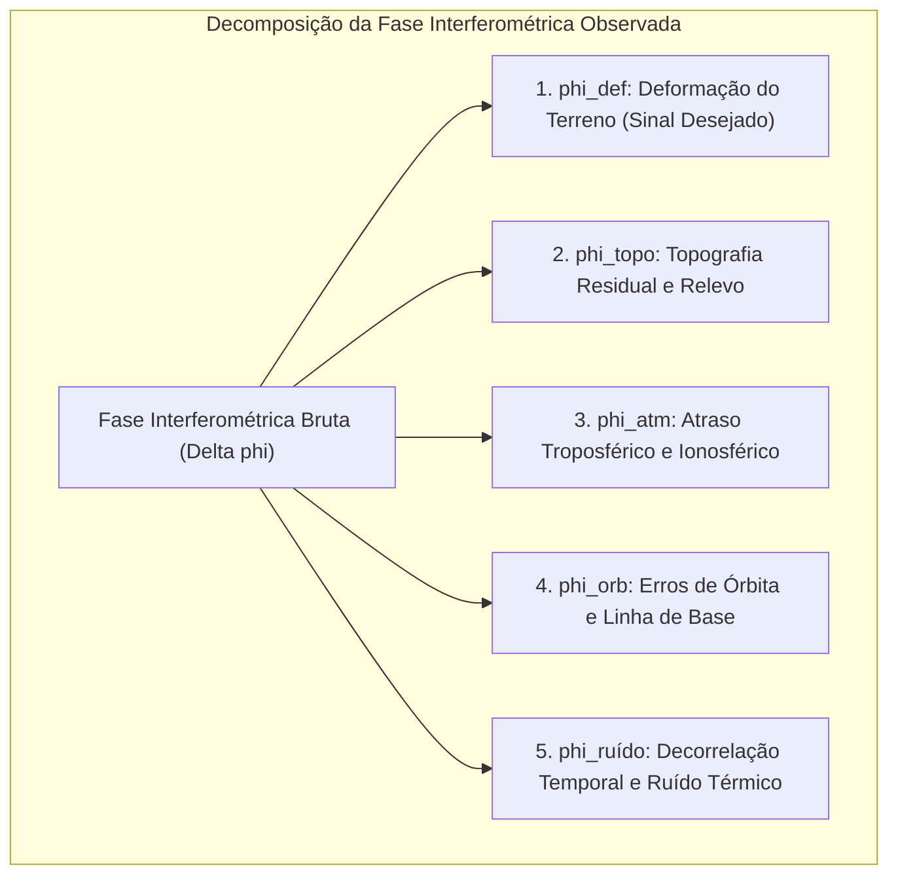
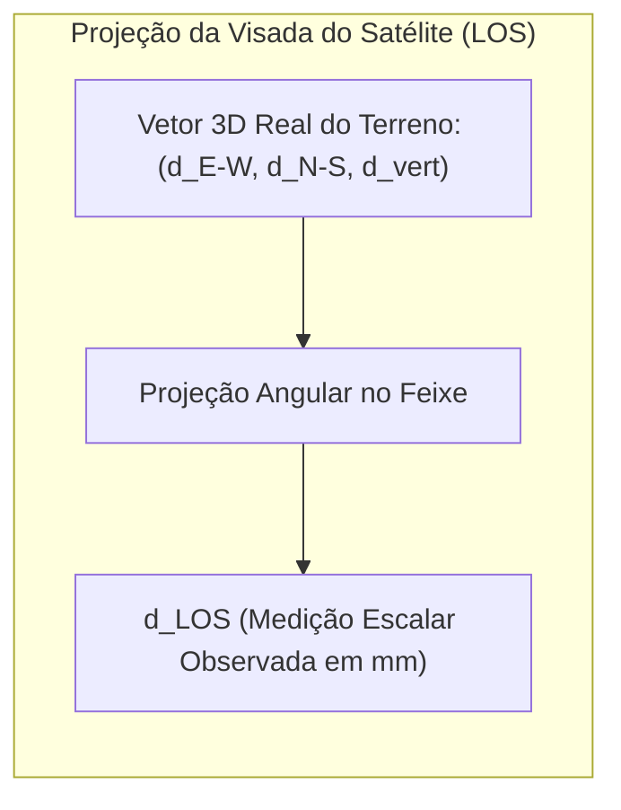
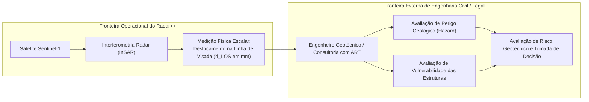

# Radar++ — Domínio: 02-glossario-cientifico.md
## Glossário Geodésico, Físico e Matemático da Interferometria por Radar (SAR/InSAR)

**Documento:** `02-glossario-cientifico.md`  
**Ciclo:** Ciclo 2 — Linguagem Ubíqua e Modelo Conceitual do Domínio  
**Data:** 24 de Outubro de 2026  
**Status:** Oficial — Entregue para Homologação de Domínio  
**Responsável:** Especialista em Sensoriamento Remoto SAR/InSAR, Modelador de Domínios Geoespaciais, Arquiteto de Software  
**Repositório Oficial:** `api-radar-deformacao` (caminho: `docs/domain/02-glossario-cientifico.md`)  
**Diretriz de Rigor Científico:** Estabelecer a fundamentação física e matemática das grandezas manipuladas pela plataforma Radar++, diferenciando estritamente medições geodésicas de avaliações de risco geotécnico.

---

## 1. Grandezas Físicas e a Equação Fundamental da Fase Interferométrica

O princípio do InSAR baseia-se na diferença de fase ($\Delta\phi$) entre duas ondas eletromagnéticas coerentes refletidas pelo terreno e capturadas em posições orbitais ligeiramente distintas:

$$\Delta\phi = \phi_2 - \phi_1 = \phi_{\text{def}} + \phi_{\text{topo}} + \phi_{\text{atm}} + \phi_{\text{orb}} + \phi_{\text{ruído}}$$



### Componentes da Equação de Fase:
1. **$\phi_{\text{def}}$ (Componente de Deformação):** Variação de percurso provocada pelo deslocamento físico do terreno entre as duas passagens na direção da linha de visada ($d_{\text{LOS}}$):
   $$\phi_{\text{def}} = -\frac{4\pi}{\lambda} d_{\text{LOS}}$$
   onde $\lambda$ é o comprimento de onda do radar ($\lambda \approx 5{,}546\text{ cm}$ para a Banda C do Sentinel-1).
2. **$\phi_{\text{topo}}$ (Componente Topográfica Residual):** Fase decorrente da altitude do terreno em relação ao elipsoide de referência. É removida subtraindo um Modelo Digital de Elevação (DEM) externo (ex.: Copernicus GLO-30):
   $$\phi_{\text{topo}} = -\frac{4\pi}{\lambda} \frac{B_\perp}{R \sin\theta} \Delta z$$
   onde $B_\perp$ é a linha de base perpendicular, $R$ é a distância sensor-alvo, $\theta$ é o ângulo de incidência e $\Delta z$ é o erro residual do DEM.
3. **$\phi_{\text{atm}}$ (Componente Atmosférica):** Atraso de propagação do feixe provocado por variações temporais e espaciais no vapor d'água troposférico e na densidade de elétrons da ionosfera (*Atmospheric Phase Screen — APS*).
4. **$\phi_{\text{orb}}$ (Componente Orbital):** Erro de rampa linear ou quadrática de fase gerado por incertezas nas efemérides da trajetória do satélite. Eliminado pelo uso de órbitas de precisão da ESA (*Precise Orbit Determination — POD*).
5. **$\phi_{\text{ruído}}$ (Ruído Estocástico):** Flutuações de fase provocadas por descorrelação temporal da vegetação, mudanças de umidade do solo e ruído térmico do receptor.

---

## 2. Geometria de Visada e Relações Vetoriais (LOS vs. Vertical)

A medição interferométrica escalar é estritamente **unidimensional ao longo da Linha de Visada (*Line-of-Sight — LOS*)**.

### 2.1. Equação de Projeção Cinemática
O deslocamento observado $d_{\text{LOS}}$ é o produto escalar do vetor tridimensional de deslocamento do terreno $\mathbf{d} = (d_{\text{E-W}}, d_{\text{N-S}}, d_{\text{vert}})$ pelo vetor unitário de visada do sensor $\mathbf{\hat{s}}$:

$$d_{\text{LOS}} = -d_{\text{vert}} \cos\theta + d_{\text{E-W}} \sin\theta \cos\alpha - d_{\text{N-S}} \sin\theta \sin\alpha$$

onde:
* $\theta$: Ângulo de incidência local do radar em relação à vertical local ($\theta \approx 39^\circ$ no centro do modo IW);
* $\alpha$: Ângulo de azimute do vetor de voo em relação ao Norte geográfico ($\alpha \approx -168^\circ$ para órbita descendente; $\alpha \approx -12^\circ$ para órbita ascendente).



### 2.2. Distinções Físicas Fundamentais
* **Sensibilidade Quase Nula à Direção Norte-Sul:** Devido à órbita quase polar do Sentinel-1 (inclinação de $98{,}2^\circ$), o feixe de radar ilumina o solo quase perpendicularmente à trajetória Norte-Sul ($\sin\alpha \approx 0$). Portanto, o satélite é praticamente cego a movimentos horizontais puros no eixo Norte-Sul.
* **Inviabilidade de Inversão Vertical com Órbita Única:** Uma única órbita não permite resolver duas incógnitas ($d_{\text{vert}}$ e $d_{\text{E-W}}$). O cálculo rigoroso de $d_{\text{vert}}$ exige no mínimo duas visadas distintas (par combinado Ascendente + Descendente) resolvendo o sistema linear:
  $$\begin{bmatrix} d_{\text{LOS}}^{\text{asc}} \\ d_{\text{LOS}}^{\text{desc}} \end{bmatrix} = \begin{bmatrix} -\cos\theta_{\text{asc}} & \sin\theta_{\text{asc}}\cos\alpha_{\text{asc}} \\ -\cos\theta_{\text{desc}} & \sin\theta_{\text{desc}}\cos\alpha_{\text{desc}} \end{bmatrix} \begin{bmatrix} d_{\text{vert}} \\ d_{\text{E-W}} \end{bmatrix}$$

---

## 3. Desdobramento de Fase (*Phase Unwrapping*) e o Algoritmo SNAPHU

A fase interferométrica observada $\psi$ é restrita ao intervalo angular modular $[-\pi, +\pi]$ radianos (*fase embrulhada* ou *wrapped phase*):

$$\psi = \mathcal{W}\{\phi\} = \phi - 2\pi k, \quad k \in \mathbb{Z}$$

### 3.1. O Problema do Desdobramento
Para converter a fase em distância métrica contínua, é indispensável determinar o número inteiro $k$ de ciclos de $2\pi$ adicionados a cada pixel da imagem.

### 3.2. O Algoritmo SNAPHU
O algoritmo SNAPHU (*Statistical-Cost, Network-Flow Algorithm for Phase Unwrapping*, Chen & Zebker, 2002) formula o desdobramento como um problema de **otimização de fluxo em redes de custo mínimo (*Minimum Cost Flow — MCF*)**:
* Ele constrói um grafo topológico onde os nós representam os laços de fase e as arestas representam as probabilidades estatísticas de descontinuidade;
* Minimiza uma função de custo não-linear baseada em modelos probabilísticos que consideram a coerência local e a inclinação topográfica;
* **Resíduos de Fase (*Singularidades / Saltos de $2\pi$*):** Ocorrem em locais de incoerência severa (ex.: corpos d'água, vegetação densa ou zonas de fratura súbita). Se o circuito fechado da soma de fases ao redor de um quadrado de 4 pixels vizinhos for diferente de zero ($\sum \Delta\psi \ne 0$), surge um resíduo (*vórtice de fase*), que gera degraus espaciais artificiais de deformação caso não seja isolado por linhas de corte (*branch cuts*).

---

## 4. Linhas de Base Geodésicas e Altura de Ambiguidade

```
+----------------------------------------------------------------------------------------------------------------------------------------------------+
|                                    GRANDEZAS DE LINHA DE BASE EM INTERFEROMETRIA RADAR                                                             |
+--------------------------+-----------------------+------------------------------------+----------------------------------------------------+
| Conceito Geodésico       | Notação Matemática    | Definição Física                   | Impacto Operacional no Radar++                     |
+--------------------------+-----------------------+------------------------------------+----------------------------------------------------+
| Linha de Base Perpendic. | $B_\perp$ (metros)    | Distância física entre as duas     | Se $B_\perp > 150\text{ m}$, há descorrelação      |
|                          |                       | trajetórias orbitais, projetada na | espacial geométrica e alta sensibilidade a erros de|
|                          |                       | perpendicular da visada.           | relevo no DEM.                                     |
+--------------------------+-----------------------+------------------------------------+----------------------------------------------------+
| Linha de Base Temporal   | $\Delta t$ (dias)     | Diferença de dias entre as duas    | Se $\Delta t > 48\text{ dias}$ em clima tropical, a|
|                          |                       | datas de aquisição satelital.      | vegetação e a umidade do solo destroem a coerência.|
+--------------------------+-----------------------+------------------------------------+----------------------------------------------------+
| Altura de Ambiguidade    | $h_a$ (metros)        | Desnível topográfico vertical ne-  | $h_a = \frac{\lambda R \sin\theta}{2 B_\perp}$.    |
|                          |                       | cessário para gerar um ciclo com-  | Quanto maior $B_\perp$, menor $h_a$ e mais ruído de|
|                          |                       | pleto de $2\pi$ radianos de fase.  | relevo residual contamina o interferograma.        |
+--------------------------+-----------------------+------------------------------------+----------------------------------------------------+
```

---

## 5. Teoria da Coerência Interferométrica e Decorrelação

A coerência interferométrica complexa $\gamma$ entre duas imagens $s_1$ e $s_2$ é calculada espacialmente sobre uma janela de vizinhança de $N$ pixels:

$$\gamma = \frac{\left| \sum_{i=1}^N s_{1,i} s_{2,i}^* \right|}{\sqrt{\sum_{i=1}^N |s_{1,i}|^2 \sum_{i=1}^N |s_{2,i}|^2}}, \quad 0 \le \gamma \le 1$$

### Fatores de Degradação da Coerência:
$$\gamma_{\text{total}} = \gamma_{\text{temporal}} \cdot \gamma_{\text{geométrica}} \cdot \gamma_{\text{volumétrica}} \cdot \gamma_{\text{térmica}}$$

1. **$\gamma_{\text{temporal}}$ (Decorrelação Temporal):** Provocada por alterações físicas ou biológicas na superfície entre as passagens (crescimento de plantas, movimento de folhas pelo vento, chuva, aração de solo). É o fator crítico que inviabiliza a Banda C sob Mata Atlântica contínua.
2. **$\gamma_{\text{geométrica}}$ (Decorrelação Espacial):** Decorrente da diferença angular entre as duas órbitas ($B_\perp \ne 0$). Quando $B_\perp$ atinge a *linha de base crítica* ($B_{\text{crítico}} \approx 5\text{ km}$ no Sentinel-1), a coerência vai a zero.
3. **$\gamma_{\text{volumétrica}}$ (Decorrelação Volumétrica):** Ocorre quando a micro-onda penetra em um meio espesso com múltiplos espalhadores em diferentes profundidades (dossel florestal, manto de neve).
4. **$\gamma_{\text{térmica}}$ (Ruído do Instrumento):** Relação sinal-ruído (SNR) eletrônica do hardware do satélite (geralmente desprezível em alvos urbanos).

---

## 6. O Modo de Aquisição TOPSAR do Sentinel-1 (Bursts e Sub-swaths)

O sensor C-SAR do Sentinel-1 adota o modo de varredura **TOPSAR (*Terrain Observation with Progressive Scans SAR*)** no modo Interferometric Wide (IW):
* A faixa imageada possui largura de $250\text{ km}$, dividida em três sub-faixas sobrepostas (*sub-swaths*: IW1, IW2 e IW3);
* Em cada sub-faixa, o feixe eletrônico é girado ativamente do sentido retroativo para o antecipado na direção azimutal (*along-track*), criando fatias discretas chamadas **Bursts** (com duração de $\approx 3\text{ segundos}$ de iluminação cada);
* **Requisito Submétrico de Corregistro Azimutal (ESD):** Devido à variação do efeito Doppler ao longo de cada *burst*, o corregistro de duas imagens Sentinel-1 deve atingir uma precisão superior a **0,001 pixel azimutal**. Para isso, o pipeline emprega o algoritmo *Enhanced Spectral Diversity (ESD)* sobre a área de sobreposição entre *bursts* consecutivos.

---

## 7. Métodos de Análise de Séries Temporais: DInSAR vs. PSInSAR vs. SBAS

```
+----------------------------------------------------------------------------------------------------------------------------------------------------+
|                                    COMPARATIVO DE MÉTODOS INTERFEROMÉTRICOS DE SÉRIE TEMPORAL                                                      |
+--------------------------+-----------------------+-----------------------------+-------------------------------------------------------------------+
| Método                   | Tipo de Espalhador    | Configuração da Rede        | Aplicação Ideal e Comportamento no Radar++                        |
+--------------------------+-----------------------+-----------------------------+-------------------------------------------------------------------+
| DInSAR Convencional      | Distribuído (Pixels   | Par único de 2 datas        | Detecção preliminar de grandes deformações após eventos bruscos;  |
| (Diferencial 2 Passagens)| contínuos)            | (1 interferograma)          | muito vulnerável a ruído atmosférico e decorrelação temporal.     |
+--------------------------+-----------------------+-----------------------------+-------------------------------------------------------------------+
| PSInSAR                  | Dispersores Pontuais  | Estrela (1 cena Master comum| Ideal para áreas urbanas e estruturas de concreto/rocha;         |
| (Persistent Scatterers)  | Puros (*PS*)          | ligada a todas as outras)   | exige alta densidade de edificações; imune a descorrelação temporal|
+--------------------------+-----------------------+-----------------------------+-------------------------------------------------------------------+
| SBAS                     | Espalhadores Distri-  | Grafo redundante de linhas  | **Método Oficial do Radar++ para Subsidência Urbana e Taludes**:   |
| (Small Baseline Subset)  | buídos Homogêneos     | de base curtas ($B_\perp$,  | conecta pares de pequenos baselines, maximiza coerência espacial  |
|                          | (*DS*)                | $\Delta t$ controlados)     | e permite inversão matricial robusta via SVD no MintPy.           |
+--------------------------+-----------------------+-----------------------------+-------------------------------------------------------------------+
```

---

## 8. Correções Atmosféricas em Ambientes Costeiros e Tropicais

Regiões tropicais costeiras (como Maceió/AL ou Serra do Mar/SP) sofrem forte influência do vapor d'água atmosférico:
* **Troposfera Estratificada:** Variação vertical do índice de refração do ar correlacionada com o relevo topográfico (ar quente e úmido no nível do mar; ar mais seco no topo dos tabuleiros). Simula subsidência aparente em encostas;
* **Troposfera Turbulenta:** Bolsões aleatórios de vapor d'água associados a frentes convectivas e evaporação de lagoas. Simula deformações circulares localizadas;
* **Estratégias de Mitigação Implementadas no MintPy:**
  1. *Modelos Numéricos Globais:* Assimilação de perfis atmosféricos do modelo reanalítico **ERA5** (ECMWF) ou dados de atraso do **GACOS** (*Generic Atmospheric Correction Online Service*);
  2. *Filtragem Espaço-Temporal:* Separação da deformação (que é correlacionada no tempo e no espaço) do ruído atmosférico turbulento (que é correlacionado no espaço, mas aleatório no tempo).

---

## 9. Fronteira Epistemológica: Medição Geodésica vs. Avaliação de Risco Geotécnico

Para garantir a estrita conformidade legal e ética da plataforma:



> **PRINCÍPIO FUNDAMENTAL DO RADAR++:**  
> O Radar++ fornece **medições geodésicas observadas ($d_{\text{LOS}}$)** e indicadores de confiabilidade matemática ($\gamma$).  
> O Radar++ **NÃO avalia risco de engenharia, fator de segurança de taludes nem probabilidade de ruptura estrutural**. Essa avaliação exige a conjugação de parâmetros geotécnicos de solo (coesão, ângulo de atrito, poro-pressão, nível freático e geometria estrutural), atribuição privativa do engenheiro civil ou geólogo devidamente habilitado perante o CREA.
