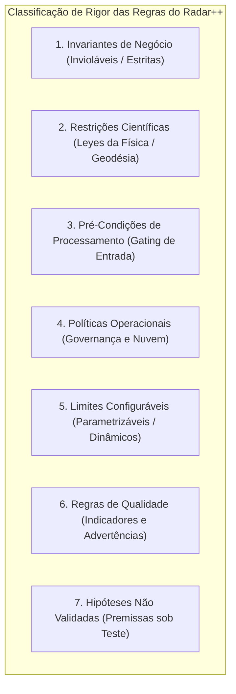

# Radar++ — Domínio: 04-regras-e-invariantes.md
## Classificação Rigorosa de Invariantes, Restrições Científicas, Políticas e Parâmetros Configuráveis

**Documento:** `04-regras-e-invariantes.md`  
**Ciclo:** Ciclo 2 — Linguagem Ubíqua e Modelo Conceitual do Domínio  
**Data:** 24 de Outubro de 2026  
**Status:** Oficial — Entregue para Homologação de Domínio  
**Responsável:** Arquiteto de Software, Especialista em Sensoriamento Remoto, Analista de Processos  
**Repositório Oficial:** `api-radar-deformacao` (caminho: `docs/domain/04-regras-e-invariantes.md`)  
**Diretriz Epistemológica Obrigatória:** Não transformar parâmetros operacionais empíricos (como coerência de 0,40, baseline perpendicular de 150 m ou intervalo de 48 dias) em constantes invariantes universais do código. Manter tais limiares estritamente como **limites parametrizáveis configuráveis**.

---

## 1. Tipologia de Regras no Radar++

Para assegurar clareza na modelagem de domínio orientada a objetos e na arquitetura de software, as regras do Radar++ são categorizadas em sete famílias funcionais com níveis distintos de rigor:



---

## 2. Invariantes de Negócio (Invioláveis no Domínio)

As invariantes de negócio definem a integridade lógica e legal do sistema. Sua violação corrompe o estado dos agregados e deve lançar exceções de domínio imediatas:

```
+----------------------------------------------------------------------------------------------------------------------------------------------------+
|                                      INVARIANTES DE NEGÓCIO DO RADAR++                                                                             |
+----+-----------------------+-------------------------------------------------------+----------------------------------+----------------------------+
| ID | Nome da Invariante    | Descrição e Condição de Aplicação                     | Mecanismo de Proteção no Modelo  | Consequência da Violação   |
+----+-----------------------+-------------------------------------------------------+----------------------------------+----------------------------+
| IB1| Isolamento Multi-     | Dados de uma Organização (AOIs, laudos e preferências)| Todo agregado raiz (`AOI`,       | Rejeição com erro de segu- |
|    | Inquilino Rigoroso    | são inacessíveis por qualquer usuário de outro Tenant.| `Estudo`) valida o `TenantId`.   | rança (HTTP 403 Forbidden).|
+----+-----------------------+-------------------------------------------------------+----------------------------------+----------------------------+
| IB2| Isenção Mandatória de | Nenhum relatório em PDF, laudo pericial ou tela de    | O serviço gerador de laudos exige| O sistema bloqueia a gera- |
|    | Responsabilidade ART  | exportação pode ser gerado sem o aviso legal de que a | a inclusão do rodapé obrigatório | ção do documento caso o    |
|    |                       | responsabilidade técnica cabe ao engenheiro com ART.  | homologado em [RN-01](file:///home/asoares/Documentos/repositories/repo_radar/api-radar-deformacao/docs/discovery/D3-05-catalogo-regras.md#L22-L37).   | texto legal seja omitido.  |
+----+-----------------------+-------------------------------------------------------+----------------------------------+----------------------------+
| IB3| Vedação a Alertas de  | É vedada a nomenclatura de "Alarme 24h", "Previsão de | O catálogo de termos e a API     | Falha de validação semân-  |
|    | Emergência Imediata   | Desastre" ou "Evacuação em Tempo Real" na interface.  | rejeitam tais rótulos ([RN-02](file:///home/asoares/Documentos/repositories/repo_radar/api-radar-deformacao/docs/discovery/D3-05-catalogo-regras.md#L39-L54)).   | tica em tempo de compilação|
+----+-----------------------+-------------------------------------------------------+----------------------------------+----------------------------+
| IB4| Auditoria Append-Only | O histórico de análises e metadados de execução é     | O repositório de histórico não   | Operações de DELETE ou     |
|    | do Histórico          | imutável e somente cumulativo (*Append-Only*).        | possui métodos de alteração/excl.| UPDATE disparam exceção.   |
+----+-----------------------+-------------------------------------------------------+----------------------------------+----------------------------+
```

---

## 3. Restrições Científicas Rígidas (Física do Radar e Geodésia)

Regras ditadas pelas leis do eletromagnetismo e da trigonometria esferoidal que não podem ser alteradas por decisões de negócio:

```
+----------------------------------------------------------------------------------------------------------------------------------------------------+
|                                    RESTRIÇÕES CIENTÍFICAS DA INTERFEROMETRIA RADAR                                                                 |
+----+-----------------------+-------------------------------------------------------+----------------------------------+----------------------------+
| ID | Restrição Científica  | Fundamentação Física e Matemática                     | Comportamento no Agregado        | Impacto Técnico            |
+----+-----------------------+-------------------------------------------------------+----------------------------------+----------------------------+
| RC1| Homogeneidade Orbital | Pares interferométricos exigem mesmo Relative Orbit   | O método `formarPares()` filtra e| Impede corregistro de fei- |
|    | de Path e Direção     | (Path), mesma direção de voo, modo IW e polarização.  | rejeita cenas incompatíveis.     | xes de visadas opostas.    |
+----+-----------------------+-------------------------------------------------------+----------------------------------+----------------------------+
| RC2| Rotulagem Escalar de  | A velocidade de órbita única é uma projeção escalar na| O objeto `ObservacaoDeslocamento`| Impede falsos diagnósticos |
|    | Linha de Visada (LOS) | linha de visada ($d_{\text{LOS}}$), não vertical pura.| expressa a unidade em mm_LOS.    | de recalque vertical.      |
+----+-----------------------+-------------------------------------------------------+----------------------------------+----------------------------+
| RC3| Irredutibilidade da   | Alvos sob vegetação densa contínua na Banda C sofrem  | Aplicação de máscara booleana    | Evita atribuir velocidades |
|    | Decorrelação Temporal | perda irreversível de coerência temporal de fase.     | que oculta os pixels ruidosos.   | a ruídos estocásticos.     |
+----+-----------------------+-------------------------------------------------------+----------------------------------+----------------------------+
```

---

## 4. Pré-Condições de Processamento (Gating de Execução)

Condições que devem ser satisfeitas antes que um Job de Processamento seja despachado para a nuvem:

1. **Topologia Vetorial Válida da AOI:** O polígono deve estar fechado (primeiro vértice idêntico ao último), sem laços cruzados (*self-intersections*) e contido nos limites geográficos suportados pela projeção.
2. **Conectividade do Grafo Interferométrico (SBAS):** A rede de conexões entre as cenas selecionadas deve formar um grafo conexo único (sem subgrafos isolados), garantindo que todas as datas estejam amarradas matematicamente na inversão temporal.
3. **Disponibilidade de Modelo Digital de Elevação (DEM):** A área da AOI deve possuir cobertura completa de dados de relevo sem lacunas (*no-data*) para a remoção da fase topográfica de referência (Copernicus GLO-30).
4. **Presença de Ponto de Referência Estável:** Existência de pelo menos uma coordenada com alta coerência média ($\bar{\gamma} \ge 0{,}60$) fora da zona presumida de deformação para ancorar a fase interferométrica.

---

## 5. Políticas Operacionais (Governança e Recursos de Nuvem)

Diretrizes de arquitetura para garantir eficiência de custos e alta disponibilidade:

* **PO-01 (Processamento Assíncrono Desacoplado):** Todas as tarefas pesadas de orquestração (HyP3, inversão MintPy e geração de COG) operam via mensageria assíncrona com persistência de estado. O endpoint HTTP responde imediatamente código 202 com identificador do Job.
* **PO-02 (Expurgo de Insumos Temporários Gigabióticos):** Arquivos brutos Nível 1 SLC (que ocupam de 4 a 8 GB por cena) devem ser processados no contêiner e expurgados imediatamente após a geração dos interferogramas, retendo em storage permanente (S3) exclusivamente os produtos matriciais finais.
* **PO-03 (Entrega Otimizada por Faixas de Bytes HTTP):** Todo raster geodésico gerado deve ser formatado em Cloud Optimized GeoTIFF (COG), viabilizando carregamento sob demanda no frontend (*HTTP Range Requests*) sem baixar o arquivo integral.

---

## 6. Limites Configuráveis e Parametrizáveis (Não Universais)

> **ESCLARECIMENTO METODOLÓGICO VITAL:**  
> Os valores abaixo são **recomendações operacionais padrão (defaults)** para o piloto urbano de Maceió, mas foram intencionalmente desenhados como **parâmetros de configuração flexíveis**. Eles podem ser ajustados por administradores ou pesquisadores conforme as particularidades de cada estudo regional.

```
+----------------------------------------------------------------------------------------------------------------------------------------------------+
|                                    CATÁLOGO DE PARÂMETROS CONFIGURÁVEIS (NÃO UNIVERSAIS)                                                           |
+----+--------------------------------+------------------------+-------------------+----------------------------------------------------------------+
| ID | Parâmetro de Domínio           | Valor Padrão (Default) | Faixa de Ajuste   | Justificativa da Flexibilidade Paramétrica                     |
+----+--------------------------------+------------------------+-------------------+----------------------------------------------------------------+
| P1 | Limiar de Coerência Mínima     | $\bar{\gamma} = 0{,}40$| $0{,}20$ a $0{,}70$| Em áreas áridas/rochosas pode ser elevado a 0,60; em áreas     |
|    | de Corte da Máscara            |                        |                   | semi-vegetadas pode ser reduzido a 0,30 para reter pontos úteis|
+----+--------------------------------+------------------------+-------------------+----------------------------------------------------------------+
| P2 | Linha de Base Perpendicular    | $B_\perp \le 150\text{ m}$| $30$ a $300\text{ m}$| Em relevo suave pode ser relaxado; em serras escarpadas deve   |
|    | Máxima Admissível              |                        |                   | ser restringido para evitar descorrelação topográfica severa.  |
+----+--------------------------------+------------------------+-------------------+----------------------------------------------------------------+
| P3 | Linha de Base Temporal         | $\Delta t \le 48\text{ dias}$| $12$ a $180\text{ d}$| Em bacias urbanas pode ser estendido; em áreas tropicais       |
|    | Máxima entre Pares (SBAS)      |                        |                   | úmidas deve ser limitado para evitar perda total de sinal.     |
+----+--------------------------------+------------------------+-------------------+----------------------------------------------------------------+
| P4 | Área Territorial Máxima        | $100\text{ km}^2$      | $10$ a $500\text{ km}^2$| Configurado com base na cota de memória e créditos da conta.   |
|    | por AOI Urbana                 |                        |                   |                                                                |
+----+--------------------------------+------------------------+-------------------+----------------------------------------------------------------+
| P5 | Tolerância a Resíduos de       | $\le 15\%$ da área     | $5\%$ a $30\%$    | Depende da homogeneidade espacial da cena; ajustável para não  |
|    | Desdobramento (Unwrapping)     |                        |                   | descartar áreas complexas que ainda preservam informação útil. |
+----+--------------------------------+------------------------+-------------------+----------------------------------------------------------------+
| P6 | Largura do Buffer Linear       | $500\text{ m}$         | $100$ a $2.000\text{ m}$| Configurado conforme a largura da faixa de domínio rodoviária. |
+----+--------------------------------+------------------------+-------------------+----------------------------------------------------------------+
```

---

## 7. Regras de Qualidade e Advertências Técnicas

Regras analíticas que atribuem bandeiras de confiabilidade ao produto sem inviabilizar sua geração:

1. **Bandeira de Advertência por Ruído de Desdobramento:** Se o percentual de pixels com resíduos de fase exceder o limiar configurado (padrão $15\%$), o `ProdutoInSAR` recebe a bandeira `StatusQualidade = COM_ADVERTENCIA_TECNICA`, exibindo tarja visual de cautela no laudo.
2. **Bandeira de Baixa Coerência Regional:** Se a média espacial de coerência sobre toda a AOI for inferior ao limiar padrão, o sistema notifica que a área possui cobertura desfavorável na Banda C (ex.: mata contínua).
3. **Bandeira de Variação Atmosférica Não Corrigida:** Caso o usuário opte por desativar o módulo de correção troposférica (ERA5), o relatório gerado deve declarar expressamente que os dados contêm ruído atmosférico residual.

---

## 8. Hipóteses Comerciais sob Teste (Não Transformadas em Regras de Código)

Para evitar poluir a engenharia de domínio com premissas de negócio ainda não comprovadas empiricamente:

* **H-COM-01 (Aderência do Modelo sob Demanda):** A precificação por laudo ou processamento pontual (Modelo M3) é tratada como premissa comercial a ser validada nas entrevistas D1-04, não devendo ser engessada em regras de cobrança irreversíveis no código do MVP.
* **H-COM-02 (Disposição a Pagar por Km de Rodovia):** O modelo de assinatura anual de corredor linear (Modelo M1) permanece congelado como especificação teórica até que concessionárias reais confirmem interesse formal.
