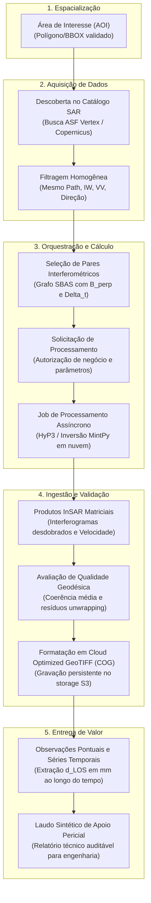
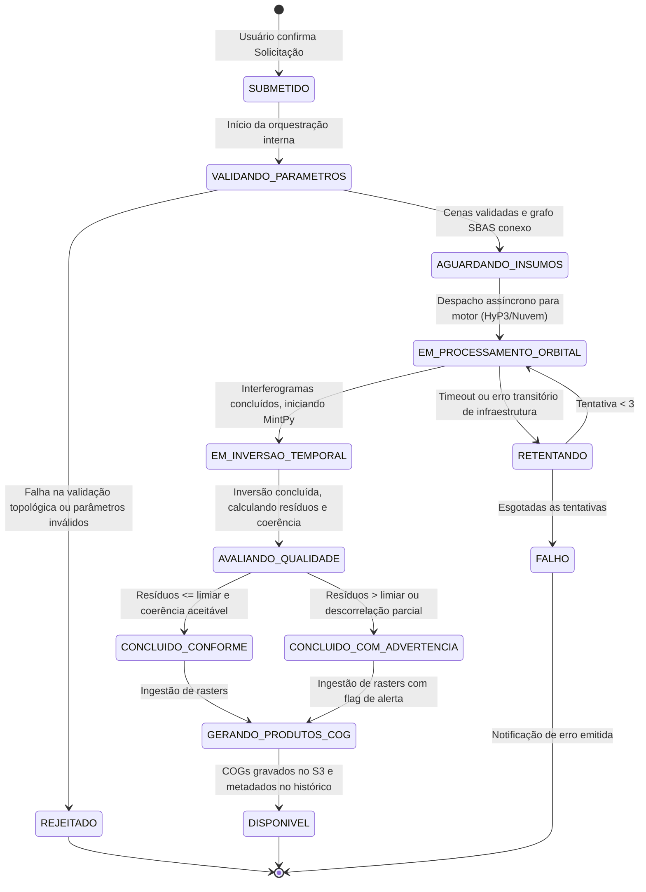
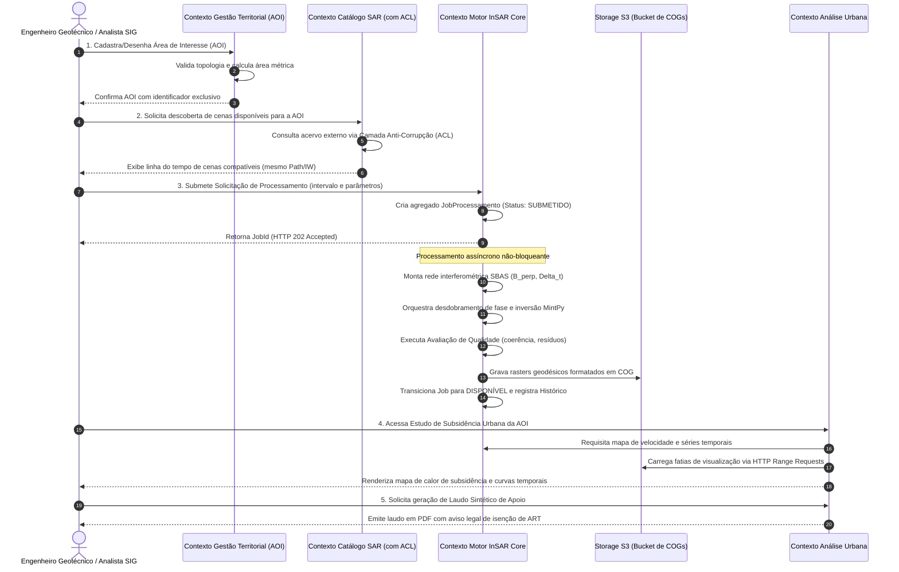
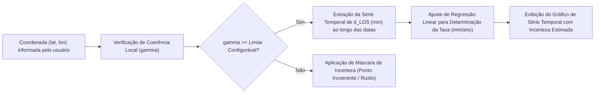

# Radar++ — Domínio: 05-fluxos-conceituais.md
## Fluxos de Ciclo de Vida, Sequenciamento de Domínio e Máquinas de Estados

**Documento:** `05-fluxos-conceituais.md`  
**Ciclo:** Ciclo 2 — Linguagem Ubíqua e Modelo Conceitual do Domínio  
**Data:** 24 de Outubro de 2026  
**Status:** Oficial — Entregue para Homologação de Domínio  
**Responsável:** Arquiteto de Software, Especialista em DDD, Modelador de Domínios Geoespaciais  
**Repositório Oficial:** `api-radar-deformacao` (caminho: `docs/domain/05-fluxos-conceituais.md`)  
**Regra de Governança:** Representar as transições e relacionamentos estritamente no nível de domínio e negócios. **Não definir contratos de API REST, controladores Spring Boot nem mapeamentos ORM nesta etapa.**

---

## 1. Visão Macro do Encadeamento Conceitual Ponta a Ponta

O fluxo de valor do Radar++ organiza-se na seguinte sequência fundamental de transformações conceituais:

$$\text{Área de Interesse} \longrightarrow \text{Descoberta de Cenas} \longrightarrow \text{Seleção de Pares} \longrightarrow \text{Solicitação} \longrightarrow \text{Job} \longrightarrow \text{Produtos InSAR} \longrightarrow \text{Avaliação de Qualidade} \longrightarrow \text{Observações / Séries}$$

---

## 2. Diagrama de Estados do Job de Processamento (*Processing Job Lifecycle*)

O ciclo de vida operacional do `JobProcessamento` é modelado como uma **Máquina de Estados Finitos Unidirecional**, garantindo previsibilidade assíncrona e rastreabilidade total:

---

## 3. Diagrama de Sequência Conceitual entre Contextos

O diagrama a seguir detalha a interação desacoplada entre os quatro contextos simplificados estabelecidos no documento [03-subdominios-e-contextos-candidatos.md](file:///home/asoares/Documentos/repositories/repo_radar/api-radar-deformacao/docs/domain/03-subdominios-e-contextos-candidatos.md):

---

## 4. Fluxo de Extração de Observações e Séries Temporais pelo Usuário

Quando o engenheiro ou analista clica em um ponto específico do mapa ou importa uma lista de coordenadas de edifícios:

### Regras do Fluxo de Extração:
1. **Validação de Coerência no Ponto:** Se o pixel selecionado possuir coerência inferior ao limiar padrão configurado (ex.: $\bar{\gamma} < 0{,}40$), a interface deve exibir aviso explícito de que o ponto sofreu decorrelação temporal (ex.: área gramada ou copa de árvore);
2. **Exibição Obrigatória da Unidade Geodésica:** Os valores são sempre apresentados com a anotação $\text{mm}_{\text{LOS}}$, com tooltip explicativo informando a geometria orbital (Ascendente ou Descendente).
