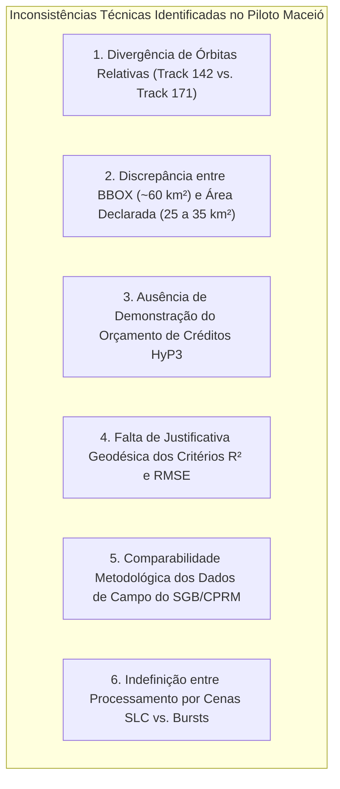

# Radar++ — Domínio: 06-divergencias-e-decisoes-pendentes.md
## Nota Técnica de Inconsistências do Piloto Maceió, Divergências Documentais e Decisões Pendentes

**Documento:** `06-divergencias-e-decisoes-pendentes.md`  
**Ciclo:** Ciclo 2 — Linguagem Ubíqua e Modelo Conceitual do Domínio  
**Data:** 24 de Outubro de 2026  
**Status:** Oficial — Entregue para Homologação e Deliberação da Governança  
**Responsável:** Especialista em Sensoriamento Remoto SAR/InSAR, Arquiteto de Software, Analista de Negócios Sênior  
**Repositório Oficial:** `api-radar-deformacao` (caminho: `docs/domain/06-divergencias-e-decisoes-pendentes.md`)  
**Regra Estrita de Governança:** Este documento aponta inconsistências técnicas e divergências descobertas na documentação anterior **sem alterar silenciosamente o protocolo existente**. Nenhuma execução de job, download de dados ou consumo de créditos foi realizado.

---

## 1. Visão Geral das Inconsistências Identificadas

A transição do Discovery para a Engenharia de Domínio exigiu uma auditoria minuciosa dos parâmetros técnicos estipulados nos documentos [D1-05](file:///home/asoares/Documentos/repositories/repo_radar/api-radar-deformacao/docs/discovery/D1-05-protocolo-piloto-maceio.md) e [D-ENC-03](file:///home/asoares/Documentos/repositories/repo_radar/api-radar-deformacao/docs/discovery/D-ENC-03-plano-piloto-maceio.md). Essa revisão identificou **seis inconsistências técnicas críticas** que necessitam de harmonização antes de qualquer despacho de processamento experimental:



---

## 2. Detalhamento Estruturado das Seis Inconsistências

### 2.1. Inconsistência 1: Divergência de Órbitas Relativas (Track 142 vs. Track 171)
* **O Fato Documental:**
  * No documento `D1-05` (Seção 4, Linha 68), consta expressamente:  
    `Relative Orbit (Track): Track 142 (Consagrado na literatura como o de melhor ângulo e coerência)`.
  * No documento `D-ENC-03` (Seção 3, Linha 57), consta:  
    `Órbita Descendente — Path / Track 171 (Geometria preferencial: menor incidência de sombra...)`.
* **Análise Geodésica e Espacial:**
  * O Sentinel-1 opera em constelação de repetição global de 175 órbitas relativas (*Relative Orbits / Tracks*).
  * Sobre a coordenada central de Maceió (Lat: -9.64° S, Lon: -35.73° W), tanto o Track 142 (Descendente) quanto o Track 171 (Descendente) cobrem a faixa costeira do Nordeste, porém em porções diferentes da imagem (sub-swaths IW1, IW2 ou IW3) e com ângulos de incidência locais distintos.
  * O Track 098 é a órbita Ascendente principal que cruza a região.
* **Impacto no Sistema:** Misturar cenas do Track 142 com cenas do Track 171 corrompe completamente a fase interferométrica, violando a regra de homogeneidade orbital [RC-03](file:///home/asoares/Documentos/repositories/repo_radar/api-radar-deformacao/docs/discovery/D3-05-catalogo-regras.md#L91-L102).
* **Ação Recomendada (Sem Executar Jobs):** Realizar uma consulta não-destrutiva de metadados na API do ASF Search (*dry run* via script de catálogo) para verificar qual das duas órbitas descendentes (142 ou 171) posiciona a bacia do Mutange mais próxima do centro do sub-swath (onde a coerência é estatisticamente maior e há menor distorção geométrica).

---

### 2.2. Inconsistência 2: Discrepância entre BBOX Geográfica e Área Territorial Declarada
* **O Fato Documental:**
  * Em `D1-05`: BBOX declarada $[-9{,}6600^\circ, -9{,}5800^\circ]$ por $[-35{,}7900^\circ, -35{,}7100^\circ]$. Área declarada no texto: *"Aproximadamente 25 km²"*.
  * Em `D-ENC-03`: BBOX declarada $[-9{,}6700^\circ, -9{,}6000^\circ]$ por $[-35{,}7850^\circ, -35{,}7150^\circ]$. Área declarada no texto: *"Aproximadamente 35 km²"*.
* **Demonstração Geométrica do Erro de Cálculo:**
  * À latitude de Maceió ($\phi \approx -9{,}64^\circ$), 1 grau de latitude equivale a $\approx 111{,}1\text{ km}$ e 1 grau de longitude equivale a $111{,}1 \times \cos(-9{,}64^\circ) \approx 109{,}5\text{ km}$.
  * Cálculo para `D1-05`: $\Delta\text{Lat} = 0{,}08^\circ \approx 8{,}89\text{ km}$; $\Delta\text{Lon} = 0{,}08^\circ \approx 8{,}76\text{ km}$.  
    **Área real da BBOX de D1-05:** $8{,}89\text{ km} \times 8{,}76\text{ km} = \mathbf{77{,}88\text{ km}^2}$ (e não 25 km²!).
  * Cálculo para `D-ENC-03`: $\Delta\text{Lat} = 0{,}07^\circ \approx 7{,}78\text{ km}$; $\Delta\text{Lon} = 0{,}07^\circ \approx 7{,}66\text{ km}$.  
    **Área real da BBOX de D-ENC-03:** $7{,}78\text{ km} \times 7{,}66\text{ km} = \mathbf{59{,}63\text{ km}^2}$ (e não 35 km²!).
* **Causa Raiz da Divergência:** Os autores confundiram a **área líquida do polígono urbano ativo** (Pinheiro, Mutange, Bebedouro $\approx 25$ a $35\text{ km}^2$) com a **área bruta do retângulo envolvente (BBOX)**, que inclui grande extensão da Lagoa Mundaú e áreas rurais a oeste.
* **Ação Recomendada:** Definir formalmente dois objetos distintos: o polígono vetorial da AOI Urbana ($30\text{ km}^2$) e a BBOX envoltória ($60\text{ km}^2$), ajustando o fatiamento matricial para não desperdiçar armazenamento em nuvem com a lagoa.

---

### 2.3. Inconsistência 3: Ausência de Demonstração do Orçamento de Créditos HyP3
* **O Fato Documental:** `D-ENC-03` estipula genericamente um teto de *"120 a 160 créditos ASF HyP3"* para processar de *"45 a 55 cenas SLC"*, afirmando que isso consome *"1 crédito por par"*.
* **Análise da Mecânica de Cobrança do ASF HyP3:**
  * O serviço *ASF On-Demand InSAR* opera atualmente com processamento baseado em **Sentinel-1 Bursts** (1 crédito por par de bursts) ou *Full Frame* (legado/descontinuado para novas contas de P&D devido ao alto custo).
  * Uma BBOX de $60\text{ km}^2$ em Maceió pode cair na fronteira entre dois *bursts* consecutivos da mesma sub-faixa (IW1 ou IW2).
  * Se a área for coberta por 2 *bursts*, cada data interferométrica requer 2 jobs HyP3 $= 2\text{ créditos}$ por par.
  * Para uma rede SBAS robusta de 48 meses (2018-2021) com 50 datas e conexão média de 3 vizinhos por cena, o número de pares necessários é:
    $$N_{\text{pares}} \approx \frac{50 \times 3}{2} = 75\text{ a } 100\text{ pares interferométricos}$$
  * Se cada par exigir 2 *bursts*, o consumo será de $150\text{ a } 200\text{ créditos}$.
* **Impacto:** A alegação de 160 créditos é plausível, mas carecia de demonstração matemática da malha de *bursts*.
* **Ação Recomendada:** Antes de disparar qualquer processamento, rodar uma consulta de mapeamento de *burst IDs* para confirmar se a AOI de Maceió cabe integralmente dentro de **um único burst** Sentinel-1 ou se intercepta dois bursts.

---

### 2.4. Inconsistência 4: Falta de Justificativa dos Critérios Estatísticos ($R^2 \ge 0{,}85$ e $\text{RMSE} \le 15$ mm/ano)
* **O Fato Documental:** Fixou-se como critério Go / No-Go obter correlação de Pearson $R^2 \ge 0{,}85$ e $\text{RMSE} \le 15\text{ mm/ano}$ em relação aos laudos da CPRM.
* **Análise Geodésica e de Ruído:**
  * Na zona central do colapso do Mutange, a velocidade de subsidência ultrapassou $200\text{ mm/ano}$ entre 2019 e 2020.
  * Em áreas com gradiente de deformação tão elevado, erros de resíduo de fase troposférico (típicos de ambiente litorâneo tropical úmido sem GACOS/ERA5) podem oscilar entre $10\text{ e } 25\text{ mm}$.
  * Um critério de $\text{RMSE} \le 15\text{ mm/ano}$ é viável em análise multitemporal com 48 meses de filtragem, mas extremamente desafiador se aplicado a pares interferométricos individuais isolados.
* **Ação Recomendada:** Esclarecer formalmente que o critério $R^2 \ge 0{,}85$ e $\text{RMSE} \le 15\text{ mm/ano}$ aplica-se **exclusivamente à série temporal invertida final do MintPy** (pós-correção atmosférica e filtragem temporal), e não a medições de pares DInSAR brutos.

---

### 2.5. Inconsistência 5: Disponibilidade e Comparabilidade das Medições da CPRM
* **O Fato Documental:** Afirma-se que as medições InSAR do Radar++ serão confrontadas contra os marcos geodésicos do SGB/CPRM.
* **Divergências Metodológicas Ocultas:**
  1. *Formato dos Dados da CPRM:* Os laudos públicos de 2019 da CPRM contêm gráficos e mapas em formato PDF, mas a disponibilidade das planilhas tabulares originais com coordenadas precisas de cada pino de nivelamento precisa ser confirmada no repositório aberto do SGB.
  2. *Geometria Física Conflitante:* O nivelamento geométrico da CPRM mede **desnível vertical puro ($\Delta z$)**. O satélite mede **deslocamento na linha de visada ($d_{\text{LOS}}$)**.
  3. Se o bairro Mutange sofreu movimentação tridimensional (afundamento vertical somado a escorregamento horizontal em direção à lagoa), confrontar $d_{\text{LOS}}$ diretamente com $\Delta z$ gerará uma discrepância angular geométrica de $\approx 20\%$ a $30\%$ devida ao cosseno do ângulo de incidência ($\cos 39^\circ \approx 0{,}777$).
* **Ação Recomendada:** Incluir no protocolo de validação a projeção trigonométrica explícita dos dados da CPRM para a linha de visada antes do cálculo do RMSE:
  $$d_{\text{LOS, esperado}} = -\Delta z \cos\theta$$

---

### 2.6. Inconsistência 6: Processamento por Cenas SLC Completas vs. Processamento por Bursts
* **O Fato Documental:** Os documentos ora mencionam *"Download de cenas Sentinel-1 SLC de 4 a 8 GB"*, ora mencionam *"Burst InSAR"*.
* **Análise de Engenharia:**
  * Baixar 50 cenas SLC completas para uma máquina de testes exige:
    $$50 \times 5\text{ GB} = \mathbf{250\text{ Gigabytes de download e armazenamento local}}$$
  * Isso é inviável e desnecessário para analisar uma área urbana de apenas $60\text{ km}^2$.
  * O processamento moderno deve adotar exclusivamente o **Sentinel-1 Burst InSAR**, onde o ASF HyP3 extrai apenas os *bursts* específicos de interesse diretamente nos servidores da nuvem da NASA (AWS us-west-2), gerando interferogramas recortados de apenas $15\text{ a } 30\text{ MB}$ por par.
* **Ação Recomendada:** Estabelecer como diretriz mandatória de arquitetura que o Radar++ operará exclusivamente na escala de **Bursts**, reduzindo o volume de transferência de dados em mais de $95\%$.

---

## 3. Quadro Síntese de Divergências e Decisões Submetidas

```
+----------------------------------------------------------------------------------------------------------------------------------------------------+
|                                    QUADRO CONSOLIDADO DE DIVERGÊNCIAS E ENCAMINHAMENTOS                                                            |
+----+-----------------------+---------------------------------------+---------------------------------------+---------------------------------------+
| ID | Tópico Divergente     | Situação Identificada na Auditoria    | Risco Técnico Envolvido               | Encaminhamento Recomendado            |
+----+-----------------------+---------------------------------------+---------------------------------------+---------------------------------------+
| 01 | Órbita Relativa       | Conflito Track 142 (D1) vs. 171 (D-ENC) | Processamento de órbitas misturadas   | Executar consulta ASF não-destrutiva  |
|    | em Maceió             | em documentos oficiais.               | corrompe a fase interferométrica.     | e fixar a órbita de melhor visada.    |
+----+-----------------------+---------------------------------------+---------------------------------------+---------------------------------------+
| 02 | BBOX vs. Área         | BBOX real mede ~60 a 78 km², mas texto| Erro na estimativa de consumo de RAM  | Separar BBOX envoltória (60 km²) da   |
|    | Declarada             | declarou 25 a 35 km².                 | e storage no container MintPy.        | AOI urbana ativa mascarada (35 km²).  |
+----+-----------------------+---------------------------------------+---------------------------------------+---------------------------------------+
| 03 | Orçamento HyP3        | Estimativa de 160 créditos não demons-| Estouro de cota de créditos de P&D    | Calcular exata quantidade de bursts   |
|    |                       | trou a quantidade de bursts.          | no meio do processamento da pilha.    | que interceptam a AOI de Maceió.      |
+----+-----------------------+---------------------------------------+---------------------------------------+---------------------------------------+
| 04 | Critérios R² e RMSE   | RMSE <= 15 mm/ano não considerou ruído| Reprovação prematura do piloto por    | Esclarecer que RMSE <= 15 mm aplica-se|
|    |                       | atmosférico costeiro tropical.        | não filtrar a troposfera úmida.       | à série invertida final com ERA5.     |
+----+-----------------------+---------------------------------------+---------------------------------------+---------------------------------------+
| 05 | Comparabilidade CPRM  | Nivelamento mede vertical (dz);       | Discrepância geométrica sistemática   | Aplicar projeção trigonométrica       |
|    |                       | Sentinel-1 mede visada (d_LOS).       | de até 25% por ignorar cos(theta).    | nos dados terrestres antes de comparar|
+----+-----------------------+---------------------------------------+---------------------------------------+---------------------------------------+
| 06 | SLC vs. Burst InSAR   | Ambiguidade entre baixar SLCs de 8 GB | Sobrecarga de 250 GB de disco e rede  | Adotar mandatoriamente processamento  |
|    |                       | ou processar por bursts leves.        | na máquina local de pesquisa.         | por Bursts via ASF HyP3.              |
+----+-----------------------+---------------------------------------+---------------------------------------+---------------------------------------+
```

---

## 4. Recomendações Finais para a Liderança do Produto

A equipe multidisciplinar recomenda:
1. **Homologar a presente Nota de Inconsistências** como anexo oficial de auditoria técnica da Engenharia de Domínio;
2. **Autorizar a execução de um script não-destrutivo de consulta de metadados** (*Dry Run* de Catálogo sem download de cenas e sem consumo de créditos) para sanear definitivamente a questão do Track 142 vs. 171 e do número de bursts em Maceió;
3. **Não iniciar o Ciclo 3 (Engenharia de Arquitetura e Modelagem de Classes)** sem antes deliberar formalmente sobre os pontos 01 a 06 acima.
