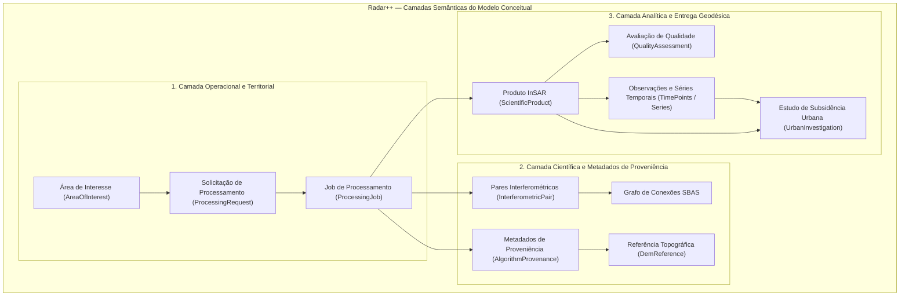

# Radar++ — Domínio: 02-modelo-conceitual.md
## Modelo Conceitual do Domínio: Estrutura, Camadas Semânticas e Relações Fundamentais

**Documento:** `02-modelo-conceitual.md`  
**Ciclo:** Ciclo 2 — Modelagem Estratégica e Tática com DDD  
**Data:** 24 de Outubro de 2026  
**Status:** Oficial — Entregue para Homologação de Arquitetura de Domínio  
**Responsável:** Modelador de Domínios Geoespaciais, Especialista em DDD, Arquiteto de Software  
**Repositório Oficial:** `api-radar-deformacao` (caminho: `docs/domain/cycle-03/02-modelo-conceitual.md`)  

---

## 1. Visão Geral da Arquitetura Conceitual

O Modelo Conceitual do Radar++ estrutura a representação da realidade geodésica e de engenharia em três camadas semânticas de informação claramente segregadas:



---

## 2. Segregação Estrutural das Três Camadas Semânticas

```
+----------------------------------------------------------------------------------------------------------------------------------------------------+
|                                    SEGREGAÇÃO DE RESPONSABILIDADES SEMÂNTICAS NO DOMÍNIO                                                           |
+----+-----------------------+------------------------------------------+------------------------------------+---------------------------------------+
| ID | Camada Semântica      | Natureza da Informação                   | Conceitos Centrais Envolvidos      | Ciclo de Vida e Mutabilidade          |
+----+-----------------------+------------------------------------------+------------------------------------+---------------------------------------+
| 01 | Operacional e         | Gestão de fluxos, transições de estado   | `AreaOfInterest`,                  | Mutável com ciclo de vida finito      |
|    | Territorial           | assíncronas, permissões e solicitações.  | `ProcessingRequest`,               | regido por máquina de estados.        |
|    |                       |                                          | `ProcessingJob`.                   |                                       |
+----+-----------------------+------------------------------------------+------------------------------------+---------------------------------------+
| 02 | Científica e          | Parâmetros geodésicos imutáveis que      | `InterferometricPair`, `BurstId`,  | **Estritamente Imutável** após o      |
|    | Proveniência          | garantem a reprodutibilidade forense.    | `DemReference`, `AlgorithmConfig`, | cálculo; append-only para auditoria.  |
|    |                       |                                          | `AtmosphericCorrectionParams`.     |                                       |
+----+-----------------------+------------------------------------------+------------------------------------+---------------------------------------+
| 03 | Analítica e           | Medições quantitativas de deformação     | `ScientificProduct`,               | Imutável após avaliação; consultável  |
|    | Entrega Geodésica     | escalar e relatórios de suporte à decisão| `QualityAssessment`, `Displacement`| via range requests e extração pontual.|
|    |                       | pericial de engenharia.                  | `Observation`, `UrbanInvestigation`.|                                       |
+----+-----------------------+------------------------------------------+------------------------------------+---------------------------------------+
```

---

## 3. Relações Estruturais entre os Elementos do Domínio

### 3.1. Relação entre Espaço, Tempo e Aquisição
1. Uma `AreaOfInterest` define o polígono vetorial e a BBOX estrita de busca;
2. O catálogo recupera múltiplas `SarScene` que cobrem a BBOX;
3. O domínio filtra as cenas que compartilham rigorosamente a mesma `AcquisitionGeometry` (mesmo Path orbital, direção e polarização);
4. As cenas válidas são combinadas em uma coleção de `InterferometricPair` respeitando limites parametrizados de linha de base perpendicular ($B_\perp$) e temporal ($\Delta t$).

### 3.2. Relação entre Execução Técnica e Validação Científica
* Um `ProcessingJob` representa a execução assíncrona na nuvem (orquestração HyP3 e contêiner MintPy);
* O término com sucesso do job técnico (`JobStatus.SUCCEEDED`) **não significa que a análise científica está aprovada**;
* O término do job gera a entidade `InSarAnalysis`, que passa imediatamente pela etapa de `QualityAssessment`;
* Apenas após a verificação de coerência e resíduos de desdobramento de fase a análise atinge o estado de `AnalysisStatus.APPROVED_FOR_VISUALIZATION` ou `AnalysisStatus.QUALIFIED_WITH_RESTRICTIONS`.

---

## 4. Diferenciação entre Serviços de Domínio e Serviços de Aplicação

Para evitar a degradação do modelo em um modelo anêmico ou, no extremo oposto, em entidades sobrecarregadas de responsabilidades de infraestrutura:

```
+----------------------------------------------------------------------------------------------------------------------------------------------------+
|                                    DISTINÇÃO ENTRE SERVIÇOS NO DOMÍNIO RADAR++                                                                     |
+--------------------------+----------------------------------------------------+--------------------------------------------------------------------+
| Categoria de Serviço     | Papel e Fronteira de Responsabilidade             | Exemplos Concretos no Radar++                                      |
+--------------------------+----------------------------------------------------+--------------------------------------------------------------------+
| **Serviço de Domínio**   | Encapsula lógica de negócio pura ou algoritmos     | `InterferometricNetworkBuilder` (Monta o grafo ótimo SBAS);        |
| *(Domain Service)*       | matemáticos/geodésicos que não pertencem           | `QualityEvaluatorService` (Calcula resíduos de fase e coerência);  |
|                          | naturalmente a uma única entidade ou agregado.     | `GeometryValidationService` (Verifica compatibilidade orbital).    |
+--------------------------+----------------------------------------------------+--------------------------------------------------------------------+
| **Serviço de Aplicação** | Orquestra casos de uso, gerencia transações,       | `CreateProcessingRequestUseCase` (Recebe comando, valida permissão)|
| *(Application Service)*  | despacha eventos para mensageria e interage com    | `PollJobStatusService` (Consulta status de jobs em nuvem);         |
|                          | adaptadores de infraestrutura (repositórios, S3).  | `GenerateSyntheticReportUseCase` (Coordena exportação de laudo).   |
+--------------------------+----------------------------------------------------+--------------------------------------------------------------------+
```
