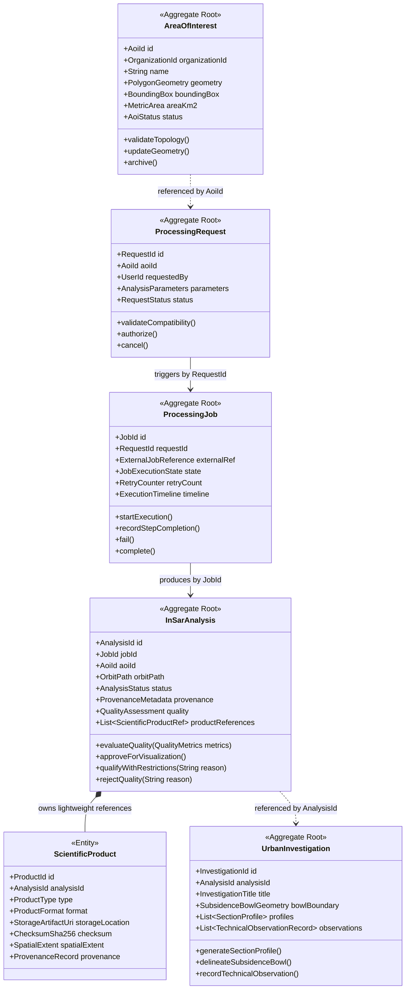

# Radar++ — Domínio: 03-agregados-entidades-value-objects.md
## Modelagem Tática: Agregados, Entidades Internas, Value Objects e Limites Transacionais

**Documento:** `03-agregados-entidades-value-objects.md`  
**Ciclo:** Ciclo 3 — Modelagem Estratégica e Tática com DDD  
**Data:** 24 de Outubro de 2026  
**Status:** Oficial — Entregue para Homologação de Arquitetura de Domínio  
**Responsável:** Especialista em DDD, Modelador de Domínios Geoespaciais, Arquiteto de Software  
**Repositório Oficial:** `api-radar-deformacao` (caminho: `docs/domain/cycle-03/03-agregados-entidades-value-objects.md`)  
**Regra Estrita de Governança:** Especificação conceitual de domínio. **Não gerar classes Java com anotações `@Entity` ou `@Table`, nem dependências do Spring Framework nesta etapa.**

---

## 1. Avaliação Crítica dos Agregados Candidatos

Em Domain-Driven Design, um **Agregado (*Aggregate*)** é um agrupamento de entidades e objetos de valor tratados como uma unidade transacional atômica para modificação de dados. Uma **Raiz de Agregado (*Aggregate Root*)** é a única entidade pela qual o mundo externo tem permissão de interagir com o agregado.

Foram investigados os seis agregados candidatos propostos na demanda:
1. `AreaOfInterest` (Confirmado como Raiz de Agregado no contexto Territorial);
2. `ProcessingRequest` (Confirmado como Raiz de Agregado de Entrada e Governança);
3. `ProcessingJob` (Confirmado como Raiz de Agregado de Execução Operacional Assíncrona);
4. `InSarAnalysis` (Confirmado como Raiz de Agregado Central Geodésico);
5. `ScientificProduct` (Avaliada a relação com `InSarAnalysis`);
6. `UrbanInvestigation` (Confirmado como Raiz de Agregado no contexto Urban).



---

## 2. Detalhamento Estruturado dos Agregados Oficiais

---

### 2.1. Agregado: `AreaOfInterest` (Gestão Territorial)
* **Identidade:** `AoiId` (UUID substituto imutável).
* **Responsabilidade:** Garantir a validade topológica, o cálculo métrico da área territorial delimitada e o isolamento organizacional do estudo.
* **Limite Transacional:** Envolve a entidade raiz `AreaOfInterest`, o objeto de valor `PolygonGeometry` e a `BoundingBox`. Modificações na geometria forçam o recálculo atômico da área métrica e da BBOX.
* **Invariantes Protegidas:**
  1. O anel poligonal exterior deve ser fechado e sem auto-interseções (*Simple Feature Rule*);
  2. A área calculada não pode exceder o teto máximo parametrizado para o tipo de estudo ([RT1](file:///home/asoares/Documentos/repositories/repo_radar/api-radar-deformacao/docs/discovery/D3-05-catalogo-regras.md#L175-L178));
  3. Toda AOI deve obrigatoriamente estar associada a uma organização proprietária (`OrganizationId`).
* **Comportamentos Principais:** `create()`, `updateGeometry()`, `validateTopology()`, `archive()`.
* **Eventos Emitidos:** `AreaOfInterestCreatedEvent`, `AreaOfInterestGeometryUpdatedEvent`, `AreaOfInterestArchivedEvent`.
* **Dependências Externas:** Nenhuma. Referenciada por outros contextos estritamente pelo seu `AoiId`.

---

### 2.2. Agregado: `ProcessingRequest` (Entrada e Governança)
* **Identidade:** `RequestId` (UUID imutável).
* **Responsabilidade:** Controlar a intenção de execução, validar o escopo temporal e parâmetros geodésicos solicitados, e autorizar o disparo do processamento.
* **Limite Transacional:** `ProcessingRequest` e seu objeto de valor `AnalysisParameters`.
* **Invariantes Protegidas:**
  1. A data final da janela temporal deve ser cronologicamente posterior à data inicial;
  2. O intervalo de datas deve possuir no mínimo duas cenas SAR compatíveis registradas no catálogo;
  3. Não é permitida alteração de parâmetros após o estado `AUTHORIZED`.
* **Comportamentos:** `submit()`, `validateParameters()`, `authorize()`, `cancel()`.
* **Eventos Emitidos:** `ProcessingRequestSubmittedEvent`, `ProcessingRequestAuthorizedEvent`, `ProcessingRequestCancelledEvent`.

---

### 2.3. Agregado: `ProcessingJob` (Orquestração e Execução Assíncrona)
* **Identidade:** `JobId` (UUID imutável) + `ExternalJobReference` (UUID do HyP3/AWS).
* **Responsabilidade:** Gerenciar a máquina de estados assíncrona da execução técnica, rastrear passos computacionais, gerenciar retentativas em caso de falha transitória de infraestrutura e consolidar o término operacional.
* **Limite Transacional:** `ProcessingJob`, `ExecutionTimeline` e `RetryCounter`.
* **Invariantes Protegidas:**
  1. A transição de estados segue rigorosamente a máquina de estados (não pode transicionar de `SUBMITTED` para `COMPLETED` sem passar por `PROCESSING`);
  2. Retentativas automáticas são limitadas a um teto máximo configurável (padrão: 3 tentativas);
  3. Uma execução no estado `FAILED` ou `SUCCEEDED` é terminal e torna-se imutável.
* **Comportamentos:** `startExecution()`, `recordStepProgress()`, `retry()`, `markAsSucceeded()`, `markAsFailed()`.
* **Eventos Emitidos:** `ProcessingJobStartedEvent`, `ProcessingJobStepCompletedEvent`, `ProcessingJobSucceededEvent`, `ProcessingJobFailedEvent`.

---

### 2.4. Agregado: `InSarAnalysis` (Motor Central Geodésico)
* **Identidade:** `AnalysisId` (UUID imutável).
* **Responsabilidade:** Consolidar o resultado científico da interferometria, manter os metadados de auditoria e proveniência e garantir que a análise passe obrigatoriamente pela avaliação de qualidade antes da disponibilização.
* **Princípio Arquitetural Antirruído:** **O agregado NÃO carrega arquivos binários volumosos, grandes matrizes geodésicas, séries temporais completas nem logs brutos de execução.** O agregado gerencia apenas referências estruturadas leves (`ScientificProductRef`), ponteiros S3 (`StorageArtifactUri`), hashes SHA-256 e resumos de métricas (`QualityAssessment`).
* **Limite Transacional:** `InSarAnalysis`, a lista de referências `ScientificProductRef` e o Value Object `QualityAssessment`.
* **Invariantes Protegidas:**
  1. Nenhum produto da análise pode ser disponibilizado com status `APPROVED_FOR_VISUALIZATION` sem que a `QualityAssessment` tenha sido executada;
  2. Todas as observações de velocidade escalar geradas são expressas na unidade $\text{mm}_{\text{LOS}}$ ([RC-01](file:///home/asoares/Documentos/repositories/repo_radar/api-radar-deformacao/docs/discovery/D3-05-catalogo-regras.md#L62-L78));
  3. Se a coerência espacial média for inferior ao limiar ou o percentual de resíduos de desdobramento for $> 15\%$, a análise deve obrigatoriamente receber a qualificação `QUALIFIED_WITH_RESTRICTIONS` ([RQ-02](file:///home/asoares/Documentos/repositories/repo_radar/api-radar-deformacao/docs/discovery/D3-05-catalogo-regras.md#L137-L151)).
* **Comportamentos:** `attachProductReference()`, `evaluateQuality()`, `approveForVisualization()`, `qualifyWithRestrictions()`, `rejectQuality()`.
* **Eventos Emitidos:** `InSarAnalysisCreatedEvent`, `ScientificQualityEvaluatedEvent`, `InSarAnalysisApprovedEvent`, `InSarAnalysisRestrictedEvent`, `InSarAnalysisRejectedEvent`.

---

### 2.5. Entidade do Agregado: `ScientificProduct`
* **Identidade:** `ProductId` (UUID imutável).
* **Responsabilidade:** Representar um artefato geodésico gerado pelo pipeline (ex.: mapa de velocidade média, mapa de coerência temporal, série temporal de deslocamento, matriz de fase desdobrada).
* **Formato e Localização:** Possui formato explícito (`ProductFormat`: `COG`, `GeoTIFF`, `NetCDF`, `HDF5`, `Parquet`, `GeoJSON`) e aponta para sua localização imutável no storage de objetos (`StorageArtifactUri` no S3/MinIO), acompanhado de seu `ChecksumSha256` para garantia de integridade. Não há acoplamento exclusivo ao formato COG.
* **Proveniência:** Mantém registro imutável dos algoritmos utilizados (ex: SNAP/MintPy/ISCE2), versão do software, modelo digital de elevação (DEM) empregado e parâmetros de filtro.
* **Decisão de Design:** É modelada como uma **Entidade subordinada ao Agregado `InSarAnalysis`**, sendo acessada e referenciada pelo agregado sem que a aplicação carregue dados binários na memória do modelo de domínio.

---

### 2.6. Agregado: `UrbanInvestigation` (Aplicação Especializada de Subsidência)
* **Identidade:** `InvestigationId` (UUID imutável).
* **Responsabilidade:** Fornecer um espaço de trabalho investigativo para exploração espacial, comparação histórica de tendências cinemáticas, delimitação de bacias de subsidência aparente, traçado de perfis transversais e registro de observações técnicas pelo analista.
* **Exclusão Explícita de Responsabilidades:** O agregador **NÃO realiza diagnóstico geotécnico de segurança estrutural, NÃO emite laudos periciais oficiais com fé pública, NÃO atesta estabilidade de fundações e NÃO faz previsões determinísticas ou garantidas de desastres.** Seu escopo é restrito ao suporte observacional geodésico.
* **Limite Transacional:** `UrbanInvestigation`, a coleção de `SectionProfile` e os registros `TechnicalObservationRecord`.
* **Invariantes Protegidas:**
  1. Uma investigação urbana só pode ser vinculada a uma `InSarAnalysis` que esteja aprovada para visualização ou qualificada com restrições;
  2. Todo registro de observação técnica emitido deve conter o carimbo imutável dos metadados de auditoria e a ressalva formal de limites de competência metodológica e necessidade de validação geotécnica in situ por profissional habilitado (ART) ([RN-01](file:///home/asoares/Documentos/repositories/repo_radar/api-radar-deformacao/docs/discovery/D3-05-catalogo-regras.md#L22-L37)).
* **Comportamentos:** `createInvestigation()`, `traceSectionProfile()`, `delineateSubsidenceBowl()`, `recordTechnicalObservation()`.
* **Eventos Emitidos:** `UrbanInvestigationCreatedEvent`, `SectionProfileTracedEvent`, `TechnicalObservationRecordedEvent`.

---

## 3. Catálogo de Objetos de Valor (*Value Objects*)

Objetos de valor são imutáveis, desprovidos de identidade individual e comparados exclusivamente pelos seus atributos:

```
+----------------------------------------------------------------------------------------------------------------------------------------------------+
|                                    CATÁLOGO DE VALUE OBJECTS DO DOMÍNIO RADAR++                                                                    |
+----+-----------------------+------------------------------------------+--------------------------------------------------------------------+
| ID | Value Object          | Atributos Imutáveis                      | Justificativa e Regras de Validação                                |
+----+-----------------------+------------------------------------------+--------------------------------------------------------------------+
| VO1| `PolygonGeometry`     | `wktString`, `srid` (EPSG:4674)          | Encapsula a geometria vetorial; valida topologia no construtor.    |
+----+-----------------------+------------------------------------------+--------------------------------------------------------------------+
| VO2| `BoundingBox`         | `minLon`, `minLat`, `maxLon`, `maxLat`   | Retângulo envolvente métrico para indexação espacial e consultas.  |
+----+-----------------------+------------------------------------------+--------------------------------------------------------------------+
| VO3| `MetricArea`          | `valueInKm2`                             | Valor numérico positivo; impede representação de áreas negativas.  |
+----+-----------------------+------------------------------------------+--------------------------------------------------------------------+
| VO4| `AcquisitionGeometry` | `orbitPath`, `direction`, `polarization` | Parâmetros orbitais imutáveis que condicionam compatibilidade SAR. |
+----+-----------------------+------------------------------------------+--------------------------------------------------------------------+
| VO5| `BaselineThresholds`  | `maxPerpendicularBperp`, `maxTemporalDt` | Limiares configuráveis para formação da rede de pares SBAS.        |
+----+-----------------------+------------------------------------------+--------------------------------------------------------------------+
| VO6| `CoherenceThreshold`  | `value` (float entre 0.0 e 1.0)          | Limiar configurável para corte de máscara de confiabilidade.       |
+----+-----------------------+------------------------------------------+--------------------------------------------------------------------+
| VO7| `DisplacementValue`   | `valueMm`, `measurementType (LOS)`       | Medição cinemática escalar primária com unidade explícita (mm_LOS). |
+----+-----------------------+------------------------------------------+--------------------------------------------------------------------+
| VO8| `StorageArtifactUri`  | `bucket`, `key`, `format`                | URI S3 com formato explícito (COG, GeoTIFF, NetCDF, HDF5, Parquet).|
+----+-----------------------+------------------------------------------+--------------------------------------------------------------------+
| VO9| `QualityMetrics`      | `meanCoherence`, `unwrapResiduePercent`  | Métricas numéricas resultantes da avaliação de confiabilidade.     |
+----+-----------------------+------------------------------------------+--------------------------------------------------------------------+
```
