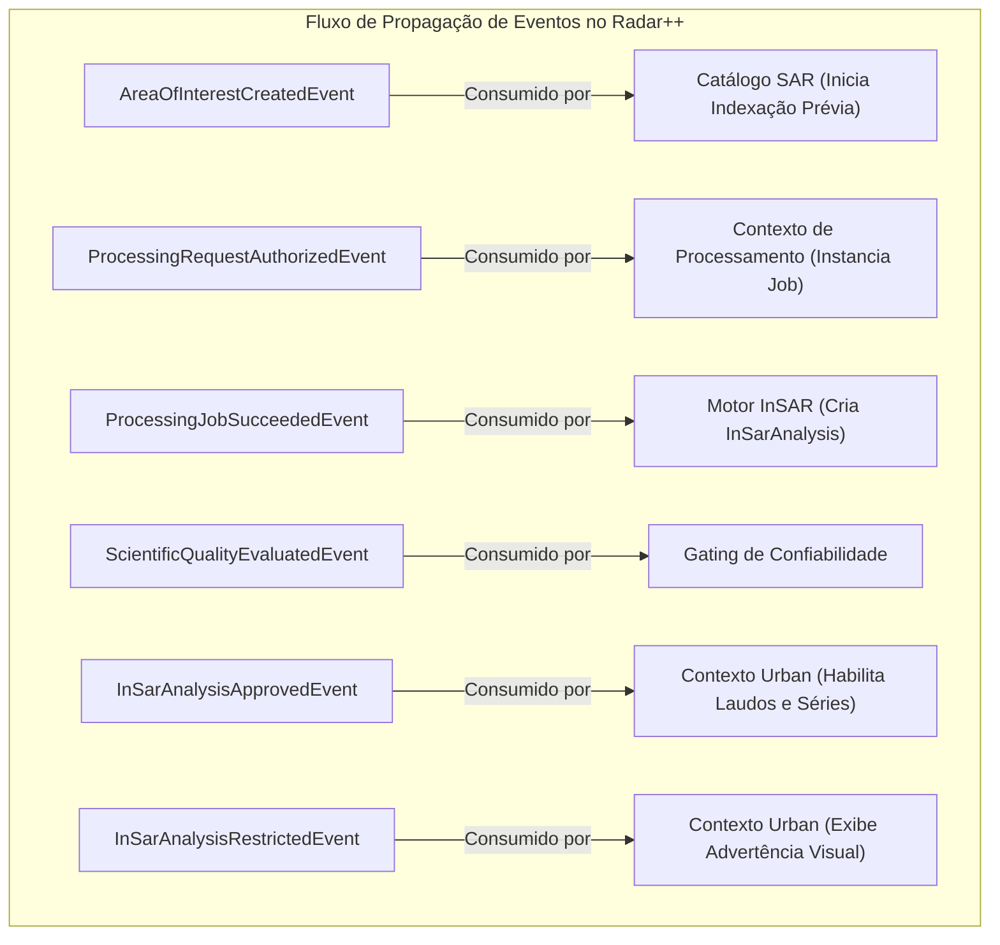

# Radar++ — Domínio: 05-eventos-de-dominio.md
## Catálogo de Eventos de Domínio, Cargas Úteis (Payloads) e Propagação Intercontextual

**Documento:** `05-eventos-de-dominio.md`  
**Ciclo:** Ciclo 3 — Modelagem Estratégica e Tática com DDD  
**Data:** 24 de Outubro de 2026  
**Status:** Oficial — Entregue para Homologação de Arquitetura de Domínio  
**Responsável:** Arquiteto de Software, Especialista em DDD, Modelador de Domínios Geoespaciais  
**Repositório Oficial:** `api-radar-deformacao` (caminho: `docs/domain/cycle-03/05-eventos-de-dominio.md`)  

---

## 1. Visão Geral da Arquitetura Orientada a Eventos (*Event-Driven Domain*)

No Domain-Driven Design (DDD), um **Evento de Domínio (*Domain Event*)** representa algo relevante e imutável que aconteceu no passado dentro de um Agregado. Ele é o principal mecanismo para manter a consistência eventual e o desacoplamento temporal entre contextos delimitados distintos:



---

## 2. Categorização e Taxonomia de Eventos

Para evitar a proliferação indevida de eventos e manter a integridade semântica da arquitetura, o Radar++ classifica suas mensagens em quatro categorias estritas:

```
+----------------------------------------------------------------------------------------------------------------------------------------------------+
|                                    TAXONOMIA DE MENSAGENS E EVENTOS DO SISTEMA RADAR++                                                             |
+---+------------------------------+---------------------------------------+-----------------------------+-------------------------------------------+
| # | Categoria                    | Escopo e Propósito                    | Exemplo Típico              | Mecanismo de Garantia e Transporte        |
+---+------------------------------+---------------------------------------+-----------------------------+-------------------------------------------+
| 1 | **Eventos de Domínio**       | Fatos passados relevantes dentro da   | `InSarAnalysisApproved`     | Publicação síncrona/in-memory ou Outbox   |
|   | *(Domain Events)*            | fronteira de um Bounded Context.      | `QualityEvaluated`          | local. Consistência com o agregado.       |
+---+------------------------------+---------------------------------------+-----------------------------+-------------------------------------------+
| 2 | **Eventos de Integração**    | Mensagens compartilhadas entre Bounded| `AnalysisApprovedForUrban`  | **Transactional Outbox Pattern** com      |
|   | *(Integration Events)*       | Contexts ou para sistemas externos.   | `AoiCatalogIndexed`         | garantia *At-Least-Once*, idempotência.   |
+---+------------------------------+---------------------------------------+-----------------------------+-------------------------------------------+
| 3 | **Eventos Técnicos / Telemetria**| Sinais efêmeros de infraestrutura,| `WorkerHeartbeatReceived`   | Mensageria rápida sem persistência dura   |
|   | *(Technical Process Events)* | progresso de download, workers.       | `ChunkDownloadProgress`     | (Redis Pub/Sub, WebSockets para UI).      |
+---+------------------------------+---------------------------------------+-----------------------------+-------------------------------------------+
| 4 | **Registros de Auditoria**   | Trilhas de conformidade legal, quem   | `ProcessingAuthorizedAudit` | Append-only store imutável com timestamp, |
|   | *(Audit Log Records)*        | executou qual comando e quando.       | `TechnicalObservationAudit` | IP, SHA-256 e credencial do analista.     |
+---+------------------------------+---------------------------------------+-----------------------------+-------------------------------------------+
```

---

## 3. Catálogo Oficial dos Eventos de Domínio e Integração

```
+----------------------------------------------------------------------------------------------------------------------------------------------------+
|                                    CATÁLOGO DE EVENTOS OFICIAIS DO RADAR++                                                                         |
+----+--------------------------------+--------------------+-----------------------+----------------------------------+-----------------------------+
| ID | Nome Canônico do Evento        | Categoria          | Agregado Emissor      | Gatilho de Disparo               | Requisitos de Entrega       |
+----+--------------------------------+--------------------+-----------------------+----------------------------------+-----------------------------+
| E1 | `AreaOfInterestRegistered`     | Domínio / Integ.   | `AreaOfInterest`      | Nova AOI validada e persistida.  | Outbox, Idempotente, Replay |
+----+--------------------------------+--------------------+-----------------------+----------------------------------+-----------------------------+
| E2 | `AreaOfInterestUpdated`        | Domínio / Integ.   | `AreaOfInterest`      | Geometria da AOI ajustada.       | Outbox, Idempotente         |
+----+--------------------------------+--------------------+-----------------------+----------------------------------+-----------------------------+
| E3 | `ProcessingRequestSubmitted`   | Domínio            | `ProcessingRequest`   | Usuário solicita processamento.  | Transacional Local          |
+----+--------------------------------+--------------------+-----------------------+----------------------------------+-----------------------------+
| E4 | `ProcessingRequestAuthorized`  | Domínio / Integ.   | `ProcessingRequest`   | Parâmetros e créditos validados. | Outbox, Dispara Fila Job    |
+----+--------------------------------+--------------------+-----------------------+----------------------------------+-----------------------------+
| E5 | `ProcessingJobDispatched`      | Domínio            | `ProcessingJob`       | Job enviado ao cluster/HyP3.     | Transacional Local          |
+----+--------------------------------+--------------------+-----------------------+----------------------------------+-----------------------------+
| E6 | `ProcessingJobCompleted`       | Domínio / Integ.   | `ProcessingJob`       | Execução computacional concluída.| Outbox, Desencadeia Análise |
+----+--------------------------------+--------------------+-----------------------+----------------------------------+-----------------------------+
| E7 | `ProcessingJobFailed`          | Domínio            | `ProcessingJob`       | Falha terminal de computação.    | Outbox, Notifica Suporte    |
+----+--------------------------------+--------------------+-----------------------+----------------------------------+-----------------------------+
| E8 | `InSarAnalysisCreated`         | Domínio            | `InSarAnalysis`       | Análise e referências instanciadas| Transacional Local         |
+----+--------------------------------+--------------------+-----------------------+----------------------------------+-----------------------------+
| E9 | `ProductQualityEvaluated`      | Domínio            | `InSarAnalysis`       | Métricas de qualidade calculadas.| Transacional Local          |
+----+--------------------------------+--------------------+-----------------------+----------------------------------+-----------------------------+
| E10| `ProductApprovedForVisualization`| Domínio / Integ. | `InSarAnalysis`       | Coerência e resíduos aprovados.  | Outbox, Libera Consumo Mapas|
+----+--------------------------------+--------------------+-----------------------+----------------------------------+-----------------------------+
| E11| `ProductQualifiedWithRestrictions`| Domínio / Integ.| `InSarAnalysis`       | Aprovado com tarja de cautela.   | Outbox, Alerta Interpretativo|
+----+--------------------------------+--------------------+-----------------------+----------------------------------+-----------------------------+
| E12| `ProductRejectedQuality`       | Domínio            | `InSarAnalysis`       | Rejeição por baixa qualidade.    | Transacional Local          |
+----+--------------------------------+--------------------+-----------------------+----------------------------------+-----------------------------+
| E13| `UrbanInvestigationInitiated`  | Domínio            | `UrbanInvestigation`  | Estudo urbano iniciado na AOI.   | Transacional Local          |
+----+--------------------------------+--------------------+-----------------------+----------------------------------+-----------------------------+
| E14| `TechnicalObservationRecorded` | Domínio / Auditoria| `UrbanInvestigation`  | Nota técnica registrada com ART. | Outbox, Hash SHA-256        |
+----+--------------------------------+--------------------+-----------------------+----------------------------------+-----------------------------+
```

---

## 4. Especificação de Cargas Úteis (*Payloads*) e Desacoplamento

### 4.1. `ProcessingJobCompleted` (Evento de Integração)
* **Descrição:** Notifica o término da computação técnica no motor remoto (sem atestar validade científica).
* **Carga Útil Conceitual:**
  ```json
  {
    "eventId": "evt_88d2f511-5321-4b10-8b1b-7a8f10b801a2",
    "occurredOn": "2026-10-24T12:15:30Z",
    "jobId": "job_11c9a874-...",
    "requestId": "req_55f2d100-...",
    "externalJobReference": "hyp3_9944a-...",
    "executionDurationSeconds": 1845,
    "outputArtifacts": [
      { "type": "UNWRAPPED_PHASE", "format": "GeoTIFF", "uri": "s3://radar-storage/jobs/.../unw.tif", "checksumSha256": "e3b0c44..." },
      { "type": "SPATIAL_COHERENCE", "format": "GeoTIFF", "uri": "s3://radar-storage/jobs/.../corr.tif", "checksumSha256": "a8f5c12..." },
      { "type": "VELOCITY_MAP", "format": "COG", "uri": "s3://radar-storage/jobs/.../velocity.tif", "checksumSha256": "4b22e11..." }
    ]
  }
  ```

### 4.2. `ProductApprovedForVisualization` (Evento de Integração)
* **Descrição:** Emitido após aprovação formal pelo portão de qualidade (`evaluateQuality()`).
* **Carga Útil Conceitual:**
  ```json
  {
    "eventId": "evt_99e3a622-7722-4a00-9c12-3b4a5f6e7d8c",
    "occurredOn": "2026-10-24T12:16:10Z",
    "analysisId": "ana_33d8c119-...",
    "aoiId": "aoi_b8f3e21a-...",
    "organizationId": "org_44c1-...",
    "meanCoherence": 0.54,
    "unwrapResiduePercentage": 8.7,
    "status": "APPROVED_FOR_VISUALIZATION",
    "primaryMeasurementType": "LOS_DISPLACEMENT_MM"
  }
  ```

---

## 5. Garantias de Entrega, Idempotência e Repetição (*Replay*)

1. **Padrão Transactional Outbox:**
   - Para todos os eventos de integração (`E1, E2, E4, E6, E10, E11, E14`), a mensagem é persistida na tabela `outbox_events` na mesma transação atômica do banco de dados relacional que modifica o agregado raiz.
   - Um worker em background lê a tabela e despacha para a fila de mensagens (RabbitMQ/Amazon SQS), garantindo entrega *At-Least-Once* mesmo diante de quedas de conexão.
2. **Idempotência Obrigatória dos Consumidores:**
   - Todo consumidor deve armazenar os `eventId` processados em uma tabela de controle (`processed_events`). Se uma mensagem for recebida mais de uma vez devido a retentativas de rede, ela é reconhecida (*ACK*) e descartada sem provocar efeitos colaterais.
3. **Capacidade de Repetição (*Event Replay*):**
   - O histórico de eventos do Outbox permanece retido por período configurável (ex: 30 dias), permitindo reprocessar projeções analíticas em caso de recuperação de desastres ou auditoria técnica.

