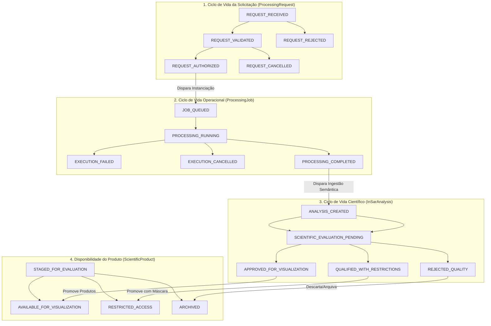

# Radar++ — Domínio: 06-estados-e-transicoes.md
## Ciclo de Vida, Máquinas de Estados, Transições e Políticas de Retentativa

**Documento:** `06-estados-e-transicoes.md`  
**Ciclo:** Ciclo 3 — Modelagem Estratégica e Tática com DDD  
**Data:** 24 de Outubro de 2026  
**Status:** Oficial — Entregue para Homologação de Arquitetura de Domínio  
**Responsável:** Arquiteto de Software, Especialista em DDD, Modelador de Domínios Geoespaciais  
**Repositório Oficial:** `api-radar-deformacao` (caminho: `docs/domain/cycle-03/06-estados-e-transicoes.md`)  
**Princípio Crítico de Domínio:** Não considerar uma análise cientificamente validada apenas porque o job de processamento concluiu tecnicamente com sucesso. A conclusão técnica do job é pré-condição necessária, mas insuficiente: a validação científica exige a etapa formal de avaliação de qualidade.

---

## 1. Visão Geral dos Quatro Ciclos de Vida Segregados

Para garantir que a infraestrutura assíncrona não seja confundida com a validade geodésica, o Radar++ modela **quatro ciclos de vida finitos desacoplados por eventos de domínio**:



---

## 2. Matriz Consolidada dos Quatro Ciclos de Vida

```
+----------------------------------------------------------------------------------------------------------------------------------------------------+
|                                    MATRIZ CONSOLIDADA DE ESTADOS DO DOMÍNIO RADAR++                                                                |
+----+--------------------------------+-----------------------+------------------------------------------+-------------------------------------------+
| Nº | Estado de Domínio              | Entidade / Agregado   | Significado Semântico no Negócio         | Característica Operacional                |
+----+--------------------------------+-----------------------+------------------------------------------+-------------------------------------------+
| 01 | `REQUEST_RECEIVED`             | `ProcessingRequest`   | Solicitação submetida pelo usuário.      | Estado inicial; parâmetros brutos.        |
| 02 | `REQUEST_VALIDATED`            | `ProcessingRequest`   | Parâmetros e topologia da AOI aprovados. | Elegível para autorização orçamentária.   |
| 03 | `REQUEST_AUTHORIZED`           | `ProcessingRequest`   | Orçamento verificado; ordem liberada.    | Estado imutável; dispara criação do job.  |
| 04 | `REQUEST_REJECTED`             | `ProcessingRequest`   | Parâmetros incompatíveis ou sem saldo.   | Estado terminal de recusa da intenção.    |
+----+--------------------------------+-----------------------+------------------------------------------+-------------------------------------------+
| 05 | `JOB_QUEUED`                   | `ProcessingJob`       | Job aguardando alocação no cluster/HyP3. | Enfileirado; cronômetro de timeout ativo. |
| 06 | `PROCESSING_RUNNING`           | `ProcessingJob`       | Pipeline executando em contêiner/remoto. | Captura de telemetria e progresso.        |
| 07 | `PROCESSING_COMPLETED`         | `ProcessingJob`       | Término com sucesso da execução técnica. | **Término operacional, NÃO científico**.  |
| 08 | `EXECUTION_FAILED`             | `ProcessingJob`       | Falha terminal após esgotar retentativas.| Estado terminal de erro técnico.          |
| 09 | `EXECUTION_CANCELLED`          | `ProcessingJob`       | Abortado voluntariamente pelo usuário.   | Estado terminal por intervenção humana.   |
+----+--------------------------------+-----------------------+------------------------------------------+-------------------------------------------+
| 10 | `ANALYSIS_CREATED`             | `InSarAnalysis`       | Referências de produto registradas.      | Transição imediata para gating.           |
| 11 | `SCIENTIFIC_EVALUATION_PENDING`| `InSarAnalysis`       | Ingestão dos rasters pronta para gating. | Gating científico bloqueante obrigatório. |
| 12 | `APPROVED_FOR_VISUALIZATION`   | `InSarAnalysis`       | Atestou critérios de qualidade global.   | **Liberada para mapas e séries temporais**.|
| 13 | `QUALIFIED_WITH_RESTRICTIONS`  | `InSarAnalysis`       | Aprovada, mas com resíduos ou ruídos.    | **Liberada sob tarja visual de cautela**. |
| 14 | `REJECTED_QUALITY`             | `InSarAnalysis`       | Rejeitada por decorrelação inaceitável.  | Bloqueada para visualização comum.        |
+----+--------------------------------+-----------------------+------------------------------------------+-------------------------------------------+
| 15 | `STAGED_FOR_EVALUATION`        | `ScientificProduct`   | Arquivo presente no S3, sob análise.     | Acesso restrito ao validador.             |
| 16 | `AVAILABLE_FOR_VISUALIZATION`  | `ScientificProduct`   | Produto validado disponível na UI/API.   | Acesso via HTTP Range Request (COG).      |
| 17 | `RESTRICTED_ACCESS`            | `ScientificProduct`   | Produto liberado com máscara de ruído.   | Visualização condicionada a aceite.       |
| 18 | `ARCHIVED`                     | `ScientificProduct`   | Produto descontinuado ou rejeitado.      | Transição para S3 Glacier.                |
+----+--------------------------------+-----------------------+------------------------------------------+-------------------------------------------+
```

---

## 3. Comportamento para Falhas, Retentativas, Reprocessamento e Falhas Parciais

### 3.1. Tratamento de Falhas Transitórias vs. Determinísticas
- **Falhas Transitórias (Infraestrutura):** Quedas de conexão HTTP com ASF HyP3, timeout de download de DEM ou falha temporária no storage S3 disparam até **3 retentativas automáticas** com recuo exponencial (*exponential backoff*: 30s, 60s, 120s), mantendo o job em `PROCESSING_RUNNING`.
- **Falhas Determinísticas (Domínio):** Erros de geometria degenerada, metadados corrompidos ou arquivo SLC ilegível encerram a execução imediatamente em `EXECUTION_FAILED` sem retentativas inúteis.

### 3.2. Falhas Parciais em Redes Interferométricas (SBAS)
- Em uma rede de 75 interferogramas, a falha de corregistro de 1 ou 2 pares pontuais (devido a decorrelação temporal extrema) **não deve cancelar todo o processamento**:
  - O pipeline remove os pares defeituosos da matriz de inversão;
  - A política `NetworkConnectivityPolicy` valida se a matriz residual ainda preserva a conectividade da rede temporal (sem clusters isolados);
  - Se a conectividade for mantida, o processamento prossegue com o subset íntegro e emite um alerta de "Pares Descartados por Baixa Coerência".

### 3.3. Reprocessamento Científico e Versionamento
- O usuário pode solicitar o reprocessamento de uma análise alterando apenas os parâmetros metodológicos (ex.: mudando o limiar de coerência de 0,40 para 0,35 ou aplicando filtro de Goldstein mais agressivo):
  - O sistema gera um novo `ProcessingRequest` e um novo `ProcessingJob`, vinculados à mesma `AreaOfInterest`;
  - Os produtos da nova análise recebem versão incremental (`v2`), mantendo a versão anterior (`v1`) intacta no histórico para auditoria comparativa.

### 3.4. Cancelamento Gracioso (*Graceful Cancellation*)
- A solicitação de cancelamento emite um sinal de terminação para a API do executor remoto (ex.: DELETE na API HyP3 ou SIGTERM no worker container) e transiciona o job para `EXECUTION_CANCELLED`, liberando travas operacionais e prevenindo consumo ocioso de recursos computacionais.

