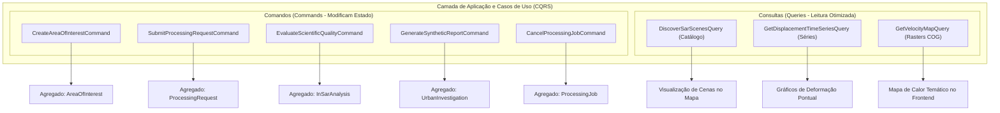

# Radar++ — Domínio: 07-casos-de-uso.md
## Casos de Uso do Domínio, Comandos de Aplicação, Consultas e Regras de Orquestração

**Documento:** `07-casos-de-uso.md`  
**Ciclo:** Ciclo 3 — Modelagem Estratégica e Tática com DDD  
**Data:** 24 de Outubro de 2026  
**Status:** Oficial — Entregue para Homologação de Arquitetura de Domínio  
**Responsável:** Analista de Processos e Requisitos, Arquiteto de Software, Especialista em DDD  
**Repositório Oficial:** `api-radar-deformacao` (caminho: `docs/domain/cycle-03/07-casos-de-uso.md`)  

---

## 1. Visão Geral da Arquitetura CQRS no Nível Conceitual

Para garantir a separação entre operações que alteram o estado do domínio e operações de leitura analítica otimizada, o Radar++ adota o padrão conceitual **CQRS (*Command Query Responsibility Segregation*)**:

---

## 2. Especificação Detalhada dos Casos de Uso Centrais

---

### UC-01: Cadastrar e Validar Área de Interesse
* **Comando:** `CreateAreaOfInterestCommand`
* **Contexto:** Gestão Territorial (*Territory Context*).
* **Ator Principal:** Engenheiro Geotécnico / Analista SIG.
* **Pré-condições:** Usuário autenticado pertencente a uma organização ativa.
* **Fluxo Principal:**
  1. O usuário submete nome e geometria vetorial (GeoJSON ou Shapefile);
  2. O serviço valida se a geometria é topologicamente válida (anel exterior fechado, sem auto-interseção);
  3. O serviço calcula a área métrica em $\text{km}^2$ e a Bounding Box (BBOX);
  4. O agregado `AreaOfInterest` é instanciado com status `ACTIVE`;
  5. O agregado é persistido e emite `AreaOfInterestCreatedEvent`.
* **Pós-condições:** A AOI torna-se imediatamente disponível para consulta de catálogo e estudos.
* **Exceções:** Geometria inválida (lança `InvalidGeometryException`); área excedendo o limite de $100\text{ km}^2$ ([RT1](file:///home/asoares/Documentos/repositories/repo_radar/api-radar-deformacao/docs/discovery/D3-05-catalogo-regras.md#L175-L178)) (lança `AreaLimitExceededException`).

---

### UC-02: Descobrir e Filtrar Cenas SAR
* **Consulta:** `DiscoverSarScenesQuery`
* **Contexto:** Catálogo SAR (*SAR Catalog Context*).
* **Ator:** Engenheiro Geotécnico.
* **Pré-condições:** `AoiId` válido informado.
* **Fluxo Principal:**
  1. O usuário solicita cenas Sentinel-1 para a AOI em uma janela temporal (ex.: 2018 a 2021);
  2. O serviço de catálogo consulta o acervo externo (ASF Vertex / Copernicus STAC) via Camada Anti-Corrupção (ACL);
  3. A ACL filtra apenas cenas em modo IW, polarização VV e agrupa as cenas por órbita relativa (*Relative Orbit / Path*);
  4. Retorna coleção imutável de `SarSceneMetadata` agrupada para exibição em linha do tempo.
* **Pós-condições:** Lista de cenas compatíveis apresentada ao usuário sem modificação de estado persistente.

---

### UC-03: Submeter Solicitação de Processamento InSAR
* **Comando:** `SubmitProcessingRequestCommand`
* **Contexto:** Processamento e Produtos InSAR (*InSAR Processing Core*).
* **Ator:** Engenheiro Geotécnico / Consultor de Projetos.
* **Pré-condições:** AOI cadastrada e cenas identificadas no catálogo.
* **Fluxo Principal:**
  1. O usuário define o intervalo temporal, órbita relativa desejada e parâmetros configuráveis (limiar de coerência $\bar{\gamma}$, baselines máximos);
  2. O agregador `ProcessingRequest` é criado com status `REQUEST_RECEIVED`;
  3. O domínio valida se existem no mínimo duas cenas compatíveis;
  4. O agregador autoriza o pedido (`REQUEST_VALIDATED` $\rightarrow$ `AUTHORIZED`);
  5. Emite `ProcessingRequestAuthorizedEvent`.
* **Pós-condições:** Ordem de processamento gravada, pronta para despacho assíncrono.

---

### UC-04: Orquestrar e Acompanhar Job Assíncrono
* **Comando:** `ExecuteProcessingJobCommand`
* **Contexto:** Processamento e Produtos InSAR.
* **Ator:** Sistema / Orquestrador em Nuvem.
* **Pré-condições:** `ProcessingRequest` autorizada.
* **Fluxo Principal:**
  1. O orquestrador instancia `ProcessingJob` (estado inicial `JOB_QUEUED`);
  2. O motor monta o grafo interferométrico SBAS obedecendo aos limiares de $B_\perp$ e $\Delta t$;
  3. Despacha o processamento para a infraestrutura de computação em nuvem (HyP3/contêiner MintPy);
  4. O job transiciona para `PROCESSING_RUNNING` e emite `ProcessingJobStartedEvent`;
  5. O orquestrador monitora o avanço e registra passos intermediários (`ProcessingJobProgressRecordedEvent`);
  6. Ao concluir a inversão geodésica, transiciona para `PROCESSING_COMPLETED` e emite `ProcessingJobSucceededEvent`.
* **Pós-condições:** Rasters brutos disponíveis em bucket temporário para ingestão e conversão em COG.

---

### UC-05: Avaliar Qualidade Científica da Análise
* **Comando:** `EvaluateScientificQualityCommand`
* **Contexto:** Processamento e Produtos InSAR.
* **Ator:** Serviço de Avaliação de Qualidade (*Domain Service*).
* **Pré-condições:** `ProcessingJob` atingiu com sucesso o estado `PROCESSING_COMPLETED`.
* **Fluxo Principal:**
  1. O agregador `InSarAnalysis` é instanciado em estado `SCIENTIFIC_EVALUATION_PENDING`;
  2. O serviço de qualidade lê a matriz de coerência espacial e calcula a coerência média ($\bar{\gamma}$) sobre a área válida da AOI;
  3. O serviço calcula o percentual de resíduos topológicos de desdobramento de fase (*unwrapping*);
  4. Se $\text{Resíduos} \le 15\%$ e $\bar{\gamma} \ge \text{limiar}$, a análise transiciona para `APPROVED_FOR_VISUALIZATION` e emite `InSarAnalysisApprovedEvent`;
  5. Se $\text{Resíduos} > 15\%$, transiciona para `QUALIFIED_WITH_RESTRICTIONS` e emite `InSarAnalysisRestrictedEvent`.
* **Pós-condições:** Análise formalmente liberada para visualização, com indicador de incerteza registrado.

---

### UC-06: Consultar Séries Temporais e Deformação Pontual
* **Consulta:** `GetDisplacementTimeSeriesQuery`
* **Contexto:** Processamento e Produtos InSAR.
* **Ator:** Engenheiro Geotécnico / Analista SIG.
* **Pré-condições:** Coordenada geográfica $(lat, lon)$ informada dentro dos limites de uma análise aprovada.
* **Fluxo Principal:**
  1. O serviço de leitura faz a requisição por faixas de bytes (*HTTP Range Request*) diretamente no arquivo COG no storage S3;
  2. Extrai o vetor de deslocamento acumulado para a coordenada $(x, y)$ em todas as datas de aquisição;
  3. Verifica a coerência média local do pixel;
  4. Retorna a coleção ordenada de `DisplacementObservation` expressa em $\text{mm}_{\text{LOS}}$ com a incerteza estimada.
* **Pós-condições:** Curva de série temporal renderizada na interface do usuário em menos de 2 segundos.

---

### UC-07: Registrar Observação Técnica e Nota Exploratória
* **Comando:** `RecordTechnicalObservationCommand`
* **Contexto:** Análise de Subsidência Urbana (*Urban Investigation Context*).
* **Ator:** Engenheiro Geotécnico / Analista Especialista.
* **Pré-condições:** Investigação urbana vinculada a uma análise aprovada ou qualificada com restrições.
* **Fluxo Principal:**
  1. O analista seleciona o estudo urbano, traça perfis de deformação e insere notas técnicas descritivas sobre os padrões observados;
  2. O serviço extrai os perfis transversais e tendências temporais a partir das referências aos produtos COG no S3;
  3. Anexa o bloco imutável de proveniência de auditoria técnica (versão de algoritmos, parâmetros e hashes SHA-256);
  4. Insere obrigatoriamente a **Declaração Formal de Limites Metodológicos**: explicita que o documento consiste em uma *Nota Técnica Exploratória baseada em sensoriamento remoto espacial*, **não constituindo laudo pericial oficial com fé pública, diagnóstico conclusivo de segurança estrutural nem substituto de Anotação de Responsabilidade Técnica (ART) presencial emitida por profissional habilitado** ([RN-01](file:///home/asoares/Documentos/repositories/repo_radar/api-radar-deformacao/docs/discovery/D3-05-catalogo-regras.md#L22-L37));
  5. Registra o evento imutável `TechnicalObservationRecordedEvent` e gera a nota técnica consolidada para exportação.
* **Pós-condições:** Dossiê observacional registrado no histórico da investigação urbana com rastreabilidade auditável.

---

### UC-08: Cancelar Job de Processamento em Andamento
* **Comando:** `CancelProcessingJobCommand`
* **Contexto:** Processamento e Produtos InSAR.
* **Ator:** Usuário Solicitante ou Administrador.
* **Pré-condições:** Job no estado `JOB_QUEUED` ou `PROCESSING_RUNNING`.
* **Fluxo Principal:**
  1. O usuário aciona o cancelamento na interface de acompanhamento;
  2. O comando localiza o `ProcessingJob` e emite instrução de aborto remoto para a API do ASF HyP3;
  3. O estado do job transiciona irreversivelmente para `EXECUTION_CANCELLED`;
  4. Emite `ProcessingJobCancelledEvent` e libera cotas operacionais.
* **Pós-condições:** Execução interrompida sem consumo adicional de créditos em nuvem.
