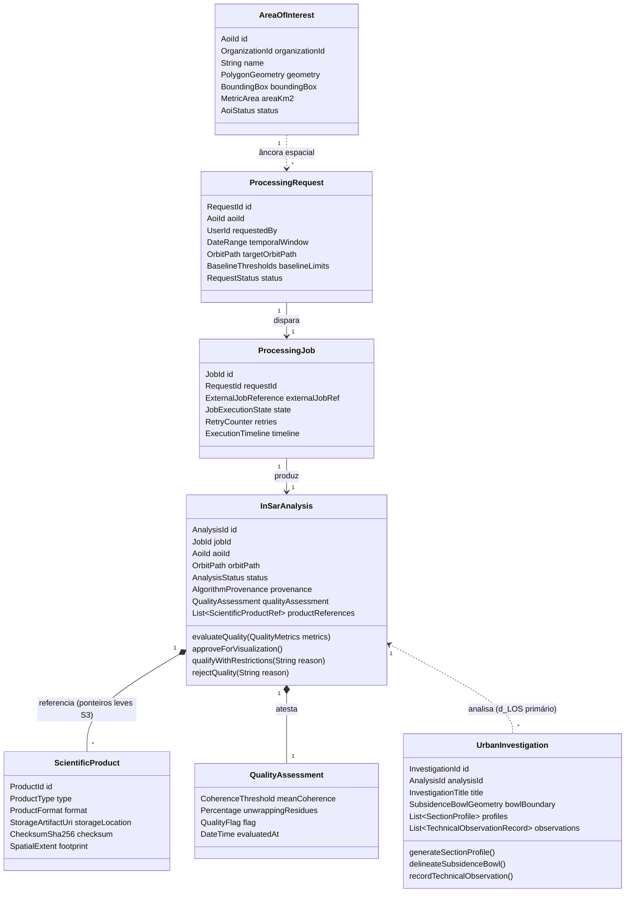
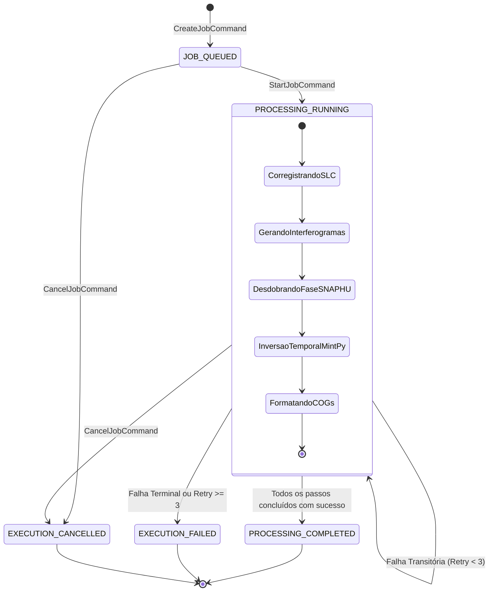
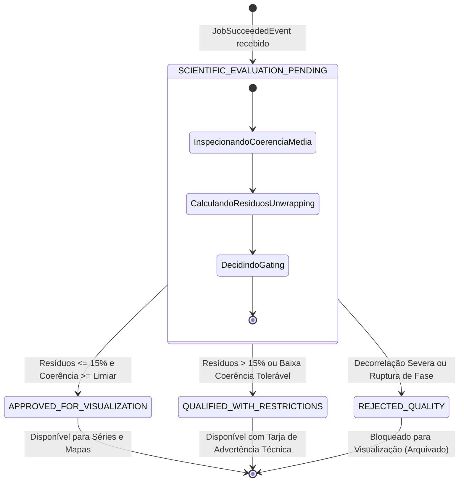
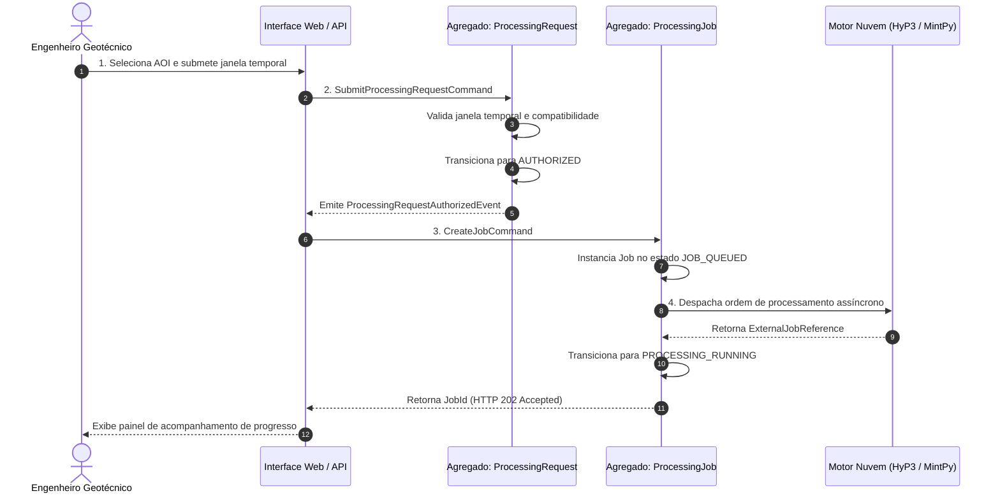
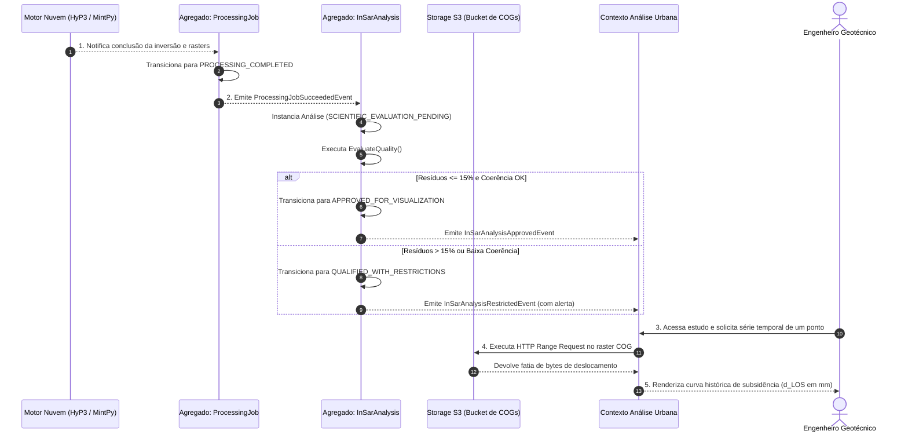
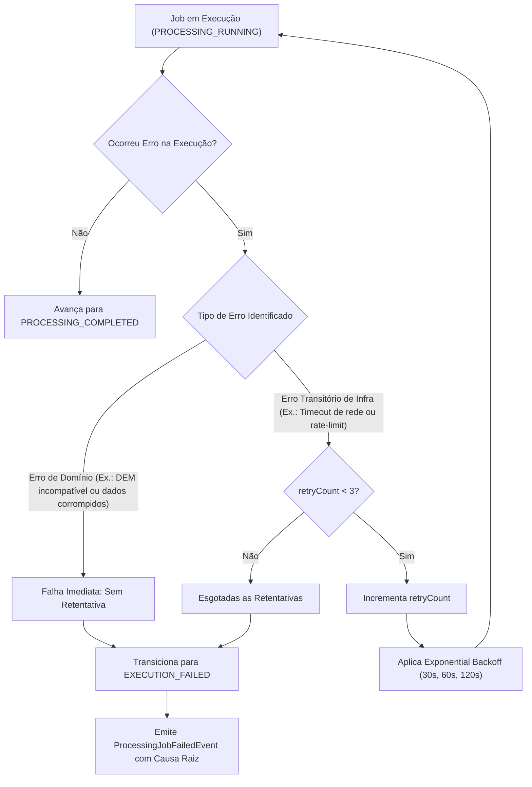

# Radar++ — Domínio: 08-diagramas-uml.md
## Suíte de Diagramas Conceituais de Domínio: Arquitetura, Agregados, Estados e Sequências

**Documento:** `08-diagramas-uml.md`  
**Ciclo:** Ciclo 3 — Modelagem Estratégica e Tática com DDD  
**Data:** 24 de Outubro de 2026  
**Status:** Oficial — Entregue para Homologação de Arquitetura de Domínio  
**Responsável:** Arquiteto de Software, Especialista em DDD, Modelador de Domínios Geoespaciais  
**Repositório Oficial:** `api-radar-deformacao` (caminho: `docs/domain/cycle-03/08-diagramas-uml.md`)  
**Aviso Conceitual Obrigatório:** Todos os diagramas contidos neste documento representam **modelos conceituais de domínio e negócios**. Eles não representam tabelas relacionais de banco de dados, entidades JPA com chaves estrangeiras físicas nem controladores REST de implementação.

---

## 1. Diagrama 1: Context Map v2 (Fronteiras e Padrões de Integração)

```mermaid
graph TD
    subgraph "Radar++ — Mapa de Contextos Estratégico (Context Map v2)"
        subgraph "Subdomínio de Suporte"
            TERR["Contexto Gestão Territorial<br/>(Territory & AOI Context)<br/>• Agregado: AreaOfInterest"]
        end

        subgraph "Subdomínio de Integração"
            CAT["Contexto Catálogo SAR<br/>(SAR Catalog Context)<br/>• Agregado: ConsultaCatalogo"]
        end

        subgraph "Domínio Principal Unificado (Core Domain)"
            CORE["Contexto Motor InSAR Core<br/>(InSAR Processing & Products)<br/>• Agregados: ProcessingRequest,<br/>ProcessingJob, InSarAnalysis"]
        end

        subgraph "Aplicação Especializada"
            URBAN["Contexto Análise Urbana<br/>(Urban Subsidence Analysis)<br/>• Agregado: UrbanInvestigation"]
        end
    end

    EXT["APIs Externas<br/>(NASA ASF / ESA CDSE)"] -->|Anti-Corruption Layer| CAT
    TERR -->|Published Language (Geometria WKT)| CAT
    TERR -->|Customer-Supplier (AoiId)| CORE
    CAT -->|Published Language (Lista de Cenas)| CORE
    CORE -->|Open Host Service (Rasters COG / Séries)| URBAN
```

---

## 2. Diagrama 2: Modelo Conceitual Estrutural do Domínio



---

## 3. Diagrama 3: Estados do Job de Processamento (*ProcessingJob*)



---

## 4. Diagrama 4: Estados da Análise Científica (*InSarAnalysis*)



---

## 5. Diagrama 5: Sequência de Solicitação, Autorização e Execução



---

## 6. Diagrama 6: Sequência de Avaliação e Disponibilização de Resultados



---

## 7. Diagrama 7: Fluxo de Tratamento de Falhas, Retentativas e Reprocessamento


